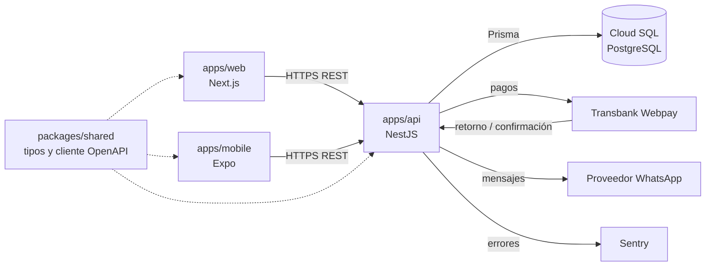
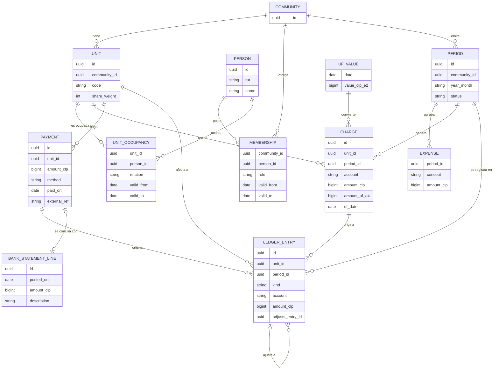

# Arquitectura de ComVive

Estado: **Propuesto** · pendiente de revisión crítica y aprobación del líder del proyecto

Primer borrador a nivel de cimientos (Etapa 0). Las decisiones marcadas con *(ADR)* se formalizarán en `docs/adr/` antes de la Etapa 2. Las reglas no negociables de `CLAUDE.md` son restricciones de este diseño, no opciones.

## 1. Componentes y monorepo

```text
apps/api          NestJS: única puerta a la base de datos, reglas de negocio, permisos, auditoría
apps/web          Next.js: administrador y comité
apps/mobile       React Native + Expo: residentes y conserjería
packages/shared   tipos y cliente generados desde OpenAPI, validaciones comunes (RUT, montos CLP), constantes
```

- **Solo la API toca PostgreSQL.** Web y app nunca acceden a la base de datos ni a Prisma.
- **Contrato primero:** cada endpoint se define en OpenAPI antes de implementarse; de ahí se generan tipos y cliente en `packages/shared`. Web y app consumen ese cliente.
- **Comunicación:** REST + JSON sobre HTTPS, autenticación con token Bearer. Sin GraphQL ni websockets en el MVP.
- **Lógica de dinero en un solo lugar:** el cálculo de prorrateo y redondeo vive en un módulo puro (sin E/S) de la API, probado con las pruebas de oro y fast-check. El cliente nunca calcula montos que se persisten; solo muestra.
- **Tareas diferidas** (notificaciones, importación de cartolas, recordatorios) se ejecutan fuera del ciclo de la petición *(ADR: mecanismo de tareas)*.



## 2. Aislamiento entre comunidades (multi-tenant)

**Propuesta: base de datos y esquema compartidos, columna `community_id` en toda tabla de negocio, con dos barreras.**

**Barrera 1 · Aplicación (obligatoria):**

- Toda ruta de negocio lleva la comunidad en la URL: `/communities/{communityId}/...`.
- Un guard de NestJS valida que el usuario tenga una membresía vigente en esa comunidad y deja un `TenantContext` (comunidad, persona, roles) para la petición.
- El acceso a datos pasa por un cliente Prisma extendido que exige y agrega `community_id` en cada lectura y escritura. Usar el cliente Prisma "crudo" fuera de ese módulo queda prohibido por regla de lint.
- Claves foráneas compuestas `(community_id, id)` entre tablas de negocio: la base de datos impide que un cargo de la comunidad A apunte a una unidad de la comunidad B.

**Barrera 2 · PostgreSQL Row Level Security (recomendada):**

- Políticas RLS en las tablas de negocio que comparan `community_id` con `current_setting('app.community_id')`, fijado con `SET LOCAL` dentro de la transacción de cada petición.
- La API se conecta con un rol sin `BYPASSRLS`; las migraciones usan otro rol.
- Costo: cada petición corre en una transacción y hay que cuidar el pool de conexiones. Se valida con un prototipo antes de aprobar *(ADR)*.

**Pruebas:** cada endpoint lleva su prueba de aislamiento (usuario de la comunidad A intenta leer y escribir datos de B y recibe 404, no 403, para no revelar existencia).

**Alternativas descartadas:**

| Opción | Por qué se descarta |
| --- | --- |
| Una base de datos por comunidad | Costo y operación desproporcionados para muchas comunidades pequeñas; migraciones multiplicadas; el administrador multi-comunidad necesita vistas consolidadas. |
| Un esquema PostgreSQL por comunidad | Prisma no maneja bien esquemas dinámicos; migraciones por esquema; complejidad alta para un equipo pequeño. |
| Solo filtro en la aplicación, sin RLS | Un solo olvido produce una fuga entre comunidades (falla crítica según la regla 4). Queda como respaldo si el prototipo de RLS resulta inviable. |

## 3. Control de acceso por rol

- **Identidad global, permisos por comunidad.** Una persona tiene una cuenta; sus permisos dependen de su membresía en cada comunidad.
- La autorización es RBAC por comunidad más **reglas de alcance por unidad** para residentes.

| Rol | Alcance | Puede (resumen inicial) |
| --- | --- | --- |
| Administrador | Todas las comunidades donde tenga membresía | Configurar comunidad y unidades, emitir y cerrar periodos, registrar pagos, conciliar, ver deudas, gestionar usuarios |
| Comité | Su comunidad | Ver finanzas, cartolas, conciliación y reportes; aprobar lo que la ley o el reglamento exija. Sin edición de montos |
| Residente propietario | Sus unidades | Ver estado de cuenta y cargos de sus unidades, pagar, comunicados, reservas |
| Residente arrendatario | Unidad que arrienda | Pagar y ver cargos de la unidad (alcance exacto: pregunta abierta), comunicados, reservas |
| Conserje | Su comunidad | Visitas, encomiendas, bitácora; ver nombre y unidad de residentes. Sin datos de deuda ni RUT completo |

- Los permisos se definen como acciones (`period.close`, `payment.register`, `debt.read`...) mapeadas a roles en una tabla de código versionada, no como `if rol == ...` dispersos.
- Una matriz rol × acción se publica en `docs/specs/` y genera pruebas de permisos automáticas.
- El administrador multi-comunidad es simplemente una persona con membresías de rol `admin` en varias comunidades. Un nivel "empresa administradora" con su propio equipo queda como pregunta abierta.

## 4. Modelo de datos inicial (alto nivel)



Todas las tablas de negocio llevan `community_id` (omitido en el diagrama por legibilidad), `created_at` y `created_by`.

**Reglas de diseño:**

- **Dinero:** `amount_clp` es `BIGINT` en pesos enteros. Prohibido `float`, `Decimal` o `numeric` para montos en CLP.
- **UF:** el valor diario se guarda en `UF_VALUE` como entero en centésimos de peso, con su fecha. Un monto expresado en UF guarda su cantidad en diezmilésimos de UF (`amount_uf_e4`) y la fecha usada; el equivalente en CLP se calcula una vez, se redondea según regla documentada y queda fijo en el cargo.
- **Participación:** cada unidad tiene un `share_weight` entero (por ejemplo 1850 para 18,50 %, o 1 para partes iguales). La parte de cada unidad es `peso / suma de pesos`, calculada con aritmética entera exacta, lo que resuelve casos como 1/3 sin decimales. Luego se aplica el método del resto mayor de `docs/qa/comunidades-simuladas.md` *(ADR)*.
- **Libro de movimientos:** `LEDGER_ENTRY` es de solo inserción (sin `UPDATE` ni `DELETE`, reforzado con permisos de base de datos y un trigger). `kind` = `debit` (cargo, interés, multa) o `credit` (pago, nota de crédito); `amount_clp` siempre positivo. `account` separa gasto común ordinario, fondo de reserva y otros conceptos.
- **Saldo** de una unidad = suma de débitos − suma de créditos. No existe columna de saldo editable. Si por rendimiento se necesita, se usa una vista o una tabla de saldos de cierre generada al cerrar periodo y verificable contra el libro.
- **Periodos:** estados `draft` → `issued` → `closed`. Al emitir se generan cargos y sus movimientos en una sola transacción y se verifica que la suma iguale el total emitido. Un periodo `closed` no admite inserciones con su `period_id` (trigger). Las correcciones son movimientos nuevos en el periodo siguiente con `adjusts_entry_id` apuntando al original.
- **Pagos:** idempotentes por `external_ref` (orden Webpay, línea de cartola). La imputación de un pago a cargos específicos queda pendiente de definición (pregunta abierta).
- **Conciliación:** `BANK_STATEMENT_LINE` importada desde cartola; el cruce con `PAYMENT` es un registro auditable, nunca una edición del pago.
- **Reproducibilidad:** con el libro, los gastos del periodo, los pesos de participación y los valores UF, cualquier cargo y saldo se puede recalcular y comparar.

## 5. Auditoría y datos personales (Ley 21.719)

**Registro de auditoría (`AUDIT_LOG`):**

- Solo inserción. Guarda actor, comunidad, acción, entidad e id, fecha y hora, origen (IP o dispositivo) y un resumen del cambio.
- Se registra toda escritura sobre dinero, periodos, membresías y datos personales, y toda **lectura** de datos sensibles (RUT completo, deudas de terceros, registros de visitas).
- El resumen del cambio no copia datos personales completos; usa identificadores y campos modificados.
- Se escribe en la misma transacción que la operación auditada.

**Minimización y protección:**

- Solo se piden los datos necesarios por función. El conserje ve nombre y unidad, no RUT completo ni deudas.
- RUT almacenado normalizado; se muestra enmascarado salvo a roles autorizados. Evaluar cifrado a nivel de columna con Cloud KMS *(ADR)*.
- Datos alojados en Google Cloud región Santiago (`southamerica-west1`).
- Sentry configurado para eliminar datos personales de eventos antes del envío.
- Plazos de retención por tipo de dato (visitas, bitácora, deudas históricas) y procedimiento para solicitudes de acceso, rectificación y supresión: por definir con asesoría legal. La supresión no puede borrar movimientos del libro; se anonimiza a la persona y se conserva el registro contable.

## 6. Ambientes

| Ambiente | Infraestructura | Datos |
| --- | --- | --- |
| Local | Docker Compose con PostgreSQL; API, web y Expo en modo desarrollo | Comunidades simuladas (semilla) |
| Pruebas | Proyecto GCP propio: Cloud Run (API y web) + Cloud SQL, región Santiago; Webpay en modo integración; canal EAS de pruebas | Solo datos simulados o anonimizados, nunca datos reales |
| Producción | Proyecto GCP separado: Cloud Run + Cloud SQL con respaldos automáticos y recuperación a un punto en el tiempo; canal EAS de producción | Datos reales |

- Secretos en Secret Manager, inyectados como variables de entorno; nunca en el repositorio.
- GitHub Actions despliega con Workload Identity Federation (sin llaves de servicio guardadas).
- Migraciones con `prisma migrate deploy` en el pipeline; en producción, solo tras aprobación explícita del líder del proyecto.
- Feature flags para trunk-based development *(ADR: mecanismo)*.

## 7. ADR recomendados a continuación

1. **0001 Estructura del monorepo y herramientas:** gestor de paquetes y orquestador de tareas (p. ej. pnpm workspaces y Turborepo).
2. **0002 Aislamiento multi-comunidad:** columna `community_id`, cliente Prisma obligatorio, FK compuestas y RLS como segunda barrera.
3. **0003 Autenticación e identidad:** propia en NestJS o Google Identity Platform; login en web y app, recuperación de cuenta.
4. **0004 Modelo de autorización:** acciones por rol, alcance por unidad y matriz de permisos verificable.
5. **0005 Libro de movimientos y cálculo de saldos:** solo inserción, débito y crédito, cuentas, ajustes.
6. **0006 Ciclo de vida y cierre de periodos:** estados, inmutabilidad reforzada en base de datos, ajustes en el periodo siguiente.
7. **0007 Representación de participaciones y regla de redondeo:** pesos enteros y método del resto mayor.
8. **0008 Manejo de UF:** fuente del valor diario, precisión y momento de conversión.
9. **0009 Contratos de API:** contrato primero con OpenAPI y generación de cliente en `packages/shared`.
10. **0010 Registro de auditoría y protección de datos personales:** qué se audita, cifrado de RUT, retención.
11. **0011 Tareas en segundo plano:** Cloud Tasks / Cloud Scheduler / Cloud Run Jobs para notificaciones e importaciones.
12. **0012 Proveedor de WhatsApp:** fuera del stack actual, requiere aprobación.
13. **0013 Integración Transbank Webpay:** flujo, idempotencia y conciliación automática de pagos en línea.
14. **0014 Ambientes, despliegue y feature flags.**

## 8. Preguntas abiertas para el líder del proyecto

1. **Empresa administradora:** ¿el administrador es siempre una persona, o necesitamos modelar una empresa administradora con varios empleados y permisos internos?
2. **Arrendatario:** ¿puede ver la deuda acumulada de la unidad (incluida la anterior a su arriendo), o solo los cargos desde su ingreso? Toca privacidad del propietario.
3. **Comité:** ¿qué acciones debe aprobar el comité según la Ley 21.442 o el reglamento de cada comunidad (por ejemplo, cierre de periodo o gastos extraordinarios)?
4. **Conserje:** ¿qué datos de residentes necesita realmente para visitas y encomiendas?
5. **Imputación de pagos:** ¿un pago parcial se aplica primero a la deuda más antigua, a intereses y multas, o según el reglamento de cada comunidad?
6. **Intereses y multas por mora:** ¿entran al MVP? Afectan el libro y el cierre.
7. **UF:** ¿qué fuente oficial se usa para el valor diario y en qué fecha se convierte (emisión o vencimiento)?
8. **Retención de datos:** ¿cuánto tiempo se conservan visitas, bitácora y datos de ex residentes? Requiere asesoría legal (Ley 21.719).
9. **Transferencia internacional:** Sentry y el proveedor de WhatsApp procesan datos fuera de Chile. ¿Se acepta con datos minimizados o se exige alternativa?
10. **Periodo:** ¿el periodo es siempre un mes calendario, o hay comunidades con otro ciclo de cobro?
