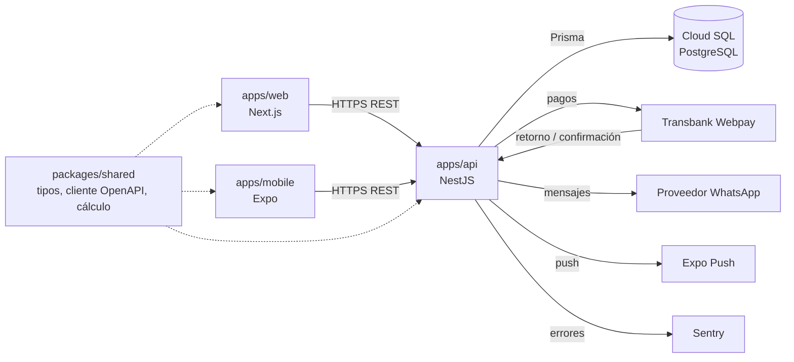
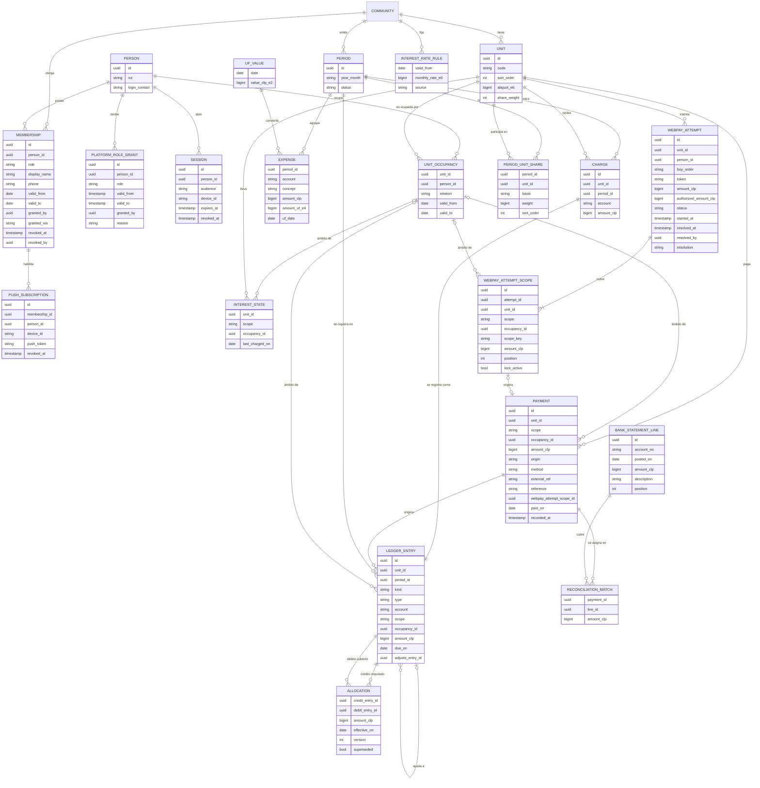

# Arquitectura de ComVive

Estado: **Propuesto** · revisión crítica 1: Aprobado con cambios (cambios aplicados) · revisión crítica 2 (`docs/revisiones/2026-11-07-diseno-rev2.md`): cambios de arquitectura aplicados (M3, M4, M5, M8, menores 12, 14 y 15, y decisiones del líder sobre pago del propietario, rol de plataforma y otorgamiento del rol de administrador) · pendiente de aprobación del líder del proyecto

Primer borrador a nivel de cimientos (Etapa 0). Las decisiones marcadas con *(ADR)* se formalizarán en `docs/adr/` antes de la Etapa 2. Las marcadas **Supuesto (a validar)** son decisiones tomadas para avanzar; se confirman o corrigen con el líder del proyecto. Las reglas no negociables de `CLAUDE.md` son restricciones de este diseño, no opciones.

## 1. Componentes y monorepo

```text
apps/api          NestJS: única puerta a la base de datos, reglas de negocio, permisos, auditoría
apps/web          Next.js: administrador y comité (y consola de plataforma, sección 3)
apps/mobile       React Native + Expo: residentes y conserjería
packages/shared   tipos y cliente generados desde OpenAPI, validaciones comunes (RUT, formato CLP), módulo de cálculo de dinero
```

- **Solo la API toca PostgreSQL.** Web y app nunca acceden a la base de datos ni a Prisma.
- **Contrato primero:** cada endpoint se define en OpenAPI antes de implementarse; de ahí se generan tipos y cliente en `packages/shared`.
- **Comunicación:** REST + JSON sobre HTTPS, token Bearer. Sin GraphQL ni websockets en el MVP.
- **Cálculo de dinero:** módulo puro (sin E/S), con aritmética `bigint`, probado con las pruebas de oro y fast-check. Puede vivir en `packages/shared`, pero **solo la API lo ejecuta para montos que se persisten**; web y app únicamente muestran lo que entrega la API.
- **Montos en JSON:** enteros CLP validados en el rango `0..Number.MAX_SAFE_INTEGER` en el contrato OpenAPI *(ADR 0003)*.
- **Tareas diferidas** (notificaciones, importación de cartolas, vencimiento de membresías) se ejecutan fuera del ciclo de la petición; mecanismo por decidir cuando haga falta.



## 2. Aislamiento entre comunidades (multi-tenant)

**Propuesta: base de datos y esquema compartidos, columna `community_id` en toda tabla de negocio, con dos barreras.**

**Barrera 1 · Aplicación (obligatoria):**

- Toda ruta de negocio lleva la comunidad en la URL: `/communities/{communityId}/...`.
- Un guard de NestJS valida la membresía vigente y deja un `TenantContext` (comunidad, persona, roles) para la petición. La membresía se lee en cada petición: revocarla corta el acceso de inmediato, sin esperar que venza el token.
- El acceso a datos pasa por un cliente Prisma extendido que exige y agrega `community_id` en cada lectura y escritura. Usar el cliente Prisma sin extender fuera de ese módulo queda prohibido por regla de lint.
- Claves foráneas compuestas `(community_id, id)`: la base de datos impide que un cargo de la comunidad A apunte a una unidad de B.

**Barrera 2 · PostgreSQL Row Level Security (recomendada, sujeta a prototipo):**

- Políticas RLS que comparan `community_id` con `current_setting('app.community_id')`, fijado con `SET LOCAL` en la transacción de cada petición. La API usa un rol sin `BYPASSRLS`; las migraciones, otro rol.
- **Criterio para posponer:** si el prototipo muestra que la transacción por petición complica el pool de conexiones, o el uso de Prisma dentro de esa transacción, RLS se pospone y la barrera 1 queda sola, con pruebas de aislamiento obligatorias *(ADR 0002)*.

**Datos que cruzan comunidades (lista cerrada).** Todo lo demás es por comunidad:

| Elemento | Por qué es global | Restricción |
| --- | --- | --- |
| `PERSON` | Identidad única para login | Solo guarda identidad (RUT, contacto de ingreso verificado, credenciales). Nombre y teléfono visibles se guardan en `MEMBERSHIP`, por comunidad |
| `UF_VALUE` | Dato público diario | Solo lectura para la API |
| Tasa de interés corriente (CMF) | Dato público periódico | Igual que `UF_VALUE`: global, con su fecha de vigencia, solo lectura para la API |
| Login, `SESSION` y `LOGIN_THROTTLE` | Previo a elegir comunidad | No devuelven datos de negocio. `LOGIN_THROTTLE` guarda el RUT como HMAC, no en claro |
| "Mis comunidades" | Lista las membresías propias | Solo comunidades donde la persona tiene membresía vigente |
| `PLATFORM_ROLE_GRANT` | Roles del equipo ComVive (sección 3) | No es una membresía de comunidad. Solo habilita rutas `/platform/...` |
| Vista `platform_webpay_review` | Única lectura transversal de datos de negocio, para "Soporte ComVive" | Excepción acotada a la regla 4 (sección 3): solo intentos Webpay en revisión, con columnas mínimas, y cada acceso auditado |

- La búsqueda por RUT (p. ej. al agregar un residente) nunca devuelve datos de otra comunidad: solo indica si se crea una membresía nueva para una persona existente, sin exponer nombre, unidades ni comunidades.

**Respuestas de error:**

| Situación | Respuesta |
| --- | --- |
| Sin membresía vigente en la comunidad, o recurso de otra comunidad | 404 |
| Membresía vigente, pero el rol no tiene permiso para la acción | 403 |
| Residente pide una unidad ajena, o un movimiento fuera de su ámbito, dentro de su comunidad | 404 |
| Ex residente con membresía vencida | 404 (sin acceso a su historial; lo obtiene a través del administrador) |
| Sesión de plataforma en una ruta `/communities/...`, o sesión de comunidad en una ruta `/platform/...` | 404 |
| "Soporte ComVive" pide un intento Webpay que no está en revisión | 404 |

- **Respuestas neutras (menor 15):** todos los 404 tienen el mismo cuerpo (`{"code":"NOT_FOUND"}`) y el mismo texto en web y app ("No encontramos lo que buscas o no tienes acceso"), exista o no el recurso. El 403 tiene un cuerpo único (`{"code":"FORBIDDEN"}`) y solo se devuelve cuando el actor ya puede ver el recurso (p. ej. el comité ve el periodo pero no puede emitirlo); si no puede verlo, la respuesta es 404. El orden de validación es fijo (sesión → membresía → visibilidad del recurso → permiso de la acción), para que la respuesta no dependa de si el recurso existe.

Cada endpoint lleva su prueba de aislamiento que verifica esta tabla.

**Alternativas descartadas:**

| Opción | Por qué se descarta |
| --- | --- |
| Una base de datos por comunidad | Costo y operación desproporcionados para muchas comunidades pequeñas; migraciones multiplicadas. |
| Un esquema PostgreSQL por comunidad | Prisma no maneja bien esquemas dinámicos; complejidad alta para un equipo pequeño. |
| Solo filtro en la aplicación, sin RLS | Un olvido produce una fuga (falla crítica, regla 4). Queda como respaldo según el criterio de arriba. |

## 3. Control de acceso por rol

- **Identidad global, permisos por comunidad.** Una persona tiene una cuenta; sus permisos dependen de su membresía en cada comunidad.
- RBAC por comunidad más **alcance por unidad y ámbito** para residentes.

| Rol | Alcance | Puede (resumen inicial) |
| --- | --- | --- |
| Administrador | Cada comunidad donde tenga membresía | Configurar comunidad y unidades, emitir y cerrar periodos, registrar y anular pagos manuales, conciliar, ver deudas. Otorgar y revocar comité, conserjería y residentes. **No otorga ni revoca el rol de administrador** |
| Comité | Su comunidad | Ver finanzas, cartolas, conciliación y reportes. Sin edición de montos ni gestión de usuarios |
| Residente propietario | Sus unidades | Estado de cuenta de sus unidades (su ámbito y, informativo, el del arrendatario vigente), pagar su ámbito, el del arrendatario vigente o ambos, comunicados, reservas |
| Residente arrendatario | Unidad que arrienda | Pagar y ver solo su ámbito: cargos emitidos desde su ingreso (`UNIT_OCCUPANCY.valid_from`), comunicados, reservas |
| Conserje | Su comunidad | Visitas, encomiendas, bitácora; nombre y unidad de residentes. Sin deudas ni RUT completo |

- Permisos como acciones (`period.close`, `payment.register`, `debt.read`...) mapeadas a roles en una tabla de código versionada. La matriz rol × acción se publica en `docs/specs/` y genera pruebas de permisos automáticas.
- El administrador multi-comunidad es una persona con membresía `admin` en varias comunidades.
- **Supuesto (a validar):** el panel consolidado multi-comunidad queda fuera del MVP. El cliente consulta cada comunidad por separado; no hay endpoints que agreguen datos de varias comunidades.

### Quién otorga cada rol

Decisión del líder: el rol de administrador solo lo otorga ComVive; el administrador otorga el comité.

| Rol que se otorga | Quién lo otorga y revoca | Endpoints |
| --- | --- | --- |
| `admin` | "Cuentas ComVive" (rol de plataforma `platform_operations`) | `POST /platform/communities/{communityId}/admin-memberships` y `POST /platform/communities/{communityId}/admin-memberships/{membershipId}/revoke` |
| `committee`, `concierge` | Administrador de la comunidad (`membership.manage`) | `POST /communities/{communityId}/memberships` y `POST /communities/{communityId}/memberships/{membershipId}/revoke` |
| `resident` (propietario o arrendatario) | Administrador, a través de la ocupación | La membresía nace y termina con `UNIT_OCCUPANCY` (flujo de ocupaciones, M7, pendiente del analista y del diseño) |

- `POST /communities/{communityId}/memberships` con `role = admin` responde 403. Revocar una membresía `admin` desde la ruta de comunidad también responde 403, incluida la propia.
- Crear una comunidad (`POST /platform/communities`) también es de `platform_operations`; el primer administrador se otorga en el mismo alta.
- `MEMBERSHIP` guarda `granted_by` y `granted_via` (`community` o `platform`), y al revocar, `revoked_at`, `revoked_by` y el motivo. No se borra.
- **Supuesto (a validar):** una persona no puede tener `admin` y `committee` a la vez en la misma comunidad (el comité supervisa al administrador, Ley 21.442). La API lo rechaza con 409.
- **Revocación (y término de cualquier membresía):** en una sola transacción se marca la membresía, se revocan todas las sesiones (`SESSION.revoked_at`) de la persona, se desvinculan sus suscripciones push de esa comunidad (sección 5) y se escribe la auditoría. Como el guard lee la membresía en cada petición, el acceso se corta de inmediato; revocar las sesiones obliga además a volver a ingresar y a recargar "Mis comunidades". **Supuesto (a validar):** se revocan todas las sesiones de la persona, no solo las de esa comunidad, por simplicidad.

### Usuarios de plataforma (ComVive)

Decisión del líder: los intentos Webpay "en revisión" (M4) los resuelve "Soporte ComVive". Esto exige modelar usuarios del equipo ComVive que no son miembros de ninguna comunidad *(ADR 0006)*.

**Modelo:**

- `PLATFORM_ROLE_GRANT` (global): `person_id`, `role`, vigencia, `granted_by`, motivo. No es una `MEMBERSHIP`: no habilita ninguna ruta `/communities/...` ni aparece en "Mis comunidades".
- Roles de plataforma, con mínimo privilegio:

| Rol de plataforma | Puede | No puede |
| --- | --- | --- |
| `platform_support` ("Soporte ComVive") | Listar y ver intentos Webpay en estado `in_review` o `reversal_pending`, con datos mínimos. Resolverlos: registrar el pago por el monto autorizado, marcar para reverso y confirmar el reverso | Ver libro, pagos, deudas, personas o RUT. Entrar a rutas de comunidad. Ver intentos en otros estados. Otorgar roles |
| `platform_operations` ("Cuentas ComVive") | Crear comunidades; otorgar y revocar la membresía `admin` | Ver datos de negocio de una comunidad. Otorgar otros roles. Resolver intentos Webpay |

- **Supuesto (a validar):** los roles de plataforma se otorgan solo por un procedimiento de operación con aprobación del líder del proyecto (sin endpoint en el MVP), y queda auditado.
- **Sesión separada:** el ingreso a la consola de plataforma emite una sesión con audiencia `platform`, distinta de la audiencia `community`. Cada guard rechaza la audiencia ajena con 404. **Supuesto (a validar):** segundo factor obligatorio y sesión de máximo 8 horas para la audiencia `platform`.

**Endpoints (todos bajo `/platform`, módulo separado de la API):**

| Método y ruta | Rol | Qué hace |
| --- | --- | --- |
| `GET /platform/webpay-attempts?status=&buyOrder=` | `platform_support` | Lista intentos en `in_review` o `reversal_pending` |
| `GET /platform/webpay-attempts/{attemptId}` | `platform_support` | Detalle mínimo del intento |
| `POST /platform/webpay-attempts/{attemptId}/resolution-preview` | `platform_support` | Simula la resolución y devuelve `previewHash` (sección 4) |
| `POST /platform/webpay-attempts/{attemptId}/resolution` | `platform_support` | Ejecuta `register_authorized`, `mark_for_reversal` o `confirm_reversal`, con motivo, `previewHash` e `Idempotency-Key` |
| `POST /platform/communities` | `platform_operations` | Alta de comunidad y su primer administrador |
| `POST /platform/communities/{communityId}/admin-memberships` | `platform_operations` | Otorga `admin` |
| `POST /platform/communities/{communityId}/admin-memberships/{membershipId}/revoke` | `platform_operations` | Revoca `admin` |

**Datos mínimos que ve Soporte:** id del intento, comunidad (id y nombre), código de la unidad, tipo de ámbito (`owner` u `occupancy`, sin nombre de la persona), orden de compra, monto iniciado por ámbito, monto autorizado, estado y códigos de Transbank, fechas. Nada más.

**Cómo se preserva la regla 4 (excepción acotada):**

- **Lectura:** el módulo `platform` no usa el cliente Prisma por comunidad. Lee únicamente la vista `platform_webpay_review` (columnas de arriba, filtrada a `in_review` y `reversal_pending`). Con RLS, la vista la consulta un rol de base de datos propio (`comvive_platform`) que solo tiene `SELECT` sobre esa vista y ningún permiso sobre las tablas base. Sin RLS (si se pospone, sección 2), una regla de lint restringe el módulo `platform` al modelo de esa vista.
- **Escritura:** la resolución no escribe directamente. Invoca el mismo servicio de pagos que usa la comunidad, dentro de una transacción con el `TenantContext` de la comunidad **del intento** (tomada del registro, nunca de la petición), `SET LOCAL app.community_id` y actor de tipo `platform`. Solo puede crear pagos en los ámbitos del intento y por el monto autorizado.
- **Auditoría obligatoria de cada acceso:** toda petición a `/platform/...`, incluidas las lecturas, escribe en `AUDIT_LOG` con `actor_type = platform`, el rol de plataforma, la comunidad y los ids devueltos. Si la auditoría falla, la petición falla. Las resoluciones exigen motivo. El administrador de la comunidad ve en su auditoría las acciones de "Soporte ComVive" en su comunidad, y el administrador y quien inició el pago reciben una notificación de la resolución.
- **Pruebas de aislamiento específicas (además de las de cada endpoint):**
  1. Una sesión de plataforma recibe 404 en cualquier ruta `/communities/...`.
  2. Una sesión de comunidad, incluida la de un administrador, recibe 404 en cualquier ruta `/platform/...`.
  3. Un intento en un estado distinto de `in_review` o `reversal_pending` responde 404 a Soporte, por listado y por id.
  4. La resolución solo inserta filas con el `community_id` del intento y en sus ámbitos; se verifica sobre todas las filas insertadas.
  5. El rol `comvive_platform` no puede leer ninguna tabla base (prueba contra la base de datos).
  6. Toda petición de plataforma deja su registro de auditoría; sin registro, la prueba falla.
  7. `platform_support` y `platform_operations` no pueden usar los endpoints del otro.
  8. Un `PLATFORM_ROLE_GRANT` revocado o vencido corta el acceso en la siguiente petición.

**Alternativas descartadas:**

| Opción | Por qué se descarta |
| --- | --- |
| Membresía `support` en cada comunidad | Multiplica membresías, mezcla al equipo ComVive con los usuarios de la comunidad y le da acceso a todo lo que la ruta de comunidad expone. |
| Rol de superusuario con `BYPASSRLS` | Rompe la regla 4 sin límite. Un error de consulta expone todas las comunidades. |
| Que el administrador de la comunidad resuelva | Decisión del líder: lo resuelve ComVive, que es quien opera la relación con Transbank. |

### Ingreso, sesiones y límites

- **Contacto del código de ingreso:** el código se envía al contacto de ingreso verificado de `PERSON`, único para la persona aunque tenga varias membresías. **Supuesto (a validar)**, a confirmar en el flujo de usuarios y roles (M9).
- **Respuesta neutra:** "Si el RUT está registrado, te enviamos un código". No revela si el RUT existe.
- **Límites (menor 12) *(ADR 0005)*:** los fallos y envíos se cuentan por separado en `LOGIN_THROTTLE`, para que nadie pueda bloquear el ingreso de otra persona escribiendo su RUT.
  - Por (RUT, dispositivo): **Supuesto (a validar):** 5 códigos fallidos bloquean 15 minutos esa combinación, no el RUT en todos los dispositivos.
  - Por IP: **Supuesto (a validar):** 30 intentos cada 10 minutos. Primera barrera en Cloud Armor (balanceador de Google Cloud) y segunda en la API.
  - Envío de códigos por RUT: **Supuesto (a validar):** 5 por hora por (RUT, IP) y 20 por día por RUT, con alerta en Sentry al superarse, para limitar el abuso de SMS o WhatsApp sin bloquear al titular.
  - El identificador de dispositivo lo genera la app al instalarse (en web, una cookie). Se puede falsificar; por eso el límite por IP es complementario.
- **Sesiones:** `SESSION` guarda audiencia (`community` o `platform`), vencimiento y revocación. **Supuesto (a validar):** token de acceso de 15 minutos y renovación ligada a una `SESSION` vigente.

## 4. Modelo de datos inicial (alto nivel)



Todas las tablas de negocio llevan `community_id` (omitido en el diagrama), `created_at` y `created_by`. `PERSON`, `UF_VALUE`, `PLATFORM_ROLE_GRANT`, `SESSION` y `LOGIN_THROTTLE` son globales (sección 2). `PUSH_SUBSCRIPTION` es por comunidad, a través de la membresía.

**Dinero y UF**

- `amount_clp` es `BIGINT` en pesos enteros. Prohibido `float`, `Decimal` o `numeric` para CLP. El cálculo usa `bigint` de punta a punta.
- `UF_VALUE` guarda el valor diario como entero en centésimos de peso, con su fecha. Los montos en UF se guardan en diezmilésimos de UF (`amount_uf_e4`) con la fecha usada.
- **Supuesto (a validar):** un gasto en UF se convierte a CLP **una sola vez**, con el valor UF de la fecha de emisión, y luego se prorratea en CLP. Si el cobro es un monto fijo en UF por unidad, cada unidad se convierte por separado y el total emitido es la suma de esas conversiones.

**Participación y prorrateo** *(ADR 0004)*

- **Supuesto (a validar):** dos bases de prorrateo; cada cuenta declara cuál usa:
  - **Alícuota legal:** `aliquot_e6`, entero en escala 10^-6 (18,50 % = 185000; 100 % = 1000000).
  - **Partes iguales o pesos relativos:** `share_weight` entero (1 para partes iguales).
- **Supuesto (a validar):** si las alícuotas no suman exactamente 1000000, la emisión se bloquea hasta corregir el dato (alineado con `docs/specs/gasto-comun.md`, regla A-3.1 y CA-19). El motor de cálculo igual reparte por `peso ÷ suma de pesos`, lo que sirve para partes iguales y pesos relativos.
- **Método del resto mayor** (`docs/qa/comunidades-simuladas.md`) con aritmética entera: cargo base = `total * peso / suma` (división entera); resto = `total * peso mod suma`. Los pesos faltantes van a los mayores restos.
- **Desempate:** `UNIT.sort_order`, entero estable y único por comunidad (menor `sort_order` gana). No se usa el código de la unidad.
- **Supuesto (a validar):** cada cuenta (gasto ordinario, fondo de reserva, extraordinarios) se prorratea por separado y la suma de sus cargos cuadra con su propio total. Así, el total del periodo también cuadra.
- **Foto de participaciones:** al emitir se guarda en `PERIOD_UNIT_SHARE` la base, el peso y el `sort_order` de cada unidad participante. Los recálculos y ajustes de ese periodo usan la foto, no los valores actuales de `UNIT`, para que sean reproducibles.
- No se crea `CHARGE` ni movimiento para cargos de $0.

**Libro de movimientos** *(ADR 0004)*

- `LEDGER_ENTRY` es de solo inserción (sin `UPDATE` ni `DELETE`, reforzado con permisos de base de datos y trigger). `kind` = `debit` (cargo, interés, multa) o `credit` (pago, nota de crédito); `amount_clp` siempre positivo; `account` separa gasto ordinario, fondo de reserva y otros.
- `type` detalla el origen: `charge`, `interest`, `fine`, `payment`, `credit_note`, `reversal`, `transfer` y `opening`.
- **Apertura:** tipo `opening` (débito o crédito por unidad, cuenta y ámbito, con referencia de origen) para cargar saldos iniciales en la migración. Es el único nombre de código para este tipo; el detalle queda para una spec futura de migración.
- **El libro es la fuente de verdad.** `CHARGE` es el detalle del cargo; invariante: cada cargo tiene exactamente un movimiento con el mismo monto, cuenta, unidad, periodo y ámbito, y ambos se crean en la misma transacción.

**Ámbito de deuda** (`docs/specs/gasto-comun.md`)

- Cada cargo y cada débito lleva un **ámbito fijo desde su creación**: `owner` (propietario de la unidad) u `occupancy` (una ocupación concreta, `occupancy_id` de `UNIT_OCCUPANCY`, p. ej. un arrendatario).
- Cada pago también lleva su ámbito (`PAYMENT.scope` y `occupancy_id`) y su crédito se imputa solo dentro de ese ámbito (spec F-9). En el pago manual lo elige el administrador (M2); en Webpay sale del ámbito del intento.
- Los intereses heredan el ámbito del capital que los genera. Los ajustes, reversos y notas de crédito heredan el ámbito del movimiento al que apuntan (`adjusts_entry_id`).
- **Saldo** = débitos − créditos, **por unidad y ámbito**; el saldo de la unidad es la suma de sus ámbitos. No existe columna de saldo editable; si por rendimiento se necesita, se usa una vista o saldos de cierre generados al cerrar, verificables contra el libro.
- Al terminar una ocupación, lo pendiente de su ámbito pasa al ámbito `owner` con un par de movimientos `transfer` (crédito en el ámbito de la ocupación, débito en `owner`, misma cuenta y monto, enlazados). Nada se edita.
- `scope_key` es una columna generada (`'owner'` o el `occupancy_id` como texto) que identifica el ámbito en índices únicos.

**Imputación** (regla de negocio en la spec, F-5)

- `ALLOCATION` registra qué crédito cubre qué débito: monto y **fecha efectiva = máx(`paid_on` del crédito, vencimiento `due_on` del débito)**. La suma imputada nunca supera el crédito ni el débito.
- Las imputaciones se derivan del libro: ante un pago, nota de crédito o reverso se **reimputa** el ámbito afectado. La versión anterior queda marcada como reemplazada (`superseded`), no se borra, y la reimputación se audita.

**Intereses** (detrás del flag `billing.interest`)

- `INTEREST_STATE` guarda el último día con interés cobrado por unidad y ámbito, para no cobrar dos veces el mismo tramo.
- `INTEREST_RATE_RULE` versiona por fecha (`valid_from`) la tasa del reglamento de cada comunidad. El tope legal se valida contra la tasa de interés corriente de la CMF (dato global, sección 2).
- Si llega un crédito con fecha efectiva anterior a intereses ya cobrados, se emite automáticamente una nota de crédito de intereses por la diferencia, en el borrador vigente.

**Periodos** *(ADR 0004)*

- Estados `draft` → `issued` → `closed`. Al emitir se generan cargos y movimientos en una transacción y se verifica que cada cuenta cuadre con su total. **Al emitir el periodo M se crea automáticamente el borrador M+1**, así siempre existe un único borrador vigente.
- Un periodo `closed` no admite inserciones con su `period_id` (trigger).
- **Regla única:** todo ajuste, pago tardío o reverso que llega después de emitir un periodo se registra en el **periodo en borrador vigente**. Los ajustes y reversos llevan `adjusts_entry_id` al movimiento original; los pagos conservan `paid_on` (fecha real de pago) y `recorded_at` (fecha de registro).

**Vistas previas atadas a la ejecución (M8)** *(ADR 0003)*

Toda operación que mueve dinero y tiene vista previa usa el mismo patrón: la vista previa no persiste nada y devuelve un `previewHash`; la ejecución lo envía y la API lo vuelve a calcular dentro de su transacción. Si no coincide, responde **409 `PREVIEW_OUTDATED`** y no escribe nada; el cliente vuelve a pedir la vista previa y muestra los cambios.

| Operación | Vista previa (no persiste) | Ejecución (`previewHash` + `Idempotency-Key`) |
| --- | --- | --- |
| Emitir periodo | `POST /communities/{communityId}/periods/{periodId}/issue-preview` | `POST /communities/{communityId}/periods/{periodId}/issue` |
| Corregir gasto | `POST /communities/{communityId}/expenses/{expenseId}/correction-preview` | `POST /communities/{communityId}/expenses/{expenseId}/corrections` |
| Anular pago manual | `POST /communities/{communityId}/payments/{paymentId}/void-preview` | `POST /communities/{communityId}/payments/{paymentId}/void` |
| Resolver intento Webpay en revisión | `POST /platform/webpay-attempts/{attemptId}/resolution-preview` | `POST /platform/webpay-attempts/{attemptId}/resolution` |

- **Qué cubre el hash:** SHA-256 de la serialización canónica del **resultado** que se mostró (cada movimiento a crear con unidad, ámbito, cuenta, tipo, monto y vencimiento; totales; reimputaciones y notas de crédito de intereses derivadas) más la versión del módulo de cálculo. Al cubrir el resultado y no las entradas, cualquier cambio que altere lo que se va a escribir (otro administrador edita el borrador, cambia la fecha de emisión, las alícuotas, la UF o una ocupación, o se registra un pago que cambia los intereses) produce 409; un cambio que no altera el resultado no molesta. Es opaco para el cliente.
- **Concurrencia:** la ejecución toma un bloqueo de fila (`SELECT ... FOR UPDATE`) sobre el periodo, el gasto, el pago o el intento antes de recalcular, así lo que se compara es lo que se escribe.
- **Orden con la idempotencia:** primero se revisa la `Idempotency-Key`. Un reintento con la misma clave devuelve el resultado original aunque el hash ya no coincida; una clave nueva con un hash viejo responde 409.
- **Simulación de emisión:** devuelve los cargos por unidad, ámbito y cuenta, el "Total emitido" (Σ cargos del periodo), en un bloque aparte los ajustes y saldos anteriores, las validaciones y el `previewHash`. Usa el mismo módulo de cálculo que la emisión real.
- **Simulación de corrección de gasto:** devuelve las notas de crédito y débitos de ajuste por unidad, ámbito y cuenta (spec H-2, con la foto de participaciones del periodo original), los ajustes de intereses derivados (E-10) y el `previewHash`. Si la spec aprueba la acción "Anular gasto" (M6, excepción a B-5), es la misma operación con monto correcto 0 y motivo obligatorio.
- **Simulación de anulación de pago:** devuelve el débito de reverso, las imputaciones que se deshacen, la reimputación del ámbito (spec F-6), las notas de crédito o débitos de intereses derivados, el saldo resultante del ámbito y el `previewHash`. La anulación exige motivo. Solo aplica a pagos con `origin = manual` (la anulación de pagos Webpay está fuera de alcance, spec F-4); otros responden 422 `PAYMENT_NOT_VOIDABLE`.

**Idempotencia de escrituras de dinero** *(ADR 0003)*

- Todo endpoint que crea movimientos exige el encabezado `Idempotency-Key` (UUID generado por el cliente al abrir el formulario o la confirmación): emisión, corrección, registro y anulación de pagos manuales, inicio de Webpay y resolución de plataforma.
- `IDEMPOTENCY_KEY` guarda `community_id` (vacío en rutas de plataforma), persona, endpoint, clave, hash del cuerpo y la respuesta. Único por (persona, endpoint, clave). La misma clave con otro cuerpo responde 422 `IDEMPOTENCY_KEY_REUSED`. **Supuesto (a validar):** se conserva 30 días.

**Pagos y conciliación**

- `PAYMENT.origin` es `manual`, `webpay` o `import`.
- **Unicidad externa solo para orígenes automáticos (M5):** índice único parcial `(community_id, origin, external_ref, scope_key) WHERE origin IN ('webpay', 'import')`. Así un reintento de Webpay o una reimportación no duplica el pago. Para Webpay, `external_ref` es la orden de compra (`buy_order`) y además `webpay_attempt_scope_id` es único.
- **Pagos manuales:** su idempotencia es la `Idempotency-Key` del envío. La referencia que escribe el administrador (`reference`, texto libre como "transferencia" o un número de recibo) no es única y solo alimenta la advertencia de posible duplicado (spec F-3). Dos pagos manuales con la misma referencia son válidos. **La spec F-2 debe alinearse con esto (pendiente del analista).**
- Registro manual: `POST /communities/{communityId}/payments` con unidad, ámbito (`scope` y `occupancyId`, M2), monto, medio, referencia y `paidOn`.
- **Supuesto (a validar):** conciliación N:M mediante `RECONCILIATION_MATCH`. Una línea de cartola puede cubrir varios pagos (p. ej. una transferencia por varias unidades del mismo dueño, o un abono de Transbank que cubre varios pagos Webpay) y la suma asignada nunca supera el monto de la línea.
- Huella única de la línea de cartola por comunidad: `(account_no, posted_on, amount_clp, description, position)`, para que reimportar una cartola no duplique líneas.
- Conciliar crea registros de asignación; nunca edita el pago ni la línea.
- La imputación de pagos a cargos sigue la sección "Imputación" y la spec de gasto común (F-5).

**Webpay** *(ADR 0007)*

Decisión del líder: el propietario puede pagar desde la app su ámbito, el del arrendatario vigente o ambos. El arrendatario paga solo su ámbito.

- **Modelo:** un `WEBPAY_ATTEMPT` (una transacción Transbank, un `buy_order`, un monto total) con uno o más `WEBPAY_ATTEMPT_SCOPE`, uno por ámbito pagado, cada uno con su monto. El total del intento es la suma de sus ámbitos.
- **Supuesto (a validar) · imputación por ámbito:** al confirmarse, se crea **un `PAYMENT` por ámbito** (mismo `buy_order` y `paid_on`, monto del ámbito), en la misma transacción, y cada crédito se imputa con F-5 solo dentro de su ámbito. Nada se compensa entre ámbitos. El monto de cada ámbito lo calcula la API al iniciar: es la deuda total del ámbito en ese momento (pagos parciales fuera del MVP). Si la deuda cambia entre el inicio y la confirmación, el remanente queda como saldo a favor de ese mismo ámbito. La regla definitiva de imputación la define el analista en la spec; este modelo soporta cualquier regla que asigne un monto fijo por ámbito.
- **Inicio:** `POST /communities/{communityId}/units/{unitId}/webpay-attempts` con `Idempotency-Key`. Cuerpo:

  ```json
  {
    "scopes": [
      { "scope": "owner" },
      { "scope": "occupancy", "occupancyId": "8f0c..." }
    ],
    "expectedTotalClp": 530004
  }
  ```

  - El arrendatario solo puede enviar su propia ocupación vigente. El propietario puede enviar `owner`, la ocupación vigente de la unidad o ambos. Cualquier otro ámbito responde 404.
  - Un ámbito sin deuda responde 422 `SCOPE_WITHOUT_DEBT`. Si la suma calculada no coincide con `expectedTotalClp` (lo que el residente vio), responde 409 `AMOUNT_CHANGED` con los montos nuevos.
  - Si algún ámbito pedido ya tiene un intento en curso, responde 409 `PAYMENT_IN_PROGRESS` indicando solo ese ámbito.
  - Responde el id del intento, el `buy_order`, el monto por ámbito y la URL y token de Transbank.
- **Bloqueo por (unidad, ámbito) (M3):** índice único parcial sobre `WEBPAY_ATTEMPT_SCOPE (community_id, unit_id, scope_key) WHERE lock_active`. Un pago del propietario sobre su ámbito no bloquea ni se muestra al arrendatario, y viceversa. Si el propietario paga el ámbito del arrendatario, ese ámbito sí queda bloqueado (es la misma deuda) y el arrendatario ve un aviso neutro, "Ya hay un pago en proceso para esta deuda", sin indicar quién paga.
- **Pago en curso:** `GET /communities/{communityId}/units/{unitId}/webpay-attempts/current` devuelve una lista con los ámbitos **visibles para quien consulta** que tienen un intento en curso: `scope`, `occupancyId`, `attemptId`, `startedAt` y `startedByMe`. El arrendatario solo ve su ámbito; el propietario, `owner` y el de la ocupación vigente. Lista vacía si no hay ninguno.
- **Estados de `WEBPAY_ATTEMPT`:** `initiated` → `confirmed` (pagos registrados), `rejected` o `abandoned`; o `in_review` → `resolved_paid`, o `reversal_pending` → `reversed`. `lock_active` es verdadero solo en `initiated`.
- **Confirmación:** si no llega en 15 minutos, la API consulta el estado en Transbank antes de liberar o confirmar el intento. Para pagar se exige identificar a la persona por su RUT. Una confirmación que llega después de terminar la ocupación se registra igual en el ámbito del intento (fijado al iniciar) y el traspaso de F-9 lo mueve después.
- **En revisión (M4):** el intento pasa a `in_review` si el monto autorizado difiere del iniciado o si Transbank no da un estado concluyente. No se registra pago. El residente ve el estado final "En revisión por la administración" (`GET /communities/{communityId}/units/{unitId}/webpay-attempts/{attemptId}`, solo para quien lo inició o el propietario si incluye su ámbito). **Supuesto (a validar):** `in_review` libera el bloqueo para no impedir pagar; la app advierte "Tienes un pago en revisión por $X; si pagas de nuevo podría quedar saldo a favor".
- **Resolución por "Soporte ComVive"** (sección 3):
  - `register_authorized`: crea los `PAYMENT` por el monto autorizado, con `paid_on` = fecha de autorización de Transbank. Solo se permite si el intento cubre un único ámbito. Un intento con varios ámbitos en revisión solo admite `mark_for_reversal`; `register_authorized` responde 422 `MULTI_SCOPE_REVIEW_REVERSAL_ONLY` (spec F-16), para no repartir entre dos deudores un monto distinto del iniciado.
  - `mark_for_reversal`: no crea pago; el intento pasa a `reversal_pending` y Soporte gestiona la anulación en Transbank. `confirm_reversal` registra la referencia de Transbank y pasa a `reversed`. **Supuesto (a validar):** la anulación se hace con la API de anulación de Webpay Plus; el mecanismo exacto se fija en el ADR 0007.
- **Alternativas descartadas:**

| Opción | Por qué se descarta |
| --- | --- |
| Un intento Webpay por ámbito (dos pagos con tarjeta) | Dos cobros para el residente, doble comisión y estados parciales difíciles de explicar. |
| Un solo `PAYMENT` con imputaciones en varios ámbitos | Rompe F-9 (cada crédito pertenece a un ámbito) y complica la anulación y la conciliación por ámbito. |
| Webpay Plus Mall (subtransacciones) | Descartado: cada comunidad tiene su propio código de comercio (§8, pregunta 14). |
| Bloqueo por unidad | Revela al arrendatario la actividad del propietario y bloquea pagos legítimos (M3). |

**Reproducibilidad:** con el libro, los gastos, la foto de participaciones del periodo y los valores UF, cualquier cargo y saldo se puede recalcular y comparar.

## 5. Auditoría y datos personales (Ley 21.719)

**Registro de auditoría (`AUDIT_LOG`):**

- Solo inserción, en la misma transacción que la operación. Guarda actor, tipo de actor (`member`, `platform` o `system`), rol de plataforma si corresponde, comunidad, acción, entidad e id, fecha y hora, origen (IP o dispositivo) y un resumen del cambio sin copiar datos personales completos.
- Se audita toda escritura sobre dinero, periodos, membresías y datos personales, incluidos los cambios de alícuotas.
- Se auditan en particular: otorgamiento y revocación de roles (`membership.grant`, `membership.revoke`, con quién otorgó y por qué vía), revocación de sesiones, otorgamiento de roles de plataforma y **toda** petición de plataforma, lecturas incluidas (sección 3).
- **Supuesto (a validar) · lecturas:** un registro por petición que devuelva RUT completo, deudas de terceros o registros de visitas. No se audita al residente que consulta su propia cuenta.

**Minimización y protección:**

- Solo se piden los datos necesarios por función. El conserje ve nombre y unidad, no RUT completo ni deudas. "Soporte ComVive" no ve nombres, RUT ni deudas.
- RUT normalizado, enmascarado salvo para roles autorizados. Evaluar cifrado de columna con Cloud KMS *(ADR 0005)*.
- Datos alojados en Google Cloud región Santiago (`southamerica-west1`). Sentry elimina datos personales antes del envío.
- Retención por tipo de dato y procedimiento de acceso, rectificación y supresión: por definir con asesoría legal. La supresión anonimiza a la persona sin borrar movimientos del libro.

**App: notificaciones push y copia local tras perder acceso (menor 14):**

- `PUSH_SUBSCRIPTION` vincula el token push de un dispositivo a una membresía. Al terminar la membresía (revocación, fin de ocupación o `valid_to` cumplido, este último con una tarea diaria) se marcan revocadas sus suscripciones en la misma transacción o tarea. Si la persona no tiene otras membresías vigentes, el token se elimina.
- Segunda barrera: al enviar, la API vuelve a verificar que la membresía esté vigente. Un retraso de la tarea diaria no produce envíos a ex residentes.
- La app guarda una copia local por comunidad, cifrada con una clave en el almacenamiento seguro del sistema (Keychain o Keystore vía `expo-secure-store`). Se borra cuando:
  - la API responde 404 para esa comunidad o deja de aparecer en "Mis comunidades";
  - se cierra la sesión o una renovación falla por sesión revocada (se borra todo);
  - pasan 30 días sin una sincronización exitosa. **Supuesto (a validar):** 30 días.

## 6. Ambientes

| Ambiente | Infraestructura | Datos |
| --- | --- | --- |
| Local | Docker Compose con PostgreSQL; API, web y Expo en desarrollo | Comunidades simuladas (semilla) |
| Pruebas | Proyecto GCP propio: Cloud Run (API y web) + Cloud SQL, región Santiago; Webpay en integración; canal EAS de pruebas | Solo datos simulados o anonimizados |
| Producción | Proyecto GCP separado: Cloud Run + Cloud SQL con respaldos y recuperación a un punto en el tiempo; canal EAS de producción | Datos reales |

- Secretos en Secret Manager, inyectados como variables de entorno; nunca en el repositorio (incluida la clave HMAC de `LOGIN_THROTTLE`).
- GitHub Actions despliega con Workload Identity Federation (sin llaves de servicio guardadas).
- `prisma migrate deploy` en el pipeline; en producción, solo tras aprobación explícita del líder del proyecto.

## 7. ADR recomendados

Todos se redactan con estado `Propuesto` y requieren la aprobación del líder del proyecto.

**A continuación (antes de la Etapa 2):**

1. **0001 Monorepo y herramientas:** gestor de paquetes y orquestador de tareas (p. ej. pnpm workspaces y Turborepo).
2. **0002 Aislamiento multi-comunidad:** `community_id`, cliente Prisma obligatorio, FK compuestas, datos globales, códigos 404/403 neutros y RLS sujeta al prototipo con su criterio para posponer.
3. **0003 Contratos de API y autorización:** OpenAPI primero, montos CLP en JSON, acciones por rol y matriz de permisos, quién otorga cada rol, `Idempotency-Key` en escrituras de dinero y vistas previas con `previewHash` y 409 `PREVIEW_OUTDATED`.
4. **0004 Libro de movimientos, periodos y prorrateo:** solo inserción, ámbitos (incluido el ámbito del pago), imputación, intereses, cierre, ajustes, bases de participación, resto mayor con `sort_order`, UF.
5. **0005 Autenticación, auditoría y datos personales:** identidad (propia o Google Identity Platform), sesiones y revocación, límites de ingreso por (RUT, dispositivo), IP y envíos (Cloud Armor y API), qué se audita, cifrado de RUT, copia local y push.
6. **0006 Usuarios de plataforma y excepción acotada al aislamiento (nuevo):** `PLATFORM_ROLE_GRANT` fuera de `MEMBERSHIP`, roles `platform_support` y `platform_operations`, sesión con audiencia separada y segundo factor, vista `platform_webpay_review` con rol de base de datos propio, escritura con el contexto de la comunidad del intento, auditoría de cada acceso y pruebas de aislamiento específicas.
7. **0007 Integración Webpay (adelantado):** intento con varios ámbitos y un pago por ámbito, bloqueo por (unidad, ámbito), estados, consulta a los 15 minutos, revisión y reverso, y un código de comercio por comunidad con sus credenciales como secreto.

**Cuando haga falta:** tareas en segundo plano, proveedor de WhatsApp (fuera del stack, requiere aprobación), ambientes y feature flags.

## 8. Preguntas abiertas para el líder del proyecto

1. **Supuestos de este documento:** confirmar o corregir cada **Supuesto (a validar)**, en especial bases de prorrateo, bloqueo de emisión si las alícuotas no suman 100 %, conversión UF en la fecha de emisión y conciliación N:M.
2. **Empresa administradora:** ¿el administrador es siempre una persona, o hay que modelar una empresa con varios empleados?
3. **Comité:** ¿qué acciones debe aprobar según la Ley 21.442 o el reglamento (p. ej. cierre de periodo, gastos extraordinarios)? ¿Puede una persona ser administrador y comité a la vez en la misma comunidad (supuesto: no)?
4. **Conserje:** ¿qué datos de residentes necesita realmente para visitas y encomiendas?
5. **Intereses y multas por mora:** ¿se activan en el MVP (flag `billing.interest`) o después?
6. **UF:** ¿qué fuente oficial se usa para el valor diario?
7. **Retención de datos:** plazos para visitas, bitácora y ex residentes (requiere asesoría legal, Ley 21.719).
8. **Transferencia internacional:** Sentry, Expo Push y el proveedor de WhatsApp procesan datos fuera de Chile. ¿Se acepta con datos minimizados?
9. **Periodo:** ¿siempre es un mes calendario?
10. **Soporte ComVive:** ¿en qué plazo debe resolver un intento en revisión? ¿Quién de ComVive tiene los roles `platform_support` y `platform_operations`, y se acepta que se otorguen solo por procedimiento de operación aprobado por el líder?
11. **Webpay con varios ámbitos:** ¿se acepta un solo cobro con un pago por ámbito? ¿El residente paga siempre la deuda total de cada ámbito o puede pagar montos parciales? ¿Cómo se reparte un monto autorizado distinto entre ámbitos (con el analista)?
12. **Pago en revisión:** ¿se libera el bloqueo para que el residente pueda volver a pagar (supuesto) o se mantiene hasta que Soporte resuelva?
13. **Revocación de rol:** ¿basta cerrar todas las sesiones de la persona (supuesto) o solo las de la comunidad afectada?
14. **Comercio Transbank (resuelta, líder del proyecto, 2026-11-07):** un código de comercio Transbank por comunidad. El abono de Transbank llega directo a la cuenta de la comunidad (ComVive no recauda fondos de terceros) y se concilia con la cartola de esa comunidad. Las credenciales del comercio son un secreto por comunidad (regla 9: gestor de secretos, nunca en la base de datos en claro). Webpay Plus Mall queda descartado. El alta del comercio es parte de la puesta en marcha de cada comunidad; mientras no exista, la comunidad opera solo con pagos manuales.
