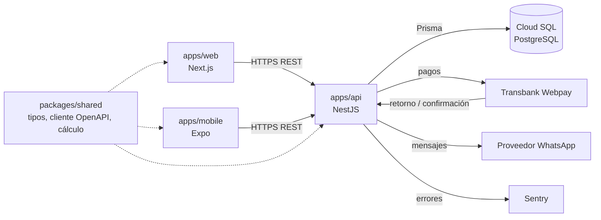
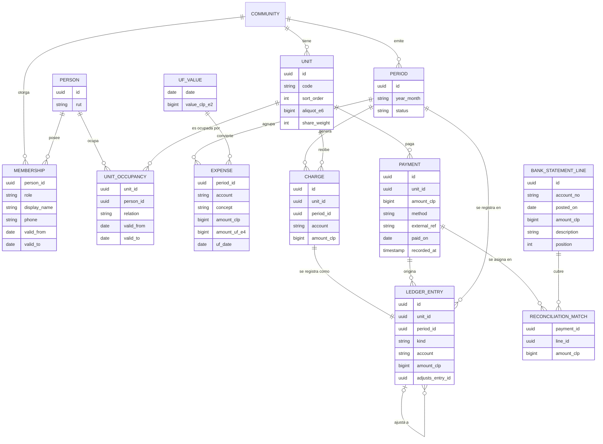

# Arquitectura de ComVive

Estado: **Propuesto** · revisión crítica: Aprobado con cambios (cambios aplicados) · pendiente de aprobación del líder del proyecto

Primer borrador a nivel de cimientos (Etapa 0). Las decisiones marcadas con *(ADR)* se formalizarán en `docs/adr/` antes de la Etapa 2. Las marcadas **Supuesto (a validar)** son decisiones tomadas para avanzar; se confirman o corrigen con el líder del proyecto. Las reglas no negociables de `CLAUDE.md` son restricciones de este diseño, no opciones.

## 1. Componentes y monorepo

```text
apps/api          NestJS: única puerta a la base de datos, reglas de negocio, permisos, auditoría
apps/web          Next.js: administrador y comité
apps/mobile       React Native + Expo: residentes y conserjería
packages/shared   tipos y cliente generados desde OpenAPI, validaciones comunes (RUT, formato CLP), módulo de cálculo de dinero
```

- **Solo la API toca PostgreSQL.** Web y app nunca acceden a la base de datos ni a Prisma.
- **Contrato primero:** cada endpoint se define en OpenAPI antes de implementarse; de ahí se generan tipos y cliente en `packages/shared`.
- **Comunicación:** REST + JSON sobre HTTPS, token Bearer. Sin GraphQL ni websockets en el MVP.
- **Cálculo de dinero:** módulo puro (sin E/S), con aritmética `bigint`, probado con las pruebas de oro y fast-check. Puede vivir en `packages/shared`, pero **solo la API lo ejecuta para montos que se persisten**; web y app únicamente muestran lo que entrega la API.
- **Montos en JSON:** enteros CLP validados en el rango `0..Number.MAX_SAFE_INTEGER` en el contrato OpenAPI *(ADR 0003)*.
- **Tareas diferidas** (notificaciones, importación de cartolas) se ejecutan fuera del ciclo de la petición; mecanismo por decidir cuando haga falta.



## 2. Aislamiento entre comunidades (multi-tenant)

**Propuesta: base de datos y esquema compartidos, columna `community_id` en toda tabla de negocio, con dos barreras.**

**Barrera 1 · Aplicación (obligatoria):**

- Toda ruta de negocio lleva la comunidad en la URL: `/communities/{communityId}/...`.
- Un guard de NestJS valida la membresía vigente y deja un `TenantContext` (comunidad, persona, roles) para la petición.
- El acceso a datos pasa por un cliente Prisma extendido que exige y agrega `community_id` en cada lectura y escritura. Usar el cliente Prisma sin extender fuera de ese módulo queda prohibido por regla de lint.
- Claves foráneas compuestas `(community_id, id)`: la base de datos impide que un cargo de la comunidad A apunte a una unidad de B.

**Barrera 2 · PostgreSQL Row Level Security (recomendada, sujeta a prototipo):**

- Políticas RLS que comparan `community_id` con `current_setting('app.community_id')`, fijado con `SET LOCAL` en la transacción de cada petición. La API usa un rol sin `BYPASSRLS`; las migraciones, otro rol.
- **Criterio para posponer:** si el prototipo muestra que la transacción por petición complica el pool de conexiones, o el uso de Prisma dentro de esa transacción, RLS se pospone y la barrera 1 queda sola, con pruebas de aislamiento obligatorias *(ADR 0002)*.

**Datos que cruzan comunidades (lista cerrada).** Todo lo demás es por comunidad:

| Elemento | Por qué es global | Restricción |
| --- | --- | --- |
| `PERSON` | Identidad única para login | Solo guarda identidad (RUT, credenciales). Nombre y teléfono visibles se guardan en `MEMBERSHIP`, por comunidad |
| `UF_VALUE` | Dato público diario | Solo lectura para la API |
| Login y sesión | Previo a elegir comunidad | No devuelve datos de negocio |
| "Mis comunidades" | Lista las membresías propias | Solo comunidades donde la persona tiene membresía vigente |

- La búsqueda por RUT (p. ej. al agregar un residente) nunca devuelve datos de otra comunidad: solo indica si se crea una membresía nueva para una persona existente, sin exponer nombre, unidades ni comunidades.

**Respuestas de error:**

| Situación | Respuesta |
| --- | --- |
| Sin membresía vigente en la comunidad, o recurso de otra comunidad | 404 |
| Membresía vigente, pero el rol no tiene permiso para la acción | 403 |
| Residente pide una unidad ajena dentro de su comunidad | 404 |

Cada endpoint lleva su prueba de aislamiento que verifica esta tabla.

**Alternativas descartadas:**

| Opción | Por qué se descarta |
| --- | --- |
| Una base de datos por comunidad | Costo y operación desproporcionados para muchas comunidades pequeñas; migraciones multiplicadas. |
| Un esquema PostgreSQL por comunidad | Prisma no maneja bien esquemas dinámicos; complejidad alta para un equipo pequeño. |
| Solo filtro en la aplicación, sin RLS | Un olvido produce una fuga (falla crítica, regla 4). Queda como respaldo según el criterio de arriba. |

## 3. Control de acceso por rol

- **Identidad global, permisos por comunidad.** Una persona tiene una cuenta; sus permisos dependen de su membresía en cada comunidad.
- RBAC por comunidad más **alcance por unidad** para residentes.

| Rol | Alcance | Puede (resumen inicial) |
| --- | --- | --- |
| Administrador | Cada comunidad donde tenga membresía | Configurar comunidad y unidades, emitir y cerrar periodos, registrar pagos, conciliar, ver deudas, gestionar usuarios |
| Comité | Su comunidad | Ver finanzas, cartolas, conciliación y reportes. Sin edición de montos |
| Residente propietario | Sus unidades | Estado de cuenta y cargos de sus unidades, pagar, comunicados, reservas |
| Residente arrendatario | Unidad que arrienda | Pagar y ver cargos de la unidad (alcance exacto: pregunta abierta), comunicados, reservas |
| Conserje | Su comunidad | Visitas, encomiendas, bitácora; nombre y unidad de residentes. Sin deudas ni RUT completo |

- Permisos como acciones (`period.close`, `payment.register`, `debt.read`...) mapeadas a roles en una tabla de código versionada. La matriz rol × acción se publica en `docs/specs/` y genera pruebas de permisos automáticas.
- El administrador multi-comunidad es una persona con membresía `admin` en varias comunidades.
- **Supuesto (a validar):** el panel consolidado multi-comunidad queda fuera del MVP. El cliente consulta cada comunidad por separado; no hay endpoints que agreguen datos de varias comunidades.

## 4. Modelo de datos inicial (alto nivel)



Todas las tablas de negocio llevan `community_id` (omitido en el diagrama), `created_at` y `created_by`. `PERSON` y `UF_VALUE` son globales (sección 2).

**Dinero y UF**

- `amount_clp` es `BIGINT` en pesos enteros. Prohibido `float`, `Decimal` o `numeric` para CLP. El cálculo usa `bigint` de punta a punta.
- `UF_VALUE` guarda el valor diario como entero en centésimos de peso, con su fecha. Los montos en UF se guardan en diezmilésimos de UF (`amount_uf_e4`) con la fecha usada.
- **Supuesto (a validar):** un gasto en UF se convierte a CLP **una sola vez**, con el valor UF de la fecha de emisión, y luego se prorratea en CLP. Si el cobro es un monto fijo en UF por unidad, cada unidad se convierte por separado y el total emitido es la suma de esas conversiones.

**Participación y prorrateo** *(ADR 0004)*

- **Supuesto (a validar):** dos bases de prorrateo; cada cuenta declara cuál usa:
  - **Alícuota legal:** `aliquot_e6`, entero en escala 10^-6 (18,50 % = 185000; 100 % = 1000000).
  - **Partes iguales o pesos relativos:** `share_weight` entero (1 para partes iguales).
- **Supuesto (a validar):** si las alícuotas no suman exactamente 1000000, la emisión se bloquea hasta corregir el dato (alineado con `docs/specs/gasto-comun.md`, regla C-4 y CA-16). El motor de cálculo igual reparte por `peso ÷ suma de pesos`, lo que sirve para partes iguales y pesos relativos.
- **Método del resto mayor** (`docs/qa/comunidades-simuladas.md`) con aritmética entera: cargo base = `total * peso / suma` (división entera); resto = `total * peso mod suma`. Los pesos faltantes van a los mayores restos.
- **Desempate:** `UNIT.sort_order`, entero estable y único por comunidad (menor `sort_order` gana). No se usa el código de la unidad.
- **Supuesto (a validar):** cada cuenta (gasto ordinario, fondo de reserva, extraordinarios) se prorratea por separado y la suma de sus cargos cuadra con su propio total. Así, el total del periodo también cuadra.

**Libro de movimientos** *(ADR 0004)*

- `LEDGER_ENTRY` es de solo inserción (sin `UPDATE` ni `DELETE`, reforzado con permisos de base de datos y trigger). `kind` = `debit` (cargo, interés, multa) o `credit` (pago, nota de crédito); `amount_clp` siempre positivo; `account` separa gasto ordinario, fondo de reserva y otros.
- **El libro es la fuente de verdad.** `CHARGE` es el detalle del cargo; invariante: cada cargo tiene exactamente un movimiento con el mismo monto, cuenta, unidad y periodo, y ambos se crean en la misma transacción.
- **Saldo** de una unidad = débitos − créditos. No existe columna de saldo editable; si por rendimiento se necesita, se usa una vista o saldos de cierre generados al cerrar, verificables contra el libro.

**Periodos** *(ADR 0004)*

- Estados `draft` → `issued` → `closed`. Al emitir se generan cargos y movimientos en una transacción y se verifica que cada cuenta cuadre con su total.
- Un periodo `closed` no admite inserciones con su `period_id` (trigger).
- **Supuesto (a validar):** una corrección a un periodo cerrado es un movimiento nuevo en el periodo siguiente, con `adjusts_entry_id` al original. Si ese periodo no existe, se crea en `draft`; si está en `draft`, el ajuste se agrega ahí.
- **Supuesto (a validar):** un pago que llega después del cierre se imputa al periodo abierto según su fecha de registro (`recorded_at`) y conserva la fecha real de pago (`paid_on`).

**Pagos y conciliación**

- `external_ref` único por `(community_id, method, external_ref)`: un reintento de Webpay o una reimportación no duplica el pago.
- **Supuesto (a validar):** conciliación N:M mediante `RECONCILIATION_MATCH`. Una línea de cartola puede cubrir varios pagos (p. ej. una transferencia por varias unidades del mismo dueño) y la suma asignada nunca supera el monto de la línea.
- Huella única de la línea de cartola por comunidad: `(account_no, posted_on, amount_clp, description, position)`, para que reimportar una cartola no duplique líneas.
- Conciliar crea registros de asignación; nunca edita el pago ni la línea.
- La imputación de un pago a cargos específicos sigue pendiente (pregunta abierta).

**Reproducibilidad:** con el libro, los gastos, las bases de prorrateo, `sort_order` y los valores UF, cualquier cargo y saldo se puede recalcular y comparar.

## 5. Auditoría y datos personales (Ley 21.719)

**Registro de auditoría (`AUDIT_LOG`):**

- Solo inserción, en la misma transacción que la operación. Guarda actor, comunidad, acción, entidad e id, fecha y hora, origen (IP o dispositivo) y un resumen del cambio sin copiar datos personales completos.
- Se audita toda escritura sobre dinero, periodos, membresías y datos personales, incluidos los cambios de alícuotas.
- **Supuesto (a validar) · lecturas:** un registro por petición que devuelva RUT completo, deudas de terceros o registros de visitas. No se audita al residente que consulta su propia cuenta.

**Minimización y protección:**

- Solo se piden los datos necesarios por función. El conserje ve nombre y unidad, no RUT completo ni deudas.
- RUT normalizado, enmascarado salvo para roles autorizados. Evaluar cifrado de columna con Cloud KMS *(ADR 0005)*.
- Datos alojados en Google Cloud región Santiago (`southamerica-west1`). Sentry elimina datos personales antes del envío.
- Retención por tipo de dato y procedimiento de acceso, rectificación y supresión: por definir con asesoría legal. La supresión anonimiza a la persona sin borrar movimientos del libro.

## 6. Ambientes

| Ambiente | Infraestructura | Datos |
| --- | --- | --- |
| Local | Docker Compose con PostgreSQL; API, web y Expo en desarrollo | Comunidades simuladas (semilla) |
| Pruebas | Proyecto GCP propio: Cloud Run (API y web) + Cloud SQL, región Santiago; Webpay en integración; canal EAS de pruebas | Solo datos simulados o anonimizados |
| Producción | Proyecto GCP separado: Cloud Run + Cloud SQL con respaldos y recuperación a un punto en el tiempo; canal EAS de producción | Datos reales |

- Secretos en Secret Manager, inyectados como variables de entorno; nunca en el repositorio.
- GitHub Actions despliega con Workload Identity Federation (sin llaves de servicio guardadas).
- `prisma migrate deploy` en el pipeline; en producción, solo tras aprobación explícita del líder del proyecto.

## 7. ADR recomendados

**A continuación (antes de la Etapa 2):**

1. **0001 Monorepo y herramientas:** gestor de paquetes y orquestador de tareas (p. ej. pnpm workspaces y Turborepo).
2. **0002 Aislamiento multi-comunidad:** `community_id`, cliente Prisma obligatorio, FK compuestas, datos globales, códigos 404/403 y RLS sujeta al prototipo con su criterio para posponer.
3. **0003 Contratos de API y autorización:** OpenAPI primero, montos CLP en JSON, acciones por rol y matriz de permisos.
4. **0004 Libro de movimientos, periodos y prorrateo:** solo inserción, cierre, ajustes, bases de participación, resto mayor con `sort_order`, UF.
5. **0005 Autenticación, auditoría y datos personales:** identidad (propia o Google Identity Platform), qué se audita, cifrado de RUT.

**Cuando haga falta:** tareas en segundo plano, proveedor de WhatsApp (fuera del stack, requiere aprobación), integración Webpay, ambientes y feature flags.

## 8. Preguntas abiertas para el líder del proyecto

1. **Supuestos de este documento:** confirmar o corregir cada **Supuesto (a validar)**, en especial bases de prorrateo, bloqueo de emisión si las alícuotas no suman 100 %, conversión UF en la fecha de emisión y conciliación N:M.
2. **Empresa administradora:** ¿el administrador es siempre una persona, o hay que modelar una empresa con varios empleados?
3. **Arrendatario:** ¿ve la deuda acumulada de la unidad anterior a su arriendo, o solo los cargos desde su ingreso?
4. **Comité:** ¿qué acciones debe aprobar según la Ley 21.442 o el reglamento (p. ej. cierre de periodo, gastos extraordinarios)?
5. **Conserje:** ¿qué datos de residentes necesita realmente para visitas y encomiendas?
6. **Imputación de pagos:** ¿un pago parcial se aplica primero a la deuda más antigua, a intereses y multas, o según reglamento?
7. **Intereses y multas por mora:** ¿entran al MVP?
8. **UF:** ¿qué fuente oficial se usa para el valor diario?
9. **Retención de datos:** plazos para visitas, bitácora y ex residentes (requiere asesoría legal, Ley 21.719).
10. **Transferencia internacional:** Sentry y el proveedor de WhatsApp procesan datos fuera de Chile. ¿Se acepta con datos minimizados?
11. **Periodo:** ¿siempre es un mes calendario?
