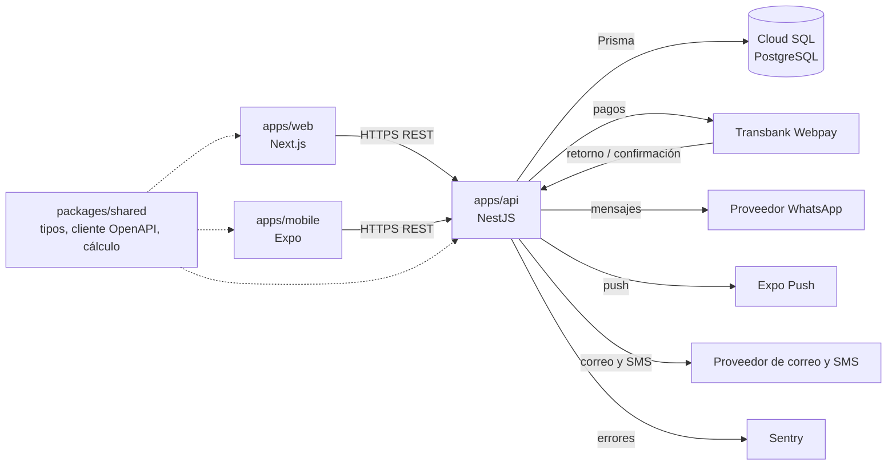
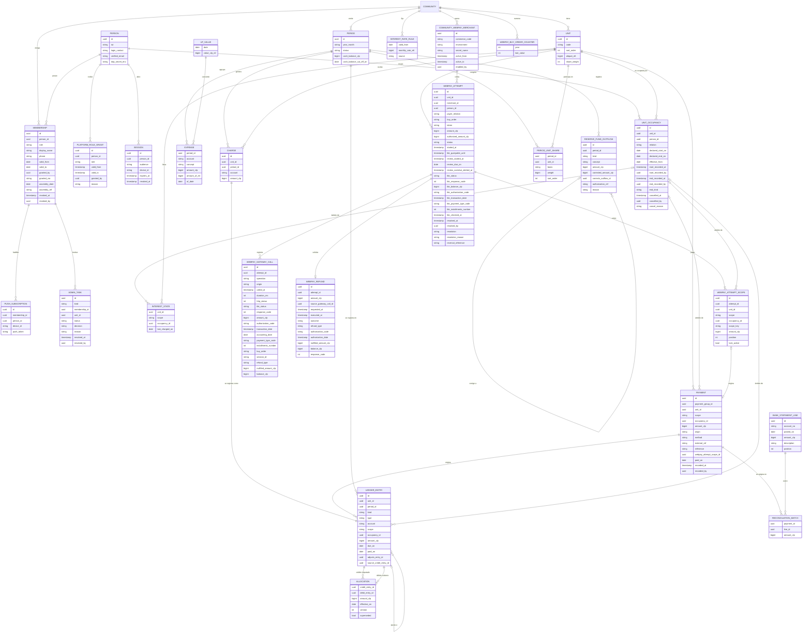

# Arquitectura de ComVive

Estado: **Propuesto** · revisión crítica 1: Aprobado con cambios (cambios aplicados) · revisión crítica 2 (`docs/revisiones/2026-11-07-diseno-rev2.md`): cambios aplicados · revisión crítica 3 (`docs/revisiones/2026-11-07-diseno-rev3.md`): cambios de arquitectura aplicados (M-1, M-2, M-4 a M-8, menores 1, 3, 4 y 10, y decisiones del líder del 2026-11-07) · alineada con `docs/specs/gasto-comun.md` rev. 4 (ocupaciones programadas y su cancelación, `payerKind`, ámbito final en la vista previa de Soporte, saldo de caja, referencia a la asamblea, egresos del fondo y auditoría de la lectura del propietario) · revisión crítica 4 (`docs/revisiones/2026-11-07-diseno-rev4.md`): cambios de arquitectura aplicados (B-3, M-1 a M-7 y menor 3, con las decisiones del líder D12 a D14 del 2026-11-07) · alineada con la spec rev. 6 · hallazgos de QA H-31 a H-35, H-37, H-41 y H-42 (`docs/qa/casos/gasto-comun.md`) aplicados con las resoluciones del coordinador · hallazgos de QA H-43 (respuesta de "confirmar" como respuesta concluyente guardada, §4) y H-46 (a) (motivo `missing_params` del retorno inválido, §5) aplicados con las resoluciones del coordinador del 2026-11-08 · pendiente de aprobación del líder del proyecto

Borrador de la Etapa 1 (Diseño). Las decisiones marcadas con *(ADR)* se formalizarán en `docs/adr/` antes de la Etapa 2. Las marcadas **Supuesto (a validar)** son decisiones tomadas para avanzar; se confirman o corrigen con el líder del proyecto. Las reglas no negociables de `CLAUDE.md` son restricciones de este diseño, no opciones. Las reglas de negocio viven en `docs/specs/gasto-comun.md`; este documento fija cómo se implementan.

## 1. Componentes y monorepo

```text
apps/api          NestJS: única puerta a la base de datos, reglas de negocio, permisos, auditoría
apps/web          Next.js: administrador y comité (y consola de plataforma, sección 3)
apps/mobile       React Native + Expo: residentes y conserjería
packages/shared   tipos y cliente generados desde OpenAPI, validaciones comunes (RUT, formato CLP), módulo de cálculo de dinero
```

- **Solo la API toca PostgreSQL.** Web y app nunca acceden a la base de datos ni a Prisma.
- **Contrato primero:** cada endpoint se define en OpenAPI antes de implementarse; de ahí se generan tipos y cliente en `packages/shared`.
- **Comunicación:** REST + JSON sobre HTTPS, token Bearer. Sin GraphQL ni websockets en el MVP.
- **Cálculo de dinero:** módulo puro (sin E/S), con aritmética `bigint`, probado con las pruebas de oro y fast-check. Puede vivir en `packages/shared`, pero **solo la API lo ejecuta para montos que se persisten**; web y app únicamente muestran lo que entrega la API.
- **Montos en JSON:** enteros CLP validados en el rango `0..Number.MAX_SAFE_INTEGER` en el contrato OpenAPI *(ADR 0003, decisión 2)*. **Campos con signo (lista cerrada, M-1 de la rev. 4):** en el contrato son enteros en `-Number.MAX_SAFE_INTEGER..Number.MAX_SAFE_INTEGER`; el tope de su valor absoluto lo garantiza la regla de negocio, no el contrato. Ningún otro monto admite negativos; agregar uno exige actualizar esta lista, la de ADR 0003 y la prueba de contrato.
  - `cashBalanceClp`: saldo de caja del aviso (spec G-4), un dato informativo y no un cobro. Es el único campo con signo que se recibe (cuerpo de `issue-preview` e `issue`): con valor absoluto sobre $9.999.999.999 responde 422 `AMOUNT_TOO_LARGE` (CA-58; sección 4, "Periodos").
  - `reserveFundBalanceClp`: saldo del fondo de reserva registrado en ComVive (spec D-5, S-50), negativo con advertencia. Solo respuesta.
  - `differenceClp`: diferencia de una corrección de egreso del fondo (`kind = correction`, ADR 0004 decisión 11), nunca $0. Solo respuesta.
  - `balanceClp`: saldo de una unidad o de un ámbito, Σ débitos − Σ créditos; negativo es saldo a favor. Solo respuesta.
  - Ajustes, notas de crédito, imputaciones y pagos no llevan signo: el tipo de movimiento dice la dirección y el monto es mayor que $0.
- **Tareas diferidas** (notificaciones, importación de cartolas, vencimiento de membresías, consulta de los 15 minutos, consulta diaria y plazo de los intentos Webpay en revisión, reembolso de `mark_for_reversal`, alertas al administrador) se ejecutan fuera del ciclo de la petición. El mecanismo lo fija el **ADR 0008 "Tareas en segundo plano"**, primera tarjeta de la Etapa 2 (decisión del líder D14, 2026-11-07; sección 7).



## 2. Aislamiento entre comunidades (multi-tenant)

**Propuesta: base de datos y esquema compartidos, columna `community_id` en toda tabla de negocio, con dos barreras.**

**Barrera 1 · Aplicación (obligatoria):**

- Toda ruta de negocio lleva la comunidad en la URL: `/communities/{communityId}/...`.
- Un guard de NestJS valida la membresía vigente y deja un `TenantContext` (comunidad, persona, roles) para la petición. La membresía se lee en cada petición: revocarla corta el acceso de inmediato, sin esperar que venza el token.
- El acceso a datos pasa por un cliente Prisma extendido que exige y agrega `community_id` en cada lectura y escritura. Usar el cliente Prisma sin extender fuera de ese módulo queda prohibido por regla de lint.
- Claves foráneas compuestas `(community_id, id)`: la base de datos impide que un cargo de la comunidad A apunte a una unidad de B.
- **Rutas de negocio sin membresía (lista cerrada).** Ninguna otra ruta que toque datos de una comunidad puede omitir el guard de membresía; agregar una exige un ADR:

  | Ruta | Por qué no exige membresía | Restricción |
  | --- | --- | --- |
  | `GET` y `POST /gateway/webpay/communities/{communityId}/webpay-attempts/{attemptId}/return` (retorno de Transbank, *ADR 0007*) | Transbank redirige el navegador del pagador sin sesión de ComVive, y el pago no puede depender de ella | Módulo `webpay-gateway` separado, con guard propio: fija el `TenantContext` de la comunidad de la ruta con actor `system`, busca el intento con el cliente Prisma por comunidad y verifica los parámetros de Transbank contra el intento, en tiempo constante (ADR 0007, decisión 4: el token, o en una expiración sin token, `TBK_ID_SESION` = id del intento y `TBK_ORDEN_COMPRA` = su `buy_order`). **Retorno inválido** (intento inexistente o de otra comunidad, o parámetros que no coinciden): no llama a Transbank, no escribe datos de negocio, deja un evento en el registro de eventos de seguridad (sin datos personales, fuera de la base de datos) y responde un 302 **neutro** a la pantalla genérica de la app, **sin id de intento**, idéntico para todo retorno inválido. **Retorno válido:** 302 al enlace de la app **con el id del intento**, sin montos, estado ni datos de la unidad. El resultado sale siempre de Transbank, nunca de los parámetros. Lleva sus pruebas de aislamiento (ADR 0007, prueba 5) |

  Las rutas `/platform/...` tampoco usan membresía, pero no son rutas de comunidad: tienen su propio rol y su excepción acotada (sección 3 y vista `platform_webpay_review`).

**Barrera 2 · PostgreSQL Row Level Security (recomendada, sujeta a prototipo):**

- Políticas RLS que comparan `community_id` con `current_setting('app.community_id')`, fijado con `SET LOCAL` en la transacción de cada petición. La API usa un rol sin `BYPASSRLS`; las migraciones, otro rol.
- **Criterio para posponer:** si el prototipo muestra que la transacción por petición complica el pool de conexiones, o el uso de Prisma dentro de esa transacción, RLS se pospone y la barrera 1 queda sola, con pruebas de aislamiento obligatorias *(ADR 0002)*.

**Datos que cruzan comunidades (lista cerrada).** Todo lo demás es por comunidad:

| Elemento | Por qué es global | Restricción |
| --- | --- | --- |
| `PERSON` | Identidad única para login | Solo guarda identidad (RUT, contactos verificados, credenciales y segundo factor). Nombre y teléfono visibles se guardan en `MEMBERSHIP`, por comunidad |
| `UF_VALUE` | Dato público diario | Solo lectura para la API |
| Tasa de interés corriente (CMF) | Dato público periódico | Igual que `UF_VALUE`: global, con su fecha de vigencia, solo lectura para la API |
| `PUBLIC_HOLIDAY` (feriados nacionales de Chile) | Dato público para contar días hábiles | Solo lectura para la API; se carga desde el calendario oficial |
| Login, `SESSION` y `LOGIN_THROTTLE` | Previo a elegir comunidad | No devuelven datos de negocio. `LOGIN_THROTTLE` guarda el RUT como HMAC, no en claro |
| "Mis comunidades" | Lista las membresías propias | Solo comunidades donde la persona tiene membresía vigente |
| `PLATFORM_ROLE_GRANT` | Roles del equipo ComVive (sección 3) | No es una membresía de comunidad. Solo habilita rutas `/platform/...` |
| Vista `platform_webpay_review` | Única lectura transversal de datos de negocio, para Soporte ComVive | Excepción acotada a la regla 4 (EX-1 de la spec, sección 3): solo intentos Webpay en revisión, con columnas mínimas, y cada acceso auditado |

- La búsqueda por RUT (p. ej. al agregar un residente) nunca devuelve datos de otra comunidad: solo indica si se crea una membresía nueva para una persona existente, sin exponer nombre, unidades ni comunidades.

**Respuestas de error: regla única (decisión del líder del proyecto, 2026-11-07; M-4)**

- **404 si el actor no puede ver el recurso. 403 solo si lo ve, pero su rol no le permite la acción.** No hay otra regla: la spec, el diseño y QA usan esta.
- El orden de validación es fijo (H-34; ADR 0003, decisión 9): autenticación (401) → membresía (o rol de plataforma), visibilidad del recurso y permiso de la acción (404/403) → forma de la petición (400 `BAD_REQUEST`) → clave de idempotencia (422 `IDEMPOTENCY_KEY_REUSED`, 409 `IDEMPOTENCY_KEY_IN_PROGRESS`) → reglas de negocio (409 de estado y 422, en el orden de la spec para cada operación; si no fija uno, 409 antes que 422). Así la respuesta no depende de si el recurso existe. Las verificaciones 404/403 que dependen de un dato del cuerpo (p. ej. `occupancyId` de otra unidad, `role = admin` al otorgar) se evalúan apenas el cuerpo pasa la forma, con la misma regla, y siempre antes de la idempotencia.

| Situación | Respuesta |
| --- | --- |
| Sin membresía vigente en la comunidad, o recurso de otra comunidad | 404 |
| Residente pide una unidad ajena, o un movimiento, pago o intento fuera de los ámbitos que ve (sección 4, "Visibilidad por ámbito") | 404 |
| Rol que no ve ese tipo de recurso (p. ej. el conserje pide un aviso de cobro, o el comité pide las tareas del administrador) | 404 |
| Rol que ve el recurso, pero no puede hacer la acción (p. ej. el comité ve el periodo e intenta emitirlo; el comité ve un grupo de pagos e intenta anularlo; el administrador ve las membresías e intenta otorgar `admin`) | 403 |
| Ex residente con membresía vencida | 404 (sin acceso a su historial; lo obtiene a través del administrador) |
| Sesión de plataforma en una ruta `/communities/...`, o sesión de comunidad (incluida la de un administrador) en una ruta `/platform/...` | 404 |
| Soporte ComVive pide un intento Webpay que no está en `in_review` ni `reversal_pending` (fuera de su vista) | 404 |
| Soporte ComVive pide una resolución que no corresponde al estado de un intento que sí ve | 409 `PREVIEW_OUTDATED` |

- **Respuestas neutras:** todos los 404 tienen el mismo cuerpo (`{"code":"NOT_FOUND"}`) y el mismo texto en web y app ("No encontramos lo que buscas o no tienes acceso"), exista o no el recurso. El 403 tiene un cuerpo único (`{"code":"FORBIDDEN"}`).
- **Resolver intentos Webpay desde la comunidad:** no existe un endpoint de resolución en las rutas `/communities/...`. Un administrador o un miembro del comité que llama a una ruta `/platform/...` recibe 404 por audiencia ajena (prueba de plataforma 2). La spec (CA-41) se alinea a esto.

- **Qué ve cada rol:** la matriz "Qué recursos ve cada rol" de la spec (H-20; Supuesto (a validar) S-53) es la que decide, recurso por recurso, si un rol no ve (404) o ve sin permiso (403). La API la implementa como una tabla de visibilidad por (rol, tipo de recurso), aplicada antes que la matriz de permisos (sección 3), y las pruebas de permisos se generan de ambas. Por ejemplo:
  - un residente que pide configurar, emitir, cerrar, crear o corregir un gasto recibe 404, no 403, porque no ve esos recursos; el comité recibe 403;
  - **comprobante de cobro del arrendatario (spec G-7):** lo descargan el arrendatario titular de esa ocupación, el administrador y el comité; el propietario y el ex arrendatario reciben 404;
  - aviso legal: administrador y comité ven todos, el propietario el suyo, el arrendatario y el conserje reciben 404.

Cada endpoint lleva su prueba de aislamiento que verifica esta tabla y la matriz de la spec.

**Alternativas descartadas:**

| Opción | Por qué se descarta |
| --- | --- |
| Una base de datos por comunidad | Costo y operación desproporcionados para muchas comunidades pequeñas; migraciones multiplicadas. |
| Un esquema PostgreSQL por comunidad | Prisma no maneja bien esquemas dinámicos; complejidad alta para un equipo pequeño. |
| Solo filtro en la aplicación, sin RLS | Un olvido produce una fuga (falla crítica, regla 4). Queda como respaldo según el criterio de arriba. |
| 403 siempre que falte permiso, aunque el actor no vea el recurso | Revela que el recurso existe. Descartado por el líder (M-4). |

## 3. Control de acceso por rol

- **Identidad global, permisos por comunidad.** Una persona tiene una cuenta; sus permisos dependen de su membresía en cada comunidad.
- RBAC por comunidad más **alcance por unidad y ámbito** para residentes (sección 4, "Visibilidad por ámbito").

| Rol | Alcance | Puede (resumen inicial) |
| --- | --- | --- |
| Administrador | Cada comunidad donde tenga membresía | Configurar comunidad y unidades, emitir y cerrar periodos, registrar y anular pagos manuales, registrar ocupaciones, conciliar, ver deudas y los intentos Webpay de la comunidad (solo lectura). Otorgar y revocar comité, conserjería y residentes. **No otorga ni revoca el rol de administrador** ni resuelve intentos Webpay |
| Comité | Su comunidad, **solo en la web** (decisión del líder) | Ver finanzas, cartolas, conciliación, reportes e intentos Webpay, con datos personales limitados (spec, "Datos de copropietarios que ve el comité"). Sin edición de montos ni gestión de usuarios |
| Residente propietario | Sus unidades | Ámbito `owner` de sus unidades y, informativo, el del arrendatario vigente; pagar su ámbito, el del arrendatario vigente o ambos; comunicados, reservas |
| Residente arrendatario | Unidad que arrienda | Solo el ámbito de su ocupación vigente (`occupancy_id`), nunca por fecha (sección 4); pagar ese ámbito; comunicados, reservas |
| Conserje | Su comunidad | Visitas, encomiendas, bitácora; nombre y unidad de residentes. Sin deudas ni RUT completo |

- Permisos como acciones mapeadas a roles en una tabla de código versionada. Los nombres son los de la spec: `period.issue`, `period.close`, `expense.write`, `payment.register`, `payment.void`, `payment.pay_online`, `adjustment.create`, `occupancy.write`, `owner_roster.read`, `webpay_attempt.read`, `committee_role.grant`, `community.billing.configure`; de plataforma, `platform.webpay_review.read`, `platform.webpay_review.resolve` y `platform.admin_role.grant`. La matriz rol × acción se publica en `docs/specs/` y genera pruebas de permisos automáticas.
- **Comité solo en la web (decisión del líder):** la app no muestra funciones de comité. La API no distingue el cliente (no es un control de seguridad); los permisos son los mismos desde cualquier cliente.
- El administrador multi-comunidad es una persona con membresía `admin` en varias comunidades.
- **Supuesto (a validar):** el panel consolidado multi-comunidad queda fuera del MVP. El cliente consulta cada comunidad por separado; no hay endpoints que agreguen datos de varias comunidades.

### Quién otorga cada rol

Decisiones del líder: el rol de administrador solo lo otorga ComVive; en el MVP, Operaciones ComVive crea las comunidades; el administrador otorga el comité.

| Rol que se otorga | Quién lo otorga y revoca | Endpoints |
| --- | --- | --- |
| `admin` | Operaciones ComVive (rol de plataforma `platform_operations`, permiso `platform.admin_role.grant`) | `POST /platform/communities/{communityId}/admin-memberships` y `POST /platform/communities/{communityId}/admin-memberships/{membershipId}/revoke` |
| `committee` | Administrador de la comunidad (`committee_role.grant`) | `POST /communities/{communityId}/memberships` y `POST /communities/{communityId}/memberships/{membershipId}/revoke` |
| `concierge` | Administrador de la comunidad (`concierge_role.grant`; **Supuesto (a validar):** el nombre se confirma en la spec de conserjería) | Los mismos endpoints de membresías |
| `resident` (propietario o arrendatario) | Administrador, a través de la ocupación (`occupancy.write`) | La membresía nace y termina con `UNIT_OCCUPANCY` (sección 4, "Ocupaciones") |

- `POST /communities/{communityId}/memberships` con `role = admin` responde 403 (el administrador ve las membresías, pero no puede otorgar ese rol). Revocar una membresía `admin` desde la ruta de comunidad también responde 403, incluida la propia.
- El comité solo se otorga a un propietario registrado, con referencia a la asamblea que lo eligió (spec S-34):
  - El cuerpo de `POST /communities/{communityId}/memberships` con `role = committee` exige `assemblyDate` (fecha) y `assemblyReference` (texto libre). Si falta alguno, o el texto está vacío, responde 422 `ASSEMBLY_REFERENCE_REQUIRED` con "Indica la asamblea que eligió al comité: fecha y referencia". Para los demás roles esos campos no se piden.
  - Si la persona no es propietaria registrada de una unidad de la comunidad, 422 `COMMITTEE_REQUIRES_OWNER` con "El rol de comité solo se otorga a propietarios registrados de la comunidad".
  - Si la persona ya tiene una membresía de comité vigente en la comunidad: 409 `ALREADY_COMMITTEE_MEMBER` con "Esta persona ya integra el comité".
  - Si fallan varias reglas, se responde la primera en el orden fijo de la spec (S-34, CA-64): `ASSEMBLY_REFERENCE_REQUIRED` → `COMMITTEE_REQUIRES_OWNER` → `ADMIN_COMMITTEE_CONFLICT` → `ALREADY_COMMITTEE_MEMBER`. Es una excepción explícita de la spec al orden general de la sección 2: el 409 va después de los 422, para que un miembro del comité que dejó de ser propietario (M-7) reciba `COMMITTEE_REQUIRES_OWNER` y no un "ya integra" que esconda el problema.
  - La fecha y la referencia se guardan en la membresía (`MEMBERSHIP.assembly_date` y `assembly_ref`) y en la auditoría de `membership.grant`.
- Crear una comunidad (`POST /platform/communities`) es de `platform_operations`; el primer administrador se otorga en el mismo alta.
- `MEMBERSHIP` guarda `granted_by` y `granted_via` (`community` o `platform`), y al revocar, `revoked_at`, `revoked_by` y el motivo. No se borra.
- **Supuesto (a validar):** una persona no puede tener `admin` y `committee` a la vez en la misma comunidad (el comité supervisa al administrador, Ley 21.442). Siguiendo la convención de la spec (422 para una entrada que una regla no permite), la API lo rechaza con **422 `ADMIN_COMMITTEE_CONFLICT`**, con los dos textos de la tabla de errores de la spec (S-43): al otorgar comité, "Esta persona es administradora de la comunidad. No puede integrar también el comité"; al otorgar administrador por la ruta de plataforma, "Esta persona integra el comité de la comunidad. Primero se debe revocar su rol de comité".
- **Revocación (y término de cualquier membresía; H-42):** en una sola transacción se marca la membresía, se eliminan las suscripciones push de esa membresía (sección 5) y se escribe la auditoría. **No se revocan sesiones:** la sesión es de identidad (`PERSON`), no de una comunidad, y el token de acceso no lleva membresías ni roles. El guard verifica la membresía vigente en cada petición, así que desde la petición siguiente esa comunidad responde 404 y deja de aparecer en "Mis comunidades", mientras las demás comunidades de la persona siguen funcionando con la misma sesión. Una revocación en una comunidad no tiene ningún efecto sobre las otras. Una membresía revocada nunca cambia `SESSION`.

### Comité que deja de ser propietario (decisión del líder del proyecto, 2026-11-07; M-7)

El rol de comité **no se revoca automáticamente**: lo revoca el administrador. Para que no quede olvidado:

- **Disparador:** la transacción que termina una ocupación `owner` (venta o cambio de propietario, sección 4) revisa si la persona se queda sin ocupaciones `owner` vigentes en la comunidad y tiene una membresía `committee` vigente.
- **En esa misma transacción:**
  - se crea un `ADMIN_TASK` con `kind = committee_member_not_owner`, la membresía de comité y la unidad, en estado `open`;
  - se escribe la auditoría (`admin_task.create`), con quién registró la venta;
  - se encola una alerta inmediata a cada administrador vigente de la comunidad (push y correo), con los textos fijados en la spec ("Comité que deja de ser propietario", alerta `committee_member_not_owner`). El push, visible en la pantalla bloqueada, no lleva el nombre; ninguno lleva montos, deudas ni la unidad vendida.
- La membresía de residente de esa persona termina si no le quedan ocupaciones; su membresía de comité sigue vigente hasta que el administrador decida.
- **Tarea pendiente visible hasta que decida** (solo administrador; para el comité, 404):
  - `GET /communities/{communityId}/admin-tasks?status=open` lista las tareas abiertas. La web la muestra como alerta fija en el inicio del administrador.
  - `POST /communities/{communityId}/admin-tasks/{taskId}/resolve` con `Idempotency-Key`, `decision` (`revoke_committee` o `keep_committee`) y motivo obligatorio. Permiso `committee_role.grant`. `revoke_committee` ejecuta en la misma transacción la revocación normal de la membresía; `keep_committee` deja la membresía y cierra la tarea. Ambas quedan auditadas.
  - Si el administrador revoca el comité por la ruta de membresías, la tarea se cierra sola con `decision = revoked_elsewhere`.
  - Una tarea ya cerrada responde 409 `TASK_ALREADY_RESOLVED`.
- La vista previa de la venta lo advierte (sección 4). El diseño ya reemplazó el texto "perderá el rol de comité" por el de esta decisión (`docs/design/flujos/admin-ocupaciones.md`).
- **Pruebas:** la venta de la última unidad de un miembro del comité crea la tarea y la alerta en la misma transacción, y la membresía de comité sigue vigente; la venta de una de dos unidades no crea tarea; el comité recibe 404 en `admin-tasks`; un residente recibe 404.

### Usuarios de plataforma (ComVive)

Decisión del líder: los intentos Webpay "en revisión" los resuelve Soporte ComVive. Esto exige modelar usuarios del equipo ComVive que no son miembros de ninguna comunidad *(ADR 0006)*.

**Modelo:**

- `PLATFORM_ROLE_GRANT` (global): `person_id`, `role`, vigencia, `granted_by`, motivo. No es una `MEMBERSHIP`: no habilita ninguna ruta `/communities/...` ni aparece en "Mis comunidades".
- Roles de plataforma, con mínimo privilegio:

| Rol de plataforma | Puede | No puede |
| --- | --- | --- |
| `platform_support` (Soporte ComVive) | Listar y ver intentos Webpay en estado `in_review` o `reversal_pending`, con los campos de EX-1. Resolverlos: registrar el pago por el monto autorizado, marcar para reverso, confirmar el reverso y resolver sin cobro (desde `in_review` o, si el reembolso respondió 292, desde `reversal_pending`; D13) | Ver libro, pagos, deudas, imputaciones, personas o RUT. Entrar a rutas de comunidad. Ver intentos en otros estados. Otorgar roles |
| `platform_operations` (Operaciones ComVive) | Crear comunidades; otorgar y revocar la membresía `admin` | Ver datos de negocio de una comunidad. Otorgar otros roles. Resolver intentos Webpay |

- **Supuesto (a validar):** los roles de plataforma se otorgan solo por un procedimiento de operación con aprobación del líder del proyecto (sin endpoint en el MVP), y queda auditado. Sigue abierto en la spec (P-24).
- **Sesión separada:** el ingreso a la consola de plataforma emite una sesión con audiencia `platform`, distinta de la audiencia `community`. Cada guard rechaza la audiencia ajena con 404. **Segundo factor obligatorio** para la audiencia `platform` (decisión del líder). **Supuesto (a validar):** sesión de máximo 8 horas.

**Endpoints (todos bajo `/platform`, módulo separado de la API):**

| Método y ruta | Rol | Qué hace |
| --- | --- | --- |
| `GET /platform/webpay-attempts?status=&buyOrder=&overdue=` | `platform_support` | Lista intentos en `in_review` o `reversal_pending` |
| `GET /platform/webpay-attempts/{attemptId}` | `platform_support` | Detalle con los campos de EX-1 |
| `POST /platform/webpay-attempts/{attemptId}/resolution-preview` | `platform_support` | Devuelve los campos de EX-1, el pago a crear (con su tipo de ámbito final) y el `previewHash` de plataforma (sección 4, "Webpay") |
| `POST /platform/webpay-attempts/{attemptId}/resolution` | `platform_support` | Ejecuta `register_authorized`, `mark_for_reversal`, `confirm_reversal` o `resolve_without_charge`, con motivo, `previewHash` e `Idempotency-Key` |
| `POST /platform/communities` | `platform_operations` | Alta de comunidad y su primer administrador |
| `POST /platform/communities/{communityId}/admin-memberships` | `platform_operations` | Otorga `admin` |
| `POST /platform/communities/{communityId}/admin-memberships/{membershipId}/revoke` | `platform_operations` | Revoca `admin`; nunca al último administrador vigente (409, abajo). Un `membershipId` de otra comunidad, inexistente o de una membresía que no es `admin` responde 404 `NOT_FOUND` (abajo) |

**Último administrador (decisión del líder del proyecto, 2026-11-07, D9; ADR 0006):** Operaciones ComVive no puede revocar la última membresía `admin` vigente de una comunidad. La revocación responde **409 `LAST_ADMIN`** con "No se puede revocar al único administrador de la comunidad. Otorga primero el rol a quien lo reemplazará" (código y texto aprobados por el líder, D10), en el orden `REASON_REQUIRED` → `ROLE_ALREADY_REVOKED` → `LAST_ADMIN` (spec, "Validaciones de la consola de Operaciones ComVive", S-68). No escribe nada en la membresía ni en las suscripciones, ni guarda la respuesta con la clave de idempotencia (D12, sección 4, "Idempotencia"); la petición sí queda en la auditoría de plataforma, como toda petición `/platform/...`. Cuenta como administrador vigente toda membresía `admin` otorgada y no revocada, aunque la persona aún no haya hecho su primer ingreso (D10). Para reemplazar al único administrador, Operaciones otorga primero el nuevo y después revoca el anterior; si reintenta la revocación rechazada con la misma clave, se reevalúa y se acepta.

- **Bloqueo contra revocaciones concurrentes:** dos revocaciones simultáneas de los dos únicos administradores podrían ver cada una "queda otro" y dejar la comunidad sin administrador. Para evitarlo, toda transacción que otorga o termina una membresía `admin` toma primero la fila de la comunidad con `SELECT ... FROM community WHERE id = $1 FOR UPDATE` y, ya con el bloqueo, cuenta las membresías `admin` vigentes distintas de la que se revoca. Si son cero, 409. La segunda revocación espera a la primera y cuenta después de su confirmación. Es un bloqueo por comunidad, corto y solo para cambios de administradores; no es el bloqueo único del libro (ADR 0003), para no frenar pagos ni emisiones.
- **Alcance:** aplica a toda vía que termine una membresía `admin`. Hoy la única es la revocación de Operaciones (la ruta de comunidad responde 403, incluida la propia). Si se agrega otra (por ejemplo, vencimiento por `valid_to`), usa la misma verificación con el mismo bloqueo.
- La revocación ya está en una sola transacción (membresía, suscripciones push y auditoría, "Revocación" más arriba; no toca sesiones, H-42); el bloqueo y la verificación van al inicio de esa misma transacción.
- **Membresía que Operaciones no ve (H-41):** Operaciones no tiene membresía en la comunidad; lo que "ve" en estas rutas son solo las membresías `admin` de la comunidad de la ruta. La capa de datos busca la membresía por (`community_id` de la ruta, `membershipId`, `role = admin`); si no la encuentra (inexistente, de otra comunidad o con otro rol, p. ej. comité o residente), responde **404 `NOT_FOUND`**, con el mismo cuerpo que un id inexistente, antes de la forma, de la clave y de las reglas (`REASON_REQUIRED`, `ROLE_ALREADY_REVOKED`, `LAST_ADMIN`). No toma el bloqueo de la comunidad ni cuenta administradores, así la respuesta no revela cuántos tiene ninguna comunidad. Una membresía `admin` ya revocada de esa comunidad sí es visible: responde 409 `ROLE_ALREADY_REVOKED`. La petición queda en la auditoría de plataforma con la comunidad de la ruta y el código `NOT_FOUND`.

**Datos que ve Soporte (EX-1):** id del intento, comunidad (id y nombre), código de la unidad, tipo de ámbito (`owner` u `occupancy`, sin nombre de la persona), orden de compra, monto iniciado por ámbito, monto autorizado, estado y códigos de Transbank, fechas y fecha límite de resolución. En la vista previa, además, el pago a crear (monto, **tipo de ámbito final** y periodo en borrador). El tipo de ámbito final es `owner` si el intento es de un ámbito `occupancy` cuya ocupación ya terminó (el pago se traspasará, F-13), y si no, el tipo de ámbito del intento. Nada más: ni deuda, ni imputaciones, ni intereses.

**Cómo se preserva la regla 4 (excepción acotada):**

- **Lectura:** el módulo `platform` no usa el cliente Prisma por comunidad. Lee únicamente la vista `platform_webpay_review` (columnas de arriba, filtrada a `in_review` y `reversal_pending`). Con RLS, la vista la consulta un rol de base de datos propio (`comvive_platform`) que solo tiene `SELECT` sobre esa vista y ningún permiso sobre las tablas base. Sin RLS (si se pospone, sección 2), una regla de lint restringe el módulo `platform` al modelo de esa vista. El periodo en borrador y el tipo de ámbito final de la vista previa salen de columnas de la misma vista (`draft_year_month` de la comunidad del intento y `final_scope_type`, que la vista calcula con `UNIT_OCCUPANCY.end_recorded_at` de la ocupación del intento), no de lecturas de `PERIOD` ni de `UNIT_OCCUPANCY`. La vista no expone la ocupación, sus fechas ni la persona: solo `owner` u `occupancy`.
- **Escritura:** la resolución no escribe directamente. Invoca el mismo servicio de pagos que usa la comunidad, dentro de una transacción con el `TenantContext` de la comunidad **del intento** (tomada del registro, nunca de la petición), `SET LOCAL app.community_id` y actor de tipo `platform`. La imputación (F-5), los ajustes de intereses (E-10) y, si la ocupación del intento terminó, el traspaso al ámbito `owner` de la unidad del intento (F-13) los calcula ese servicio al escribir, de forma determinista. Soporte no los ve; el administrador los ve en su comunidad y en su auditoría.
- **Límite de lo que puede escribir:** solo filas de la comunidad del intento, de la unidad del intento, en los ámbitos del intento y, únicamente para el traspaso de F-13, en el ámbito `owner` de esa unidad; y solo por el monto autorizado.
- **Auditoría obligatoria de cada acceso:** toda petición a `/platform/...`, incluidas las lecturas y las rechazadas, escribe en `AUDIT_LOG` con `actor_type = platform`, el rol de plataforma, la comunidad, los ids devueltos y, en un rechazo, el código de error. Si la auditoría falla, la petición falla. **Ningún rechazo escribe datos de negocio** (D12): la transacción de negocio se deshace y el registro del rechazo va en una transacción propia, sin fila en `IDEMPOTENCY_KEY`. Las resoluciones exigen motivo. El administrador de la comunidad ve en su auditoría las acciones de Soporte ComVive en su comunidad. El administrador y quien inició el pago reciben una notificación de la resolución; si quien inició el pago ya no tiene membresía (p. ej. un ex arrendatario), recibe el aviso sin membresía de la sección 5.
- **Pruebas de aislamiento específicas (además de las de cada endpoint):**
  1. Una sesión de plataforma recibe 404 en cualquier ruta `/communities/...`.
  2. Una sesión de comunidad, incluida la de un administrador, recibe 404 en cualquier ruta `/platform/...`.
  3. Un intento en un estado distinto de `in_review` o `reversal_pending` responde 404 a Soporte en el listado, el detalle, la vista previa y la resolución.
  4. La resolución solo inserta filas con el `community_id` del intento y la unidad del intento, en los ámbitos del intento. La única excepción admitida es el ámbito `owner` de esa misma unidad, y solo cuando la ocupación del intento terminó: el par `transfer` enlazado al pago y las imputaciones y ajustes de intereses que deriven en ese ámbito. Se verifica sobre todas las filas insertadas (`PAYMENT`, `LEDGER_ENTRY`, `ALLOCATION`, `AUDIT_LOG`, `IDEMPOTENCY_KEY`), con un caso de ocupación vigente y otro de ocupación terminada durante la revisión.
  5. El rol `comvive_platform` no puede leer ninguna tabla base (prueba contra la base de datos).
  6. Toda petición de plataforma deja su registro de auditoría; sin registro, la prueba falla.
  7. `platform_support` y `platform_operations` no pueden usar los endpoints del otro.
  8. Un `PLATFORM_ROLE_GRANT` revocado o vencido corta el acceso en la siguiente petición.
  9. La respuesta de `resolution-preview` contiene solo los campos de EX-1 y el pago a crear (prueba de contrato contra una lista cerrada de campos). Con la ocupación del intento terminada, `finalScopeType` es `owner`; si la ocupación termina entre la vista previa y la resolución, la resolución responde 409 `PREVIEW_OUTDATED` y no escribe nada (CA-54).
  10. Una resolución que no corresponde al estado de un intento visible (p. ej. `mark_for_reversal` sobre `reversal_pending`) responde 409 y no escribe nada.
  11. `resolve_without_charge` consulta Transbank con el comercio de la comunidad del intento y solo escribe el cambio de estado del intento y su auditoría en esa comunidad; con `AUTHORIZED` en Transbank responde 422 y no escribe nada (ADR 0007, prueba 11).
  12. Último administrador (D9, D10 y D12): revocar al único administrador vigente responde 409 `LAST_ADMIN` y deja la membresía y las suscripciones sin cambios, sin fila en `IDEMPOTENCY_KEY` y con su fila en `AUDIT_LOG`. Con dos administradores vigentes, dos revocaciones concurrentes (una por cada uno, en transacciones paralelas sincronizadas con una barrera en la prueba) terminan con exactamente una revocación aceptada y otra 409, y la comunidad queda con un administrador vigente; se repite muchas veces para detectar carreras. Con dos administradores, revocar uno se acepta. Un reintento con la misma clave de una revocación rechazada **se reevalúa**: sin cambios vuelve a responder 409 `LAST_ADMIN`; después de otorgar `admin` a otra persona (aunque no haya hecho su primer ingreso, D10), se acepta. Revocar un administrador de la comunidad A no cuenta ni bloquea administradores de B.
  13. Huella por resolución (M-5 de la rev. 4; ADR 0006, decisión 6): para cada resolución, cambiar entre la vista previa y la ejecución un campo de su huella (`transbankStatus`, `transbankStatusSource`, `refundToRequest` o `refundOutcome`, con el doble de Transbank) responde 409 `PREVIEW_OUTDATED` y no escribe nada; un cambio de la deuda del ámbito, que Soporte no ve, no produce 409.
  14. Membresía que Operaciones no ve (H-41; ISO-GC-operaciones-1): revocar por la ruta de la comunidad A una membresía `admin` de B, una membresía de comité o de residente de A, o un id inexistente responde 404 `NOT_FOUND` con el mismo cuerpo en los tres casos, también con el cuerpo mal formado o sin motivo; no toma el bloqueo de la fila de A ni de B (una revocación en B con la fila de B bloqueada por otra transacción no espera); membresías y suscripciones de A y B sin cambios; un registro en `AUDIT_LOG` con la comunidad de la ruta y `NOT_FOUND`; ninguna fila en `IDEMPOTENCY_KEY`. Una membresía `admin` ya revocada de A responde 409 `ROLE_ALREADY_REVOKED`.
  15. Revocación sin efecto entre comunidades (H-42; ISO-GC-operaciones-3): una persona con membresía en A y B y una sesión vigente; se revoca su membresía en B. Con el mismo token, la siguiente petición a B responde 404 y la siguiente a A responde 2xx; "Mis comunidades" lista solo A; `SESSION` no cambia (sin `revoked_at`) y la renovación del token funciona; se eliminan las filas de `PUSH_SUBSCRIPTION` de la membresía de B y las de A no cambian; un push de A se envía y uno de B no. Lo mismo para una revocación por la ruta de comunidad (comité o conserjería) y por término de ocupación.

**Alternativas descartadas:**

| Opción | Por qué se descarta |
| --- | --- |
| Membresía `support` en cada comunidad | Multiplica membresías, mezcla al equipo ComVive con los usuarios de la comunidad y le da acceso a todo lo que la ruta de comunidad expone. |
| Rol de superusuario con `BYPASSRLS` | Rompe la regla 4 sin límite. Un error de consulta expone todas las comunidades. |
| Que el administrador de la comunidad resuelva | Decisión del líder: lo resuelve ComVive, que es quien opera la relación con Transbank. |
| Mostrar a Soporte la imputación y la deuda en la vista previa | Excede EX-1 y obliga a dar a `comvive_platform` lectura del libro (M-5). |

### Ingreso, sesiones y límites

- **Contacto del código de ingreso:** el código se envía al contacto de ingreso verificado de `PERSON`, único para la persona aunque tenga varias membresías. **Supuesto (a validar)**, alineado con `docs/design/flujos/admin-usuarios-y-roles.md`.
- **Respuesta neutra:** "Si el RUT está registrado, te enviamos un código". No revela si el RUT existe.
- **Segundo factor (decisión del líder):** obligatorio para la audiencia `platform`; **opcional** para administradores en el MVP (lo activan en su perfil). **Supuesto (a validar):** el segundo factor es un código TOTP de una app autenticadora, con códigos de recuperación de un solo uso; el secreto TOTP se guarda cifrado en `PERSON`. Exigirlo a los administradores antes del Piloto queda como pregunta abierta (§8).
- **Límites *(ADR 0005)*:** los fallos y envíos se cuentan por separado en `LOGIN_THROTTLE`, para que nadie pueda bloquear el ingreso de otra persona escribiendo su RUT.
  - Por (RUT, dispositivo): **Supuesto (a validar):** 5 códigos fallidos bloquean 15 minutos esa combinación, no el RUT en todos los dispositivos.
  - Por IP: **Supuesto (a validar):** 30 intentos cada 10 minutos. Primera barrera en Cloud Armor (balanceador de Google Cloud) y segunda en la API.
  - Envío de códigos por RUT: **Supuesto (a validar):** 5 por hora por (RUT, IP) y 20 por día por RUT, con alerta en Sentry al superarse, para limitar el abuso de SMS o WhatsApp sin bloquear al titular.
  - El identificador de dispositivo lo genera la app al instalarse (en web, una cookie). Se puede falsificar; por eso el límite por IP es complementario.
- **Sesiones:** `SESSION` guarda audiencia (`community` o `platform`), vencimiento y revocación. **Supuesto (a validar):** token de acceso de 15 minutos y renovación ligada a una `SESSION` vigente.

## 4. Modelo de datos inicial (alto nivel)



Todas las tablas de negocio llevan `community_id` (omitido en el diagrama), `created_at` y `created_by`. `PERSON`, `UF_VALUE`, `PUBLIC_HOLIDAY`, `PLATFORM_ROLE_GRANT`, `SESSION` y `LOGIN_THROTTLE` son globales (sección 2). `PUSH_SUBSCRIPTION` es por comunidad, a través de la membresía. `IDEMPOTENCY_KEY` se describe más abajo.

**Dinero y UF**

- `amount_clp` es `BIGINT` en pesos enteros. Prohibido `float`, `Decimal` o `numeric` para CLP. El cálculo usa `bigint` de punta a punta.
- `UF_VALUE` guarda el valor diario como entero en centésimos de peso, con su fecha. Los montos en UF se guardan en diezmilésimos de UF (`amount_uf_e4`) con la fecha usada.
- **Supuesto (a validar):** un gasto en UF se convierte a CLP **una sola vez**, con el valor UF de la fecha de emisión, y luego se prorratea en CLP. Si el cobro es un monto fijo en UF por unidad, cada unidad se convierte por separado y el total emitido es la suma de esas conversiones.

**Participación y prorrateo** *(ADR 0004)*

- **Supuesto (a validar):** dos bases de prorrateo; cada cuenta declara cuál usa:
  - **Alícuota legal:** `aliquot_e6`, entero en escala 10^-6 (18,50 % = 185000; 100 % = 1000000).
  - **Partes iguales o pesos relativos:** `share_weight` entero (1 para partes iguales).
- **Supuesto (a validar):** si las alícuotas no suman exactamente 1000000, la emisión se bloquea hasta corregir el dato (spec A-3.1 y CA-19). El motor de cálculo igual reparte por `peso ÷ suma de pesos`, lo que sirve para partes iguales y pesos relativos.
- **Método del resto mayor** (`docs/qa/comunidades-simuladas.md`) con aritmética entera: cargo base = `total * peso / suma` (división entera); resto = `total * peso mod suma`. Los pesos faltantes van a los mayores restos.
- **Desempate:** `UNIT.sort_order`, entero estable y único por comunidad (menor `sort_order` gana). No se usa el código de la unidad.
- **Supuesto (a validar):** cada cuenta (gasto ordinario, fondo de reserva, extraordinarios) se prorratea por separado y la suma de sus cargos cuadra con su propio total. Así, el total del periodo también cuadra.
- **Foto de participaciones:** al emitir se guarda en `PERIOD_UNIT_SHARE` la base, el peso y el `sort_order` de cada unidad participante. Los recálculos y ajustes de ese periodo usan la foto, no los valores actuales de `UNIT`, para que sean reproducibles.
- No se crea `CHARGE` ni movimiento para cargos de $0.

**Libro de movimientos** *(ADR 0004)*

- `LEDGER_ENTRY` es de solo inserción (sin `UPDATE` ni `DELETE`, reforzado con permisos de base de datos y trigger). `kind` = `debit` (cargo, interés, multa) o `credit` (pago, nota de crédito); `amount_clp` siempre positivo; `account` separa gasto ordinario, fondo de reserva y otros.
- `type` detalla el origen: `charge`, `interest`, `fine`, `payment`, `credit_note`, `reversal`, `transfer` y `opening`.
- **Apertura:** tipo `opening` (débito o crédito por unidad, cuenta y ámbito, con referencia de origen) para cargar saldos iniciales en la migración. Es el único nombre de código para este tipo; el detalle queda para una spec futura de migración.
- **El libro es la fuente de verdad.** `CHARGE` es el detalle del cargo; invariante: cada cargo tiene exactamente un movimiento con el mismo monto, cuenta, unidad, periodo y ámbito, y ambos se crean en la misma transacción.
- **Bloqueo único por comunidad para escribir en el libro:** toda transacción que inserta en `LEDGER_ENTRY` (emisión, corrección, pago, anulación, confirmación o resolución Webpay, término de ocupación) toma primero `SELECT ... FOR UPDATE` sobre la fila del periodo en borrador vigente de la comunidad, y después el bloqueo del objeto propio (gasto, grupo de pagos, intento, ocupación). Si al obtener el bloqueo ese periodo ya no es borrador (otra transacción lo emitió), se vuelve a leer el borrador vigente y se reintenta. Con un orden fijo de bloqueos no hay interbloqueos, y ninguna escritura del libro corre en paralelo con otra de la misma comunidad (por ejemplo, una emisión con un término de ocupación). **Supuesto (a validar):** la contención es aceptable para comunidades pequeñas; si el piloto muestra lo contrario, se afina por unidad en un ADR.

**Ámbito de deuda** (`docs/specs/gasto-comun.md`, F-9)

- Cada cargo y cada débito lleva un **ámbito fijo desde su creación**: `owner` (propietario de la unidad) u `occupancy` (una ocupación concreta, `occupancy_id` de `UNIT_OCCUPANCY`, p. ej. un arrendatario).
- Cada pago también lleva su ámbito (`PAYMENT.scope` y `occupancy_id`) y su crédito se imputa solo dentro de ese ámbito (F-9). En el pago manual lo elige el administrador con `allocations`; en Webpay sale del ámbito del intento.
- Los intereses heredan el ámbito del capital que los genera. Los ajustes, reversos y notas de crédito heredan el ámbito del movimiento al que apuntan (`adjusts_entry_id`).
- **Saldo** = débitos − créditos, **por unidad y ámbito**; el saldo de la unidad es la suma de sus ámbitos. No existe columna de saldo editable; si por rendimiento se necesita, se usa una vista o saldos de cierre generados al cerrar, verificables contra el libro.
- Al terminar una ocupación, lo pendiente de su ámbito pasa al ámbito `owner` con pares de movimientos `transfer` enlazados, de la misma cuenta y monto. Nada se edita. Todo movimiento que caiga después en una ocupación terminada se traspasa en la misma transacción (F-13).
  - **Deuda pendiente:** crédito en el ámbito de la ocupación y débito en `owner`, que conserva el vencimiento del débito original (E-11).
  - **Saldo a favor (spec F-13; Supuesto (a validar) S-54; P-41):** débito en el ámbito de la ocupación y crédito en `owner`. El crédito de traspaso **hereda el `paid_on` del crédito que generó ese saldo a favor**, nunca la fecha del traspaso: si lo generó un pago (confirmación tardía, `register_authorized` o un pago anterior al término), el `paid_on` de ese pago; si lo generó una nota de crédito (incluida la parte liberada de un crédito de traspaso), la fecha de F-11 (vencimiento del cargo ajustado).
  - **Un crédito de traspaso por crédito de origen:** si el saldo a favor viene de varios créditos, el traspaso se divide en un par por cada uno, cada crédito con su `paid_on`. Para eso `LEDGER_ENTRY` guarda `paid_on` en todo crédito (en un pago, el de `PAYMENT`; en una nota de crédito, el de F-11; en un traspaso, el heredado) y `source_credit_entry_id` en el crédito de traspaso, que apunta al crédito de origen. Así el `paid_on` es reproducible desde el libro.
  - Ese `paid_on` alimenta la fecha de referencia de "vencido" (F-5) y la fecha efectiva de la imputación en `owner` (F-11); si cae en días con intereses ya cobrados, aplica E-10. El resultado no depende de cuándo se registró el término ni de cuándo llegó la confirmación (CA-36, CA-54).
- `scope_key` es una columna generada (`'owner'` o el `occupancy_id` como texto) que identifica el ámbito en índices únicos.

**Ocupaciones (M-6, UX-37; spec F-9, F-13, F-14)**

`UNIT_OCCUPANCY` registra que una persona es propietaria (`relation = owner`) o arrendataria (`relation = tenant`) de una unidad.

- **Fechas declaradas** (`declared_start_on`, `declared_end_on`): las que informa el administrador (contrato, inscripción, entrega). Son historial y auditoría; el sistema no las usa para asignar ámbitos ni para dar acceso.
- **Fechas de registro** (`start_recorded_at`, `end_recorded_at`, con `start_recorded_by` y `end_recorded_by`): cuándo se registró cada hecho en ComVive.
- **Fecha efectiva de inicio:** `effective_from = máx(declared_start_on, fecha de registro en hora de Chile)`. Un ingreso retroactivo rige desde su registro (F-14, P-27 cerrada); uno futuro, desde el inicio del día de la fecha declarada (00:00, hora de Chile; spec F-14, Supuesto (a validar) S-47).
- **Término:** la ocupación deja de estar vigente en el instante `end_recorded_at` (F-14: un término retroactivo rige desde su registro). No se acepta un término ni una venta con fecha futura (S-47, 422 `END_DATE_IN_FUTURE`).
- **Estados** (derivados, sin columna de estado; spec "Definiciones"), en el instante `t`:
  - **Programada:** sin término ni cancelación y `fecha(t) < effective_from`. Solo puede serlo un ingreso de arrendatario con fecha futura.
  - **Vigente:** `effective_from ≤ fecha(t)`, sin cancelación y (`end_recorded_at` vacío o posterior a `t`). La emisión asigna el ámbito de cada cargo con esta definición, dentro de su transacción (bloqueo único de arriba): una ocupación programada no recibe cargos y la emisión del día de inicio ya la ve vigente.
  - **Terminada:** con `end_recorded_at` ≤ `t`.
  - **Cancelada:** con `cancelled_at`. Nunca estuvo vigente (ver "Cancelación" más abajo).
- `end_kind`: `lease_end` (término de arriendo) u `ownership_transfer` (venta).
- **Unicidad:** a lo más una ocupación `tenant` y una `owner` programadas o vigentes por unidad (índices únicos parciales `WHERE end_recorded_at IS NULL AND cancelled_at IS NULL`). Así un arrendatario programado también impide registrar otro (409 `TENANT_ALREADY_ACTIVE`). Varios propietarios por unidad quedan fuera del MVP (UX-40).
- **Membresía de residente:** nace al registrar la ocupación (con `valid_from = effective_from`) y termina cuando la persona ya no tiene ocupaciones vigentes en la comunidad, con la revocación de la sección 3. Con una ocupación programada, el guard no la considera vigente hasta `valid_from`: el arrendatario recibe 404 en la unidad y no recibe notificaciones (spec F-14, CA-53).

| Operación | Vista previa (no persiste) | Ejecución (`previewHash` + `Idempotency-Key`) |
| --- | --- | --- |
| Alta de arrendatario | `POST /communities/{communityId}/units/{unitId}/occupancies/preview` | `POST /communities/{communityId}/units/{unitId}/occupancies` |
| Término de arriendo | `POST /communities/{communityId}/occupancies/{occupancyId}/end-preview` | `POST /communities/{communityId}/occupancies/{occupancyId}/end` |
| Venta, o propietario faltante (sin propietario anterior) | `POST /communities/{communityId}/units/{unitId}/ownership-transfers/preview` | `POST /communities/{communityId}/units/{unitId}/ownership-transfers` |
| Cancelación de un arriendo programado | Sin vista previa (no mueve dinero ni cambia el responsable de una deuda) | `POST /communities/{communityId}/occupancies/{occupancyId}/cancel` (solo `Idempotency-Key`) |

- Permiso `occupancy.write` (solo administrador). El comité ve el historial con `GET /communities/{communityId}/units/{unitId}/occupancies` (`owner_roster.read`, con el filtro de campos de la spec) y recibe 403 en las acciones, incluida la cancelación. Un residente recibe 404.
- **Alta:** cuerpo con persona (RUT, nombre, contacto) y `declaredStartOn`. La vista previa devuelve la ocupación a crear con su `effective_from`, la membresía a crear, si la persona ya existe en ComVive (sin sus datos, sección 2) y las advertencias de fecha pasada o futura, con los textos de la spec (F-14): "La fecha de ingreso es anterior a hoy. Los cargos ya emitidos no cambian de responsable" o "El arriendo comienza el {dd-mm-aaaa}. Hasta entonces, los cargos siguen siendo del propietario y {nombre} no tiene acceso". Con una fecha futura la ocupación queda programada.
- **Cancelación de un arriendo programado (spec F-14, S-47):** solo para una ocupación `tenant` programada. Cuerpo con `reason` (motivo obligatorio); no lleva fecha de término. En una sola transacción, con el bloqueo único del libro (para que no corra en paralelo con una emisión que podría verla vigente) y el de la ocupación:
  - se vuelve a comprobar que siga programada (`fecha de hoy en hora de Chile < effective_from`);
  - se marca `cancelled_at`, `cancelled_by` y `cancel_reason`. No se escribe `end_recorded_at`, no se crean movimientos ni traspasos (nunca estuvo vigente ni tuvo cargos);
  - se termina la membresía de residente que iba a nacer, si la persona no tiene otra ocupación en la comunidad, con la revocación de la sección 3;
  - se escribe la auditoría `occupancy.cancel` (quién, cuándo, ocupación, unidad y motivo, sin copiar datos personales).
  - El historial la muestra como "Cancelada". Después, se puede registrar otro arrendatario en la unidad.
  - **Errores, en el orden fijo de la spec (F-14, CA-61):** después de la visibilidad y del permiso (sección 2), se responde el primero que falle, sin escribir nada:
    1. ocupación de propietario: 422 `USE_OWNERSHIP_TRANSFER` con "Para cambiar al propietario, registra la venta";
    2. estado de la ocupación, comprobado dentro de la transacción con la fecha de hoy en hora de Chile:
       - vigente: 409 `OCCUPANCY_ALREADY_STARTED` con "Este arriendo ya comenzó. Para terminarlo, registra su término". Incluye el mismo día de `effective_from`, porque ese día la ocupación ya está vigente;
       - terminada: 409 `OCCUPANCY_ALREADY_ENDED` con "Este arriendo ya terminó";
       - ya cancelada (otra clave): 409 `OCCUPANCY_CANCELLED` con "Este arriendo ya fue cancelado";
    3. sin motivo: 422 `REASON_REQUIRED` con "Indica el motivo de la cancelación".
  - Este orden es una excepción explícita de la spec al orden general de la sección 2: `USE_OWNERSHIP_TRANSFER` (422) se valida antes del estado (409), y el estado antes del motivo, porque no tiene sentido pedir el motivo de una acción que no se puede hacer.
- **Término:** cuerpo con `declaredEndOn`. Solo para `tenant`; una ocupación `owner` termina con la venta (422 `USE_OWNERSHIP_TRANSFER`). La vista previa devuelve, calculado por la API: cada débito pendiente que pasa a `owner` (periodo, cuenta, monto y vencimiento conservado, E-11), el saldo a favor que pasa (un crédito de traspaso por crédito de origen, con su `paid_on` heredado, S-54; "Ámbito de deuda"), la deuda bruta y el saldo a favor del ámbito `owner` antes y después, la reimputación (F-6), la advertencia de fecha pasada, si hay un intento Webpay en curso sobre esa ocupación (F-13) y la membresía que termina.
- **Venta:** cuerpo con el nuevo propietario y `declaredStartOn`. Una fecha futura responde 422 `END_DATE_IN_FUTURE` con "Registra la venta el día que ocurra", en la vista previa y en la ejecución (S-47): la venta no se programa. En una transacción termina la ocupación `owner` vigente (si existe) y crea la nueva. No mueve dinero: la deuda del ámbito `owner` sigue a la unidad (Ley 21.442, art. 6). La vista previa devuelve la deuda y el saldo a favor por ámbito, el arriendo vigente que no cambia, las membresías que terminan y nacen, y si el propietario anterior integra el comité (se creará la tarea de la sección 3).
- **`previewHash`:** como en las demás operaciones, cubre el resultado mostrado: ocupaciones a crear o terminar con sus fechas efectivas, membresías, movimientos `transfer` (con el `paid_on` heredado de cada crédito de traspaso) y reimputaciones, intentos en curso y tareas a crear. Si una nueva emisión, un pago o una confirmación Webpay cambia lo pendiente entre la vista previa y la ejecución, la respuesta es 409 `PREVIEW_OUTDATED`.
- **Errores:** los códigos y textos son los de la tabla de errores de la spec (rev. 4), que es la fuente de verdad: 409 `TENANT_ALREADY_ACTIVE` (también con un arrendatario programado), 409 `ALREADY_OWNER`, 409 `OCCUPANCY_ALREADY_ENDED`, 422 `END_BEFORE_START`, 422 `END_DATE_IN_FUTURE` (con un texto para el término y otro para la venta), 422 `USE_OWNERSHIP_TRANSFER` y 422 `INVALID_RUT`; en la cancelación, además, 409 `OCCUPANCY_ALREADY_STARTED`, 409 `OCCUPANCY_CANCELLED` y 422 `REASON_REQUIRED` (orden arriba). Al pago manual dirigido a una ocupación no vigente le corresponden 409 `OCCUPANCY_ALREADY_ENDED`, 409 `OCCUPANCY_NOT_STARTED` y 409 `OCCUPANCY_CANCELLED` ("Pagos y conciliación").

**Visibilidad por ámbito (M-6; spec S-14, S-19)**

Lo que ve un residente se filtra **por ámbito, nunca por fecha**. Una sola función de la API, `visibleScopes(contexto, unidad)`, devuelve los pares (`scope`, `occupancy_id`) que la persona ve en esa unidad, y toda consulta de residente sobre movimientos, cargos, pagos, imputaciones, intentos y avisos filtra por `(unit_id, scope_key)` en esa lista:

- **Arrendatario:** solo el ámbito `occupancy` de su ocupación vigente en la unidad. No ve el ámbito `owner` ni ocupaciones anteriores, aunque sean suyas. Con un ingreso retroactivo, los cargos emitidos antes del registro quedan en `owner` (F-14) y nunca los ve.
- **Propietario:** el ámbito `owner` de las unidades donde tiene una ocupación `owner` vigente, y el ámbito de la ocupación `tenant` vigente de esas unidades (no el de una programada ni el de una terminada). **Supuesto (a validar):** ve la historia completa del ámbito `owner`, porque la deuda sigue a la unidad, pero los pagos registrados antes de su ocupación se muestran sin identificar a quien pagó (spec S-51; P-40 y pregunta 14 de §8).
- **Datos del arrendatario que ve el propietario (spec S-44, Supuesto (a validar)):** del ámbito del arrendatario vigente, el nombre (desde `MEMBERSHIP.display_name`), la deuda bruta y el saldo a favor, cargos, intereses, ajustes y pagos con monto, fecha, medio y quién pagó. El filtro lo aplica la API con un DTO propio de esta vista: el RUT, el teléfono y el correo del arrendatario no viajan en la respuesta (CA-60). Los intentos Webpay del arrendatario le responden 404. Cada lectura queda en auditoría (sección 5).
- **Quién pagó (`payerKind`):** la API devuelve en cada pago un `payerKind` relativo a quien consulta, y el cliente muestra el texto canónico de la spec (regla F-17), idéntico en web y app:

  | `payerKind` | Cuándo | Texto (spec F-17) |
  | --- | --- | --- |
  | `self` | Pago Webpay que inició quien consulta | "Pagado por ti" |
  | `owner` | Quien consulta es el arrendatario y el pago Webpay de su ámbito lo inició el propietario | "Pagado por el propietario" |
  | `tenant` | Quien consulta es el propietario y el pago Webpay del ámbito del arrendatario lo inició el arrendatario | "Pagado por el arrendatario" |
  | `administration` | Pago manual (`origin = manual`), siempre, aunque el administrador sepa quién transfirió | "Registrado por la administración" |

  - Se calcula con `PAYMENT.origin`, `WEBPAY_ATTEMPT.person_id` y `WEBPAY_ATTEMPT.payer_relation` (`owner` o `tenant`, la relación de quien inició con la unidad, fijada al iniciar el intento para que la etiqueta sea reproducible aunque la ocupación termine después).
  - **Sin etiqueta (spec F-12 y F-17; Supuesto (a validar) S-51; P-40):** el pago Webpay que inició un propietario anterior, visto por el propietario nuevo en el ámbito `owner`, va con `payerKind` nulo (`null`) y sin datos de esa persona. No hay texto canónico para ese caso: el cliente muestra solo monto, fecha y medio (CA-63). Los pagos de origen `import` quedan para la spec de migración.
- **Prueba de aislamiento por ámbito:** con un ingreso retroactivo, el arrendatario recibe 404 en todo movimiento `owner` posterior a su fecha declarada de ingreso; tras el término, recibe 404 en todo; con una ocupación programada, recibe 404 en toda la unidad hasta `effective_from`, y el propietario no ve ese ámbito (CA-53).

**Imputación** (regla de negocio en la spec, F-5)

- `ALLOCATION` registra qué crédito cubre qué débito: monto y **fecha efectiva = máx(`paid_on` del crédito, vencimiento `due_on` del débito)**. La suma imputada nunca supera el crédito ni el débito.
- Las imputaciones se derivan del libro: ante un pago, nota de crédito o reverso se **reimputa** el ámbito afectado. La versión anterior queda marcada como reemplazada (`superseded`), no se borra, y la reimputación se audita.

**Intereses** (detrás del flag `billing.interest`)

- `INTEREST_STATE` guarda el último día con interés cobrado por unidad y ámbito, para no cobrar dos veces el mismo tramo.
- `INTEREST_RATE_RULE` versiona por fecha (`valid_from`) la tasa del reglamento de cada comunidad. El tope legal se valida contra la tasa de interés corriente de la CMF (dato global, sección 2).
- Si llega un crédito con fecha efectiva anterior a intereses ya cobrados, se emite automáticamente una nota de crédito de intereses por la diferencia, en el borrador vigente.

**Periodos** *(ADR 0004)*

- Estados `draft` → `issued` → `closed`. Al emitir se generan cargos y movimientos en una transacción y se verifica que cada cuenta cuadre con su total. **Al emitir el periodo M se crea automáticamente el borrador M+1**, así siempre existe un único borrador vigente.
- Un periodo `closed` no admite inserciones con su `period_id` (trigger).
- **Regla única:** todo ajuste, pago tardío o reverso que llega después de emitir un periodo se registra en el **periodo en borrador vigente**. Los ajustes y reversos llevan `adjusts_entry_id` al movimiento original; los pagos conservan `paid_on` (fecha real de pago) y `recorded_at` (fecha de registro).
- **Tope de la suma del periodo (spec B-6; Supuesto (a validar) S-55):** la suma de los gastos y cargos directos del borrador (los que generan cargos; sin egresos ni recargo del fondo) no puede superar $9.999.999.999. Se valida, con 422 `AMOUNT_TOO_LARGE` y "La suma de los gastos del periodo superaría el máximo permitido de $9.999.999.999", y sin escribir nada:
  - al crear o editar un gasto o un cargo directo del borrador, dentro de su transacción, con la suma calculada en `bigint`;
  - en `issue-preview`;
  - en `issue`, dentro de su transacción y con el bloqueo del periodo, como resguardo ante escrituras concurrentes.
  - Un monto individual sobre el tope responde antes el mensaje de monto individual ("El monto supera el máximo permitido de $9.999.999.999").
- **Saldo de caja del aviso (spec G-4, Supuesto (a validar) S-45; cierra UX-27):** es el saldo de la cuenta bancaria de la comunidad que declara el administrador al emitir, no un saldo de unidad ni del libro, así que no choca con la regla 5. Viaja en el cuerpo de `issue-preview` y de `issue` (`cashBalanceClp`, entero con signo, y `cashBalanceCutOffOn`) y se guarda al emitir en `PERIOD.cash_balance_clp` y `cash_balance_cut_off_on`, inmutables desde la emisión (como todo el periodo emitido). Validaciones, en la vista previa y en la emisión:
  - sin monto o sin fecha de corte: 422 `CASH_BALANCE_REQUIRED` con "Ingresa el saldo de caja y su fecha de corte. Puede ser $0";
  - acepta $0 y negativos; con valor absoluto sobre $9.999.999.999: 422 `AMOUNT_TOO_LARGE` con "El monto supera el máximo permitido de $9.999.999.999";
  - fecha de corte posterior a la fecha de emisión (hora de Chile): 422 `CASH_BALANCE_DATE_IN_FUTURE` con "La fecha de corte no puede ser futura".
  - Forma parte de la huella de la vista previa de emisión (siguiente sección).

**Egresos del fondo de reserva** (spec B-3 y D-5; Supuestos (a validar) S-46, S-49 y S-50; preguntas abiertas P-33, P-38 y P-39)

- `RESERVE_FUND_OUTFLOW` registra los egresos pagados con el fondo. No se prorratean, no crean `CHARGE` ni `LEDGER_ENTRY` de unidades y el motor de prorrateo no los lee. Van en una tabla propia, separada de `EXPENSE`, para que ningún egreso entre por error a un grupo de prorrateo.
  - `kind = outflow`: egreso del borrador vigente, con concepto, `amount_clp` entero mayor que $0 (reglas B-5 y B-6) y `authorization_ref` **obligatorio** (texto libre, p. ej. "Acta comité 18-11-2026"; S-49, P-38). Sin referencia, o con el texto vacío, responde 422 `AUTHORIZATION_REFERENCE_REQUIRED` con "Indica quién autorizó el uso del fondo de reserva: acuerdo del comité o de la asamblea, con su fecha", y no se escribe nada (CA-62). ComVive solo guarda el texto: no valida quién autorizó ni modela el acuerdo, porque la autorización de egresos queda fuera de este módulo.
  - Mientras el periodo es borrador, el egreso se edita como un gasto del borrador. Desde la emisión es inmutable (mismo trigger que `EXPENSE` y `PERIOD`).
- **Corrección de un egreso de un periodo emitido o cerrado (S-46):** fila nueva con `kind = correction` en el **borrador vigente**, con `corrects_outflow_id` al egreso original, `reason` obligatorio, `corrected_amount_clp` (monto correcto; $0 para anular) y `amount_clp` = `monto_correcto − (monto_original + Σ correcciones previas)`, con signo: negativa aumenta el saldo del fondo y positiva lo disminuye. Es el único `amount_clp` con signo de esta tabla y nunca es $0 (restricción `CHECK` por `kind`: `amount_clp <> 0` en `correction`). No crea cargos ni notas de crédito a las unidades. La corrección no pide una referencia de autorización nueva: apunta al egreso original, que tiene la suya.
  - **Monto correcto:** entero CLP mayor o igual que $0 ($0 solo para anular) y no mayor que $9.999.999.999.
  - Sigue el patrón de las vistas previas (tabla de abajo), con `Idempotency-Key`, `previewHash` y el mensaje de 409 de la fila "Corrección o anulación de un gasto" de la regla A-7. La huella cubre la fila a crear (egreso corregido, borrador, diferencia y monto correcto).
  - Permiso `adjustment.create`, como la corrección de un gasto. El comité ve el egreso y recibe 403.
  - **Errores, en el orden fijo de la spec (B-3, CA-62):** se responde el primero que falle, sin escribir nada. Los tres primeros se validan en la vista previa y en la ejecución; el último, solo en la ejecución:
    1. monto correcto negativo o con decimales: 422 `INVALID_AMOUNT` con "El monto correcto debe ser un número entero de pesos, mayor o igual que $0. Usa $0 solo para anular"; sobre el máximo: 422 `AMOUNT_TOO_LARGE` con "El monto supera el máximo permitido de $9.999.999.999";
    2. monto correcto igual al monto vigente del egreso (`monto_original + Σ correcciones previas`): 422 `CORRECTION_WITHOUT_CHANGE` con "El monto correcto es igual al monto vigente del egreso ($<monto>). No hay nada que corregir"; anular un egreso ya anulado (monto vigente $0): el mismo código con "Este egreso ya está anulado. No hay nada que corregir". Nunca se crea una corrección por $0;
    3. sin motivo: 422 `REASON_REQUIRED` con "Indica el motivo de la corrección" si el monto correcto es mayor que $0, o con "Indica el motivo de la anulación" si es $0;
    4. huella distinta: 409 `PREVIEW_OUTDATED`.
- **Saldo del fondo negativo (S-50, P-39):** un egreso o una corrección que deja el saldo del fondo bajo $0 **no se bloquea**. La respuesta trae una advertencia con el texto según el contexto (spec B-3):
  - registro del egreso (formulario): "Con este egreso, el saldo del fondo de reserva registrado en ComVive queda en −$<monto>. Revisa el monto; si el fondo tenía saldo antes de usar ComVive, ese saldo aún no está cargado";
  - vista previa de una corrección o anulación de egreso: "Con esta corrección, el saldo del fondo de reserva registrado en ComVive queda en −$<monto>. Revisa el monto; si el fondo tenía saldo antes de usar ComVive, ese saldo aún no está cargado".

  La advertencia y el saldo **no forman parte del `previewHash`**, porque el saldo del fondo cambia con cada pago imputado: un pago entre la vista previa y la ejecución no produce 409. El aviso muestra el saldo negativo con signo: "Saldo del fondo de reserva: −$<monto>".
- **Saldo del fondo (D-5):** se calcula, nunca se guarda, con la fórmula de la spec: recargos imputados + intereses imputados + multas imputadas (desde `ALLOCATION` y el libro) − egresos del fondo − correcciones de egresos del fondo (con su signo). Es reproducible desde el libro y esta tabla. Es el saldo **registrado en ComVive**: no incluye el saldo previo a ComVive (apertura reservada, F-10), por eso puede quedar negativo.
- **Lo que la spec deja abierto:** si una corrección que aumenta el egreso exige un acuerdo nuevo del comité o de la asamblea, y cómo se rinde (P-33); si la referencia obligatoria basta (P-38); si se acepta el saldo negativo con advertencia (P-39). Si P-33 exige un acuerdo nuevo, se agrega una referencia de autorización a la fila `correction` sin cambiar el modelo de saldos.

**Vistas previas atadas a la ejecución** *(ADR 0003)*

Toda operación que mueve dinero o cambia el responsable de una deuda tiene vista previa con el mismo patrón: la vista previa no persiste nada y devuelve un `previewHash`; la ejecución lo envía y la API lo vuelve a calcular dentro de su transacción. Si no coincide, responde **409 `PREVIEW_OUTDATED`** y no escribe nada; el cliente vuelve a pedir la vista previa y muestra los cambios.

| Operación | Vista previa (no persiste) | Ejecución (`previewHash` + `Idempotency-Key`) |
| --- | --- | --- |
| Emitir periodo | `POST /communities/{communityId}/periods/{periodId}/issue-preview` | `POST /communities/{communityId}/periods/{periodId}/issue` |
| Corregir o anular gasto | `POST /communities/{communityId}/expenses/{expenseId}/correction-preview` | `POST /communities/{communityId}/expenses/{expenseId}/corrections` |
| Corregir o anular un egreso del fondo de reserva (S-46) | `POST /communities/{communityId}/reserve-fund-outflows/{outflowId}/correction-preview` | `POST /communities/{communityId}/reserve-fund-outflows/{outflowId}/corrections` |
| Anular un grupo de pagos manuales | `POST /communities/{communityId}/payment-groups/{paymentGroupId}/void-preview` | `POST /communities/{communityId}/payment-groups/{paymentGroupId}/void` |
| Alta, término de arriendo y venta | Tabla de "Ocupaciones" | Tabla de "Ocupaciones" |
| Resolver intento Webpay en revisión | `POST /platform/webpay-attempts/{attemptId}/resolution-preview` | `POST /platform/webpay-attempts/{attemptId}/resolution` |

- **Qué cubre el hash:** SHA-256 de la serialización canónica del **resultado** que se mostró (cada movimiento a crear con unidad, ámbito, cuenta, tipo, monto y vencimiento; totales; reimputaciones y notas de crédito de intereses derivadas) más la versión del módulo de cálculo. Al cubrir el resultado y no las entradas, cualquier cambio que altere lo que se va a escribir produce 409; un cambio que no lo altera no molesta. Es opaco para el cliente. **Única excepción:** la huella de plataforma (sección "Webpay"), que cubre solo lo que Soporte ve.
- **Concurrencia:** la ejecución toma el bloqueo único del libro y el bloqueo del objeto (periodo, gasto, grupo de pagos, intento u ocupación) antes de recalcular, así lo que se compara es lo que se escribe.
- **Orden con la idempotencia:** después de validar sesión, membresía o rol, visibilidad, permiso y forma (400), se revisa la `Idempotency-Key`, y recién después las reglas de negocio y la huella (sección 2, H-34). Un reintento con la misma clave de una ejecución **exitosa** devuelve el resultado original aunque el hash ya no coincida (la clave es de la misma persona, así que no revela nada nuevo); una clave nueva con un hash viejo responde 409. Un 409 `PREVIEW_OUTDATED` u otro rechazo no se guarda: el reintento con la misma clave se reevalúa (D12, "Idempotencia de escrituras de dinero").
- **Simulación de emisión:** devuelve los cargos por unidad, ámbito y cuenta, el "Total emitido" (Σ cargos del periodo), en un bloque aparte los ajustes y saldos anteriores, el saldo de caja con su fecha de corte, las validaciones y el `previewHash`. Usa el mismo módulo de cálculo que la emisión real. **La huella incluye el saldo de caja y su fecha de corte** (spec G-4): aunque no es un movimiento, se escribe en el periodo y sale en el aviso, así que cambiar el monto o la fecha entre la vista previa y la emisión responde 409 `PREVIEW_OUTDATED` con "El borrador cambió desde la vista previa. Revisa la nueva vista previa antes de emitir" (CA-58).
- **Simulación de corrección de gasto:** devuelve las notas de crédito y débitos de ajuste por unidad, ámbito y cuenta (spec H-2, con la foto de participaciones del periodo original), los ajustes de intereses derivados (E-10), los traspasos de F-13 si un cargo es de una ocupación terminada, y el `previewHash`. "Anular gasto" (spec H-6) es la misma operación con monto correcto 0 y motivo obligatorio.
  - **Monto correcto $0 = anular (spec B-5 y H-6):** en esta ruta, $0 es "Anular gasto" y exige el motivo de la anulación. Solo se rechaza un monto negativo o con decimales.
  - **Errores, en el orden fijo de la spec (H-1, H-6 y H-7):** se responde el primero que falle, sin escribir nada. Los tres primeros se validan en la vista previa y en la ejecución; el último, solo en la ejecución:
    1. monto correcto negativo o con decimales: 422 `INVALID_AMOUNT` con "El monto correcto debe ser un número entero de pesos, mayor o igual que $0. Usa $0 solo para anular"; sobre el máximo: 422 `AMOUNT_TOO_LARGE` con "El monto supera el máximo permitido de $9.999.999.999";
    2. corrección sin cambios (mismo monto, cuenta, base de pesos, conjunto de unidades y subcategoría que la versión vigente): 422 `CORRECTION_WITHOUT_CHANGE` con "La corrección no cambia el gasto. No hay nada que corregir"; anular un gasto ya anulado: el mismo código con "Este gasto ya está anulado. No hay nada que corregir". Un cambio solo de subcategoría sí es una corrección (H-3, sin movimiento);
    3. sin motivo: 422 `REASON_REQUIRED` con "Indica el motivo de la corrección" (monto correcto mayor que $0) o "Indica el motivo de la anulación" ($0);
    4. huella distinta: 409 `PREVIEW_OUTDATED` con "El gasto cambió desde la vista previa. Revisa la nueva vista previa antes de confirmar".
- **Simulación de anulación de un grupo de pagos:** devuelve, por cada pago del grupo, el débito de reverso en su ámbito, las imputaciones que se deshacen, la reimputación del ámbito (F-6), las notas de crédito o débitos de intereses derivados, el saldo resultante de cada ámbito y el `previewHash`. La anulación exige motivo y siempre cubre **el grupo completo** (F-4, CA-32).

**Idempotencia de escrituras de dinero** *(ADR 0003)*

- Todo endpoint que crea movimientos o cambia el responsable de una deuda exige el encabezado `Idempotency-Key` (UUID generado por el cliente al abrir el formulario o la confirmación): emisión, corrección de gastos y de egresos del fondo, registro de pagos manuales, anulación de grupos de pagos, inicio de Webpay, operaciones de ocupación, resolución de tareas del administrador y resolución de plataforma.
- `IDEMPOTENCY_KEY` guarda persona, `community_id` (vacío en rutas de plataforma), endpoint, clave, hash del cuerpo y la respuesta. **Único por (persona, `community_id`, endpoint, clave)** (menor 10 de la rev. 3; spec S-36), con `NULLS NOT DISTINCT` para las rutas de plataforma (PostgreSQL 15 o superior). Así una clave repetida en otra comunidad no devuelve la respuesta guardada en la primera. **Supuesto (a validar):** se conserva 30 días.
- **Qué se guarda y qué se reevalúa (decisión del líder D12, 2026-11-07; ADR 0003, decisión 6):**
  - Solo las respuestas **exitosas** (2xx). La fila se inserta en la misma transacción que la escritura de negocio: existe solo si la escritura se confirmó.
  - **Todo rechazo se reevalúa:** 400, 409 (de estado, `LAST_ADMIN`, `PREVIEW_OUTDATED`), 422 y 503 se deshacen con su transacción y no quedan con la clave. Reenviar con la misma clave, igual o corregido, se evalúa como una petición nueva: un pago manual rechazado con 422 `PAYMENT_REFERENCE_REQUIRED` se corrige y se registra con la misma clave (CA-67).
  - **Único conflicto definitivo:** 422 `IDEMPOTENCY_KEY_REUSED`, cuando la clave ya tiene una respuesta exitosa y el cuerpo es distinto. Se deriva de la fila guardada, no se guarda aparte.
  - **Lugar en el orden (H-34):** la clave se revisa después de la forma (un cuerpo mal formado responde 400 aunque la clave ya tenga una respuesta guardada) y antes de las reglas de negocio (un reenvío con la misma clave y el mismo cuerpo de una emisión exitosa devuelve la respuesta guardada, no 409 `PERIOD_ALREADY_ISSUED`).
  - **Envíos paralelos con la misma clave:** el segundo espera en el índice único; si el primero confirmó, responde lo guardado; si se deshizo, se evalúa.
  - **Inicio de Webpay (dos fases, ADR 0007 decisión 3):** la fila se inserta sin respuesta junto con el intento, la respuesta se guarda al recibir el token, y la falla al crear en Transbank borra la fila en la misma transacción que deja el intento `abandoned`. Un reenvío mientras la fila no tiene respuesta: 409 `IDEMPOTENCY_KEY_IN_PROGRESS` (**Supuesto (a validar)** ADR-0003-S2; código y texto, del analista).
  - **Ningún rechazo escribe datos de negocio.** En las rutas `/platform/...`, la auditoría del rechazo sí se escribe, en su propia transacción (sección 3).
- La idempotencia es solo contra reintentos. Ninguna regla de negocio depende de ella: el grupo de pagos vive en `PAYMENT.payment_group_id`, no en la clave.

**Pagos y conciliación**

- `PAYMENT.origin` es `manual`, `webpay` o `import`.
- **Grupo de pagos (M-1):** todo `PAYMENT` tiene `payment_group_id` (no nulo, con índice por `(community_id, payment_group_id)`). En Webpay es el id del `WEBPAY_ATTEMPT`; en el pago manual lo genera la API al registrar, y es el mismo para todos los pagos de ese registro. Un pago solo es un grupo de uno. El grupo es permanente: no depende de la clave de idempotencia, que se borra a los 30 días.
- **Unicidad externa solo para orígenes automáticos:** índice único parcial `(community_id, origin, external_ref, scope_key) WHERE origin IN ('webpay', 'import')`. Así un reintento de Webpay o una reimportación no duplica el pago. Para Webpay, `external_ref` es la orden de compra (`buy_order`) y además `webpay_attempt_scope_id` es único.
- **Pagos manuales:** su idempotencia es la `Idempotency-Key` del envío. La referencia que escribe el administrador (`reference`, texto libre) no es única y solo alimenta la advertencia de posible duplicado (spec F-3). Dos pagos manuales con la misma referencia son válidos (spec F-2).
- **Registro manual:** `POST /communities/{communityId}/payments` (`payment.register`) con `Idempotency-Key`. Cuerpo:

  ```json
  {
    "unitId": "3b1e...",
    "paidOn": "2026-12-05",
    "method": "transfer",
    "reference": "Transferencia 4471",
    "allocations": [
      { "scope": "owner", "amountClp": 100000 },
      { "scope": "occupancy", "occupancyId": "8f0c...", "amountClp": 162500 }
    ]
  }
  ```

  - Una o dos asignaciones, con ámbitos distintos, cada una con monto entero mayor que $0. Se crea un `PAYMENT` por asignación, con el mismo `payment_group_id`, `paid_on`, medio y referencia, en una sola transacción.
  - `occupancyId` debe ser la ocupación vigente de la unidad (F-9: ningún pago nuevo va a una ocupación terminada ni programada). El administrador ve las ocupaciones de su comunidad, así que el estado se responde con 409, después de la visibilidad y del permiso (sección 2), y no se escribe nada:
    - ocupación terminada: 409 `OCCUPANCY_ALREADY_ENDED` con "El arriendo de esta persona ya terminó. Aplica el pago a la deuda del propietario";
    - ocupación programada (ingreso con fecha futura, F-14): 409 `OCCUPANCY_NOT_STARTED` con "El arriendo aún no comienza. Aplica el pago a la deuda del propietario" (CA-53). La comprobación se hace dentro de la transacción, con la fecha de hoy en hora de Chile: el día de `effective_from` la ocupación ya está vigente y el pago se acepta;
    - ocupación cancelada (F-9, CA-61): 409 `OCCUPANCY_CANCELLED` con "Este arriendo fue cancelado y nunca comenzó. Aplica el pago a la deuda del propietario";
    - ocupación de otra unidad (o de otra comunidad): 404.
  - En Webpay no aplican estos 409: para un residente, un ámbito de una ocupación programada, cancelada o terminada no es visible y responde 404 (spec F-9; "Webpay" más abajo).
  - **Siempre al menos una asignación con ámbito (spec F-9, H-29):** sin asignaciones, o con una sin `scope`, responde 422 `SCOPE_REQUIRED` con "Elige a qué deuda aplicar el pago", **con o sin arrendatario vigente**, y no se escribe nada (CA-32). La API nunca supone `owner`. La web envía siempre la asignación, también `owner` cuando la unidad no tiene arrendatario y no se pregunta.
  - Responde `paymentGroupId` y la lista de pagos creados.
- **Lectura y anulación del grupo:** `GET /communities/{communityId}/payment-groups/{paymentGroupId}` para administrador y comité (el comité recibe 403 al anular). Cada `PAYMENT` expone su `paymentGroupId`. La anulación usa los endpoints de la tabla de vistas previas, solo para grupos con `origin = manual` (otros, 422 `PAYMENT_NOT_VOIDABLE`); un grupo ya anulado responde 409 `PAYMENT_ALREADY_VOIDED`. El arrendatario solo ve su pago del grupo; el grupo y el otro pago le responden 404.
- **Supuesto (a validar):** conciliación N:M mediante `RECONCILIATION_MATCH`. Una línea de cartola puede cubrir varios pagos (p. ej. una transferencia por varias unidades del mismo dueño, o un abono de Transbank que cubre los pagos de un intento de dos ámbitos) y la suma asignada nunca supera el monto de la línea.
- Huella única de la línea de cartola por comunidad: `(account_no, posted_on, amount_clp, description, position)`, para que reimportar una cartola no duplique líneas.
- Conciliar crea registros de asignación; nunca edita el pago ni la línea.
- La imputación de pagos a cargos sigue la sección "Imputación" y la spec de gasto común (F-5).

**Webpay** *(ADR 0007)*

Decisiones del líder: el propietario puede pagar desde la app su ámbito, el del arrendatario vigente o ambos; el arrendatario paga solo su ámbito; cada comunidad tiene su propio código de comercio Transbank.

- **Modelo:** un `WEBPAY_ATTEMPT` (una transacción Transbank, un `buy_order`, un monto total) con uno o más `WEBPAY_ATTEMPT_SCOPE`, uno por ámbito pagado, cada uno con su monto. El total del intento es la suma de sus ámbitos.
- **Imputación por ámbito (spec F-12):** al confirmarse, se crea **un `PAYMENT` por ámbito** (mismo `buy_order`, `paid_on` y `payment_group_id` = id del intento, monto del ámbito), en la misma transacción, y cada crédito se imputa con F-5 solo dentro de su ámbito. Nada se compensa entre ámbitos. El monto de cada ámbito lo calcula la API al iniciar: es la deuda total del ámbito en ese momento (pagos parciales fuera del MVP). Si la deuda cambia entre el inicio y la confirmación, el remanente queda como saldo a favor de ese mismo ámbito.
- **Disponibilidad:** si la comunidad no tiene código de comercio, el inicio responde 422 `ONLINE_PAYMENT_NOT_AVAILABLE`.
- **Inicio:** `POST /communities/{communityId}/units/{unitId}/webpay-attempts` con `Idempotency-Key`. Cuerpo:

  ```json
  {
    "scopes": [
      { "scope": "owner" },
      { "scope": "occupancy", "occupancyId": "8f0c..." }
    ],
    "expectedTotalClp": 530004
  }
  ```

  - El arrendatario solo puede enviar su propia ocupación vigente. El propietario puede enviar `owner`, la ocupación vigente de la unidad o ambos. Cualquier otro ámbito responde 404.
  - Un ámbito sin deuda responde 422 `SCOPE_WITHOUT_DEBT`. Si la suma calculada no coincide con `expectedTotalClp` (lo que el residente vio), responde 409 `AMOUNT_CHANGED` con los montos nuevos.
  - Si algún ámbito pedido ya tiene un intento en curso, responde 409 `PAYMENT_IN_PROGRESS` indicando solo ese ámbito.
  - Al crear el intento se guarda `payer_relation` (`owner` o `tenant`, la relación vigente de quien inicia con la unidad), que alimenta `payerKind` ("Visibilidad por ámbito").
  - **Orden de validación (spec S-56, CA-66):** `ONLINE_PAYMENT_NOT_AVAILABLE` → `SCOPE_REQUIRED` → `DUPLICATE_SCOPE` → `PAYMENT_IN_PROGRESS` → `SCOPE_WITHOUT_DEBT` → `AMOUNT_CHANGED`; se responde el primero que falle. Si Transbank falla al crear la transacción, 503 `PAYMENT_GATEWAY_UNAVAILABLE` con "No pudimos conectar con Webpay. Intenta en unos minutos" (S-57) y el intento queda `abandoned` (ADR 0007, decisión 3).
  - Responde el id del intento, el `buy_order`, el monto por ámbito y la URL y token de Transbank.
- **Bloqueo por (unidad, ámbito):** índice único parcial sobre `WEBPAY_ATTEMPT_SCOPE (community_id, unit_id, scope_key) WHERE lock_active`. Un pago del propietario sobre su ámbito no bloquea ni se muestra al arrendatario, y viceversa. Si el propietario paga el ámbito del arrendatario, ese ámbito sí queda bloqueado (es la misma deuda). El arrendatario no ve un estado previo (spec F-17): solo si intenta pagar recibe 409 `PAYMENT_IN_PROGRESS` **"Ya hay un pago en proceso para esta deuda"** (decisión del líder, M-8), sin indicar quién paga. Solo quien inició el intento ve "Tienes un pago en proceso".
- **Pago en curso (H-31; CA-30, UX-68):** `GET /communities/{communityId}/units/{unitId}/webpay-attempts/current` devuelve **solo los intentos en curso (`initiated`) que inició quien consulta** (`WEBPAY_ATTEMPT.person_id` = la persona de la sesión), en esa unidad y con todos sus ámbitos dentro de sus `visibleScopes`: por cada uno, `attemptId`, `startedAt` y sus ámbitos (`scope`, `occupancyId`). Lista vacía si no hay ninguno. Un ámbito bloqueado por un intento de **otra persona** no aparece nunca, ni siquiera sin id: la respuesta es idéntica a la de un ámbito sin intento. Quien no inició el intento (el arrendatario cuando paga el propietario, o el propietario cuando paga el arrendatario) se entera solo por el 409 `PAYMENT_IN_PROGRESS` neutro si intenta pagar. El campo `startedByMe` sale del contrato: siempre sería verdadero.
- **Estados de `WEBPAY_ATTEMPT`:** `initiated` → `confirmed` (pagos registrados), `rejected` o `abandoned`; o `in_review` → `resolved_paid`, `reversal_pending` → `reversed`, o `rejected` (resolución sin cobro de Soporte, decisión del líder del 2026-11-07, D3). Desde `reversal_pending` también → `rejected`, solo si el reembolso respondió 292 (D13). `lock_active` es verdadero solo en `initiated`. Diagrama, reglas de cada transición y qué resolución admite cada estado en ADR 0007, decisión 5.
- **Tablas de la integración** *(ADR 0007)*, todas por comunidad (`community_id` y FK compuestas, sección 2):
  - `COMMUNITY_WEBPAY_MERCHANT`: código de comercio, ambiente (`integration` o `production`), `secret_name` (el nombre del secreto en Secret Manager, nunca su valor), vigencia y quién lo habilitó. A lo más una fila vigente por comunidad (índice único parcial). La carga Operaciones ComVive por procedimiento auditado. `WEBPAY_ATTEMPT.merchant_id` fija el comercio con que se opera cada intento.
  - `WEBPAY_BUY_ORDER_COUNTER`: correlativo por comunidad y año para `buy_order` (`OC-<AAAA>-<n>`), tomado con `FOR UPDATE` en la transacción del inicio.
  - `WEBPAY_GATEWAY_CALL`: solo inserción; una fila por llamada a Transbank (`create`, `commit`, `status`, `refund`), con su origen (`initiation`, `return`, `status_job`, `review_refresh`, `refund_job`, `support_resolution`) y los campos mínimos de la respuesta. Sin token, sin `card_detail` y sin cuerpo completo (Ley 21.719). Permite reconstruir cada estado y cada pago Webpay.
  - `WEBPAY_REFUND`: a lo más una por intento (índice único por `attempt_id`); la crea `mark_for_reversal` solo si Transbank informa un cobro vigente o no hay estado concluyente pasados los 7 días (no si ya está `REVERSED` o `NULLIFIED`, D4) y la ejecuta una tarea diferida. Guarda `amount_clp` (monto pedido, abajo) y `source_gateway_call_id` (la llamada de `WEBPAY_GATEWAY_CALL` de donde salió el monto). `outcome` es `pending`, `reversed`, `nullified` o `failed`, con los datos que devuelve Transbank y, en `failed`, el `response_code` del error (284, 16, 292, 310, 311 u otro; D13). No es un estado del intento.
  - Columnas nuevas de `WEBPAY_ATTEMPT`: `merchant_id`; `tbk_queryable_until` (fin de los 7 días consultables, H-37: el instante en que se envió el `create` a Transbank más 168 horas; ADR 0007, decisión 7); la copia de la última respuesta relevante de Transbank (`tbk_status`, `tbk_response_code`, `tbk_balance_clp` (saldo anulable tras una anulación parcial), `tbk_authorization_code`, `tbk_transaction_date`, `tbk_payment_type_code`, `tbk_installments_number`, `tbk_checked_at`) para las vistas de Soporte y del administrador; `review_due_on` (5 días hábiles, ver "Plazo de Soporte") y `review_overdue_alerted_at` (la tarea de plazo vencido alerta una sola vez); `resolution` (`register_authorized`, `mark_for_reversal`, `confirm_reversal` o `resolve_without_charge`), `resolution_reason` y `reversal_reference`. El `session_id` enviado a Transbank es el id del intento.
- **Retorno de expiración sin token (decisión del líder D18, 2026-11-07; H-32):** si el guard verifica `TBK_ID_SESION` (id del intento) y `TBK_ORDEN_COMPRA` (`buy_order`) y el intento sigue en `initiated`, la API consulta el estado en Transbank con el token guardado y el comercio del intento antes de cancelar: `INITIALIZED` (sin cobro), `abandoned`; `AUTHORIZED`, "confirmar" y el mismo resultado que el retorno normal; sin respuesta, error o cualquier otro estado, el intento sigue en `initiated` y lo resuelve la consulta de los 15 minutos. Así una expiración falsificada no puede dejar sin registrar un cobro (ADR 0007, decisión 4).
- **Confirmación:** si no llega en 15 minutos, la API consulta el estado en Transbank antes de liberar o confirmar el intento. Para pagar se exige identificar a la persona por su RUT. Una confirmación que llega después de terminar la ocupación se registra igual en el ámbito del intento (fijado al iniciar) y, en la misma transacción, se traspasa al ámbito `owner` (F-13). Si quien inició ya no tiene membresía, recibe el aviso sin membresía (sección 5).
- **En revisión:** el intento pasa a `in_review` si el monto autorizado difiere del iniciado o si Transbank no da un estado concluyente. No se registra pago. Se fijan `review_started_at` y `review_due_on`.
  - **Texto para el residente (decisión del líder, M-8):** el estado se muestra como **"En revisión por ComVive"**.
  - **Supuesto (a validar):** `in_review` libera el bloqueo para no impedir pagar; la app advierte "Tienes un pago en revisión por $X; si pagas de nuevo podría quedar saldo a favor" (spec F-16).
- **Plazo de Soporte (decisiones del líder):** 5 días hábiles desde `review_started_at`. **Día hábil:** lunes a viernes, salvo feriados nacionales legales de Chile, según el calendario oficial (tabla global `PUBLIC_HOLIDAY`, cargada por operación y versionada). `review_due_on` se calcula al entrar a revisión, en hora de Chile. Una tarea diaria marca "Plazo vencido" y envía la alerta a Soporte; si el canal sale de Chile, la alerta lleva solo el id del intento y el `buy_order`.
- **Los 7 días consultables (H-37):** se cuentan por instante, 7 × 24 horas desde la creación de la transacción en Transbank, no por días calendario ni en hora de Chile. Como ComVive no conoce el instante exacto en que Transbank la crea, usa el instante en que envió el `create` (`WEBPAY_GATEWAY_CALL.called_at`, anterior o igual al de Transbank) y guarda `tbk_queryable_until` = ese instante + 168 horas al recibir el token. "Dentro de los 7 días" es `now() < tbk_queryable_until`, comparado en UTC. Así ComVive nunca cree estar dentro del plazo cuando Transbank ya no permite consultar; en el borde puede dar por vencido el plazo unos segundos antes, lo que solo lleva a usar la última respuesta guardada. **Supuesto (a validar en integración):** Transbank cuenta el plazo desde la creación y en horas corridas.
- **Quién ve un intento en la comunidad (menor 3):**

| Endpoint | Quién | Qué ve |
| --- | --- | --- |
| `GET /communities/{communityId}/webpay-attempts?status=&buyOrder=&overdue=` y `GET /communities/{communityId}/webpay-attempts/{attemptId}` | Administrador y comité (`webpay_attempt.read`), solo lectura | Orden de compra, unidad, tipo de ámbito y monto por ámbito, monto autorizado, estado, plazo, resolución y "Soporte ComVive" como actor. El administrador ve además el nombre de quien inició y del arrendatario; el comité ve "Propietario" o "Arrendatario", sin nombre (spec S-33). Por defecto lista `in_review` y `reversal_pending`. Cada lectura del comité se audita |
| `GET /communities/{communityId}/units/{unitId}/webpay-attempts/{attemptId}` | Solo la persona que inició el intento, mientras tenga membresía vigente y vea todos sus ámbitos | Estado, monto por ámbito, total, `reversalKind` (`refund_requested` \| `already_returned` en `reversal_pending`; si no, `null`) y `rejectionKind` (`transbank_rejected` \| `resolved_without_charge` en `rejected`; si no, `null`; M-6 de la rev. 4), para que la app elija el texto de F-17 sin calcular. Ambos se derivan (de `WEBPAY_REFUND` y de `resolution`), sin columnas nuevas. A cualquier otra persona, incluido el propietario cuando el intento lo inició el arrendatario y el arrendatario cuando lo inició el propietario, le responde 404 |

- El propietario no ve los intentos del arrendatario (minimización, Ley 21.719): ve el pago resultante en el ámbito del arrendatario, con su etiqueta de quién pagó. El arrendatario tampoco ve los intentos del propietario sobre su ámbito: solo recibe el 409 neutro si intenta pagar y, si se confirma, el pago "Pagado por el propietario".
- **Resolución por Soporte ComVive** (sección 3):
  - `register_authorized`: crea el `PAYMENT` por el monto autorizado, con `paid_on` = fecha de autorización de Transbank y `payment_group_id` = id del intento, en el ámbito del intento. **Si la ocupación del intento terminó** (por ejemplo, durante la revisión), el crédito se registra en ese ámbito, queda a favor y en la misma transacción se traspasa al ámbito `owner` de la unidad del intento (F-13, M-2). Solo se permite si el intento cubre un único ámbito; con varios, 422 `MULTI_SCOPE_REVIEW_REVERSAL_ONLY` (spec F-16).
  - `mark_for_reversal`: no crea pago; el intento pasa a `reversal_pending`. **Antes de escribir** (vista previa y ejecución), la API consulta el estado en Transbank con el comercio del intento (origen `support_resolution`; decisión del líder D4, 2026-11-07):
    - con cobro vigente (`AUTHORIZED`; también `CAPTURED` o `PARTIALLY_NULLIFIED`), en la misma transacción se crea la solicitud `WEBPAY_REFUND` y **la API pide el reembolso automáticamente** a Transbank (API de reembolso de Webpay Plus, con el comercio del intento), con una tarea diferida que corre apenas se confirma la transacción (D2; spec P-31). Si el reembolso falla, Soporte lo gestiona con Transbank fuera de ComVive (o, con 292, resuelve sin cobro; abajo);
    - **monto del reembolso (M-3 de la rev. 4; ADR 0007, decisión 8):** lo que queda cobrado según la respuesta que decidió: con `PARTIALLY_NULLIFIED`, el saldo anulable (`balance` de esa respuesta; si falta, es $0 o supera el autorizado, la respuesta es anómala: abajo, H-33); con `AUTHORIZED` o `CAPTURED`, el total autorizado (`amount`); sin respuesta concluyente pasados los 7 días, el monto iniciado del intento (`WEBPAY_ATTEMPT.amount_clp`, spec S-69), y `WEBPAY_REFUND.source_gateway_call_id` queda nulo. **Respuesta concluyente guardada (H-43):** una fila de `WEBPAY_GATEWAY_CALL` de `status` o de `commit` con un estado conocido (y, con `PARTIALLY_NULLIFIED`, `balance` válido); la de "confirmar" con `AUTHORIZED` y su `amount` cuenta, también la que llevó el intento a `in_review`, y la "última" es la de mayor `called_at`. Así, en CA-73 ("confirmar" `AUTHORIZED` por $11.000 sobre $110.000 iniciados), pasadas las 168 horas se pide $11.000 (o el `balance` de un `PARTIALLY_NULLIFIED` posterior), nunca el monto iniciado (ADR 0007, decisión 8). La vista previa lo muestra como "Se pedirá reembolso: sí, por $X" (o "no") y entra en la huella;
    - con el cobro ya devuelto (`REVERSED` o `NULLIFIED`), **no** se crea `WEBPAY_REFUND` ni se pide reembolso: el intento queda en `reversal_pending`, con el estado de Transbank guardado, listo para `confirm_reversal` (D4);
    - con `INITIALIZED` o `FAILED`, 422 `NO_CHARGE_TO_REVERSE` sin escribir nada (D6, spec S-66) y la consola sugiere `resolve_without_charge`; sin respuesta de Transbank dentro de los 7 días consultables, 503 `PAYMENT_GATEWAY_UNAVAILABLE` con "No pudimos consultar el estado en Transbank. Intenta en unos minutos" (spec S-57);
    - **Transbank responde, pero con algo inesperado (H-33):** dentro de los 7 días, un estado que ComVive no conoce o un `PARTIALLY_NULLIFIED` con `balance` anómalo (falta, es $0 o supera el autorizado) **no** es "sin estado concluyente" ni 503 (Transbank sí respondió): responde **422 `TRANSBANK_STATUS_UNEXPECTED`** (texto de la spec), en la vista previa y en la ejecución, sin escribir datos de negocio (la llamada queda en `WEBPAY_GATEWAY_CALL`, como todas). El intento sigue en `in_review` y el caso pasa a gestión manual: Soporte lo revisa con Transbank fuera de ComVive y, cuando el estado sea uno conocido, vuelve a pedir la vista previa. Pasados los 7 días, una respuesta guardada inesperada **no cuenta como concluyente**: se usa la última respuesta guardada concluyente y, si no hay ninguna, se pide el reembolso por el monto iniciado (S-69), como hasta ahora;
    - pasados los 7 días sin ninguna respuesta concluyente guardada, se pide el reembolso por el monto iniciado (S-69). Si Transbank responde 310 (anulada previamente) o 292 (no autorizada), `WEBPAY_REFUND.outcome = failed` con ese `response_code`, sin otro trato especial (D13): con 310, Soporte confirma el reverso con la referencia que obtenga de Transbank, con la advertencia de D7; con 292, puede resolver sin cobro desde `reversal_pending` (abajo). Con 284 (más de 90 días desde la venta), gestión manual (ADR 0007, decisión 8, "Plazos").
  - `confirm_reversal` registra la referencia de Transbank y pasa a `reversed`. La consola la propone desde `WEBPAY_REFUND` o, en un cobro ya devuelto, desde la consulta de estado. **Supuesto (a validar) en integración** (ADR-0007-S14): si la consulta de estado no trae la referencia de la anulación, Soporte la toma del portal de Transbank y la ingresa.
    - **Cobro ya devuelto (decisión del líder del 2026-11-07, D7):** la consola **no** muestra la advertencia por falta de reembolso exitoso registrado, aunque no haya referencia propuesta: el estado `REVERSED` o `NULLIFIED` de Transbank respalda el reverso. Si no hay referencia propuesta, el campo queda vacío con una ayuda breve para que Soporte la ingrese (texto de la spec). La advertencia solo aplica cuando hubo `WEBPAY_REFUND` y su resultado es `failed` (H-35).
    - **Reembolso aún sin respuesta (H-35):** con `WEBPAY_REFUND.outcome = pending` (la tarea aún no lo ejecuta o espera a Transbank), `confirm_reversal` responde **409 `REFUND_PENDING`** (texto de la spec) en la vista previa y en la ejecución, sin escribir nada, y la consola muestra que se espera la respuesta de Transbank, sin advertencia ni botón de confirmar. Es un 409 de estado: va antes de los 422 de la resolución (`REASON_REQUIRED`, `REVERSAL_REFERENCE_REQUIRED`), salvo que la spec fije otro orden, y no se guarda con la clave (D12). Un `pending` que no avanza lo detecta la alerta de `WEBPAY_REFUND` en `pending` con más de 1 hora (ADR 0008). `refundOutcome` sigue en la huella de `confirm_reversal`.
    - **Cómo se distingue un cobro ya devuelto:** el intento en `reversal_pending` **no tiene fila en `WEBPAY_REFUND`** (D4: `mark_for_reversal` no la crea si Transbank ya informaba `REVERSED` o `NULLIFIED`; con cobro vigente, la crea en la misma transacción). Ese mismo dato elige la advertencia de la consola (D7) y los textos del pagador (D8, sección 5). No se agrega columna: el estado de Transbank que lo respaldó queda en `tbk_status` y en `WEBPAY_GATEWAY_CALL`.
    - **Textos del pagador en `reversal_pending` (D8):** el detalle del intento (`GET .../units/{unitId}/webpay-attempts/{attemptId}`) devuelve `reversalKind`: `refund_requested` (existe `WEBPAY_REFUND`) o `already_returned` (no existe), y `null` fuera de `reversal_pending`. Con `already_returned`, la app muestra **"Tu pago no se registró. Transbank ya devolvió el monto"**, que reemplaza en ese caso a "Se solicitará la devolución"; con `refund_requested`, el texto vigente de la spec. Pasados los 7 días consultables sin respuesta concluyente (ADR-0007-S13), `mark_for_reversal` crea `WEBPAY_REFUND` y el caso es `refund_requested`, aunque Transbank después responda 310 o 292: al marcar no se sabía, y el texto no cambia mientras el intento siga en `reversal_pending`.
  - `resolve_without_charge` (decisión del líder del 2026-11-07, D3): `in_review` → `rejected` cuando Transbank no cobró nada. Antes de escribir, en la vista previa y en la ejecución, la API consulta el estado en Transbank con el comercio del intento (fila en `WEBPAY_GATEWAY_CALL` con origen `support_resolution`). Solo se acepta con `INITIALIZED` o `FAILED`; con otro estado responde 422 y no escribe nada: `CHARGE_AUTHORIZED_IN_TRANSBANK` con `AUTHORIZED` (D3) y, por **Supuesto (a validar)** ADR-0007-S11, con `CAPTURED` o `PARTIALLY_NULLIFIED`; `TRANSBANK_STATUS_NOT_WITHOUT_CHARGE` con `REVERSED`, `NULLIFIED` (decisión del líder D4: un cobro ya devuelto se cierra con `mark_for_reversal` → `confirm_reversal` y termina en `reversed`) o un estado desconocido. Si Transbank no responde, 503 `PAYMENT_GATEWAY_UNAVAILABLE`. No crea pagos, movimientos ni reembolso; la deuda no cambia; el ámbito queda libre (ya lo está desde `in_review` por el supuesto de abajo; si ese supuesto cambia, esta transición libera el bloqueo). Motivo obligatorio, `previewHash` con `paymentToCreate = null` e `Idempotency-Key`; se permite con uno o dos ámbitos. Se audita como `webpay_attempt.resolve_without_charge` con el estado de Transbank que la respaldó. Detalle, incluido el caso pasados los 7 días consultables (ADR-0007-S12, aprobado en D5), en ADR 0007, decisión 8.
    - **Desde `reversal_pending` (decisión del líder D13, 2026-11-07):** solo si `withoutChargeAvailable` es verdadero: el intento tiene un `WEBPAY_REFUND` creado pasados los 7 días sin respuesta concluyente (`source_gateway_call_id` nulo) con `outcome = failed` y `response_code = 292`. Lo calcula la vista `platform_webpay_review` y lo devuelven el detalle de Soporte y `resolution-preview`. En este camino la API **no consulta a Transbank**: el 292 es el respaldo (`transbankStatusSource = refund_292`), sin la advertencia de D5. Si al ejecutar ya no se cumple, 409 `PREVIEW_OUTDATED` (404 si el intento salió de la vista). Efectos iguales: `rejected`, `resolution = resolve_without_charge`, sin pagos ni movimientos, `WEBPAY_REFUND` intacto, `rejectionKind = resolved_without_charge` y el aviso sin membresía de `resolve_without_charge` si corresponde. Sin ese 292, sobre `reversal_pending` responde 409 `PREVIEW_OUTDATED`.
  - **Vista previa de plataforma (M-5; spec F-16):** `resolution-preview` devuelve solo los campos de EX-1 más el pago a crear (`null` para `mark_for_reversal`, `confirm_reversal` y `resolve_without_charge`, que la pantalla muestra como "ninguno"). `finalScopeType` es el **tipo de ámbito final**: `owner` si el intento es de un ámbito `occupancy` cuya ocupación ya terminó (el pago se registra en la ocupación y se traspasa en la misma transacción, F-13), y si no, el tipo de ámbito del intento:

    ```json
    {
      "attemptId": "a71c...",
      "buyOrder": "OC-2027-0001",
      "status": "in_review",
      "resolution": "register_authorized",
      "paymentToCreate": {
        "amountClp": 263190,
        "finalScopeType": "owner",
        "draftPeriod": "2027-01"
      },
      "transbankStatus": null,
      "transbankStatusSource": null,
      "refundToRequest": null,
      "refundOutcome": null,
      "previewHash": "…"
    }
    ```

    Campos de Transbank de la vista previa (parte de "estado y códigos de Transbank" de EX-1; `null` cuando la resolución no los usa):
    - `transbankStatus` y `transbankStatusSource` (`query` | `last_stored` | `refund_292` | `none`): en `mark_for_reversal` y `resolve_without_charge`, el estado que usó la API para decidir y de dónde salió. La consulta en vivo la hace la API con el comercio del intento; no sale de la vista `platform_webpay_review`, que expone solo lo guardado.
    - `refundToRequest` (`{ "amountClp": 11000 }` o `null`): en `mark_for_reversal`, el reembolso que se pedirá y su monto.
    - `refundOutcome` (`reversed` | `nullified` | `failed` | `null`): en `confirm_reversal`, el resultado del reembolso, que decide la advertencia de D7 (solo con `failed`). Con `pending` no hay vista previa: responde 409 `REFUND_PENDING` (H-35).
    - `withoutChargeAvailable` (booleano; también en el detalle `GET /platform/webpay-attempts/{attemptId}`): verdadero solo en `reversal_pending` con el reembolso fallido por 292 descrito arriba; entra en la huella de `resolve_without_charge`.
    - La vista `platform_webpay_review` expone además, de lo guardado, el resultado, el código y el monto del reembolso (`refund_outcome`, `refund_response_code`, `refund_amount_clp`) y calcula `without_charge_available`.

  - **Huella de plataforma, por resolución (spec A-7 y F-16; ADR 0006, decisión 6; M-5 de la rev. 4):** SHA-256 de la serialización canónica de los campos comunes (estado del intento, resolución y pago a crear: monto, tipo de ámbito final y periodo del borrador vigente) más los propios de cada resolución, y la versión del módulo de cálculo. Propios: `mark_for_reversal`, `transbankStatus`, `transbankStatusSource` y `refundToRequest` (con su monto); `confirm_reversal`, `refundOutcome`; `resolve_without_charge`, `transbankStatus`, `transbankStatusSource` y `withoutChargeAvailable`; `register_authorized`, ninguno. Así, si Transbank pasa de `AUTHORIZED` a `REVERSED`, o baja el saldo anulable, entre la vista previa y la ejecución, responde 409. Nada más: no cubre deuda ni imputación, que Soporte no ve, así que un cambio de la deuda del ámbito que no altera esos datos no produce 409. Si la ocupación termina entre la vista previa y la resolución, el tipo de ámbito final pasa de `occupancy` a `owner` y la resolución responde 409 (CA-54). La imputación, los ajustes de intereses y el traspaso de F-13 se calculan al escribir, de forma determinista, con el `TenantContext` de la comunidad del intento.
  - **404 o 409:** si el intento salió de la vista de Soporte (`resolved_paid`, `reversed`, `rejected` u otro estado fuera de EX-1), toda lectura, vista previa o resolución responde 404. Si sigue en la vista, hay dos 409 `PREVIEW_OUTDATED`, con los textos de la spec (F-16):
    - La resolución no corresponde a su estado (p. ej. `mark_for_reversal` sobre `reversal_pending`, `resolve_without_charge` sobre `reversal_pending` sin un reembolso rechazado con 292, o dos personas de Soporte que resuelven a la vez y la primera dejó el intento en `reversal_pending`), en la vista previa o en la resolución: "Esta resolución no corresponde al estado actual del intento. Revisa la nueva vista previa".
    - La resolución corresponde al estado, pero la huella cambió (periodo del borrador, tipo de ámbito final o un campo de Transbank de su resolución): "El intento cambió desde la vista previa. Revisa la nueva vista previa antes de resolver". El diseño muestra el resultado solo en la confirmación inmediata (la respuesta de la ejecución), no recargando el detalle.
- **Alternativas descartadas:**

| Opción | Por qué se descarta |
| --- | --- |
| Un intento Webpay por ámbito (dos pagos con tarjeta) | Dos cobros para el residente, doble comisión y estados parciales difíciles de explicar. |
| Un solo `PAYMENT` con imputaciones en varios ámbitos | Rompe F-9 (cada crédito pertenece a un ámbito) y complica la anulación y la conciliación por ámbito. |
| Agrupar pagos por la clave de idempotencia | La clave se borra a los 30 días; después se podría anular un solo pago del grupo (M-1). |
| Webpay Plus Mall (subtransacciones) | Descartado: cada comunidad tiene su propio código de comercio (§8, decisiones). |
| Bloqueo por unidad | Revela al arrendatario la actividad del propietario y bloquea pagos legítimos. |

**Reproducibilidad:** con el libro, los gastos, la foto de participaciones del periodo y los valores UF, cualquier cargo y saldo se puede recalcular y comparar.

## 5. Auditoría y datos personales (Ley 21.719)

**Registro de auditoría (`AUDIT_LOG`):**

- Solo inserción, en la misma transacción que la operación. Guarda actor, tipo de actor (`member`, `platform` o `system`), rol de plataforma si corresponde, comunidad, acción, entidad e id, fecha y hora, origen (IP o dispositivo) y un resumen del cambio sin copiar datos personales completos.
- Se audita toda escritura sobre dinero, periodos, ocupaciones, membresías y datos personales, incluidos los cambios de alícuotas.
- Se auditan en particular: otorgamiento y revocación de roles (`membership.grant`, `membership.revoke`, con quién otorgó y por qué vía), creación y resolución de tareas del administrador (`admin_task.create`, `admin_task.resolve`), cancelación de un arriendo programado (`occupancy.cancel`, con motivo), revocación de sesiones, otorgamiento de roles de plataforma, avisos enviados a personas sin membresía y **toda** petición de plataforma, lecturas incluidas (sección 3).
- **Supuesto (a validar) · lecturas:** un registro por petición que devuelva RUT completo, deudas de terceros, intentos Webpay de terceros o registros de visitas. No se audita al residente que consulta su propia cuenta.
- **Lectura del propietario sobre el ámbito del arrendatario (spec S-44, Supuesto (a validar); P-34):** es deuda de un tercero, así que se audita cada lectura.
  - **Cuándo:** toda petición de un propietario cuya respuesta incluya datos del ámbito de la ocupación `tenant` vigente de su unidad (deuda, cargos, intereses, ajustes, pagos o el aviso que los muestra por ámbito). La marca la pone la misma capa que aplica `visibleScopes` (sección 4): si la respuesta trae algún par (`scope`, `occupancy_id`) que no es del propio consultante, escribe el registro. Así ningún endpoint nuevo puede olvidarlo, y la prueba de cada endpoint del propietario lo verifica.
  - **Evento:** `owner.tenant_scope.read`, uno por petición (no uno por fila).
  - **Qué guarda (mínimo necesario, Ley 21.719):** actor (persona y membresía), comunidad, unidad, `occupancy_id` leído, endpoint o tipo de recurso, fecha y hora y origen (IP o dispositivo). **No** guarda montos, nombre, RUT ni contacto del arrendatario, ni el contenido de la respuesta: con el `occupancy_id` y la fecha, el libro permite reconstruir qué vio.
  - **Sin registro no hay respuesta:** si la escritura de auditoría falla, la petición falla, como en las rutas de plataforma.
  - No se audita la lectura del propietario sobre su propio ámbito `owner`, ni la del arrendatario sobre el suyo.
  - Quién puede consultar estos registros y por cuánto tiempo se guardan sigue la retención por definir (pregunta 7 de §8). Si basta el deber de información al arrendatario o se requiere otra base de licitud queda en P-34 (abogado).

**Registro de eventos de seguridad (H-32):**

- Para rechazos que no deben escribir en la base de datos, empezando por el retorno inválido de Transbank (sección 2). No es `AUDIT_LOG` ni una tabla: es un registro estructurado de la API en Cloud Logging (región Santiago), con una métrica y una alerta en Sentry sobre la tasa de eventos.
- Evento `webpay_return.rejected`: instante, id de la petición, método, `communityId` y `attemptId` tal como vienen en la ruta, motivo y tipo de retorno (`token_ws`, `TBK_TOKEN`, expiración o `none`). Motivos, en orden de evaluación, se registra el primero que aplica (H-46 (a); ADR 0007, decisión 4): `missing_params` (sin `token_ws` ni `TBK_*`, o con una combinación que no corresponde a ningún flujo de Transbank; se decide sin leer la base de datos, con tipo `none`), `attempt_not_found` (intento inexistente o de otra comunidad), `token_mismatch` (token, o en un pago abortado orden o sesión, que no coinciden) y `expiration_mismatch` (expiración con orden o sesión que no coinciden). El 302 neutro es el mismo para todos. **Sin datos personales:** sin IP, token, `TBK_ORDEN_COMPRA`, `TBK_ID_SESION`, cookies ni encabezados. El motivo solo está en el registro, nunca en la respuesta.
- **Supuesto (a validar):** alerta con más de 20 eventos en 10 minutos (posible sondeo de intentos); retención la de la pregunta 7 de §8.

**Minimización y protección:**

- Solo se piden los datos necesarios por función. El conserje ve nombre y unidad, no RUT completo ni deudas. Soporte ComVive no ve nombres, RUT ni deudas.
- RUT normalizado, enmascarado salvo para roles autorizados. Evaluar cifrado de columna con Cloud KMS *(ADR 0005)*.
- Datos alojados en Google Cloud región Santiago (`southamerica-west1`). Sentry elimina datos personales antes del envío.
- Retención por tipo de dato y procedimiento de acceso, rectificación y supresión: por definir con asesoría legal. La supresión anonimiza a la persona sin borrar movimientos del libro.

**App: notificaciones push y copia local tras perder acceso:**

- `PUSH_SUBSCRIPTION` vincula el token push de un dispositivo a una membresía (una fila por membresía y dispositivo). Al terminar la membresía (revocación, fin de ocupación o `valid_to` cumplido, este último con una tarea diaria) se **eliminan** las filas de esa membresía en la misma transacción o tarea, y la auditoría de la revocación lo registra (H-42). Las suscripciones de las demás comunidades de la persona no cambian, y la sesión tampoco (sección 3, "Revocación").
- Segunda barrera: al enviar un push, la API vuelve a verificar que la membresía esté vigente. Un retraso de la tarea diaria no produce envíos a ex residentes. **Esta verificación no tiene excepciones.**
- La app guarda una copia local por comunidad, cifrada con una clave en el almacenamiento seguro del sistema (Keychain o Keystore vía `expo-secure-store`). Se borra cuando:
  - la API responde 404 para esa comunidad o deja de aparecer en "Mis comunidades";
  - se cierra la sesión o una renovación falla por sesión revocada (se borra todo);
  - pasan 30 días sin una sincronización exitosa. **Supuesto (a validar):** 30 días.

**Aviso a quien inició un pago y ya no tiene membresía (M-2):**

Un ex arrendatario (o un ex propietario) cuyo intento Webpay se confirma o se resuelve después de perder la membresía no puede recibir push ni abrir la app. Para no dejarlo sin respuesta sobre su propio cobro con tarjeta, sin relajar la verificación de push:

- **No es un push ni usa `PUSH_SUBSCRIPTION`.** Es un aviso transaccional ligado al intento, no a una membresía: el destinatario es `WEBPAY_ATTEMPT.person_id` y el canal, el correo verificado de `PERSON`. **Supuesto (a validar):** si la persona no tiene correo verificado, se envía por SMS al contacto de ingreso, con el mismo texto.
- **Cuándo:** solo por eventos de su propio intento (confirmación tardía de F-13, `register_authorized`, `mark_for_reversal`, `confirm_reversal` y `resolve_without_charge`, este último con el texto de la spec F-13, S-59) y solo si al enviar no tiene membresía vigente en la comunidad del intento. Si la tiene, recibe la notificación normal.
- **Contenido (plantilla fija, sin datos de deuda):** el asunto y el texto por evento son los fijados en la spec (regla F-13, "Aviso al pagador que ya no tiene membresía"), y la plantilla los usa tal cual. Asunto del correo: "Tu pago en línea en {comunidad}". Texto:

  | Evento | Texto (spec F-13) |
  | --- | --- |
  | Confirmación tardía (F-13) o `register_authorized` | "Tu pago en línea con número de orden {buy_order} en {comunidad} se registró. Si tienes dudas, contacta a la administración de tu comunidad" |
  | `mark_for_reversal` con reembolso solicitado (existe `WEBPAY_REFUND` del intento) | "Tu pago en línea con número de orden {buy_order} en {comunidad} no se registró. Se solicitará la devolución del monto a Transbank. Si tienes dudas, contacta a la administración de tu comunidad" |
  | `mark_for_reversal` de un cobro ya devuelto (no existe `WEBPAY_REFUND` del intento; decisión del líder del 2026-11-07, D8) | "Tu pago en línea con número de orden {buy_order} en {comunidad} no se registró y Transbank ya devolvió el monto. Si tienes dudas, contacta a la administración de tu comunidad" |
  | `confirm_reversal` | "Tu pago en línea con número de orden {buy_order} en {comunidad} fue anulado en Transbank. El reembolso a tu medio de pago depende de tu banco. Si tienes dudas, contacta a la administración de tu comunidad" |
  | `resolve_without_charge` | "Tu pago en línea con número de orden {buy_order} en {comunidad} no se completó y no se hizo ningún cargo a tu medio de pago. Si tienes dudas, contacta a la administración de tu comunidad" |

  Sin montos, saldos, deudas, unidad, nombres ni enlaces a la app.
- **Variante de `mark_for_reversal`:** se elige en la misma transacción de la resolución, según si se creó la fila `WEBPAY_REFUND` del intento (sección 4, "Resolución por Soporte ComVive"), y el aviso se encola con la plantilla ya elegida. La misma regla elige el texto de la app (`reversalKind`).
- Cada envío queda en auditoría (`notification.sent_without_membership`).

## 6. Ambientes

| Ambiente | Infraestructura | Datos |
| --- | --- | --- |
| Local | Docker Compose con PostgreSQL; API, web y Expo en desarrollo | Comunidades simuladas (semilla) |
| Pruebas | Proyecto GCP propio: Cloud Run (API y web) + Cloud SQL, región Santiago; Webpay en integración; canal EAS de pruebas | Solo datos simulados o anonimizados |
| Producción | Proyecto GCP separado: Cloud Run + Cloud SQL con respaldos y recuperación a un punto en el tiempo; canal EAS de producción | Datos reales |

- Secretos en Google Secret Manager; nunca en el repositorio, la base de datos, los registros ni Sentry (regla 9). Dos formas, según el secreto:
  - **Globales** (p. ej. la clave HMAC de `LOGIN_THROTTLE`, la DSN de Sentry): inyectados como variables de entorno en la revisión de Cloud Run.
  - **Por comunidad** (credenciales del comercio Transbank, decisión del líder del 2026-11-07, D1; *ADR 0007*): un secreto por comunidad (`tbk-webpay-<communityId>`), que la API lee en tiempo de ejecución con su cuenta de servicio (único principal con `secretAccessor`) y guarda en memoria a lo más 5 minutos (**Supuesto (a validar)**), para incorporar comunidades y rotaciones sin desplegar. La base de datos guarda solo el nombre del secreto (`COMMUNITY_WEBPAY_MERCHANT.secret_name`). Operaciones ComVive agrega versiones por procedimiento auditado, sin permiso para leerlas. Producción y pruebas usan proyectos y secretos separados; pruebas solo tiene las credenciales públicas de integración de Transbank.
- GitHub Actions despliega con Workload Identity Federation (sin llaves de servicio guardadas).
- `prisma migrate deploy` en el pipeline; en producción, solo tras aprobación explícita del líder del proyecto.
- Cloud SQL con PostgreSQL 15 o superior (índices `NULLS NOT DISTINCT`).

## 7. ADR recomendados

Todos se redactan con estado `Propuesto` y requieren la aprobación del líder del proyecto.

**A continuación (antes de la Etapa 2):**

1. **0001 Monorepo y herramientas:** gestor de paquetes y orquestador de tareas (p. ej. pnpm workspaces y Turborepo).
2. **0002 Aislamiento multi-comunidad:** `community_id`, cliente Prisma obligatorio, FK compuestas, datos globales, regla única 404/403 con orden de validación fijo, y RLS sujeta al prototipo con su criterio para posponer.
3. **0003 Contratos de API y autorización:** OpenAPI primero, montos CLP en JSON, acciones por rol y matriz de permisos, quién otorga cada rol, `Idempotency-Key` con alcance (persona, comunidad, endpoint, clave), vistas previas con `previewHash` y 409 `PREVIEW_OUTDATED` (incluidas las de ocupaciones), grupos de pagos y bloqueo único del libro por comunidad.
4. **0004 Libro de movimientos, periodos y prorrateo:** solo inserción, ámbitos (incluido el ámbito del pago), ocupaciones con fechas declaradas, de registro y efectivas (programada, vigente, terminada y cancelada), visibilidad por ámbito, egresos del fondo y su corrección, saldo de caja del aviso, imputación, intereses, cierre, ajustes, bases de participación, resto mayor con `sort_order`, UF.
5. **0005 Autenticación, auditoría y datos personales:** identidad (propia o Google Identity Platform), segundo factor (obligatorio en plataforma, opcional para administradores), sesiones y revocación, límites de ingreso por (RUT, dispositivo), IP y envíos (Cloud Armor y API), qué se audita, cifrado de RUT, copia local, push y aviso sin membresía.
6. **0006 Usuarios de plataforma y excepción acotada al aislamiento:** `PLATFORM_ROLE_GRANT` fuera de `MEMBERSHIP`, roles `platform_support` y `platform_operations`, sesión con audiencia separada y segundo factor, vista `platform_webpay_review` con rol de base de datos propio, huella de plataforma, escritura con el contexto de la comunidad del intento (incluido el traspaso de F-13), auditoría de cada acceso y pruebas de aislamiento específicas.
7. **0007 Integración Webpay:** intento con varios ámbitos y un pago por ámbito agrupados por el intento, bloqueo por (unidad, ámbito), estados, consulta a los 15 minutos, revisión con plazo en días hábiles y reverso, y un código de comercio por comunidad con sus credenciales como secreto.

**Primera tarjeta de la Etapa 2 (decisión del líder D14, 2026-11-07; M-7 de la rev. 4):**

- **0008 Tareas en segundo plano:** mecanismo (Cloud Scheduler o Cloud Tasks sobre un endpoint interno de Cloud Run), reintentos, toma de trabajo con `FOR UPDATE SKIP LOCKED`, frecuencias y latencias exigidas (consulta de los 15 minutos al menos cada minuto; reembolso dentro de las 3 horas para que sea reversa) y alertas en Sentry. Debe estar aprobado antes de que Webpay pase a "Lista para desarrollo" (ADR 0007, "Dependencias"). No se redacta en la Etapa 1.

**Cuando haga falta:** proveedor de WhatsApp (fuera del stack, requiere aprobación), proveedor de correo y SMS, ambientes y feature flags.

## 8. Preguntas abiertas para el líder del proyecto

1. **Supuestos de este documento:** confirmar o corregir cada **Supuesto (a validar)**, en especial bases de prorrateo, bloqueo de emisión si las alícuotas no suman 100 %, conversión UF en la fecha de emisión, conciliación N:M y bloqueo único del libro por comunidad.
2. **Empresa administradora:** ¿el administrador es siempre una persona, o hay que modelar una empresa con varios empleados?
3. **Comité:** ¿qué acciones debe aprobar según la Ley 21.442 o el reglamento (p. ej. cierre de periodo, gastos extraordinarios)? ¿Puede una persona ser administrador y comité a la vez en la misma comunidad (supuesto: no, 422 `ADMIN_COMMITTEE_CONFLICT`)?
4. **Conserje:** ¿qué datos de residentes necesita realmente para visitas y encomiendas?
5. **Intereses y multas por mora:** ¿se activan en el MVP (flag `billing.interest`) o después?
6. **UF:** ¿qué fuente oficial se usa para el valor diario?
7. **Retención de datos:** plazos para visitas, bitácora y ex residentes (requiere asesoría legal, Ley 21.719).
8. **Transferencia internacional:** Sentry, Expo Push, el proveedor de correo y SMS y el proveedor de WhatsApp procesan datos fuera de Chile. ¿Se acepta con datos minimizados?
9. **Periodo:** ¿siempre es un mes calendario?
10. **Roles de plataforma:** ¿quién de ComVive tiene `platform_support` y `platform_operations`, y se acepta que se otorguen solo por procedimiento de operación aprobado por el líder? (spec P-24).
11. **Pago en revisión:** ¿se libera el bloqueo para que el residente pueda volver a pagar (supuesto, adoptado en la spec F-16) o se mantiene hasta que Soporte resuelva?
12. **Revocación de rol:** resuelta por el coordinador (H-42), pendiente de la aprobación del líder junto con este documento: no se revoca ninguna sesión; el acceso a cada comunidad se verifica por petición contra la membresía vigente (sección 3).
13. **Segundo factor de administradores:** hoy es opcional (decisión del líder). ¿Se exige antes del Piloto, cuando haya datos reales? (sugerencia de la rev. 3).
14. **Propietario nuevo:** ¿qué ve de los pagos del propietario anterior en el ámbito `owner`? La spec adopta el supuesto (S-51: historia completa, y los pagos Webpay del anterior con `payerKind` nulo y sin datos suyos); la pregunta sigue abierta como spec P-40 (abogado y líder).
15. **Lectura del propietario:** la auditoría de cada lectura ya no es pregunta: la spec la exige (S-44) y la arquitectura la implementa (`owner.tenant_scope.read`, §5). Queda abierta solo la parte legal, para el abogado: si basta el deber de información al arrendatario o se requiere otra base de licitud según la Ley 21.719 (spec P-34).
16. **Aviso sin membresía:** ¿se acepta el correo (o SMS) sin datos de deuda al ex residente cuyo pago se confirma o resuelve después de perder el acceso?

**Resueltas (decisiones del líder del proyecto, 2026-11-07):**

- **Comercio Transbank:** un código de comercio Transbank por comunidad. El abono de Transbank llega directo a la cuenta de la comunidad (ComVive no recauda fondos de terceros) y se concilia con la cartola de esa comunidad. Las credenciales del comercio son un secreto por comunidad (regla 9: gestor de secretos, nunca en la base de datos en claro). Webpay Plus Mall queda descartado. El alta del comercio es parte de la puesta en marcha de cada comunidad; mientras no exista, la comunidad opera solo con pagos manuales.
- **Plazo de Soporte ComVive:** 5 días hábiles desde que el intento entra a revisión, con alerta automática al vencer. Días hábiles: lunes a viernes, sin feriados nacionales legales de Chile (calendario oficial).
- **Webpay con varios ámbitos:** un solo cobro con un pago por ámbito; el residente paga la deuda total de cada ámbito (pagos parciales fuera del MVP); un intento de varios ámbitos en revisión solo se marca para reverso (spec F-16), así que no se reparte un monto distinto.
- **Webpay, después de ADR 0007:** credenciales del comercio de cada comunidad en Google Secret Manager, leídas en tiempo de ejecución (D1, §6); el reembolso lo pide la API automáticamente en `mark_for_reversal` (D2, spec P-31); nueva transición `in_review` → `rejected` con la resolución de Soporte `resolve_without_charge`, rechazada si Transbank reporta `AUTHORIZED` (D3, §4); un cobro ya devuelto (`REVERSED` o `NULLIFIED`) no se resuelve sin cobro (422 `TRANSBANK_STATUS_NOT_WITHOUT_CHARGE`), sino con `mark_for_reversal` → `confirm_reversal`, y `mark_for_reversal` consulta antes el estado en Transbank para no pedir un reembolso que ya ocurrió (D4, spec P-45, §4).
- **Webpay y Operaciones (2026-11-07, D7 a D9):** en un cobro ya devuelto la consola no advierte por falta de reembolso, aunque no haya referencia propuesta (D7, §4); textos propios para el pagador cuando el cobro ya fue devuelto, elegidos por la ausencia de `WEBPAY_REFUND` (D8, §4 y §5); Operaciones ComVive no puede revocar al último administrador de una comunidad, con 409 y bloqueo de la fila de la comunidad (D9, §3).
- **Revisión 4 (2026-11-07, D10 a D14):** `LAST_ADMIN` con su texto, y el administrador sin primer ingreso cuenta como vigente (D10, §3); la clave de idempotencia guarda solo los éxitos, todo rechazo se reevalúa y `IDEMPOTENCY_KEY_REUSED` es el único conflicto definitivo; ningún rechazo escribe datos de negocio, pero la auditoría de plataforma los registra (D12, §3 y §4); un reembolso que responde 310 o 292 queda `failed` con su código, y con 292 Soporte puede resolver sin cobro desde `reversal_pending` (D13, §4); el ADR 0008 de tareas en segundo plano es la primera tarjeta de la Etapa 2, antes de que Webpay pase a "Lista para desarrollo" (D14, §1 y §7).
- **Errores 403 y 404:** 404 si el actor no ve el recurso; 403 solo si lo ve, pero no puede hacer la acción (sección 2).
- **Comité que vende:** no se revoca automáticamente; alerta y tarea pendiente para el administrador, auditadas (sección 3).
- **Textos:** "Ya hay un pago en proceso para esta deuda", "Registrado por la administración" y "En revisión por ComVive".
- **Anteriores (rev. 2):** Operaciones ComVive crea las comunidades en el MVP; segundo factor opcional para administradores y obligatorio para plataforma; comité solo en la web.
