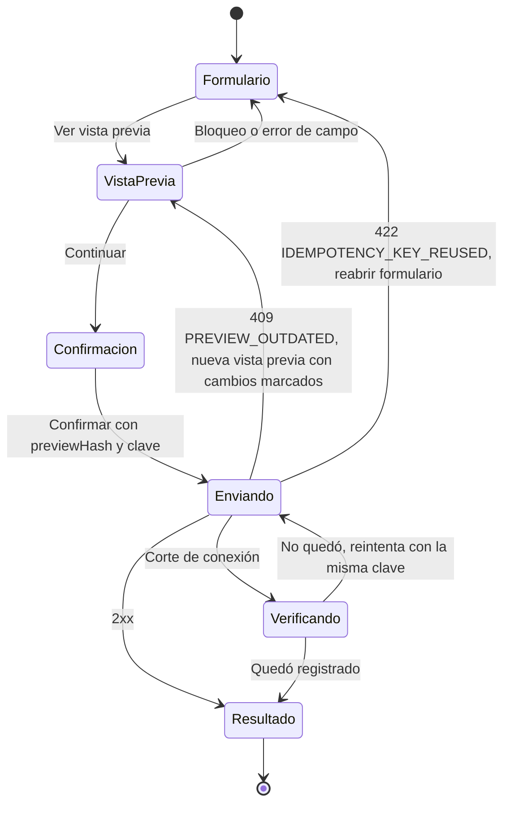

# Design system

Estado: **Aprobado** (aprobado por el líder del proyecto el 2026-11-08, cierre de la Etapa 1)
Responsable: disenador-ux
Aprobación: líder del proyecto

Base visual y de interacción de las cuatro superficies de ComVive: web de administración (administrador y comité), consola de plataforma (equipo ComVive), app residente (propietario y arrendatario) y modo conserjería (tablet, **Posterior**). Las reglas de negocio vienen de `docs/specs/gasto-comun.md` rev. 4 ("la spec"); este documento solo define cómo se ven y se comportan. Los wireframes que lo usan están en `wireframes/README.md`.

Convenciones de este documento:

- **Texto de la spec:** se copia tal cual desde la tabla "Códigos y mensajes de error" o desde F-17, sin variantes.
- **Texto del diseño:** texto propio de este documento o de los wireframes, sin respaldo en la spec. Va marcado así y queda registrado en `wireframes/README.md`, "Preguntas UX nuevas" (UX-50 en adelante).
- **Supuesto (a validar):** decisión de diseño que necesita confirmación del analista, del arquitecto o del líder.

## 1. Principios

1. **El dinero se entiende a la primera.** Cada monto dice de quién es ("Tu deuda", "Deuda del arrendatario {nombre}", "Deuda del propietario") y desde cuándo vence. Nunca se muestra un saldo neto que compense deudas de distinto responsable (F-9). La interfaz no calcula montos: todos vienen de la API.
2. **Una acción de dinero siempre muestra antes lo que va a pasar.** Emitir, corregir, anular, terminar un arriendo, vender y resolver un intento Webpay pasan por una vista previa con versión (A-7) y una confirmación con resumen.
3. **Densidad según la superficie.**
   - Web de administración: computador, mucha información, tablas con filtros y acciones masivas.
   - App residente: celular, sesiones de segundos; la deuda y "Pagar gasto común" se ven sin desplazar.
   - Conserjería (Posterior): tablet en portería, botones grandes y flujos de tres pasos o menos.
   - Consola de plataforma: mínima, solo lo que el rol necesita, todo auditado.
4. **Móvil primero en la app.** Se diseña para 360 px de ancho y se adapta hacia arriba. La web se diseña para 1280 px y funciona desde 1024 px.
5. **Accesible por defecto (WCAG 2.2 AA).** Contraste verificado, foco visible, estados que no dependen solo del color, objetivos táctiles de 44 px o más y compatibilidad con lectores de pantalla y texto ampliado.
6. **Español de Chile, simple y concreto.** "Pagar gasto común", no "Procesar transacción". Se trata de tú.
7. **Datos personales al mínimo.** RUT enmascarado salvo para el titular y el administrador; notificaciones sin montos en la pantalla bloqueada; ningún nombre en la consola de Soporte (Ley 21.719; spec, EX-1).
8. **Lo que el rol no puede hacer no se muestra.** El comité ve la web sin botones de acción; si igual llega a la API, ve el texto del 403 (spec, "Respuestas de error").

## 2. Superficies, tamaños y objetivos táctiles

| Superficie | Ancho de diseño | Mínimo soportado | Objetivo táctil o de clic | Tipografía base |
| --- | --- | --- | --- | --- |
| Web de administración | 1280 px | 1024 px | 44 px de alto en botones; 32 px en acciones dentro de filas de tabla (área de clic de al menos 24 × 24 px, WCAG 2.5.8) | 16 px; tablas 14 px |
| Consola de plataforma | 1280 px | 1024 px | Igual que la web | Igual que la web |
| App residente | 360 px | 320 px | 48 px de alto en botones principales; 44 × 44 px en todo elemento táctil | 16 px |
| Conserjería (Posterior) | 1024 px (tablet horizontal) | 768 px | 56 px en todo elemento táctil | 20 px |

- **Texto ampliado:** la app respeta el tamaño de texto del sistema hasta 200 %. Los montos grandes bajan de tamaño antes de cortarse y nunca se truncan: un monto se lee completo o pasa a la línea siguiente.
- **Zoom en la web:** al 200 % no aparece desplazamiento horizontal fuera de las tablas; las tablas se desplazan dentro de su contenedor con la primera columna fija.

## 3. Tokens

Los tokens se definen una vez y los usan la web (Next.js) y la app (React Native). El nombre es el mismo en las dos; cambia solo la forma de consumirlo (variables CSS en la web, objeto de tema en la app). **Supuesto (a validar):** los tokens viven en `packages/shared` como datos (sin componentes), cuando el paquete se cree en la Etapa 2.

### 3.1 Color

Los contrastes se calcularon con la fórmula de luminancia relativa de WCAG 2.2 y se redondearon hacia abajo. Mínimos: 4,5:1 para texto normal, 3:1 para texto grande (24 px, o 18,66 px en negrita) y para bordes de controles, íconos con significado y anillos de foco (WCAG 1.4.3 y 1.4.11).

**Base y texto**

| Token | Uso | Claro | Oscuro | Contraste (claro) | Contraste (oscuro) |
| --- | --- | --- | --- | --- | --- |
| `color.bg` | Fondo de la página | `#FFFFFF` | `#0F1720` | — | — |
| `color.surface` | Tarjetas, paneles, encabezado de tablas | `#F5F7FA` | `#17212B` | — | — |
| `color.surface.raised` | Hojas, diálogos, menús | `#FFFFFF` | `#1F2B37` | — | — |
| `color.text` | Texto principal y montos | `#1A2433` | `#E8EDF3` | 15,6:1 sobre `bg` | 15,3:1 sobre `bg`; 13,8:1 sobre `surface` |
| `color.text.muted` | Texto secundario, ayudas, fechas | `#4B5563` | `#A9B4C2` | 7,5:1 sobre `bg`; 7,0:1 sobre `surface` | 8,5:1 sobre `bg`; 7,7:1 sobre `surface` |
| `color.border` | Divisores decorativos | `#D9DEE5` | `#2C3946` | No aplica (decorativo) | No aplica |
| `color.border.strong` | Bordes de campos, casillas y radios | `#6B7785` | `#7D8A99` | 4,5:1 sobre `bg` | 5,1:1 sobre `bg`; 4,6:1 sobre `surface` |

**Acción**

| Token | Uso | Claro | Oscuro | Contraste |
| --- | --- | --- | --- | --- |
| `color.action` | Botón principal (fondo), enlaces, foco | `#0B5FA5` | `#6CB4F0` | Claro: 6,5:1 con texto `#FFFFFF` y sobre `bg`; 6,1:1 sobre `surface`. Oscuro: 8,1:1 con texto `#0F1720`; 7,3:1 sobre `surface` |
| `color.action.hover` | Botón principal al pasar el puntero o presionar | `#094C84` | `#93C7F4` | Más contraste que `color.action` en ambos modos |
| `color.action.on` | Texto sobre `color.action` | `#FFFFFF` | `#0F1720` | Ver fila anterior |
| `color.focus` | Anillo de foco de 2 px con 2 px de separación | `#0B5FA5` | `#6CB4F0` | 6,5:1 y 7,3:1 contra el fondo (mínimo 3:1) |
| `color.disabled.bg` / `color.disabled.text` | Controles desactivados | `#E3E7EC` / `#6B7785` | `#24303C` / `#7D8A99` | 3,6:1 (exentos por WCAG, pero legibles) |

**Estados semánticos generales**

| Token | Uso | Texto e ícono (claro) | Fondo (claro) | Contraste del texto sobre su fondo (claro) | Texto e ícono (oscuro) | Contraste sobre `surface.raised` (oscuro) |
| --- | --- | --- | --- | --- | --- | --- |
| `color.success` | Confirmaciones, "Listo" | `#1E7A3C` | `#E8F5EC` | 4,7:1 (5,3:1 sobre `bg`) | `#5FD18A` | 7,5:1 |
| `color.warning` | Advertencias que no bloquean | `#8A5300` | `#FFF4E0` | 5,8:1 (6,3:1 sobre `bg`) | `#F2B84B` | 8,0:1 |
| `color.danger` | Errores, bloqueos, acciones irreversibles | `#B42318` | `#FDECEA` | 5,7:1 (6,5:1 sobre `bg`) | `#FF8A80` | 6,3:1 |
| `color.info` | Información neutra, ayudas destacadas | `#0B5FA5` | `#E7F0FA` | 5,7:1 | `#6CB4F0` | 6,4:1 |
| `color.neutral` | Estados sin valoración (Borrador, Cancelada) | `#4B5563` | `#EEF1F5` | 6,6:1 | `#A9B4C2` | 6,8:1 |

**Estados de deuda** (chip de estado y tarjeta de deuda; sección 5.6)

| Estado | Token | Texto e ícono (claro) | Fondo (claro) | Contraste (claro) | Texto e ícono (oscuro) | Contraste (oscuro, sobre `surface.raised`) | Ícono |
| --- | --- | --- | --- | --- | --- | --- | --- |
| Al día | `color.debt.paid` | `#1E7A3C` | `#E8F5EC` | 4,7:1 | `#5FD18A` | 7,5:1 | `circle-check` |
| Por vencer | `color.debt.due` | `#8A5300` | `#FFF4E0` | 5,8:1 | `#F2B84B` | 8,0:1 | `clock` |
| Vencida | `color.debt.overdue` | `#B42318` | `#FDECEA` | 5,7:1 | `#FF8A80` | 6,3:1 | `circle-alert` |
| Saldo a favor | `color.debt.credit` | `#0E6E6E` | `#E6F4F4` | 5,3:1 (6,0:1 sobre `bg`) | `#4FD1C5` | 7,7:1 | `piggy-bank` |
| En revisión | `color.debt.review` | `#5B3FA0` | `#F0ECFA` | 6,7:1 (7,8:1 sobre `bg`) | `#B9A6F5` | 6,7:1 | `search-check` |

- **Nunca solo color:** cada estado lleva su ícono y su texto. En escala de grises se distinguen por el texto y el ícono.
- **Montos:** el monto de una deuda va siempre en `color.text`, no en el color del estado. El color va en el chip y en el borde izquierdo de 4 px de la tarjeta. Así el número mantiene el máximo contraste.
- **Oscuro:** en modo oscuro los chips usan `color.surface.raised` de fondo, el texto del estado y un borde de 1 px del mismo color.

### 3.2 Tipografía

- **Familia:** Inter en web, consola y app (en la app se carga con `expo-font`); respaldo `system-ui`, `-apple-system`, `Segoe UI`, `Roboto`, `sans-serif`. **Supuesto (a validar):** licencia SIL Open Font License, sin costo.
- **Cifras tabulares** (`font-variant-numeric: tabular-nums` en la web, `fontVariant: ['tabular-nums']` en la app) en todo monto, fecha, RUT y número de orden, para que las columnas se alineen.
- **Pesos:** 400 (regular), 600 (semibold) y 700 (bold, solo montos grandes).

| Token | Web y consola (tamaño/interlínea, peso) | App (tamaño/interlínea, peso) | Uso |
| --- | --- | --- | --- |
| `type.amount.xl` | 32/40, 700 | 40/48, 700 | Monto principal: deuda en Inicio de la app, total de una vista previa |
| `type.amount.lg` | 24/32, 600 | 28/36, 600 | Montos destacados secundarios |
| `type.h1` | 24/32, 600 | 22/28, 600 | Título de pantalla |
| `type.h2` | 20/28, 600 | 18/24, 600 | Título de sección o de tarjeta |
| `type.h3` | 16/24, 600 | 16/24, 600 | Subtítulo, encabezado de tabla |
| `type.body` | 16/24, 400 | 16/24, 400 | Texto y formularios |
| `type.body.sm` | 14/20, 400 | 14/20, 400 | Filas de tabla, texto secundario |
| `type.caption` | 12/16, 400 | 13/18, 400 | Metadatos (quién registró, hora). Nunca un dato que haga falta para decidir |
| `type.button` | 16/24, 600 | 17/24, 600 | Botones |

Conserjería (Posterior): `type.body` 20/28 y `type.button` 20/28, 600.

### 3.3 Espaciado

Escala de 4 px. Los componentes usan solo estos valores.

| Token | Valor | Uso típico |
| --- | --- | --- |
| `space.0` | 0 | — |
| `space.1` | 4 px | Separación entre ícono y texto en chips |
| `space.2` | 8 px | Entre etiqueta y campo; celdas compactas |
| `space.3` | 12 px | Relleno vertical de filas de tabla |
| `space.4` | 16 px | Relleno de tarjetas en la app; margen lateral de la app |
| `space.5` | 24 px | Relleno de tarjetas y paneles en la web; entre grupos de campos |
| `space.6` | 32 px | Entre secciones |
| `space.7` | 48 px | Separación mayor; margen del área de trabajo en la web |
| `space.8` | 64 px | Estados vacíos |

- **Rejilla web:** menú lateral de 240 px, área de trabajo fluida con 12 columnas y medianiles de 24 px; paneles laterales (formularios) de 480 px.
- **Rejilla app:** una columna con margen lateral de 16 px; botón principal a todo el ancho.

### 3.4 Radios

| Token | Valor | Uso |
| --- | --- | --- |
| `radius.sm` | 4 px | Campos, casillas, chips de tabla |
| `radius.md` | 8 px | Botones, tarjetas de la web, banners |
| `radius.lg` | 16 px | Tarjetas de deuda de la app, diálogos |
| `radius.sheet` | 16 px en las esquinas superiores | Hoja inferior de la app |
| `radius.full` | 999 px | Chips de estado, avatar |

### 3.5 Elevación

| Token | Claro | Oscuro | Uso |
| --- | --- | --- | --- |
| `elevation.0` | Sin sombra, borde `color.border` | Sin sombra, borde `color.border` | Tablas, tarjetas de la web |
| `elevation.1` | `0 1px 2px rgba(16,24,40,0.08)` | Fondo `color.surface` | Tarjetas de la app |
| `elevation.2` | `0 4px 12px rgba(16,24,40,0.12)` | Fondo `color.surface.raised` | Menús, panel lateral |
| `elevation.3` | `0 12px 32px rgba(16,24,40,0.18)` y velo `rgba(15,23,32,0.5)` | Fondo `color.surface.raised` y velo `rgba(0,0,0,0.6)` | Diálogos y hoja inferior |

En modo oscuro la profundidad se expresa con superficies más claras, no con sombras.

### 3.6 Movimiento

- Duraciones: 120 ms (cambios de estado), 200 ms (paneles y hojas), 0 ms si la persona activó "reducir movimiento" (`prefers-reduced-motion` en la web, `AccessibilityInfo.isReduceMotionEnabled` en la app).
- Nada parpadea ni se mueve solo más de 5 segundos (WCAG 2.2.2).
- Los esqueletos de carga usan un pulso de opacidad, no un barrido, y se detienen con "reducir movimiento".

### 3.7 Modo oscuro

- **Supuesto (a validar), UX-57:** la app y la web siguen la preferencia del sistema operativo o del navegador; no hay selector propio en el MVP.
- Todos los tokens de color tienen su valor oscuro (tablas anteriores), con contraste verificado.
- Los PDF (aviso de cobro y comprobante del arrendatario) se generan siempre en modo claro.
- Las imágenes y logos de la comunidad se muestran sobre una placa `color.surface` para no perder contraste.

## 4. Formatos

Los formatos los aplica la capa de presentación; la API entrega enteros y fechas ISO. Las funciones de formato son las mismas en web y app. **Supuesto (a validar):** viven en `packages/shared` y tienen pruebas unitarias con los ejemplos de esta sección.

### 4.1 Dinero (CLP)

| Caso | Se muestra | Nota |
| --- | --- | --- |
| Monto positivo | `$1.234.567` | Signo peso pegado, punto como separador de miles, sin decimales ni "CLP" |
| Cuatro dígitos | `$1.234` | Siempre agrupado. No usar `Intl.NumberFormat('es')` sin verificar: en algunos motores el español no agrupa números de cuatro dígitos |
| Cero | `$0` | — |
| Negativo | `−$1.234` | Signo menos tipográfico (U+2212) antes del signo peso. Para lectores de pantalla: "menos 1.234 pesos" |
| Nota de crédito en una vista previa de ajustes | `−$2.000` | Igual que un negativo (CA-13) |
| Saldo de caja o del fondo negativo | `−$350.000` | Texto de la spec: "Saldo de caja al 31-10-2026: −$350.000" (G-4, CA-58) |

- La API entrega enteros (`bigint` en el servidor; en JSON, el formato que fije la arquitectura). La interfaz **nunca** convierte a decimales ni hace aritmética con montos: no suma, no resta, no reparte. La única excepción es el control visual "Total del pago" del pago manual con "Ambos", que suma lo escrito por el administrador y no es un cálculo de deuda (`flujos/admin-pago-manual.md`).
- **Alineación:** en tablas, los montos van alineados a la derecha con cifras tabulares.
- **Campo de monto:** ver 5.2, "Campo de monto".

### 4.2 Fechas, horas y periodos

| Dato | Formato | Ejemplo |
| --- | --- | --- |
| Fecha | `dd-mm-aaaa` | `11-11-2026` |
| Fecha y hora | `dd-mm-aaaa hh:mm`, 24 horas, hora de Chile (`America/Santiago`) | `05-12-2026 10:05` |
| Periodo en texto corrido | mes en minúscula y año | `octubre 2026` |
| Periodo como código (donde la spec escribe `<AAAA-MM>` o `AAAA-MM`) | `AAAA-MM` | `2026-10` |
| Periodo como título | mes con mayúscula inicial y año | `Octubre 2026` |

- **UX-59 (cerrada, spec rev. 6, G-6 y S-60):** `<periodo>` y `{mes}` en los textos de la spec se muestran como "octubre 2026"; `<AAAA-MM>` se muestra como código. La spec usa el mismo formato, también en la notificación de G-6 (CA-38 y CA-45).
- **Medio de pago (spec F-17, S-61):** con mayúscula inicial como elemento de la línea de un pago ("Transferencia"); en minúscula dentro de una frase ("por transferencia"), salvo "Webpay".
- **Campo de fecha:** se escribe o se elige en un calendario; acepta `dd-mm-aaaa` y `dd/mm/aaaa` y siempre muestra `dd-mm-aaaa`. Donde la spec prohíbe fechas futuras (fecha de pago, fecha de corte, término y venta), el calendario no permite elegir días posteriores a hoy, y si se escribe una, el campo muestra el error de la spec.

### 4.3 RUT

| Caso | Formato | Ejemplo |
| --- | --- | --- |
| Completo (solo el titular y el administrador) | Puntos, guion y dígito verificador; `K` mayúscula | `12.345.670-K` |
| Enmascarado (comité, propietario que ve a terceros, todo PDF) | Se ocultan los tres últimos dígitos del cuerpo y el dígito verificador | `12.345.***-*` |

- **Supuesto (a validar), UX-53:** con cuerpos de siete dígitos, `9.876.***-*`. El enmascarado lo hace la API: los campos que el rol no ve no viajan (spec, "Datos de copropietarios que ve el comité").
- **Campo de RUT:** acepta el RUT con o sin puntos y guion, en mayúsculas o minúsculas, y lo muestra formateado al salir del campo. El dígito verificador se valida al salir del campo; el error es el de la spec: "Ingresa un RUT válido. Revisa el dígito verificador".

### 4.4 Porcentajes y otros

| Dato | Formato | Ejemplo |
| --- | --- | --- |
| Alícuota | Cuatro decimales con coma | `18,5000 %` |
| Suma de alícuotas | Cuatro decimales con coma | `99,9900 %` |
| Fondo de reserva | Dos decimales con coma | `5,00 %` |
| Número de orden Webpay | Tal como lo entrega la API, en cifras tabulares | `OC-2026-0002` |
| Código de unidad | Tal como lo registra la comunidad | `Depto 101` |

## 5. Componentes

Cada componente tiene el mismo nombre y las mismas propiedades en la web (React, Next.js) y en la app (React Native). Cuando el comportamiento cambia según la plataforma, se indica en "Web" y "App". No hay componentes de conserjería en el MVP.

### 5.1 Botón (`Button`)

| Variante | Uso | Estilo |
| --- | --- | --- |
| `primary` | La acción principal de la pantalla (una por vista) | Fondo `color.action`, texto `color.action.on` |
| `secondary` | Acciones alternativas | Fondo transparente, borde y texto `color.action` |
| `danger` | Acciones irreversibles que quitan o anulan (anular pago, anular gasto, revocar rol, cerrar periodo) | Fondo `color.danger`, texto `#FFFFFF` (6,5:1) |
| `ghost` | Acciones terciarias y de tabla | Sin fondo ni borde, texto `color.action` y subrayado al enfocar |

- **Tamaños:** `lg` 48 px (app, botón principal), `md` 44 px (por defecto), `sm` 32 px (solo dentro de filas de tabla de la web).
- **Estados:** normal, al pasar el puntero, presionado, con foco (anillo `color.focus`), **cargando** (indicador y texto en gerundio, por ejemplo "Guardando…"; no admite otro clic ni toque) y desactivado.
- **Desactivado con motivo:** si una acción existe pero no se puede usar, el botón va desactivado y el motivo se muestra como texto visible debajo, no solo en un tooltip (por ejemplo, "Un pago que cubre dos deudas solo se puede marcar para reverso" en la consola).
- **Texto:** verbo en infinitivo y objeto ("Emitir periodo", "Registrar pago", "Pagar ${monto}").
- **Web:** `<button>` nativo; nunca un `div` clicable. **App:** `Pressable` con `accessibilityRole="button"` y `accessibilityState` (`disabled`, `busy`).

### 5.2 Campos (`TextField` y familia)

Anatomía común, de arriba abajo: **etiqueta** (siempre visible, nunca solo marcador de posición), **ayuda** (opcional, `color.text.muted`), **control**, **error** (texto `color.danger` con ícono `circle-alert`). El error reemplaza a la ayuda solo si la ayuda no es necesaria para corregirlo; si lo es, se muestran ambos.

- **Obligatorio:** la etiqueta dice "(obligatorio)" en texto, no solo con un asterisco.
- **Cuándo se valida:** formato al salir del campo; reglas de negocio con la respuesta de la API. Los errores de la API con campo se muestran en ese campo con el texto de la spec; los que no tienen campo, en un banner de error arriba del formulario.
- **Al enviar con errores:** el foco va al primer campo con error y un resumen arriba enlaza a cada uno (WCAG 3.3.1).
- **Accesibilidad:** la ayuda y el error se asocian al control (`aria-describedby` en la web; `accessibilityHint` y anuncio con `AccessibilityInfo.announceForAccessibility` en la app). El error se anuncia al aparecer.

**Variantes:**

| Componente | Comportamiento | Errores de la spec que muestra |
| --- | --- | --- |
| `MoneyField` | Solo dígitos, máscara de miles mientras se escribe (`1.050.000`), signo `$` fijo a la izquierda. No acepta coma, punto decimal ni signo. Teclado numérico en la app. Envía un entero en pesos. Rechaza 0 en el campo | "El monto debe ser un número entero de pesos mayor que $0"; "El monto supera el máximo permitido de $9.999.999.999" |
| `MoneyField` con `allowZero` | Igual, pero acepta $0. Solo en el monto correcto de una corrección (gasto o egreso del fondo), donde $0 anula (B-5, H-6, B-3) | "El monto correcto debe ser un número entero de pesos, mayor o igual que $0. Usa $0 solo para anular" |
| `SignedMoneyField` | Campo de monto que acepta $0 más un selector "Saldo positivo / Saldo negativo (sobregiro)". Solo para el saldo de caja (G-4) | "Ingresa el saldo de caja y su fecha de corte. Puede ser $0"; "El monto supera el máximo permitido de $9.999.999.999" |
| `DateField` | Ver 4.2. Con `maxToday` no permite fechas futuras | Según el uso: "La fecha de pago no puede ser futura", "La fecha de corte no puede ser futura", "Registra el término el día que ocurra", "Registra la venta el día que ocurra" |
| `RutField` | Ver 4.3 | "Ingresa un RUT válido. Revisa el dígito verificador" |
| `ReasonField` | Área de texto para motivos y referencias. Ayuda fija "No incluyas datos personales" en todo texto libre que aparece en avisos o auditoría | "Indica el motivo de la anulación", "Indica el motivo de la corrección", "Indica el motivo de la cancelación", "Indica el motivo de la resolución", "Indica el motivo de tu decisión" |
| `RadioGroup` sin valor por defecto | Opciones excluyentes en tarjetas, sin opción marcada al abrir. Se usa en "Aplicar a la deuda de" y en las decisiones de la tarea de comité | "Elige a qué deuda aplicar el pago" |
| `SearchField` | Búsqueda con resultados al escribir (unidad por código, propietario por nombre o unidad, número de orden) | Según la pantalla |
| `Select` | Lista cerrada (cuenta, subcategoría, base, medio de pago) | — |

**Ayudas fijas de la spec que usan los campos:**

- Motivo de corrección o anulación de un gasto o egreso del fondo: "El motivo aparecerá en el aviso de cobro" (H-7) y, además, "No incluyas datos personales".
- Concepto de un gasto: "Aparece en el resumen que ven los residentes. No incluyas nombres de personas" (texto del flujo `admin-emitir-cerrar-periodo.md`).

### 5.3 Monto (`Money`)

Muestra un monto con el formato de 4.1. Propiedades: `value` (entero que entrega la API), `size` (`xl`, `lg`, `md`, `sm`), `tone` (siempre `color.text`; `muted` para montos de referencia). En la app, `accessibilityLabel` lee el monto en palabras ("262.500 pesos"; "menos 10.500 pesos"). Nunca recibe un número decimal.

### 5.4 Tabla de movimientos (`DataTable`)

Tabla de la web para gastos, cargos, pagos, cuentas por unidad, vistas previas y listas de la consola.

- **Encabezado** fijo al desplazar, con orden por columna (ícono `arrow-up-down` y `aria-sort`).
- **Columnas de monto** alineadas a la derecha; **columnas de fecha** en `dd-mm-aaaa`; primera columna (unidad o concepto) fija al desplazar horizontalmente.
- **Fila de totales** al pie, con la suma **que entrega la API** (nunca sumada en la pantalla), en `type.h3`.
- **Filas especiales:**
  - **Anulado:** chip "Anulado" (neutral), motivo visible y monto original tachado (`text-decoration: line-through`), con texto para lectores de pantalla "monto original, anulado".
  - **Cambió** (después de un 409 `PREVIEW_OUTDATED`): borde izquierdo `color.warning` y chip "Cambió" (texto del diseño, UX-61) en las filas y totales que cambiaron respecto de la vista previa anterior (UX-56).
  - **Ajuste o traspaso:** el rótulo de la spec en la columna Concepto ("Ajuste periodo AAAA-MM: motivo", "Traspaso desde arriendo terminado el {dd-mm-aaaa}", "Saldo a favor traspasado desde arriendo terminado el {dd-mm-aaaa}").
- **Selección para acciones masivas:** casilla en la primera columna y barra de acciones que aparece arriba de la tabla con el número de filas elegidas ("3 avisos seleccionados · Reenviar"). Solo en las tablas donde la IA lo define (reenviar avisos, enviar invitaciones).
- **Filtros** arriba de la tabla, como chips quitables; búsqueda por código de unidad.
- **Densidad:** filas de 44 px por defecto; 36 px en modo compacto (opción de la tabla, recordada por persona).
- **Estados:** carga (esqueleto de 5 filas con las columnas reales), vacío (componente 5.13 dentro de la tabla, con el texto del flujo) y error (banner de error dentro del contenedor con "Reintentar").
- **Accesibilidad:** `<table>` real con `<th scope>`; la acción de cada fila nombra la fila ("Corregir: Electricidad octubre").
- **App:** no hay tablas. Los movimientos se muestran como **lista de movimientos** (5.5).

### 5.5 Lista de movimientos (`MovementList`, app)

Cada fila tiene: rótulo (concepto o tipo de pago) y fecha a la izquierda; monto a la derecha; debajo, la etiqueta de quién pagó (5.7) o el chip de estado. Filas de al menos 56 px de alto; toda la fila es el objetivo táctil cuando abre un detalle. Agrupadas por periodo con encabezado ("Noviembre 2026").

### 5.6 Chip de estado (`StatusChip`)

Ícono + texto en `type.caption` semibold, `radius.full`, alto 24 px (28 px en la app). Nunca se usa solo color.

| Grupo | Estados (texto exacto) | Tono | Origen del texto |
| --- | --- | --- | --- |
| Deuda | "Al día", "Por vencer", "Vencida", "Saldo a favor" | `debt.paid`, `debt.due`, `debt.overdue`, `debt.credit` | Texto del diseño (UX-54, UX-63) |
| Pago en revisión | "En revisión por ComVive" | `debt.review` | Spec, F-17 |
| Periodo | "Borrador", "Emitido", "Cerrado" | `neutral`, `info`, `success` | IA, "Estados del periodo" |
| Pago (web) | "Registrado", "Anulado" | `success`, `neutral` | Texto del diseño (UX-61) y flujo |
| Intento Webpay (web y consola) | "En revisión", "Para reverso", "Registrado", "Reversado", "Sin cobro", "Plazo vencido" | `review`, `warning`, `success`, `neutral`, `neutral`, `danger` | Flujo `plataforma-soporte-webpay.md` ("Plazo vencido" es de la spec, F-16; "Sin cobro" es texto del diseño para `rejected` por `resolve_without_charge`, UX-61) |
| Aviso PDF | "Generando", "Listo", "Error al generar" | `neutral`, `success`, `danger` | Flujo `admin-emitir-cerrar-periodo.md` |
| Ocupación | "Vigente", "Programado: comienza el {dd-mm-aaaa}", "Terminada", "Cancelada", "Propietario sin registrar" | `success`, `info`, `neutral`, `neutral`, `warning` | Flujo `admin-ocupaciones.md` y texto del diseño ("Vigente", "Terminada", UX-61) |
| Gasto | "Anulado" | `neutral` | Spec, H-6 |
| Invitación | "Pendiente", "Activo" | `warning`, `success` | Flujo `admin-usuarios-y-roles.md` |

**Regla de estado de una deuda** (Supuesto (a validar), UX-54): el chip se elige con los campos que entrega la API para el ámbito, sin calcular montos: "Vencida" si hay monto vencido mayor que $0; si no, "Por vencer" si hay monto por vencer mayor que $0; si no, "Saldo a favor" si hay saldo a favor mayor que $0; si no, "Al día". "En revisión por ComVive" es un chip adicional, del pago, que aparece junto al de la deuda cuando la persona tiene un intento propio en `in_review`; la deuda no cambia mientras tanto (F-16).

### 5.7 Etiqueta de quién pagó (`PayerLabel`)

Traduce `payerKind` a los textos de F-17, sin variantes:

| `payerKind` | Texto |
| --- | --- |
| `self` | "Pagado por ti" |
| `owner` | "Pagado por el propietario" |
| `tenant` | "Pagado por el arrendatario" |
| `administration` | "Registrado por la administración" |
| nulo | Sin etiqueta: solo monto, fecha y medio (S-51, CA-63) |

Formato de la línea completa (flujo `residente-estado-de-cuenta-y-pago.md`): "{etiqueta} · ${monto} · {dd-mm-aaaa} · {medio}". El separador es un punto medio con espacios. Para lectores de pantalla, los puntos medios se leen como comas.

### 5.8 Tarjeta de deuda por ámbito (`DebtCard`)

Responde en una mirada: de quién es la deuda, cuánto es, desde o hasta cuándo, y si se puede pagar.

```text
+---------------------------------------+
| [borde de estado]                     |
| Tu deuda                  [Vencida]   |  <- título por ámbito + chip
| $266.814                              |  <- type.amount.xl
| Vencido desde 11-11-2026: $264.139    |
| Por vencer el 11-01-2027: $2.675      |
| > Ver detalle                         |  <- desglose o pantalla de detalle
+---------------------------------------+
```

- **Título según el ámbito** (F-9): "Tu deuda" (propietario, ámbito `owner`), "Tu gasto común" (arrendatario, su ámbito), "Deuda del arrendatario {nombre}" (propietario con arrendatario vigente). En la web: "Deuda del propietario" y "Deuda del arrendatario".
- **Una tarjeta por ámbito.** Nunca hay una tarjeta ni una línea que sume o compense ámbitos (F-9, M1). Entre dos tarjetas no hay un total.
- **Cuerpo según el estado:** con deuda, monto y las líneas "Vencido desde {dd-mm-aaaa}: ${monto}" y "Por vencer el {dd-mm-aaaa}: ${monto}" (solo las que tengan monto). Sin deuda, el texto del estado vacío del flujo ("Estás al día…", "Tienes ${monto} a favor…").
- **Estado de pago en la tarjeta** (F-17), debajo del monto, en una franja `color.surface`:
  - Intento propio en `initiated`: "Tienes un pago en proceso" y debajo "Número de orden {buy_order}. Te avisaremos el resultado".
  - Intento propio en `in_review`: chip "En revisión por ComVive" y debajo "Te avisaremos cuando se resuelva. Número de orden {buy_order}".
  - Intento propio en `reversal_pending`: "Tu pago no se registró. Se solicitará la devolución del monto a Transbank".
  - Intento propio en `reversal_pending` con cobro ya devuelto (Transbank ya informaba `REVERSED` o `NULLIFIED` y ComVive no pidió reembolso): "Tu pago no se registró. Transbank ya devolvió el monto" (decisión del líder D8, 2026-11-07; se elige por `reversalKind = already_returned`, spec S-67).
  - Intento propio en `reversed`: "Tu pago fue anulado en Transbank. El reembolso a tu medio de pago depende de tu banco".
  - Intento propio en `rejected` con `rejectionKind = resolved_without_charge` (Soporte lo resolvió sin cobro): "Tu pago no se completó. No se hizo ningún cargo" (F-17, S-59).
  - Intento propio en `rejected` con `rejectionKind = transbank_rejected`: "Tu banco rechazó el pago. No se hizo ningún cargo".
  - Intento propio en `abandoned` (cancelado, sin conexión con Webpay al iniciar, o formulario expirado que Transbank informó sin cobro tras la consulta previa de D18): "Pago cancelado. No se hizo ningún cargo" (texto del diseño, UX-69 aprobado, D15).
  - La app elige el texto de `rejected` por `rejectionKind` y el de `reversal_pending` por `reversalKind`; nunca lo deduce. Un texto por caso, sin variantes ni punto final (M-6, rev. 4).
- **Aviso de intereses** (E-8, solo con el flag `billing.interest`): banner `warning` dentro de la tarjeta con "Tu deuda está vencida. Se pueden generar intereses hasta la fecha de tu pago, que se cobrarán en el próximo aviso".
- **Accesibilidad:** la tarjeta es una región con título (`aria-labelledby` o `accessibilityRole="summary"`); el lector lee título, estado, monto y vencimientos en ese orden.
- **Web:** se usa en el estado de cuenta de la unidad y en la pestaña Ocupantes, en versión compacta (sin `type.amount.xl`).

### 5.9 Hoja de pago (`PaymentSheet`, app)

Hoja inferior "¿Qué quieres pagar?" (flujo `residente-estado-de-cuenta-y-pago.md`, paso 3). Ver `wireframes/app-hoja-de-pago.md`.

- Asa visible, título, opciones como `RadioGroup` de tarjetas de 64 px de alto, botón principal fijo al pie ("Pagar ${monto}") desactivado hasta elegir.
- Cada opción muestra el monto que entrega la API para esa opción, incluido el de "Ambas"; la app no suma.
- Una opción no disponible se muestra desactivada con su motivo visible ("Tienes un pago en proceso" o "Ya hay un pago en proceso para esta deuda").
- Se cierra deslizando hacia abajo, con "Cerrar" y con el gesto atrás de Android. Al abrirse, el foco va al título; al cerrarse, vuelve al botón "Pagar gasto común".

### 5.10 Vista previa con confirmación (`PreviewConfirm`)

Patrón para toda acción que la spec confirma contra una vista previa (A-7): emitir, corregir o anular un gasto o egreso del fondo, anular un grupo de pagos, registrar un arrendatario, terminar un arriendo, registrar una venta o un propietario faltante, y resolver un intento Webpay. Detalle en la sección 6.1.

Partes:

1. **Formulario** con los datos de entrada.
2. **Vista previa** (botón `secondary` "Ver vista previa"): pide a la API la vista previa; muestra bloqueos (banner `danger`), advertencias (banner `warning`) y el resultado (tabla o lista), todo como lo entrega la API.
3. **Confirmación** (diálogo con el resumen de la spec o del flujo y el botón `primary` o `danger` con el verbo de la acción). Al abrirse genera la clave de idempotencia.
4. **Envío** con `previewHash` y clave de idempotencia. El botón pasa a "cargando".
5. **Resultado:** banner `success` en la pantalla de destino, o el comprobante.

**Respuesta 409 `PREVIEW_OUTDATED`:** el diálogo se cierra, aparece arriba un banner `warning` con el mensaje de la spec para esa acción, la pantalla pide sola una vista previa nueva, marca con "Cambió" lo que cambió y vuelve a pedir confirmación. No se reintenta automáticamente.

| Acción | Mensaje del 409 (spec, A-7 y F-16) |
| --- | --- |
| Emitir | "El borrador cambió desde la vista previa. Revisa la nueva vista previa antes de emitir" |
| Anular un grupo de pagos | "La cuenta de la unidad cambió desde la vista previa. Revisa la nueva vista previa antes de anular" |
| Corregir o anular un gasto o un egreso del fondo | "El gasto cambió desde la vista previa. Revisa la nueva vista previa antes de confirmar" |
| Terminar un arriendo o registrar una venta | "La cuenta de la unidad cambió desde la vista previa. Revisa la nueva vista previa antes de confirmar" |
| Registrar un arrendatario | Sin texto en la spec. Supuesto (a validar), UX-55: el mismo de término y venta |
| Resolver un intento (la huella cambió) | "El intento cambió desde la vista previa. Revisa la nueva vista previa antes de resolver" |
| Resolver un intento (la resolución no corresponde al estado) | "Esta resolución no corresponde al estado actual del intento. Revisa la nueva vista previa" |

### 5.11 Banner de alerta (`AlertBanner`)

Franja con ícono, título opcional, texto y hasta dos acciones.

| Tono | Ícono | Uso | ¿Se puede cerrar? |
| --- | --- | --- | --- |
| `info` | `info` | Contexto ("Se registrará en el periodo en borrador {mes}…") | Sí, salvo que sea un aviso fijo del flujo |
| `success` | `circle-check` | Resultado de una acción | Sí; se queda hasta que la persona lo cierra o navega (no desaparece solo) |
| `warning` | `triangle-alert` | Advertencias que no bloquean (posible duplicado, fecha pasada, saldo del fondo negativo, 409) | No mientras la condición siga |
| `danger` | `circle-alert` | Bloqueos y errores sin campo | No |

- Los banners que aparecen después de cargar la pantalla se anuncian (`role="status"` para `info` y `success`; `role="alert"` para `warning` y `danger`; en la app, `announceForAccessibility`).
- No se usan avisos que desaparecen solos para resultados de dinero. La única excepción es la conserjería (Posterior), que vuelve al inicio tras 3 segundos.

### 5.12 Tarea pendiente (`TaskCard`)

Alerta fija arriba de Inicio en la web, solo para el administrador (M-7, CA-57).

- Fondo `color.surface`, borde izquierdo de 4 px `color.warning`, ícono `user-round-cog`.
- Título con el texto de la spec: "Revisar rol de comité de {nombre}". Metadatos: fecha de la venta y quién la registró. Botón `primary` `md` "Decidir".
- **No tiene botón de cerrar ni de posponer.** Desaparece solo cuando la tarea se cierra.
- Varias tareas se apilan en un bloque "Tareas pendientes" con el número en el título ("Tareas pendientes (2)").
- Al comité y a los residentes no se les muestra el bloque (la API responde 404).

### 5.13 Estado vacío (`EmptyState`)

Ícono de línea de 48 px en `color.text.muted`, una frase que explica qué falta y, si el rol puede hacer algo, una sola acción. Los textos están en cada flujo y wireframe ("Aún no hay gastos en este periodo." con "Agregar gasto"). Sin ilustraciones decorativas en el MVP.

### 5.14 Carga (`Skeleton` y `LoadingOverlay`)

- **Esqueleto** con la forma real del contenido (bloques de tarjetas, filas de tabla con sus columnas). Se muestra después de 300 ms para no parpadear.
- **Con copia local en la app:** se muestran primero los datos guardados con el texto "Actualizando…" (flujo del residente) en lugar del esqueleto.
- **Bloqueante** solo en emitir ("Emitiendo periodo… no cierres esta ventana") y al volver de Webpay ("Confirmando tu pago…").
- Lectores de pantalla: la región en carga lleva `aria-busy="true"` y se anuncia "Cargando" una sola vez.

### 5.15 Estados de error (`ErrorState`)

Pantalla o bloque completo para respuestas que no son de un campo. Textos de la spec, iguales en web, app y consola:

| Respuesta | Título | Texto | Acción |
| --- | --- | --- | --- |
| 404 `NOT_FOUND` | — | "No encontramos lo que buscas o no tienes acceso" | "Volver al inicio" (texto del diseño, UX-64) |
| 403 `FORBIDDEN` | — | "Tu rol no permite esta acción" | Se muestra como banner `danger` en la misma pantalla; no cambia de pantalla |
| Sin conexión (app) | — | "Sin conexión. Mostramos tus datos del {dd-mm} a las {hh:mm}." (flujo del residente) | Muestra la copia local y desactiva "Pagar" |
| Error inesperado | — | "No se pudo completar la acción. Intenta de nuevo." (texto del flujo de Soporte, usado en todas las superficies; UX-64) | "Reintentar" |

- El 404 nunca dice si el recurso existe. No muestra el identificador pedido ni el nombre de la comunidad.
- El 403 aparece solo si una acción llega a la API pese a no mostrarse (el botón no existe para ese rol).
- Ícono: `search-x` para 404, `lock` para 403, `wifi-off` sin conexión, `circle-alert` error inesperado.

### 5.16 Diálogo de confirmación (`ConfirmDialog`)

Diálogo modal con título, resumen (texto de la spec o del flujo), detalle opcional y dos botones: cancelar (`secondary`, a la izquierda) y confirmar (`primary` o `danger`, a la derecha, con el verbo de la acción). El foco queda atrapado dentro; `Esc` cierra salvo mientras envía. Para acciones irreversibles sin vista previa de montos (cerrar periodo), pide escribir el periodo (`2026-10`) para habilitar el botón (flujo `admin-emitir-cerrar-periodo.md`).

### 5.17 Encabezado y navegación

- **Web:** barra superior de 64 px con el logo, el **selector de comunidad** (nombre siempre visible, IA "Comunidad activa"), "Mi cuenta" y "Cerrar sesión". Menú lateral de 240 px con el árbol de la IA; el comité ve el mismo menú sin las pantallas "Solo admin".
- **App:** barra inferior con 4 pestañas (Inicio, Pagos, Cobros, Más), íconos con texto siempre visible, objetivo de 48 px. El título de cada pantalla incluye la comunidad y, si hay varias, el selector de unidad.
- **Consola:** barra superior propia con "ComVive · Consola de plataforma" y el rol de la sesión; sin selector de comunidad.

### 5.18 Comprobante (`Receipt`)

Resumen del resultado de un pago (manual en la web; Webpay en la app). Encabezado con el monto (`type.amount.lg`), unidad y fecha; cuerpo por ámbito ("Tu deuda ${monto}", "Deuda del arrendatario ${monto}" en la app; "Deuda del propietario" y "Deuda del arrendatario" en la web) con lo que entrega la API. En la app, "Compartir comprobante" usa la hoja de compartir del sistema.

## 6. Patrones

### 6.1 Acciones con vista previa, versión e idempotencia



- La clave de idempotencia se genera al abrir la confirmación (o al abrir el formulario, en el pago manual; F-2) y se conserva hasta un resultado final.
- **Corte de conexión:** la pantalla muestra "Revisando si…" con el texto del flujo de cada acción y consulta el estado antes de permitir reintentar.
- **Doble clic:** el botón pasa a "cargando" al primer clic.

### 6.2 Permisos en pantalla

| Marca de la IA | Comité ve | Residente ve |
| --- | --- | --- |
| (A) acción solo del administrador | La pantalla, sin el botón | — |
| (Solo admin) pantalla | No está en su menú; por ruta directa, `ErrorState` 404 | — |
| Recurso que el rol no ve | `ErrorState` 404 | `ErrorState` 404 |

### 6.3 Sin conexión y copia local (app)

- Banner `info` fijo arriba con el texto de sin conexión; montos con su fecha de actualización; "Pagar gasto común" desactivado con el motivo visible "Necesitas conexión para pagar" (texto del diseño, UX-63).
- La copia local se borra al cerrar sesión, al perder el acceso y tras 30 días sin sincronizar (arquitectura §5).

### 6.4 Notificaciones

Sin montos ni unidad en la pantalla bloqueada. Los textos son los de la spec (G-6 para avisos; "Comité que deja de ser propietario" para la tarea) o los del flujo correspondiente.

## 7. Iconografía

- **Librería:** Lucide (licencia ISC), `lucide-react` en la web y `lucide-react-native` en la app, trazo de 2 px. **Supuesto (a validar).**
- **Tamaños:** 16 px en tablas y chips, 20 px en botones y campos, 24 px en navegación, 48 px en estados vacíos.
- **Siempre con texto:** ningún ícono es la única forma de entender una acción. Los íconos decorativos van ocultos para lectores de pantalla (`aria-hidden`, `accessibilityElementsHidden`).

| Concepto | Ícono |
| --- | --- |
| Inicio | `house` |
| Gasto común, periodos | `receipt-text` |
| Pagos | `credit-card` |
| Cobros, avisos | `file-text` |
| Cuentas por unidad | `table-2` |
| Unidades y residentes | `building-2` |
| Ocupantes | `users` |
| Configuración | `settings` |
| Usuarios y roles | `user-round-cog` |
| Más | `menu` |
| Descargar PDF | `download` |
| Compartir | `share-2` |
| Reenviar | `send` |
| Corregir | `pencil` |
| Anular | `ban` |
| Vista previa | `eye` |
| Al día, listo | `circle-check` |
| Por vencer | `clock` |
| Vencida, error | `circle-alert` |
| Saldo a favor | `piggy-bank` |
| En revisión | `search-check` |
| Advertencia | `triangle-alert` |
| Bloqueado o 403 | `lock` |
| 404 | `search-x` |
| Sin conexión | `wifi-off` |
| Encomienda (Posterior) | `package` |

## 8. Tono de voz

- **Tú, no usted.** "Revisa", "Ingresa", "Tienes". La spec ya usa tú.
- **Concreto y corto.** Una idea por frase. Verbo primero en botones. Sin signos de exclamación.
- **Explica la consecuencia antes de una acción de dinero:** qué cambia, dónde queda y qué no cambia ("Los cargos y avisos de octubre 2026 no cambian").
- **Errores sin culpa:** qué pasó y qué hacer ("Registra el término el día que ocurra"), nunca "Error 422" ni códigos visibles.
- **Sin jerga técnica en la app:** no se dice "ámbito", "imputación", "intento", "transacción" ni "crédito". Se dice "deuda", "pago", "a favor".
- **Neutral con la deuda:** sin alarmas ni lenguaje de cobranza agresiva. "Vencida", no "Moroso".
- **Español de Chile:** "gasto común", "depto", "celular", "comprobante", "transferencia". Montos y fechas según la sección 4.

**Glosario de interfaz**

| Concepto interno | Web de administración | App residente |
| --- | --- | --- |
| Ámbito `owner` | "Deuda del propietario" | "Tu deuda" (propietario) |
| Ámbito `occupancy` | "Deuda del arrendatario" | "Tu gasto común" (arrendatario); "Deuda del arrendatario {nombre}" (propietario) |
| Imputación | "Imputación" (solo en comprobantes y vistas previas) | No se muestra: "Se aplicó a…" |
| Crédito a favor | "A favor" | "Saldo a favor" |
| Intento Webpay | "Pago en línea" ("Intentos Webpay" solo como nombre de la pantalla) | "Pago" |
| `previewHash` | No se muestra | No se muestra |
| Nota de crédito | "Nota de crédito" | "Ajuste" |
| Cuentas | "Ordinario", "Fondo de reserva", "Extraordinario", "Intereses", "Multas" | Supuesto (a validar), UX-58: "Gasto común", "Fondo de reserva", "Gasto extraordinario", "Intereses por mora", "Multa" |

## 9. Lista de verificación de accesibilidad (WCAG 2.2 AA)

Cada wireframe se revisa con esta lista antes de pasar a desarrollo.

- [ ] Contraste de texto ≥ 4,5:1 y de controles e íconos con significado ≥ 3:1, en claro y en oscuro (1.4.3, 1.4.11).
- [ ] Ningún estado depende solo del color (1.4.1).
- [ ] Foco visible con `color.focus`, nunca tapado por barras fijas (2.4.7, 2.4.11).
- [ ] Orden de foco igual al orden visual; diálogos y hojas atrapan el foco y lo devuelven al cerrar (2.4.3).
- [ ] Objetivos de al menos 24 × 24 px en la web y 44 × 44 px en la app (2.5.8 y principio de ComVive).
- [ ] Todo se puede hacer con teclado en la web y con lector de pantalla en la app (2.1.1).
- [ ] Ninguna acción exige arrastrar (2.5.7): la hoja de pago también se cierra con un botón.
- [ ] Etiquetas visibles en todos los campos; errores en texto, asociados al campo y anunciados (3.3.1, 3.3.2).
- [ ] Acciones de dinero reversibles o con confirmación y revisión previa (3.3.4).
- [ ] No se pide volver a escribir datos ya ingresados en el mismo proceso (3.3.7): al volver de una vista previa, el formulario conserva lo escrito.
- [ ] Ingreso sin pruebas cognitivas: código de un solo uso que se puede pegar (3.3.8).
- [ ] Texto ampliado al 200 % sin pérdida de contenido (1.4.4) y sin desplazamiento horizontal fuera de las tablas (1.4.10).
- [ ] Idioma de la página `es-CL` (3.1.1).
- [ ] Movimiento reducido respetado (2.3.3, buena práctica).

## 10. Supuestos y preguntas de este documento

Las preguntas nuevas se registran en `wireframes/README.md`, sección "Preguntas UX nuevas":

- **UX-53:** enmascarado de RUT con cuerpos de siete dígitos.
- **UX-54:** campos de la API para el chip de estado de la deuda.
- **UX-56:** marcar lo que cambió después de un 409.
- **UX-57:** modo oscuro en el MVP.
- **UX-58:** nombres de las cuentas en la app.
- **UX-59:** formato de `<periodo>` y `{mes}` (cerrada con la spec rev. 6).
- **UX-64:** textos del diseño de los estados globales.

Supuestos propios: tokens y funciones de formato en `packages/shared`; Inter y Lucide como fuente e íconos (licencias abiertas).
