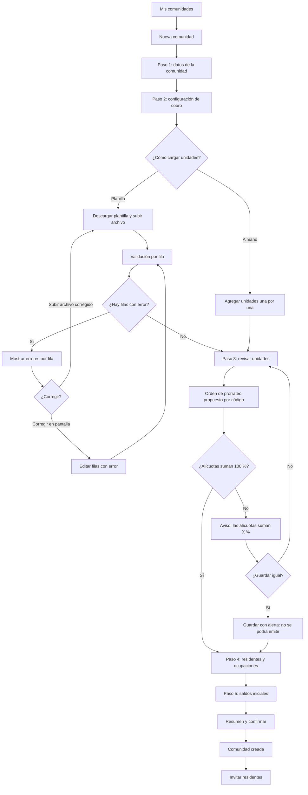

# Flujo: alta de comunidad y unidades

Estado: Borrador
Actor: administrador
Superficie: web de administración
Alcance: MVP
Referencias: `docs/specs/gasto-comun.md` (C-1, C-3, C-4, D-2, E-1, E-3, S-3), `docs/arquitectura.md` §2 y §4, `docs/qa/comunidades-simuladas.md`

## Diagrama

## Pasos

1. **Datos de la comunidad:** nombre, dirección, comuna, tipo (edificio o condominio), RUT de la comunidad y cuenta bancaria para el aviso.
2. **Configuración de cobro** (`community.billing.configure`):
   - Fondo de reserva en porcentaje; mínimo 5,00 % (D-2). El campo rechaza valores menores con "El fondo de reserva no puede ser menor a 5 %".
   - Plazo de vencimiento en días corridos; por defecto 10 (E-1).
   - Cobra intereses: no por defecto (E-3). Si se activa, pide la tasa mensual del reglamento y la referencia al reglamento.
3. **Unidades:** código, tipo (departamento, casa, estacionamiento, bodega, local), alícuota en porcentaje y orden de prorrateo.
   - El orden se propone según el código en orden natural ("Depto 9" antes que "Depto 10") y el administrador puede arrastrar para reordenar (UX-21).
   - Un contador fijo muestra la suma de alícuotas: verde con 100,00 %, rojo con cualquier otro valor.
   - **Supuesto (a validar):** la alícuota acepta hasta 4 decimales en porcentaje (p. ej. 18,7345 %), que se guarda como entero `aliquot_e6` (escala 10^-6; ver arquitectura §4).
4. **Residentes y ocupaciones:** por unidad, propietario y arrendatario opcional, con fecha de inicio de ocupación y teléfono o correo para invitar (UX-8). Este paso se puede saltar y completar después.
5. **Saldos iniciales:** paso reservado y sin regla definida (UX-1). En el MVP de prueba se muestra "Disponible cuando se defina la regla de migración" y se puede saltar.
6. **Resumen:** número de unidades, suma de alícuotas, configuración de cobro y residentes cargados. "Crear comunidad".
7. Al crear, ofrece "Invitar residentes ahora" o "Más tarde".

**Migración asistida desde planilla (Supuesto, a validar; UX-16):**

- Plantilla descargable con columnas: código, tipo, alícuota, orden, propietario, arrendatario, fecha de ocupación, teléfono, correo.
- La importación nunca guarda filas con error: muestra una tabla con cada fila, su estado y el motivo.
- Se puede guardar un borrador de la importación y volver.

## Estados vacíos

- **Sin comunidades:** "Aún no tienes comunidades. Crea la primera o impórtala desde una planilla." con botón "Nueva comunidad".
- **Comunidad sin unidades:** "Agrega unidades para poder emitir el gasto común." con "Importar planilla" y "Agregar unidad".
- **Unidad sin residentes:** etiqueta "Sin residente"; no bloquea la emisión.

## Errores

| Caso | Mensaje | Comportamiento |
| --- | --- | --- |
| Alícuotas no suman 100 % | "Las alícuotas suman 99,99 %; deben sumar 100 %" (C-4) | Permite guardar; bloquea la emisión hasta corregir |
| Código de unidad repetido | "El código Depto 101 ya existe en esta comunidad" | Fila marcada; no se guarda |
| Alícuota con más decimales de los permitidos | "La alícuota admite hasta 4 decimales" | Fila marcada |
| Alícuota negativa o mayor a 100 % | "La alícuota debe estar entre 0 % y 100 %" | Fila marcada |
| RUT inválido | "El RUT no es válido. Revisa el dígito verificador" | Fila marcada |
| Archivo con formato no soportado | "Sube un archivo CSV o Excel con la plantilla de ComVive" | No procesa |
| Fondo de reserva bajo 5 % | "El fondo de reserva no puede ser menor a 5 %" | Campo bloqueado |
| Tasa sobre el tope vigente | "La tasa supera el tope legal vigente; se aplicará X %" (CA-7) | Guarda con advertencia |
| Persona ya registrada en ComVive | "Esta persona ya tiene cuenta. Se agregará a esta comunidad." | No muestra nombre ni otras comunidades (arquitectura §2) |

## Carga

- Importación: barra de progreso con "Validando fila 120 de 300"; el administrador puede salir y volver (tarea diferida).
- Guardado de cada paso: botón con indicador y texto "Guardando…"; los datos del paso quedan guardados antes de avanzar.

## Supuestos (a validar)

- La creación es un asistente de 5 pasos que se puede pausar.
- Unidad con alícuota 0 % se permite (C-5), con etiqueta "Sin participación".
- Editar alícuotas después de la primera emisión: ver UX-15.
