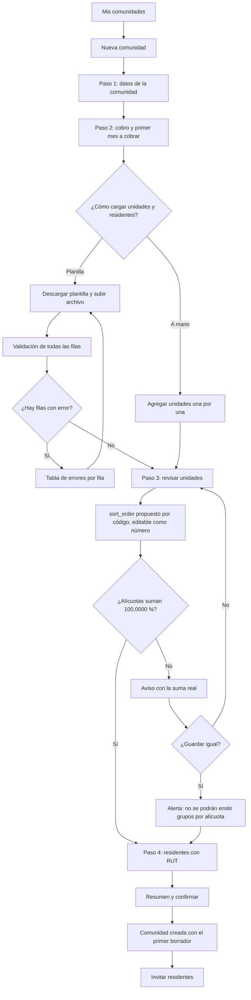

# Flujo: alta de comunidad y unidades

Estado: Borrador
Actor: administrador
Superficie: web de administración
Alcance: MVP
Referencias en `docs/specs/gasto-comun.md`:

- Ciclo del periodo: A-2 (primer borrador).
- Prorrateo: A-3.1 y CA-19 (alícuotas), C-4 (`sort_order`), S-3.
- Cobro: D-2 (fondo de reserva), E-1 (vencimiento).
- Intereses: E-3 y CA-7, con el flag `billing.interest`.
- Apertura: F-10.

Otras referencias: `docs/arquitectura.md` §2 y §4.

## Diagrama

## Pasos

1. **Datos de la comunidad:** nombre, dirección, comuna, tipo (edificio o condominio) y RUT de la comunidad.
2. **Cobro** (`community.billing.configure`):
   - Fondo de reserva en porcentaje. El mínimo es 5,00 % (D-2) y un valor menor se rechaza con "El fondo de reserva no puede ser menor a 5 %".
   - Plazo de vencimiento en días corridos, 10 por defecto (E-1).
   - **Primer mes a cobrar:** mes y año, por ejemplo "Octubre 2026". Con ese dato se crea el primer borrador vigente (A-2). Ayuda: "Se cobra mes vencido: los gastos de octubre se emiten a comienzos de noviembre" (S-2).
   - **Intereses:** la sección solo aparece con el flag `billing.interest` activo. En ese caso:
     - Se ingresa la tasa del reglamento, mensual o anual, con la referencia al reglamento. Si es mensual, se muestra el equivalente anual: "1,00 % mensual = 12,00 % anual" (E-3).
     - Si supera el tope vigente, se muestra el texto de CA-7: "La tasa configurada supera el tope legal vigente (15,00 % anual). Se aplicará el tope".
3. **Unidades:** código, tipo (departamento, casa, estacionamiento, bodega, local), alícuota y `sort_order`.
   - **Alícuota:** campo de texto con hasta 4 decimales. Se convierte a `aliquot_e6` sin punto flotante (ver `arquitectura-de-informacion.md`).
   - **`sort_order`:** se propone en orden natural del código ("Depto 9" antes que "Depto 10") y se edita como número entero único (C-4). La pantalla avisa si hay números repetidos.
   - **Suma de alícuotas:** un contador fijo la muestra, calculada con enteros: "Suma: 100,0000 %" en verde o "Suma: 99,9900 %" en rojo.
   - **Alícuota 0 %:** se permite, con la etiqueta "Sin participación" (C-5).
4. **Residentes** (UX-8). Por cada unidad:
   - Propietario y, si hay, arrendatario.
   - Datos de cada uno: RUT (obligatorio), nombre, fecha de ingreso y teléfono o correo para invitar.
   - La persona se reconoce por su RUT. Si ya existe en ComVive, se le agrega la membresía sin mostrar sus datos ni sus otras comunidades (arquitectura §2).
   - Este paso se puede dejar para después.
5. **Resumen:** unidades, suma de alícuotas, configuración de cobro, primer mes a cobrar y residentes cargados. Botón "Crear comunidad".
6. Al crear, se ofrece "Invitar residentes ahora" o "Más tarde".

**Migración desde planilla (MVP mínimo: validar y confirmar; UX-16):**

- **Plantilla descargable:** código, tipo, alícuota, `sort_order`, y RUT, nombre, relación, fecha de ingreso, teléfono y correo de cada residente.
- **Validación:** se valida todo el archivo. Si alguna fila tiene error, no se guarda nada y se muestra la tabla de errores para corregir el archivo y subirlo de nuevo.
- **Saldos de apertura:** no se cargan. El movimiento `apertura` está reservado (F-10) para una especificación de migración futura (UX-1).

## Estados vacíos

- **Sin comunidades:** "Aún no tienes comunidades. Crea la primera o impórtala desde una planilla." con el botón "Nueva comunidad".
- **Comunidad sin unidades:** "Agrega unidades para poder emitir el gasto común." con "Importar planilla" y "Agregar unidad".
- **Unidad sin residentes:** etiqueta "Sin residente". No bloquea la emisión.

## Errores

| Caso | Mensaje | Comportamiento |
| --- | --- | --- |
| Alícuotas no suman 100 % | "Las alícuotas suman 99,9900 %; deben sumar 100,0000 %" (A-3.1, CA-19) | Se puede guardar; la emisión se bloqueará si hay grupos por alícuota |
| Código de unidad repetido | "El código Depto 101 ya existe en esta comunidad" | Fila marcada |
| `sort_order` repetido | "El orden 3 ya lo usa Depto 201" | Fila marcada |
| Alícuota con más de 4 decimales | "La alícuota admite hasta 4 decimales" | Fila marcada |
| Alícuota fuera de rango | "La alícuota debe estar entre 0 % y 100 %" | Fila marcada |
| RUT faltante o inválido | "Ingresa un RUT válido. Revisa el dígito verificador" | Fila marcada |
| El mismo RUT con datos distintos en la planilla | "El RUT 12.345.678-9 aparece con nombres distintos" | Fila marcada |
| Formato de archivo no soportado | "Sube un archivo CSV o Excel con la plantilla de ComVive" | No se procesa |
| Fondo de reserva bajo 5 % | "El fondo de reserva no puede ser menor a 5 %" | El campo no se acepta |

## Carga

- **Importación:** barra de progreso "Validando fila 120 de 300". El administrador puede salir y volver.
- **Guardado de cada paso:** botón con indicador y el texto "Guardando…". Los datos quedan guardados antes de avanzar.

## Supuestos (a validar)

- La creación es un asistente de 4 pasos que se puede pausar.
- Las alícuotas se pueden editar después de la primera emisión: ver UX-15.
