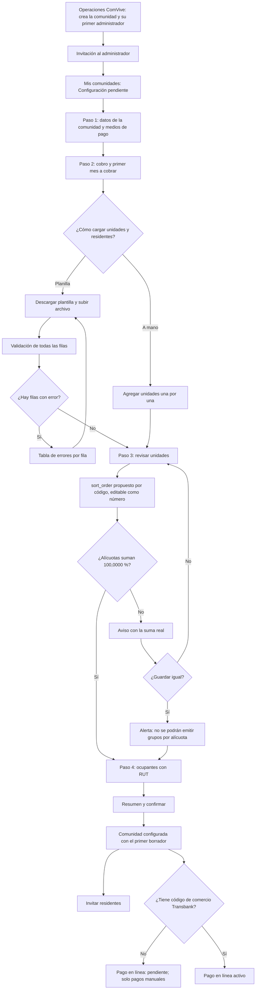

# Flujo: alta de comunidad y unidades

Estado: Borrador
Actor: Operaciones ComVive (crea la comunidad y su primer administrador) y administrador (completa la configuración)
Superficie: consola de plataforma (Operaciones) y web de administración
Alcance: MVP
Referencias en `docs/specs/gasto-comun.md`:

- Ciclo del periodo: A-2 (primer borrador).
- Prorrateo: A-3.1 y CA-19 (alícuotas), C-4 (`sort_order`), S-3.
- Cobro: D-2 (fondo de reserva), E-1 (vencimiento).
- Intereses: E-3 y CA-7, con el flag `billing.interest`.
- Ocupaciones: F-9, F-14 y F-15. Apertura: F-10.
- Otorgamiento de roles: sección "Otorgamiento de roles".
- Pago en línea: F-12 (un código de comercio Transbank por comunidad, decisión del líder del proyecto, 2026-11-07).
- Códigos y mensajes de error: tabla de la spec.

Otras referencias: `docs/arquitectura.md` §2 y §3 ("Quién otorga cada rol": `POST /platform/communities` crea la comunidad y su primer administrador).

> **Revisión crítica 3 (`docs/revisiones/2026-11-07-diseno-rev3.md`): cambios aplicados.** Menor 1: referencias vigentes. Menor 5: textos del fondo de reserva de la spec. UX-32 cerrada: en el MVP Operaciones ComVive crea las comunidades. La portada de la web se llama "Inicio".

## Reglas de pantalla

- **Quién crea la comunidad:** Operaciones ComVive, en la consola de plataforma, con nombre, RUT de la comunidad y el RUT y contacto del primer administrador (decisión del líder del proyecto, 2026-11-07; arquitectura §3). El administrador no ve un botón "Nueva comunidad"; ve la comunidad nueva en "Mis comunidades" con la etiqueta "Configuración pendiente" (UX-32 cerrada).
- **Lista de puesta en marcha:** la comunidad muestra, hasta completarla, una lista de pasos con su estado. El último es el pago en línea, que no depende del administrador.
- **Pago en línea (Webpay):** cada comunidad necesita su propio código de comercio Transbank. Mientras no lo tenga, la comunidad opera solo con pagos manuales: la app no muestra el botón de pago y la lista muestra "Pago en línea: pendiente". El administrador no ingresa credenciales: son un secreto que carga ComVive (regla 9 de `CLAUDE.md`).

## Diagrama

## Pasos

1. **Operaciones ComVive** crea la comunidad y otorga el rol de administrador (ver `admin-usuarios-y-roles.md`). El administrador recibe la invitación e ingresa a la web con su RUT.
2. **Datos de la comunidad:** nombre, dirección, comuna, tipo (edificio o condominio) y RUT de la comunidad (los dos últimos los trae Operaciones y se pueden revisar).
   - **Medios de pago** que aparecerán en el aviso y en "Cómo pagar" de la app (G-2): banco, tipo y número de cuenta, titular, RUT del titular y correo para comprobantes.
3. **Cobro** (`community.billing.configure`):
   - Fondo de reserva en porcentaje, entre 5,00 % y 50,00 % (D-2). Un valor menor se rechaza con "El fondo de reserva no puede ser menor que 5,00 % (Ley 21.442, art. 39)" y uno mayor con "El fondo de reserva no puede superar 50,00 %. Si el reglamento fija más, contacta a soporte".
   - Plazo de vencimiento en días corridos, 10 por defecto (E-1).
   - **Primer mes a cobrar:** mes y año, por ejemplo "Octubre 2026". Con ese dato se crea el primer borrador vigente (A-2). Ayuda: "Se cobra mes vencido: los gastos de octubre se emiten a comienzos de noviembre" (S-2).
   - **Intereses:** ver "Configuración > Cobro > Intereses" en `arquitectura-de-informacion.md`. En el alta solo se puede cargar la tasa del reglamento; activarlos es una acción aparte (menor 18).
4. **Unidades:** código, tipo (departamento, casa, estacionamiento, bodega, local), alícuota y `sort_order`.
   - **Alícuota:** campo de texto con hasta 4 decimales. Acepta coma o punto como separador decimal (`18,5` o `18.5`) y la pantalla lo muestra con coma. Se convierte a `aliquot_e6` sin punto flotante (ver `arquitectura-de-informacion.md`).
   - **`sort_order`:** se propone en orden natural del código ("Depto 9" antes que "Depto 10") y se edita como número entero único (C-4). La pantalla avisa si hay números repetidos.
   - **Suma de alícuotas:** un contador fijo la muestra, calculada con enteros: "Suma: 100,0000 %" en verde o "Suma: 99,9900 %" en rojo.
   - **Alícuota 0 %:** se permite, con la etiqueta "Sin participación" (C-5).
5. **Ocupantes** (UX-8). Por cada unidad, propietario y, si hay, arrendatario, con RUT (obligatorio), nombre, fecha de ingreso y teléfono o correo para invitar. Usa las mismas reglas que `admin-ocupaciones.md`.
   - La persona se reconoce por su RUT. Si ya existe en ComVive, se le agrega la membresía sin mostrar sus datos ni sus otras comunidades (arquitectura §2).
   - Este paso se puede dejar para después. Una unidad sin propietario queda con la etiqueta "Propietario sin registrar" (F-15).
6. **Resumen:** unidades, suma de alícuotas, configuración de cobro, primer mes a cobrar, medios de pago y ocupantes cargados. Botón "Guardar configuración".
7. Al guardar, se ofrece "Invitar residentes ahora" o "Más tarde".

**Lista de puesta en marcha** (en Inicio, hasta completarla):

| Paso | Estado posible | Quién lo completa |
| --- | --- | --- |
| Datos y medios de pago | Pendiente o listo | Administrador |
| Cobro y primer mes | Pendiente o listo | Administrador |
| Unidades con alícuotas que suman 100 % | Pendiente, con advertencia o listo | Administrador |
| Ocupantes registrados | "{n} unidades sin propietario" o listo | Administrador |
| Residentes invitados | "{n} de {total} aceptaron" | Administrador y residentes |
| Pago en línea (Webpay) | "Pendiente: ComVive lo activa cuando Transbank entregue el código de comercio de la comunidad" o "Activo" | ComVive (UX-33) |

**Migración desde planilla (MVP mínimo: validar y confirmar; UX-16):**

- **Plantilla descargable:** código, tipo, alícuota, `sort_order`, y RUT, nombre, relación, fecha de ingreso, teléfono y correo de cada residente.
- **Validación:** se valida todo el archivo. Si alguna fila tiene error, no se guarda nada y se muestra la tabla de errores para corregir el archivo y subirlo de nuevo.
- **Archivo subido:** se borra al terminar de procesarlo, con o sin errores. La pantalla lo dice: "Borramos el archivo después de revisarlo" (supuesto, requisito para el arquitecto).
- **Saldos de apertura:** no se cargan. El movimiento `opening` está reservado (F-10) para una especificación de migración futura (UX-1).

## Estados vacíos

- **Sin comunidades:** "Aún no tienes comunidades en ComVive. Cuando ComVive cree tu primera comunidad, aparecerá aquí."
- **Comunidad sin unidades:** "Agrega unidades para poder emitir el gasto común." con "Importar planilla" y "Agregar unidad".
- **Unidad sin ocupantes:** etiqueta "Propietario sin registrar". No bloquea la emisión (F-15).

## Errores

| Caso | Mensaje | Comportamiento |
| --- | --- | --- |
| Alícuotas no suman 100 % | "Las alícuotas suman 99,9900 %; deben sumar 100,0000 %" (A-3.1, CA-19) | Se puede guardar; la emisión se bloqueará si hay grupos por alícuota |
| Código de unidad repetido | "El código Depto 101 ya existe en esta comunidad" | Fila marcada |
| `sort_order` repetido | "El orden 3 ya lo usa Depto 201" | Fila marcada |
| Alícuota con más de 4 decimales | "La alícuota admite hasta 4 decimales" | Fila marcada |
| Alícuota fuera de rango | "La alícuota debe estar entre 0 % y 100 %" | Fila marcada |
| RUT faltante o inválido | "Ingresa un RUT válido. Revisa el dígito verificador" | Fila marcada |
| El mismo RUT con datos distintos en la planilla | "El RUT 12.345.678-9 aparece con nombres distintos" | Fila marcada |
| Formato de archivo no soportado | "Sube un archivo CSV o Excel con la plantilla de ComVive" | No se procesa |
| Fondo de reserva bajo 5,00 % (422 `RESERVE_RATE_BELOW_MINIMUM`) | "El fondo de reserva no puede ser menor que 5,00 % (Ley 21.442, art. 39)" | El campo no se acepta |
| Fondo de reserva sobre 50,00 % (422 `RESERVE_RATE_ABOVE_MAXIMUM`) | "El fondo de reserva no puede superar 50,00 %. Si el reglamento fija más, contacta a soporte" | El campo no se acepta |

## Carga

- **Importación:** barra de progreso "Validando fila 120 de 300". El administrador puede salir y volver.
- **Guardado de cada paso:** botón con indicador y el texto "Guardando…". Los datos quedan guardados antes de avanzar.

## Supuestos (a validar)

- La configuración es un asistente de 4 pasos que se puede pausar.
- Las alícuotas se pueden editar después de la primera emisión: ver UX-15.
- El autoservicio (que el administrador cree comunidades por su cuenta) queda fuera del MVP y se revisará después del Piloto (Supuesto (a validar); UX-32 cerrada para el MVP).
