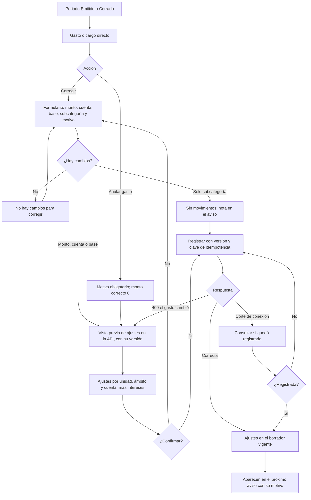

# Flujo: corregir o anular un gasto de un periodo emitido o cerrado

Estado: Borrador
Actor: administrador (el comité ve las correcciones, las anulaciones y sus ajustes en modo lectura)
Superficie: web de administración
Alcance: MVP
Referencias en `docs/specs/gasto-comun.md`:

- Ajustes: H-1 a H-5. Anular gasto: H-6 (excepción explícita a B-5).
- Versión confirmada: A-7.
- Movimientos posteriores a la emisión: A-4.
- Inmutabilidad: A-3.5 y A-5.4.
- Reimputación: F-6. Ámbitos: F-9 y F-13. Intereses: E-10.
- Criterios de aceptación: CA-13, CA-14, CA-33, CA-34 y CA-36.

Otras referencias: `docs/arquitectura.md` §4 (`correction-preview` y `corrections`, `previewHash`, 409 `PREVIEW_OUTDATED`, foto de participaciones).

**Regla de diseño:** la pantalla nunca acepta montos de ajuste por unidad. El administrador corrige o anula el gasto (el dato de origen) y la API calcula los ajustes con la fórmula H-2 y la foto de participaciones del periodo original.

## Diagrama

## Pasos

1. En un periodo Emitido o Cerrado, cada gasto y cargo directo tiene dos acciones: **"Corregir"** y **"Anular gasto"**. En un borrador no existen: el gasto se edita o se elimina (A-2, H-6).
2. **Corregir — formulario:** muestra el valor original y el corregido lado a lado.
   - Campos: monto (dígitos con máscara de miles, mayor que 0), cuenta, base de pesos y subcategoría.
   - Motivo obligatorio, que aparecerá en el aviso. Ejemplo: "corrección factura electricidad". Ayuda: "No incluyas datos personales".
3. **Anular gasto (H-6, M6):** para un gasto duplicado o que no debió existir.
   - No pide monto: el monto correcto es $0, y es el único lugar de la interfaz donde se acepta.
   - Motivo obligatorio con la misma ayuda.
   - Texto: "El gasto no se borra. Quedará como Anulado, con su motivo y su monto original, y se registrarán notas de crédito a las unidades."
4. **Solo cambia la subcategoría:** no hay movimientos. Se registra como nota en el aviso del borrador vigente (H-3).
5. **Vista previa** (`correction-preview`, que devuelve la versión). Muestra:
   - **Tabla por unidad y ámbito:** ajuste de cada cuenta. Las notas de crédito van en negativo y los débitos en positivo, por ejemplo Depto 101: −$2.000 de ordinario y −$100 de fondo (CA-13). La columna "Deuda de" dice "Propietario", "Arrendatario {nombre}" o "Arrendatario anterior (pasa al propietario)" si el cargo era de una ocupación terminada (F-13, CA-36).
   - **Suma por cuenta:** igual a la diferencia del grupo, por ejemplo −$10.000 de ordinario y −$500 de fondo. En una anulación, igual a menos el gasto y su fondo (CA-33); si el grupo queda en $0, también el fondo del grupo (CA-34).
   - **Ajustes de intereses** (E-10, solo con el flag activo): bloque aparte por unidad y ámbito (menor 17).
   - **Reimputaciones:** las unidades cuyo cargo ya estaba pagado y quedan con saldo a favor, por ámbito (F-6).
   - **Correcciones previas:** "Incluye la corrección anterior del {dd-mm-aaaa}" (H-2, CA-14).
   - **Reclasificación** (cambio de cuenta o base): dos bloques, "Se revierte de {grupo de origen}" y "Se aplica en {grupo de destino}" (H-3).
6. **Confirmación:** "Se registrarán ajustes en el periodo en borrador {mes}. Los cargos y avisos de {periodo original} no cambian." El envío lleva la versión de la vista previa y una clave de idempotencia.
7. **Resultado:**
   - Los ajustes quedan en el borrador vigente (A-4), con un enlace al gasto original.
   - Si liberan dinero de pagos ya imputados, la API lo reimputa (F-6) y la pantalla muestra el resumen.
   - En el próximo aviso aparecen como "Ajuste periodo AAAA-MM: motivo" (H-4).
   - Un gasto anulado muestra la etiqueta **Anulado**, su motivo y su monto original tachado. "Corregir" sigue disponible: una corrección a un monto mayor que $0 lo reactiva (H-6).

## Estados vacíos

- **Gasto sin correcciones:** el historial dice "Este gasto no tiene correcciones."
- **Borrador sin ajustes recibidos:** "No hay ajustes de periodos anteriores."
- **Vista previa sin ajustes de intereses:** el bloque no aparece.

## Errores

| Caso | Mensaje | Comportamiento |
| --- | --- | --- |
| Sin cambios | "No hay cambios para corregir" | No llama a la API |
| Monto vacío o 0 en "Corregir" | "Ingresa un monto mayor que $0. Para dejarlo en $0, usa Anular gasto" | El campo no acepta otros caracteres (B-5) |
| Motivo vacío al corregir | "Escribe el motivo; aparecerá en el aviso de cobro" | El campo es inválido |
| Motivo vacío al anular | "Indica el motivo de la anulación" (H-6, CA-33) | El campo es inválido |
| El gasto cambió desde la vista previa | "El gasto cambió desde la vista previa. Revisa la nueva vista previa antes de confirmar" (409, A-7) | Pide una vista previa nueva y marca lo que cambió |
| Corte de conexión al confirmar | "Revisando si la corrección quedó registrada…" | Consulta el estado; reintenta con la misma clave |
| Comité | Las acciones "Corregir" y "Anular gasto" no se muestran | 403 en la API (CA-24) |

## Carga

- **Vista previa:** esqueleto de la tabla de ajustes.
- **Confirmación:** botón con indicador y bloqueo del doble envío.

## Supuestos (a validar)

- La corrección parte del gasto original y no de un formulario libre de ajustes.
- **Egresos del fondo de reserva** de un periodo emitido o cerrado: no tienen "Corregir" ni "Anular" hasta que la spec lo defina, porque no generan cargos y la sección H no los cubre (pregunta UX-29).
