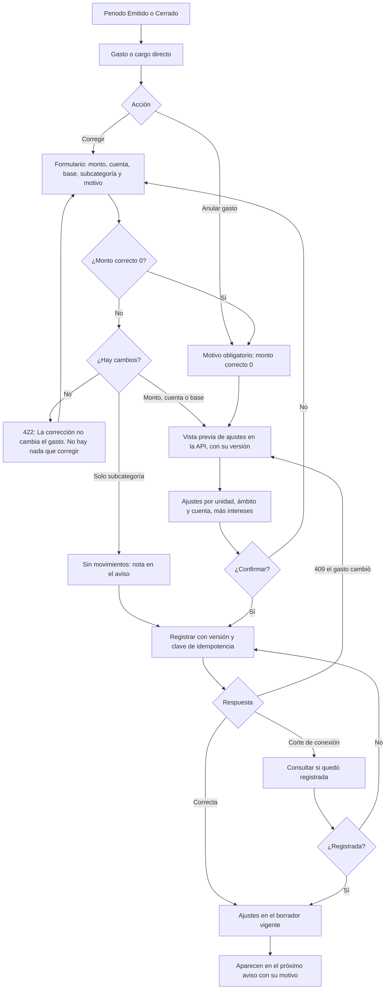

# Flujo: corregir o anular un gasto de un periodo emitido o cerrado

Estado: **Aprobado** (aprobado por el líder del proyecto el 2026-11-08, cierre de la Etapa 1)
Actor: administrador (el comité ve las correcciones, las anulaciones y sus ajustes en modo lectura)
Superficie: web de administración
Alcance: MVP
Referencias en `docs/specs/gasto-comun.md`:

- Ajustes: H-1 a H-5. Anular gasto: H-6 (excepción explícita a B-5). Corrección sin cambios y motivo: H-7. Egresos del fondo y su corrección: B-3 (S-46, S-50).
- Versión confirmada: A-7.
- Movimientos posteriores a la emisión: A-4.
- Inmutabilidad: A-3.5 y A-5.4.
- Reimputación: F-6. Ámbitos: F-9 y F-13. Intereses: E-10.
- Criterios de aceptación: CA-13, CA-14, CA-33, CA-34, CA-36 y CA-62.

Otras referencias: `docs/arquitectura.md` §4 (`correction-preview` y `corrections`, `previewHash`, 409 `PREVIEW_OUTDATED`, foto de participaciones).

**Regla de diseño:** la pantalla nunca acepta montos de ajuste por unidad. El administrador corrige o anula el gasto (el dato de origen) y la API calcula los ajustes con la fórmula H-2 y la foto de participaciones del periodo original.

## Diagrama

## Pasos

1. En un periodo Emitido o Cerrado, cada gasto y cargo directo tiene dos acciones: **"Corregir"** y **"Anular gasto"**. En un borrador no existen: el gasto se edita o se elimina (A-2, H-6).
2. **Corregir — formulario:** muestra el valor original y el corregido lado a lado.
   - Campos: monto correcto (dígitos con máscara de miles, mayor o igual que $0), cuenta, base de pesos y subcategoría.
   - **Monto correcto $0 = anular (B-5, H-6):** la corrección y la anulación usan la misma ruta. Si el administrador escribe $0, el formulario pasa a "Anular gasto": cambia el título, pide el motivo de la anulación y muestra el texto del paso 3.
   - Motivo obligatorio. Ayuda bajo el campo (H-7): "El motivo aparecerá en el aviso de cobro". Segunda ayuda: "No incluyas datos personales". Ejemplo: "corrección factura electricidad".
3. **Anular gasto (H-6, M6):** para un gasto duplicado o que no debió existir.
   - No pide monto: el monto correcto es $0. Es el único gasto o cargo de la interfaz que se lleva a $0 (las otras excepciones, el saldo de caja y la anulación de un egreso del fondo, no son cobros; G-4, B-3).
   - Motivo obligatorio con las mismas ayudas.
   - Texto: "El gasto no se borra. Quedará como Anulado, con su motivo y su monto original, y se registrarán notas de crédito a las unidades."
4. **Solo cambia la subcategoría:** no hay movimientos. Se registra como nota en el aviso del borrador vigente (H-3).
5. **Vista previa** (`correction-preview`, que devuelve la versión). Muestra:
   - **Tabla por unidad y ámbito:** ajuste de cada cuenta. Las notas de crédito van en negativo y los débitos en positivo, por ejemplo Depto 101: −$2.000 de ordinario y −$100 de fondo (CA-13). La columna "Deuda de" dice "Propietario", "Arrendatario {nombre}" o "Arrendatario anterior (pasa al propietario)" si el cargo era de una ocupación terminada (F-13, CA-36).
   - **Suma por cuenta:** igual a la diferencia del grupo, por ejemplo −$10.000 de ordinario y −$500 de fondo. En una anulación, igual a menos el gasto y su fondo (CA-33); si el grupo queda en $0, también el fondo del grupo (CA-34).
   - **Ajustes de intereses** (E-10, solo con el flag activo): bloque aparte por unidad y ámbito (menor 17).
   - **Reimputaciones:** las unidades cuyo cargo ya estaba pagado y quedan con saldo a favor, por ámbito (F-6).
   - **Correcciones previas:** "Incluye la corrección anterior del {dd-mm-aaaa}" (H-2, CA-14).
   - **Reclasificación** (cambio de cuenta o base): dos bloques, "Se revierte de {grupo de origen}" y "Se aplica en {grupo de destino}" (H-3).
6. **Confirmación:** "Se registrarán ajustes en el periodo en borrador {mes}. Los cargos y avisos de {periodo original} no cambian." El envío lleva la versión de la vista previa y una clave de idempotencia.
7. **Resultado:**
   - Los ajustes quedan en el borrador vigente (A-4), con un enlace al gasto original.
   - Si liberan dinero de pagos ya imputados, la API lo reimputa (F-6) y la pantalla muestra el resumen.
   - En el próximo aviso aparecen como "Ajuste periodo AAAA-MM: motivo" (H-4).
   - Un gasto anulado muestra la etiqueta **Anulado**, su motivo y su monto original tachado. "Corregir" sigue disponible: una corrección a un monto mayor que $0 lo reactiva (H-6).

**Corregir o anular un egreso del fondo de reserva (B-3; Supuesto (a validar) S-46, P-33)**

1. En un periodo Emitido o Cerrado, cada egreso del fondo tiene **"Corregir"** y **"Anular egreso"**. No generan cargos ni notas de crédito a las unidades.
2. **Formulario:** monto correcto (mayor o igual que $0; $0 anula) y motivo obligatorio, con la ayuda "El motivo aparecerá en el aviso de cobro". No pide una referencia de autorización nueva: la corrección apunta al egreso original, que tiene la suya.
3. **Vista previa** (con versión, A-7): la diferencia que se registrará en el borrador vigente, la línea del aviso "Corrección egreso del fondo periodo AAAA-MM: motivo" y el saldo del fondo resultante.
   - Si el saldo del fondo queda bajo $0, advertencia sin bloqueo: "Con esta corrección, el saldo del fondo de reserva registrado en ComVive queda en −${monto}. Revisa el monto; si el fondo tenía saldo antes de usar ComVive, ese saldo aún no está cargado" (S-50, CA-62).
4. **Confirmación** con la versión de la vista previa y una clave de idempotencia.
5. **Errores**, en el orden de la spec (CA-62): `INVALID_AMOUNT` o `AMOUNT_TOO_LARGE` → `CORRECTION_WITHOUT_CHANGE` → `REASON_REQUIRED` → `PREVIEW_OUTDATED`.
   - 422 `INVALID_AMOUNT`: "El monto correcto debe ser un número entero de pesos, mayor o igual que $0. Usa $0 solo para anular".
   - 422 `CORRECTION_WITHOUT_CHANGE`: "El monto correcto es igual al monto vigente del egreso (${monto}). No hay nada que corregir" o, si ya está anulado, "Este egreso ya está anulado. No hay nada que corregir".
   - 422 `REASON_REQUIRED`: "Indica el motivo de la corrección" (monto mayor que $0) o "Indica el motivo de la anulación" ($0).
   - 409 `PREVIEW_OUTDATED`: "El gasto cambió desde la vista previa. Revisa la nueva vista previa antes de confirmar" (A-7, fila de corrección de un gasto).

## Estados vacíos

- **Gasto sin correcciones:** el historial dice "Este gasto no tiene correcciones."
- **Borrador sin ajustes recibidos:** "No hay ajustes de periodos anteriores."
- **Vista previa sin ajustes de intereses:** el bloque no aparece.

## Errores

Los textos con código son los de la tabla "Códigos y mensajes de error" de la spec, copiados tal cual. La API responde solo el primer error, en este orden: `INVALID_AMOUNT` o `AMOUNT_TOO_LARGE` → `CORRECTION_WITHOUT_CHANGE` → `REASON_REQUIRED` → `PREVIEW_OUTDATED` (solo al confirmar).

| Caso | Código | Mensaje | Comportamiento |
| --- | --- | --- | --- |
| Monto correcto vacío, negativo o con decimales | 422 `INVALID_AMOUNT` | "El monto correcto debe ser un número entero de pesos, mayor o igual que $0. Usa $0 solo para anular" | El campo no acepta otros caracteres (B-5) |
| Monto sobre el máximo | 422 `AMOUNT_TOO_LARGE` | "El monto supera el máximo permitido de $9.999.999.999" | El campo es inválido (B-6) |
| Sin cambios (mismo monto, cuenta, base, conjunto de unidades y subcategoría) | 422 `CORRECTION_WITHOUT_CHANGE` | "La corrección no cambia el gasto. No hay nada que corregir" | El formulario lo avisa sin llamar a la API; si llega, se rechaza (H-7) |
| Anular un gasto ya anulado | 422 `CORRECTION_WITHOUT_CHANGE` | "Este gasto ya está anulado. No hay nada que corregir" | "Anular gasto" no se muestra en un gasto anulado; si llega a la API, se rechaza (H-7) |
| Motivo vacío al corregir (monto correcto mayor que $0) | 422 `REASON_REQUIRED` | "Indica el motivo de la corrección" | El campo es inválido (H-1, H-7) |
| Motivo vacío al anular ($0) | 422 `REASON_REQUIRED` | "Indica el motivo de la anulación" | El campo es inválido (H-6, CA-33) |
| El gasto cambió desde la vista previa | 409 `PREVIEW_OUTDATED` | "El gasto cambió desde la vista previa. Revisa la nueva vista previa antes de confirmar" | Pide una vista previa nueva y marca lo que cambió (A-7) |
| Misma clave de idempotencia con otros datos | 422 `IDEMPOTENCY_KEY_REUSED` | "Esta operación ya se envió con otros datos. Vuelve a abrir el formulario" | Cierra la confirmación y pide una vista previa nueva |
| Corte de conexión al confirmar | — | "Revisando si la corrección quedó registrada…" | Consulta el estado; reintenta con la misma clave |
| Comité | 403 `FORBIDDEN` | "Tu rol no permite esta acción" | Las acciones "Corregir" y "Anular gasto" no se muestran (CA-24) |

## Carga

- **Vista previa:** esqueleto de la tabla de ajustes.
- **Confirmación:** botón con indicador y bloqueo del doble envío.

## Supuestos (a validar)

- La corrección parte del gasto original y no de un formulario libre de ajustes.
- **Egresos del fondo de reserva:** la corrección sigue la regla B-3 de la spec, que es un supuesto (S-46) pendiente del contador (P-33). Si una corrección que aumenta el egreso requiere un acuerdo nuevo, también queda en P-33.
