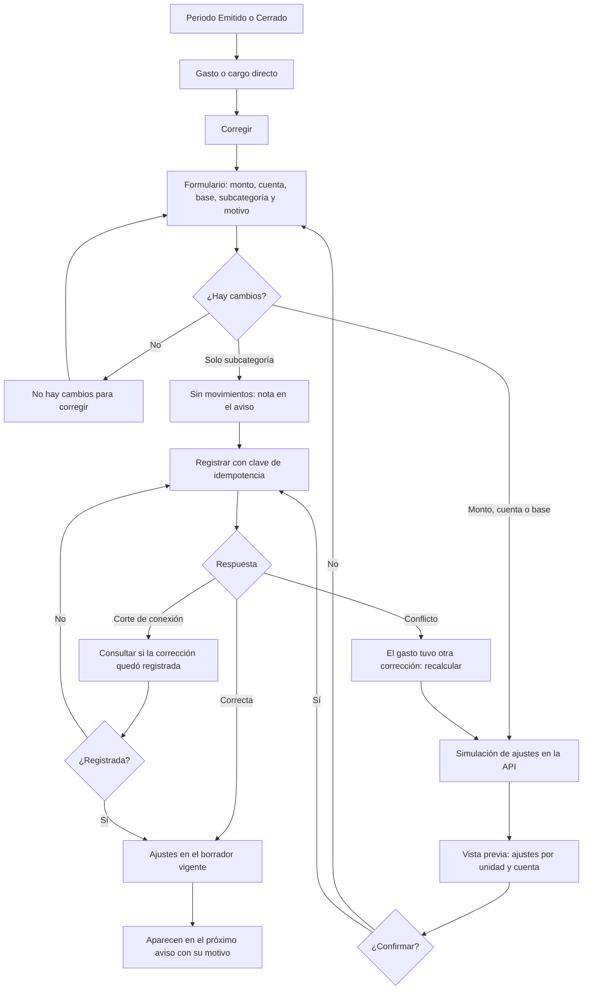

# Flujo: corregir un gasto de un periodo emitido o cerrado

Estado: Borrador
Actor: administrador (el comité ve los ajustes en modo lectura)
Superficie: web de administración
Alcance: MVP
Referencias en `docs/specs/gasto-comun.md`:

- Ajustes: H-1 a H-4.
- Movimientos posteriores a la emisión: A-4.
- Inmutabilidad: A-3.5 y A-5.4.
- Reimputación: F-6.
- Criterios de aceptación: CA-13 y CA-14.

Otras referencias: `docs/arquitectura.md` §4 (foto de participaciones).

**Regla de diseño:** la pantalla nunca acepta montos de ajuste por unidad. El administrador corrige el gasto (el dato de origen) y la API calcula los ajustes con la fórmula H-2 y la foto de participaciones del periodo original.

## Diagrama

## Pasos

1. En un periodo Emitido o Cerrado, cada gasto y cargo directo tiene la acción "Corregir" (UX-22 para los cargos directos).
2. **Formulario:** muestra el valor original y el valor corregido lado a lado.
   - Campos: monto (dígitos con máscara de miles), cuenta, base de pesos y subcategoría.
   - Motivo obligatorio, que aparecerá en el aviso. Ejemplo: "corrección factura electricidad".
3. **Solo cambia la subcategoría:** no hay movimientos. Se registra como nota en el aviso del borrador vigente (H-3).
4. **Cambia el monto, la cuenta o la base:** la API simula los ajustes (requisito para el arquitecto; ver `mapa-de-usuarios.md`). La vista previa muestra:
   - **Tabla por unidad:** ajuste de ordinario y de fondo de reserva (o de las cuentas que correspondan). Las notas de crédito van en negativo y los débitos en positivo, por ejemplo Depto 101: −$2.000 de ordinario y −$100 de fondo (CA-13).
   - **Suma por cuenta:** igual a la diferencia del grupo, por ejemplo −$10.000 de ordinario y −$500 de fondo.
   - **Correcciones previas:** si el gasto ya tuvo correcciones, se muestran con el texto "Incluye la corrección anterior del {dd-mm-aaaa}" (H-2, CA-14).
   - **Reclasificación** (cambio de cuenta o base): dos bloques, "Se revierte de {grupo de origen}" y "Se aplica en {grupo de destino}" (H-3).
5. **Confirmación:** "Se registrarán ajustes en el periodo en borrador {mes}. Los cargos y avisos de {periodo original} no cambian." El envío lleva una clave de idempotencia.
6. **Resultado:**
   - Los ajustes quedan en el borrador vigente (A-4), con un enlace al gasto original.
   - Si liberan dinero de pagos ya imputados, la API lo reimputa (F-6) y la pantalla muestra el resumen.
   - En el próximo aviso aparecen como "Ajuste periodo AAAA-MM: motivo" (H-4).

## Estados vacíos

- **Gasto sin correcciones:** el historial dice "Este gasto no tiene correcciones."
- **Borrador sin ajustes recibidos:** "No hay ajustes de periodos anteriores."

## Errores

| Caso | Mensaje | Comportamiento |
| --- | --- | --- |
| Sin cambios | "No hay cambios para corregir" | No llama a la API |
| Monto vacío o 0 | "Ingresa un monto mayor que $0" | El campo no acepta otros caracteres (B-5) |
| Motivo vacío | "Escribe el motivo; aparecerá en el aviso de cobro" | El campo es inválido |
| Otra corrección del mismo gasto mientras se revisaba | "Este gasto tuvo otra corrección. Revisa la vista previa de nuevo." | Recalcula la simulación |
| Corte de conexión al confirmar | "Revisando si la corrección quedó registrada…" | Consulta el estado antes de reintentar |
| Comité | La acción "Corregir" no se muestra | 403 en la API (CA-24) |

## Carga

- **Simulación:** esqueleto de la tabla de ajustes.
- **Confirmación:** botón con indicador y bloqueo del doble envío.

## Supuestos (a validar)

- La corrección parte del gasto original y no de un formulario libre de ajustes.
- La simulación de ajustes es un endpoint aparte de `issue-preview`.
