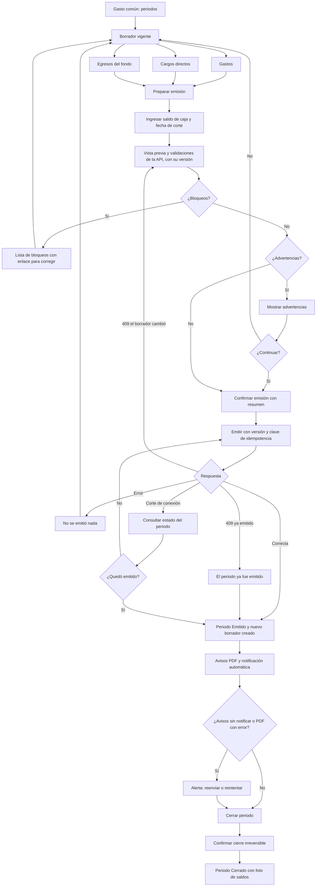

# Flujo: emitir y cerrar el periodo de gasto común

Estado: **Aprobado** (aprobado por el líder del proyecto el 2026-11-08, cierre de la Etapa 1)
Actor: administrador (el comité ve las mismas pantallas en modo lectura)
Superficie: web de administración
Alcance: MVP
Referencias en `docs/specs/gasto-comun.md`:

- Ciclo del periodo: A-2, A-3.1 a A-3.7, A-5 y A-7 (versión confirmada).
- Gastos y cargos: B-1 a B-5.
- Unidad sin propietario registrado: F-15.
- Aviso de cobro y notificación: G-2, G-4 a G-6.
- Vencimiento: E-1 (S-29). Intereses: E-7, solo con el flag `billing.interest`.
- Criterios de aceptación: CA-1, CA-19, CA-20, CA-24, CA-25, CA-38, CA-39, CA-45, CA-46 y CA-58.
- Casos borde: "Comunidad sin unidades". Códigos y mensajes de error: tabla de la spec.

Otras referencias: `docs/arquitectura.md` §4 (`issue-preview`, `previewHash` y 409 `PREVIEW_OUTDATED`; idempotencia).

> **Revisión crítica 3 (`docs/revisiones/2026-11-07-diseno-rev3.md`): cambios aplicados.** Menor 6: el saldo de caja sigue la regla G-4 de la spec (UX-27 cerrada). Menor 5: textos y códigos de la spec. La portada de la web se llama "Inicio".

Este flujo no define montos ni cálculos: los calcula la API según la spec. La interfaz ordena los pasos y muestra lo que devuelve la API. En los mensajes, `{dato}` marca un valor variable.

## Diagrama

## Pasos

**Borrador vigente**

1. Siempre existe un único borrador vigente (A-2). "Periodos" lo muestra arriba. No hay botón para crear periodos.
2. **Gastos:** tabla con concepto, cuenta, subcategoría, base de pesos, monto y respaldo. El formulario lateral para agregar tiene:
   - **Cuenta:** ordinario, con una subcategoría (administración, mantención, reparación, uso o consumo), o extraordinario (B-1, B-2).
   - **Base:** alícuota (por defecto) o partes iguales. Con partes iguales se eligen las unidades del conjunto.
   - **Monto:** campo de dígitos con máscara de miles y mayor que 0 (B-5).
   - **Concepto:** ayuda "Aparece en el resumen que ven los residentes. No incluyas nombres de personas". Las remuneraciones se agrupan solas en "Remuneraciones del personal" (G-8).
3. **Cargos directos** por unidad (B-4):
   - Consumo individual: se ingresa el monto, que se calcula fuera de ComVive.
   - Multa: con motivo y referencia al reglamento o al acuerdo. Ayuda: "El motivo aparece en el aviso. No incluyas datos personales".
   - Otro: a la cuenta ordinario o extraordinario.
4. **Egresos del fondo de reserva** (B-3):
   - Monto (mayor que $0) y **referencia obligatoria a la autorización**, en texto libre, con la ayuda "Acuerdo del comité o de la asamblea, con su fecha. No incluyas datos personales" (S-49).
   - Si el egreso deja el saldo del fondo bajo $0, advertencia sin bloqueo: "Con este egreso, el saldo del fondo de reserva registrado en ComVive queda en −${monto}. Revisa el monto; si el fondo tenía saldo antes de usar ComVive, ese saldo aún no está cargado" (S-50, CA-62).
5. **Ajustes recibidos:** lista de solo lectura con los ajustes que dejaron las correcciones y anulaciones de gastos de periodos anteriores (ver `admin-corregir-gasto.md`), con su ámbito.

**Emisión**

1. "Preparar emisión" pide el **saldo de caja** (G-4, S-16, S-45, CA-58). Es obligatorio para emitir:
   - **Monto:** campo de dígitos con máscara de miles que **acepta $0** y un selector "Saldo positivo / Saldo negativo (sobregiro)". Envía un entero CLP; con "Saldo negativo", el entero es negativo. Su valor absoluto no puede superar $9.999.999.999 (B-6). Es una excepción a la regla de montos mayores que 0 de la interfaz, porque no es un cobro sino un dato informativo del aviso (G-4).
   - **Fecha de corte:** no puede ser futura respecto de la fecha de emisión (hora de Chile); por defecto, el último día del mes del periodo. Puede ser anterior a ese día.
   - El aviso muestra un negativo con signo: "Saldo de caja al {dd-mm-aaaa}: −${monto}".
   - Cambiar el monto o la fecha de corte después de pedir la vista previa la deja desactualizada (A-7).
2. La pantalla llama a `issue-preview` (arquitectura §4), que devuelve la vista previa y su versión (`previewHash`). Muestra:
   - **Bloqueos:**
     - La comunidad no tiene unidades (casos borde).
     - Las alícuotas no suman 100 %, solo si algún grupo usa alícuota (A-3.1).
     - Un grupo tiene total y ninguna unidad con participación (A-3.2).
   - **Advertencias:**
     - Periodo sin gastos (CA-20).
     - Unidades sin propietario registrado (F-15, CA-38).
     - Unidades sin ningún canal de notificación (sin app ni correo): "{n} unidades no recibirán la notificación del aviso. Revisa sus contactos". Ayuda a prevenir "Avisos sin notificar".
     - Falta la tasa CMF, solo con el flag `billing.interest` activo (E-7).
   - **Vista previa:** tabla por unidad y ámbito, con una columna por cuenta (ordinario, fondo de reserva, extraordinario, intereses y multas) y la suma de cada columna. Las unidades con $0 aparecen con $0 (C-5). Si la unidad tiene arrendatario vigente, su fila dice "Arrendatario" o "Propietario" según el ámbito al que irán los cargos (F-9).
   - **Bloque aparte, "No forma parte del total emitido":** ajustes recibidos de periodos anteriores y saldos anteriores por unidad y ámbito, que sí aparecerán en cada aviso (menor 5).
3. **Confirmación:** "Vas a emitir el periodo octubre 2026: 4 avisos, total emitido $1.050.000, vencimiento 11-11-2026. Después no podrás editar sus gastos. Se creará el borrador de noviembre 2026 y se notificará a los residentes." Botón "Emitir periodo".
   - "Total emitido" es siempre Σ cargos del periodo, tal como lo entrega la API. Nunca incluye ajustes ni saldos anteriores.
4. **Envío:** lleva la versión de la vista previa confirmada (A-3.6, A-7) y una clave de idempotencia generada al abrir la confirmación (A-3.4). Si el administrador hace doble clic o reintenta con la misma clave, recibe el mismo resultado (CA-25).
5. **El borrador cambió (409 `PREVIEW_OUTDATED`, CA-39):** "El borrador cambió desde la vista previa. Revisa la nueva vista previa antes de emitir". La pantalla pide una vista previa nueva, marca las filas y totales que cambiaron y vuelve a pedir confirmación. También pasa si la vista previa es de otro día (cambia la fecha de emisión).
6. **Resultado:** el periodo queda **Emitido**, con los avisos en PDF y el borrador M+1 creado.
   - **Notificación automática (G-6, menor 6):** al terminar la emisión, ComVive notifica a cada propietario y a cada arrendatario vigente. No hay botón "Notificar a residentes".
   - **Avisos sin notificar (CA-45):** alerta en el periodo y en Inicio: "Avisos sin notificar: {unidades}". Cada unidad tiene "Reenviar" y el enlace a sus contactos. El vencimiento no cambia (E-1, S-29).
   - **Avisos PDF:** cada aviso muestra su estado: "Generando", "Listo" o "Error al generar" con "Reintentar". El RUT del propietario va siempre enmascarado (G-2, S-30, CA-46).

**Cierre**

1. Desde el periodo Emitido, "Cerrar periodo" (A-5).
2. Confirmación: "Al cerrar octubre 2026 no se podrá modificar. Las correcciones se harán con ajustes en el borrador vigente." Para confirmar, el administrador escribe el periodo (`2026-10`).
3. Resultado: el periodo queda **Cerrado** y la foto de saldos se puede descargar.
4. El cierre no muestra advertencias de conciliación (A-5.2).

## Estados vacíos

- **Borrador sin gastos:** "Aún no hay gastos en este periodo." con "Agregar gasto". La emisión pide confirmación (CA-20).
- **Sin cargos directos:** "No hay multas ni consumos este mes."
- **Sin ajustes recibidos:** "No hay ajustes de periodos anteriores."
- **Sin periodos emitidos (vista del comité):** "Todavía no hay periodos emitidos para revisar."
- **Todos los avisos notificados:** la alerta no aparece.

## Errores

Los textos con código son los de la tabla "Códigos y mensajes de error" de la spec, copiados tal cual.

| Caso | Código | Mensaje | Comportamiento |
| --- | --- | --- | --- |
| Comunidad sin unidades | 422 `COMMUNITY_WITHOUT_UNITS` | "La comunidad no tiene unidades. Crea las unidades antes de emitir" | Bloqueo con enlace a Unidades |
| Alícuotas no suman 100 % | 422 `ALIQUOTS_NOT_100` | "Las alícuotas suman 99,9900 %; deben sumar 100,0000 %" (con la suma real) | Bloqueo con enlace a Unidades (A-3.1, CA-19) |
| Grupo sin participación | 422 `GROUP_WITHOUT_WEIGHTS` | "El grupo {cuenta} / {base} no tiene unidades con participación para repartir ${total}" | Bloqueo con enlace al gasto (A-3.2) |
| Periodo sin gastos | — (advertencia) | "El periodo no tiene gastos. Se emitirán avisos sin cargos de gastos del periodo" | Pide confirmación (CA-20) |
| Unidad sin propietario registrado | — (advertencia) | "Unidades sin propietario registrado: {lista}. Su aviso se emitirá a nombre de 'Propietario sin registrar'" | Advertencia con enlace a Ocupantes; se puede emitir (F-15, CA-38) |
| Falta tasa CMF (solo con el flag activo) | — (advertencia) | "Falta la tasa de referencia CMF desde {dd-mm-aaaa}. Se emitirá sin intereses y se cobrarán en la próxima emisión" | Advertencia; se puede emitir (E-7) |
| Egreso del fondo sin referencia a la autorización | 422 `AUTHORIZATION_REFERENCE_REQUIRED` | "Indica quién autorizó el uso del fondo de reserva: acuerdo del comité o de la asamblea, con su fecha" | El campo es inválido (B-3) |
| Monto de gasto, cargo directo o egreso del fondo vacío, 0 o con decimales | 422 `INVALID_AMOUNT` | "El monto debe ser un número entero de pesos mayor que $0" | El campo no acepta otros caracteres (B-5) |
| Monto de gasto o saldo de caja sobre el máximo | 422 `AMOUNT_TOO_LARGE` | "El monto supera el máximo permitido de $9.999.999.999" | El campo es inválido (B-6, G-4, CA-58) |
| Saldo de caja o fecha de corte vacíos | 422 `CASH_BALANCE_REQUIRED` | "Ingresa el saldo de caja y su fecha de corte. Puede ser $0" | El campo es inválido (G-4, CA-58) |
| Fecha de corte futura | 422 `CASH_BALANCE_DATE_IN_FUTURE` | "La fecha de corte no puede ser futura" | El campo es inválido (G-4, CA-58) |
| El borrador cambió desde la vista previa | 409 `PREVIEW_OUTDATED` | "El borrador cambió desde la vista previa. Revisa la nueva vista previa antes de emitir" | Nueva vista previa con los cambios marcados (A-7, CA-39) |
| Otra emisión con otra clave | 409 `PERIOD_ALREADY_ISSUED` | "El periodo ya fue emitido" | Recarga el periodo (A-3.4) |
| Misma clave de idempotencia con otros datos | 422 `IDEMPOTENCY_KEY_REUSED` | "Esta operación ya se envió con otros datos. Vuelve a abrir el formulario" | Cierra la confirmación y pide una vista previa nueva |
| Cerrar un periodo en borrador | 409 `PERIOD_NOT_ISSUED` | "Solo se puede cerrar un periodo emitido" | El botón solo aparece en periodos emitidos; si llega a la API, se rechaza (A-5) |
| Cerrar un periodo ya cerrado (otra clave) | 409 `PERIOD_ALREADY_CLOSED` | "El periodo ya está cerrado" | Recarga el periodo (A-5) |
| Escritura en un periodo emitido o cerrado | 409 `PERIOD_NOT_EDITABLE` | "El periodo {AAAA-MM} está {emitido o cerrado}. Registra el movimiento en el borrador vigente" | Los botones de edición no se muestran; aparecen "Corregir" y "Anular gasto" (A-4, sección H) |
| Falla en la emisión | — | "No se pudo emitir. No se creó ningún cargo. Intenta de nuevo." | El periodo sigue en Borrador (A-3.3) |
| Corte de conexión al emitir | — | "Revisando si el periodo quedó emitido…" | Consulta el estado; si no quedó emitido, reintenta con la misma clave |
| Error al generar un PDF | — | "No se pudo generar el aviso de {unidad}" | El periodo sigue Emitido; "Reintentar" genera el mismo aviso con los mismos montos (G-5) |
| Notificación no entregada | — | "Avisos sin notificar: {unidades}" | "Reenviar"; la emisión no se revierte (G-6, CA-45) |
| Comité | 403 `FORBIDDEN` | "Tu rol no permite esta acción" | Los botones de acción no se muestran (CA-24) |

## Carga

- **Vista previa:** esqueleto de tabla mientras responde `issue-preview`.
- **Emisión:** pantalla bloqueante "Emitiendo periodo… no cierres esta ventana". Si los PDF tardan, el periodo ya figura como Emitido y cada aviso muestra "Generando".
- **Notificaciones:** el periodo muestra "Notificando a residentes: {n} de {total}" hasta terminar; luego la alerta si hubo fallas.
- **Cierre:** indicador en el botón y bloqueo del doble clic.

## Supuestos (a validar)

- El cierre se confirma escribiendo el periodo, porque es irreversible.
- El saldo de caja acepta $0 y negativos: la spec lo adoptó en G-4 (S-45; UX-27 cerrada).
- La advertencia de unidades sin canal de notificación sale de la vista previa (requisito para el arquitecto, UX-28).
