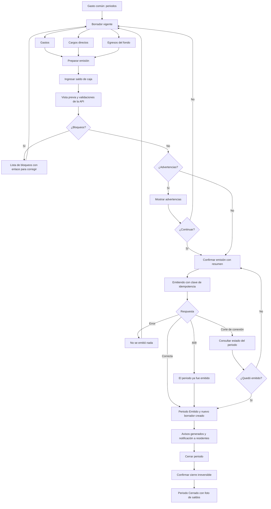

# Flujo: emitir y cerrar el periodo de gasto común

Estado: Borrador
Actor: administrador (el comité ve las mismas pantallas en modo lectura)
Superficie: web de administración
Alcance: MVP
Referencias en `docs/specs/gasto-comun.md`:

- Ciclo del periodo: A-2, A-3.1 a A-3.5 y A-5.
- Gastos y cargos: B-1 a B-5.
- Aviso de cobro: G-4 y G-5.
- Intereses: E-7, solo con el flag `billing.interest`.
- Criterios de aceptación: CA-1, CA-19, CA-20, CA-24 y CA-25.

Otras referencias: `docs/arquitectura.md` §4 (`issue-preview`).

Este flujo no define montos ni cálculos: los calcula la API según la spec. La interfaz ordena los pasos y muestra lo que devuelve la API. En los mensajes, `{dato}` marca un valor variable.

## Diagrama

## Pasos

**Borrador vigente**

1. Siempre existe un único borrador vigente (A-2). "Periodos" lo muestra arriba. No hay botón para crear periodos.
2. **Gastos:** tabla con concepto, cuenta, subcategoría, base de pesos, monto y respaldo. El formulario lateral para agregar tiene:
   - **Cuenta:** ordinario, con una subcategoría (administración, mantención, reparación, uso o consumo), o extraordinario (B-1, B-2).
   - **Base:** alícuota (por defecto) o partes iguales. Con partes iguales se eligen las unidades del conjunto.
   - **Monto:** campo de dígitos con máscara de miles y mayor que 0 (B-5).
3. **Cargos directos** por unidad (B-4):
   - Consumo individual: se ingresa el monto, que se calcula fuera de ComVive.
   - Multa: con motivo y referencia al reglamento o al acuerdo.
   - Otro: a la cuenta ordinario o extraordinario.
4. **Egresos del fondo de reserva:** monto y referencia de texto libre a la autorización (B-3).
5. **Ajustes recibidos:** lista de solo lectura con los ajustes que dejaron las correcciones de periodos anteriores (ver `admin-corregir-gasto.md`).

**Emisión**

1. "Preparar emisión" pide el **saldo de caja**: monto y fecha de corte (G-4, S-16).
2. La pantalla llama a `issue-preview` (arquitectura §4) y muestra:
   - **Bloqueos:**
     - Las alícuotas no suman 100 %, solo si algún grupo usa alícuota (A-3.1).
     - Un grupo tiene total y ninguna unidad con participación (A-3.2).
   - **Advertencias:**
     - Periodo sin gastos (CA-20).
     - Falta la tasa CMF, solo con el flag `billing.interest` activo (E-7).
   - **Vista previa:** tabla por unidad con una columna por cuenta (ordinario, fondo de reserva, extraordinario, intereses, multas y ajustes) y la suma de cada columna. Las unidades con $0 aparecen con $0 (C-5).
3. **Confirmación:** "Vas a emitir el periodo octubre 2026: 4 avisos, total $1.050.000, vencimiento 11-11-2026. Después no podrás editar sus gastos. Se creará el borrador de noviembre 2026." Botón "Emitir periodo".
4. **Envío:** la confirmación lleva una clave de idempotencia (A-3.4). Si el administrador hace doble clic o reintenta con la misma clave, recibe el mismo resultado (CA-25).
5. **Resultado:** el periodo queda **Emitido**, con los avisos en PDF disponibles, y el borrador M+1 queda creado. El botón "Notificar a residentes" envía las notificaciones (UX-6, UX-19).

**Cierre**

1. Desde el periodo Emitido, "Cerrar periodo" (A-5).
2. Confirmación: "Al cerrar octubre 2026 no se podrá modificar. Las correcciones se harán con ajustes en el borrador vigente." Para confirmar, el administrador escribe el periodo (`2026-10`).
3. Resultado: el periodo queda **Cerrado** y la foto de saldos se puede descargar.
4. El cierre no muestra advertencias (decisión del coordinador; ver UX-20 sobre A-5.2).

## Estados vacíos

- **Borrador sin gastos:** "Aún no hay gastos en este periodo." con "Agregar gasto". La emisión pide confirmación (CA-20).
- **Sin cargos directos:** "No hay multas ni consumos este mes."
- **Sin periodos emitidos (vista del comité):** "Todavía no hay periodos emitidos para revisar."

## Errores

| Caso | Mensaje | Comportamiento |
| --- | --- | --- |
| Alícuotas no suman 100 % | "Las alícuotas suman 99,9900 %; deben sumar 100,0000 %" (A-3.1, CA-19) | Bloqueo con enlace a Unidades |
| Grupo sin participación | "El grupo {cuenta} / {base} no tiene unidades con participación para repartir ${total}" (A-3.2) | Bloqueo con enlace al gasto |
| Periodo sin gastos | "El periodo no tiene gastos. Se emitirán avisos con cargo $0" (CA-20) | Pide confirmación |
| Falta tasa CMF (solo con el flag activo) | "Falta la tasa de referencia CMF desde {fecha}. Se emitirá sin intereses y se cobrarán en la próxima emisión" (E-7) | Advertencia; se puede emitir |
| Monto 0 o vacío | "Ingresa un monto mayor que $0" | El campo no acepta otros caracteres (B-5) |
| Falla en la emisión | "No se pudo emitir. No se creó ningún cargo. Intenta de nuevo." | El periodo sigue en Borrador (A-3.3) |
| Otra emisión con otra clave | "El periodo ya fue emitido" (409, A-3.4) | Recarga el periodo |
| Corte de conexión al emitir | "Revisando si el periodo quedó emitido…" | Consulta el estado antes de permitir reintentar |
| Intento de editar un periodo Emitido o Cerrado | Los botones de edición no se muestran; aparece "Corregir gasto" | Sección H |
| Comité | Los botones de acción no se muestran | 403 en la API (CA-24) |

## Carga

- **Vista previa:** esqueleto de tabla mientras responde `issue-preview`.
- **Emisión:** pantalla bloqueante "Emitiendo periodo… no cierres esta ventana". Si los PDF tardan, el periodo ya figura como Emitido y cada aviso muestra "Generando".
- **Cierre:** indicador en el botón y bloqueo del doble clic.

## Supuestos (a validar)

- El cierre se confirma escribiendo el periodo, porque es irreversible.
- La notificación a residentes es una acción separada de la emisión (UX-6).
