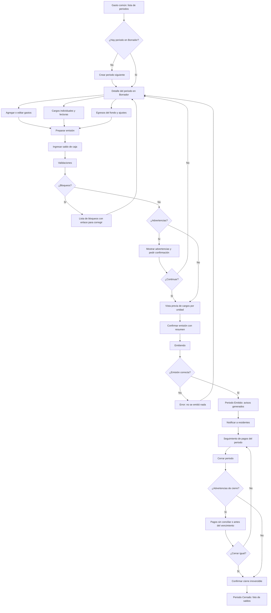

# Flujo: emitir y cerrar el periodo de gasto común

Estado: Borrador
Actor: administrador (el comité ve las mismas pantallas en modo lectura)
Superficie: web de administración
Alcance: MVP
Referencias: `docs/specs/gasto-comun.md` secciones A, B, C, E, G y H; CA-1, CA-12, CA-16, CA-17

Este flujo no define montos ni cálculos: todo cálculo lo hace la API según la spec. La interfaz solo ordena los pasos y muestra lo que la API devuelve.

## Diagrama

## Pasos

**Borrador**

1. En "Periodos" el administrador abre el periodo en Borrador o crea el siguiente (solo puede haber uno, A-2).
2. **Gastos:** tabla con concepto, tipo, subcategoría, criterio de distribución, monto y respaldo. Formulario lateral para agregar:
   - Tipo: ordinario (con subcategoría: administración, mantención, reparación, uso o consumo), extraordinario (B-1, B-2).
   - Criterio: por alícuota (por defecto), partes iguales, por consumo (C-1).
   - Monto en pesos enteros mayor que 0 (B-5). El campo no acepta coma decimal.
3. **Cargos individuales:** multa (con motivo y referencia al reglamento, B-4), consumo medido u otro cargo directo, por unidad.
4. **Lecturas de consumo:** tabla de unidades con un campo por lectura, para gastos por consumo.
5. **Egresos del fondo de reserva** con referencia a la autorización (B-3) y **ajustes** de periodos anteriores con motivo (sección H).
6. Totales en vivo devueltos por la API: ordinarios, extraordinarios, consumos, fondo de reserva y total.

**Emisión**

1. "Preparar emisión" pide el **saldo de caja**: monto, fecha de corte y cuenta bancaria (G-4, S-16).
2. **Validaciones** (la API las evalúa; la pantalla las agrupa):
   - Bloqueos: periodo anterior en Borrador (A-3); alícuotas no suman 100 % (C-4); grupo por consumo sin lecturas (casos borde).
   - Advertencias: periodo sin gastos (CA-17); comunidad con intereses sin tope CMF del mes (E-6); tasa del reglamento sobre el tope (CA-7).
3. **Vista previa:** tabla por unidad con columnas por cuenta (ordinario, fondo de reserva, extraordinario, consumos, intereses, multas, ajustes) y fila de suma por cuenta. Cada columna muestra "Cuadra con el total" (A-3.2). Supuesto: la vista previa viene de una simulación de la API (UX-5).
4. **Confirmación:** "Vas a emitir el periodo octubre 2026: 4 avisos, total $1.050.000, vencimiento 11-11-2026. Después no podrás editar sus gastos." Botón "Emitir periodo".
5. Resultado: periodo **Emitido**, avisos en PDF disponibles, opción "Notificar a residentes" (UX-6, UX-19).

**Cierre**

1. Desde el periodo Emitido, "Cerrar periodo".
2. Advertencias no bloqueantes (A-5.2): "Hay 3 pagos de octubre sin conciliar" o "Aún no vence el plazo de pago (11-11-2026)".
3. Confirmación: "Al cerrar, el periodo no admite más cambios. Las correcciones se harán con ajustes en el periodo siguiente." Escribir el nombre del periodo para confirmar (p. ej. `2026-10`).
4. Resultado: periodo **Cerrado** y foto de saldos de cierre descargable.

## Estados vacíos

- **Sin periodos:** "Crea el primer periodo para registrar los gastos del mes." con "Crear periodo".
- **Periodo sin gastos:** "Aún no hay gastos en este periodo." con "Agregar gasto"; la emisión pide confirmación (CA-17).
- **Sin cargos individuales:** "No hay multas ni consumos este mes."
- **Comité sin periodos emitidos:** "Todavía no hay periodos emitidos para revisar."

## Errores

| Caso | Mensaje | Comportamiento |
| --- | --- | --- |
| Alícuotas no suman 100 % | "Las alícuotas suman X %; deben sumar 100 %" (C-4) | Bloqueo con enlace a Unidades |
| Periodo anterior en Borrador | "Primero emite el periodo septiembre 2026" | Bloqueo con enlace |
| Consumo sin lecturas | "No hay consumos para distribuir $X" (casos borde) | Bloqueo; sugiere cambiar el criterio |
| Monto 0, negativo o con decimales | "Ingresa un monto en pesos, mayor que 0 y sin decimales" | Campo inválido |
| Falla al emitir | "No se pudo emitir. No se creó ningún cargo. Intenta de nuevo." | Periodo sigue en Borrador (A-3.2) |
| Otro usuario emitió o editó a la vez | "Este periodo cambió mientras lo revisabas. Revisa la vista previa de nuevo." | Recarga la vista previa |
| Intento de editar periodo Emitido o Cerrado | Acciones de edición no se muestran; enlace "Registrar ajuste en el periodo siguiente" | Sección H |
| Sin permiso (comité) | Botones de acción no se muestran | CA-20 |

## Carga

- Totales y vista previa: esqueleto de tabla mientras responde la API.
- Emisión: pantalla bloqueante con "Emitiendo periodo… no cierres esta ventana" y pasos (calculando cargos, generando avisos). Si los PDF tardan, el periodo ya figura Emitido y los avisos muestran "Generando" por unidad.
- Cierre: indicador en el botón y bloqueo de doble clic.

## Supuestos (a validar)

- La creación del periodo siguiente es manual, con el mes propuesto (S-2).
- El administrador ve la vista previa antes de emitir (UX-5).
- El cierre se confirma escribiendo el periodo, por ser irreversible.
