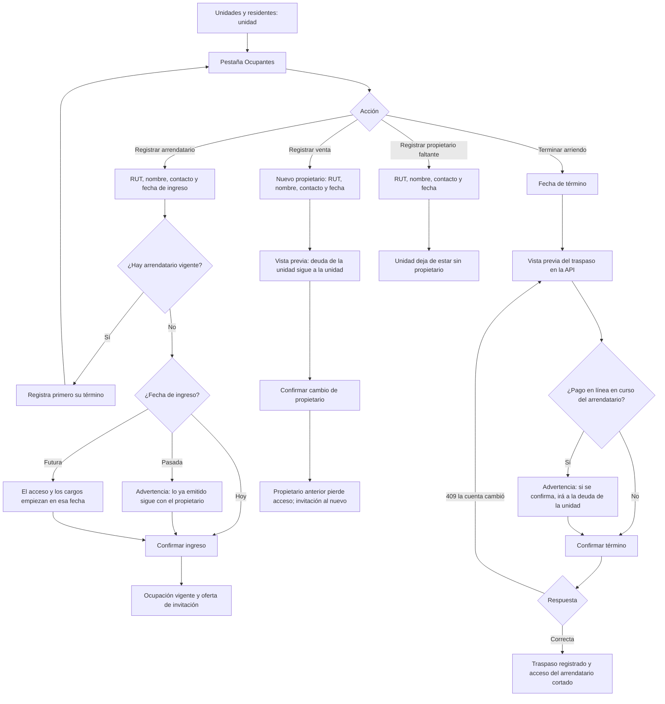

# Flujo: ocupaciones (arriendos y cambios de propietario)

Estado: Borrador
Actor: administrador (el comité ve el registro de copropietarios con datos limitados; los residentes ven el efecto en la app)
Superficie: web de administración
Alcance: MVP
Referencias en `docs/specs/gasto-comun.md`:

- Definiciones: ámbito, ocupación vigente y terminada, traspaso.
- Ámbitos y fin de la ocupación: F-9. Ocupación terminada: F-13. Ingresos y términos retroactivos: F-14. Unidad sin propietario: F-15.
- Capital traspasado: E-11. Acceso de ex residentes: S-14.
- Permisos: `occupancy.write` (solo administrador); "Datos de copropietarios que ve el comité".
- Criterios de aceptación: CA-21, CA-22, CA-35, CA-36, CA-37, CA-38 y CA-44.

Otras referencias: `docs/arquitectura.md` §3 (la membresía de residente nace y termina con `UNIT_OCCUPANCY`; revocación de sesiones y push) y §4 (movimientos `transfer`).

En los mensajes, `{dato}` marca un valor variable. Las fechas se muestran como `dd-mm-aaaa`.

## Reglas de pantalla

- **Quién:** solo el administrador registra ocupaciones. El comité ve la pestaña en lectura, con los campos de "Datos de copropietarios que ve el comité": nombre del propietario, unidad, alícuota, deuda por ámbito y RUT enmascarado; el arrendatario aparece solo como "Arrendatario", sin nombre ni RUT, y sin teléfonos ni correos de nadie.
- **Efecto desde el registro (F-14, decisión del líder del proyecto, 2026-11-07):** un ingreso o término con fecha pasada rige desde que se registra. Los cargos ya emitidos no cambian de responsable. La confirmación siempre lo advierte.
- **Vista previa del traspaso:** el término de un arriendo mueve dinero entre ámbitos, así que se confirma después de ver lo que calcula la API, igual que la emisión (A-7). La pantalla no calcula montos.
- **Una ocupación de arrendatario vigente por unidad:** para registrar otro arrendatario, primero se registra el término del actual (supuesto de diseño; UX-35).
- **Nada se borra:** una ocupación terminada queda en el historial de la unidad con sus fechas declaradas y de registro.

## Diagrama

## Pasos

**Pestaña Ocupantes de la unidad**

1. Muestra, en este orden:
   - **Propietario:** nombre, RUT (completo para el administrador), contacto, desde cuándo y estado de su invitación. Si no hay: etiqueta "Propietario sin registrar" con "Registrar propietario".
   - **Arrendatario vigente:** igual, más "Terminar arriendo". Si no hay: "Sin arrendatario" con "Registrar arrendatario".
   - **Deuda por ámbito:** "Deuda del propietario" y "Deuda del arrendatario", cada una con deuda y saldo a favor (F-9), con enlace al estado de cuenta.
   - **Historial:** ocupaciones terminadas con fecha de ingreso, fecha de término declarada, fecha de registro del término y quién lo registró.

**Registrar arrendatario (alta de arriendo)**

1. Campos: RUT (obligatorio, con dígito verificador), nombre, teléfono o correo y fecha de ingreso (hoy por defecto).
2. Si el RUT ya existe en ComVive, la pantalla solo dice "Esta persona ya tiene cuenta en ComVive; se le agregará esta unidad", sin mostrar sus datos ni sus otras comunidades (arquitectura §2).
3. **Confirmación,** según la fecha de ingreso:
   - **Hoy:** "Desde hoy, los cargos que se emitan para {unidad} irán a la deuda de {nombre}. Los cargos ya emitidos siguen siendo del propietario."
   - **Pasada (F-14, CA-37):** "La fecha de ingreso es anterior a hoy. Los cargos ya emitidos no cambian de responsable". Debajo: "El arriendo rige en ComVive desde hoy, {dd-mm-aaaa}. Si el arrendatario debe pagar cargos anteriores, acuérdenlo entre propietario y arrendatario." (P-27).
   - **Futura:** "El arriendo comienza el {dd-mm-aaaa}. Hasta entonces, los cargos siguen siendo del propietario y {nombre} no tiene acceso."
4. **Resultado:** ocupación vigente, membresía de residente creada y "Enviar invitación ahora" (ver `residente-primer-ingreso.md`).
5. **Notificación al propietario** (supuesto de diseño, UX-36): "Se registró un arriendo en tu unidad. Desde ahora verás la deuda del arrendatario aparte." Sin nombre del arrendatario en la pantalla bloqueada.

**Terminar arriendo**

1. "Terminar arriendo" pide la **fecha de término** (hoy por defecto; no se acepta una fecha futura, supuesto UX-35).
2. **Vista previa del traspaso** (la calcula la API; requisito para el arquitecto, UX-37). Muestra:
   - **Lo que pasa a la deuda del propietario:** cada débito pendiente del arrendatario con su periodo, cuenta, monto y vencimiento, que se conserva (E-11).
   - **Saldo a favor del arrendatario** que pasa al propietario, si hay.
   - **Deuda del propietario antes y después** del traspaso, y cómo se reimputa (F-6).
   - Si la fecha de término es pasada: "La fecha de término es anterior a hoy. El traspaso se hace hoy con todo lo que el arrendatario tenga pendiente, incluidos los cargos emitidos desde el {fecha de término}" (F-14, CA-37).
   - Si hay un pago en línea en curso del arrendatario (F-13, CA-35): "Hay un pago en línea en curso del arrendatario. Si se confirma, se aplicará a la deuda de la unidad".
   - "{nombre} dejará de tener acceso a la unidad de inmediato."
3. **Confirmación:** el envío lleva la versión de la vista previa y una clave de idempotencia. Si la cuenta cambió (por ejemplo, entró un pago), la API responde 409 y la pantalla pide una vista previa nueva.
4. **Resultado:**
   - El traspaso queda en el estado de cuenta del propietario como "Traspaso desde arriendo terminado el {dd-mm-aaaa}", por periodo y cuenta.
   - El ex arrendatario pierde el acceso en ese momento: sus sesiones se revocan, su dispositivo deja de recibir notificaciones de la comunidad y su copia local se borra al abrir la app (S-14, arquitectura §3 y §5).
   - **Notificación al propietario** (supuesto de diseño, UX-36): "Hay cambios en la deuda de tu unidad. Revisa tu estado de cuenta." Sin montos.
5. **Después del término:**
   - Un pago Webpay iniciado antes y confirmado después se aplica a la deuda de la unidad (F-13, CA-35). El administrador lo ve en el estado de cuenta como "Pago del arrendatario anterior aplicado a la deuda de la unidad".
   - Una corrección o anulación de gasto que afecta cargos del arrendatario anterior aparece en la vista previa con "Arrendatario anterior (pasa al propietario)" (F-13, CA-36).
   - Un pago manual del ex arrendatario se registra en la deuda del propietario: el formulario no ofrece ocupaciones terminadas (F-9).

**Registrar venta (cambio de propietario)**

1. "Registrar venta" pide RUT, nombre, contacto y fecha de inscripción o de entrega del nuevo propietario.
2. **Vista previa:**
   - "La deuda de la unidad, ${monto}, sigue a la unidad y pasa a ser responsabilidad de {nuevo propietario}, incluida la anterior a la compra (Ley 21.442, art. 6)."
   - Si hay saldo a favor del propietario anterior: "El saldo a favor de ${monto} queda en la unidad". Cualquier devolución entre vendedor y comprador es un asunto entre ellos (pregunta UX-38).
   - "El arriendo vigente de {unidad} no cambia" si hay arrendatario.
   - Si el propietario anterior integra el comité: "{nombre} integra el comité. Al dejar de ser propietario, perderá el rol de comité" (supuesto, UX-39).
   - "{propietario anterior} dejará de tener acceso a la unidad de inmediato" (CA-21).
3. **Confirmación** con clave de idempotencia. Si la fecha es pasada, la misma advertencia de F-14: "Los cargos y avisos ya emitidos no cambian de destinatario".
4. **Resultado:** el propietario anterior pierde el acceso; se ofrece invitar al nuevo. Los próximos avisos van a su nombre.

**Unidad sin propietario registrado (F-15)**

- La unidad muestra la etiqueta "Propietario sin registrar" en Unidades, en la tabla de cuentas y en la vista previa de emisión (CA-38).
- Su aviso legal sale a nombre de "Propietario: sin registrar" y no se notifica a ningún propietario.
- La deuda del ámbito `unidad` solo se puede pagar con un pago manual del administrador.
- "Registrar propietario" usa el mismo formulario de la venta, sin la parte del propietario anterior.

## Estados vacíos

- **Unidad sin ocupantes:** "Esta unidad no tiene propietario ni arrendatario registrados." con "Registrar propietario".
- **Sin arrendatario:** "Sin arrendatario" con "Registrar arrendatario".
- **Historial vacío:** "No hay ocupaciones anteriores."
- **Traspaso sin nada pendiente:** "El arrendatario no tiene deuda ni saldo a favor. No se moverá dinero."

## Errores

| Caso | Mensaje | Comportamiento |
| --- | --- | --- |
| RUT faltante o inválido | "Ingresa un RUT válido. Revisa el dígito verificador" | El campo es inválido |
| Ya hay un arrendatario vigente | "La unidad ya tiene un arrendatario vigente. Registra su término antes de agregar otro" | Enlace a "Terminar arriendo" |
| El mismo RUT ya es propietario de la unidad | "Esta persona ya es propietaria de esta unidad" | No se guarda |
| Fecha de término anterior a la fecha de ingreso | "La fecha de término no puede ser anterior al ingreso ({dd-mm-aaaa})" | El campo es inválido |
| Fecha de término futura | "Registra el término el día que ocurra" | El campo es inválido (supuesto UX-35) |
| La cuenta cambió desde la vista previa del traspaso | "La cuenta de la unidad cambió desde la vista previa. Revisa la nueva vista previa antes de confirmar" | Nueva vista previa |
| Corte de conexión al confirmar | "Revisando si el cambio quedó registrado…" | Consulta el estado; reintenta con la misma clave |
| Comité | Las acciones no se muestran | 403 en la API |

## Carga

- **Vista previa del traspaso o de la venta:** esqueleto de la tabla.
- **Confirmar:** botón con indicador y bloqueo del doble envío.

## Supuestos (a validar)

- Una sola ocupación de arrendatario vigente por unidad; sin coarrendatarios (UX-35).
- El término no se registra con fecha futura (UX-35).
- La vista previa del traspaso tiene su propio endpoint con versión (UX-37).
- El propietario recibe notificaciones sin montos al registrarse un arriendo o un traspaso (UX-36).
- El propietario que vende pierde el rol de comité (UX-39).
- Varios propietarios por unidad, propietario persona jurídica y residentes sin RUT quedan fuera de este flujo hasta que el analista los defina (UX-40).
