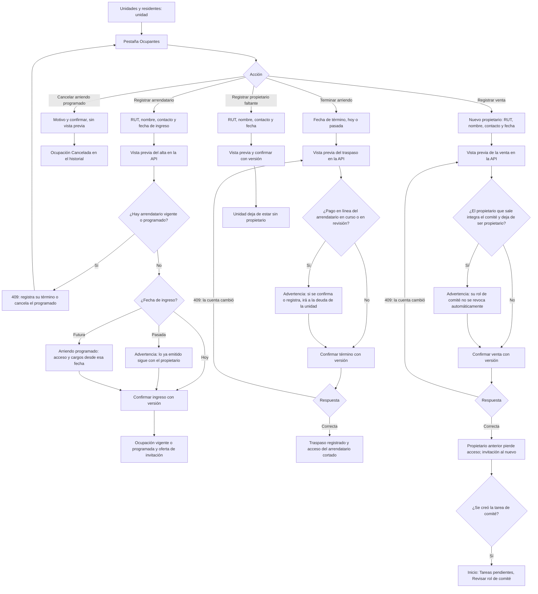

# Flujo: ocupaciones (arriendos y cambios de propietario)

Estado: Borrador
Actor: administrador (el comité ve el registro de copropietarios con datos limitados; los residentes ven el efecto en la app)
Superficie: web de administración
Alcance: MVP
Referencias en `docs/specs/gasto-comun.md`:

- Definiciones: ámbito, ocupación, inicio y fin efectivos, ocupación programada, vigente y terminada, traspaso.
- Ámbitos, visibilidad y fin de la ocupación: F-9. Ocupación terminada: F-13. Ingresos y términos retroactivos o futuros, rutas y vista previa: F-14. Unidad sin propietario: F-15.
- Vista previa confirmada del término y de la venta, con su huella: A-7.
- Comité que deja de ser propietario (M-7). Datos del arrendatario que ve el propietario (S-44).
- Capital traspasado: E-11. Acceso de ex residentes: S-14.
- Permisos: `occupancy.write` (solo administrador); "Datos de copropietarios que ve el comité".
- Códigos y mensajes de error: tabla de la spec (filas de F-14).
- Criterios de aceptación: CA-21, CA-22, CA-35, CA-36, CA-37, CA-38, CA-44, CA-53, CA-56 y CA-57.

Otras referencias: `docs/arquitectura.md` §3 (la membresía de residente nace y termina con `UNIT_OCCUPANCY`; revocación: elimina las suscripciones push y no cierra sesiones, H-42; "Comité que deja de ser propietario") y §4 ("Ocupaciones": fechas declaradas, de registro y efectivas, endpoints de vista previa y ejecución; movimientos `transfer`; "Visibilidad por ámbito").

En los mensajes, `{dato}` marca un valor variable. Las fechas se muestran como `dd-mm-aaaa`.

> **Revisión crítica 3 (`docs/revisiones/2026-11-07-diseno-rev3.md`): cambios aplicados.** M-6: término de arriendo y venta con vista previa, versión y 409 (UX-37 cerrada), arriendo programado y fechas declaradas y de registro. M-7: el comité que vende no pierde el rol automáticamente; queda una tarea pendiente (UX-39 cerrada). Menor 2: ámbito `owner`. Menor 5: textos y códigos de la spec.

## Reglas de pantalla

- **Quién:** solo el administrador registra ocupaciones. El comité ve la pestaña en lectura, con los campos de "Datos de copropietarios que ve el comité": nombre del propietario, unidad, alícuota, deuda por ámbito y RUT enmascarado; el arrendatario aparece solo como "Arrendatario", sin nombre ni RUT, y sin teléfonos ni correos de nadie.
- **Efecto desde el registro (F-14, decisión del líder del proyecto, 2026-11-07):** un ingreso o término con fecha pasada rige desde que se registra. Los cargos ya emitidos no cambian de responsable. La confirmación siempre lo advierte.
- **Fechas a la vista:** cada ocupación muestra su fecha declarada (la del contrato o la inscripción) y la fecha y hora en que se registró, con quién la registró. El sistema usa las fechas efectivas, nunca las declaradas (F-14).
- **Visibilidad por ámbito (F-9, M-6):** lo que ve el arrendatario depende solo del ámbito de cada cargo, nunca de fechas. La pantalla no ofrece reasignar cargos ya emitidos.
- **Vistas previas con versión (A-7, M-6):** el alta, el término y la venta (no la cancelación de un arriendo programado, que no mueve dinero) se confirman después de ver lo que calcula la API, con la versión de la vista previa (`previewHash`) y una clave de idempotencia. La pantalla no calcula montos.
- **Un arrendatario vigente o programado por unidad (F-14):** para registrar otro, primero se registra el término del vigente o se cancela el programado. Los coarrendatarios quedan fuera del MVP (UX-35).
- **Nada se borra:** una ocupación terminada o cancelada queda en el historial de la unidad con sus fechas declaradas y de registro.

## Diagrama

## Pasos

**Pestaña Ocupantes de la unidad**

1. Muestra, en este orden:
   - **Propietario:** nombre, RUT (completo para el administrador), contacto, fecha de ingreso declarada, fecha de registro y estado de su invitación. Si no hay: etiqueta "Propietario sin registrar" con "Registrar propietario".
   - **Arrendatario vigente:** igual, más "Terminar arriendo". Si no hay: "Sin arrendatario" con "Registrar arrendatario".
   - **Arrendatario programado** (ingreso con fecha futura, F-14): etiqueta "Programado: comienza el {dd-mm-aaaa}", con "Cancelar arriendo programado".
   - **Deuda por ámbito:** "Deuda del propietario" y "Deuda del arrendatario", cada una con deuda y saldo a favor (F-9), con enlace al estado de cuenta.
   - **Historial:** ocupaciones terminadas o canceladas con fecha de ingreso declarada, fecha de registro del ingreso, fecha de término declarada, fecha de registro del término y quién registró cada una. Las canceladas dicen "Cancelada" con su motivo.

**Registrar arrendatario (alta de arriendo)**

1. Campos: RUT (obligatorio, con dígito verificador), nombre, teléfono o correo y fecha de ingreso (hoy por defecto).
2. **Vista previa** (`POST .../units/{unitId}/occupancies/preview`): devuelve la ocupación a crear con su fecha efectiva, la membresía a crear y si la persona ya existe en ComVive. Si ya existe, la pantalla solo dice "Esta persona ya tiene cuenta en ComVive; se le agregará esta unidad", sin mostrar sus datos ni sus otras comunidades (arquitectura §2).
3. **Confirmación,** según la fecha de ingreso:
   - **Hoy:** "Desde hoy, los cargos que se emitan para {unidad} irán a la deuda de {nombre}. Los cargos ya emitidos siguen siendo del propietario."
   - **Pasada (F-14, CA-37):** "La fecha de ingreso es anterior a hoy. Los cargos ya emitidos no cambian de responsable". Debajo, texto del diseño: "El arriendo rige en ComVive desde hoy, {dd-mm-aaaa}. Si el arrendatario debe pagar cargos anteriores, acuérdenlo entre propietario y arrendatario." (P-27 cerrada).
   - **Futura (F-14, S-47):** "El arriendo comienza el {dd-mm-aaaa}. Hasta entonces, los cargos siguen siendo del propietario y {nombre} no tiene acceso".
   - **Aviso de privacidad para el arrendatario** (S-44), que se le mostrará en la invitación: "El propietario de la unidad puede ver tu nombre, tu deuda de gasto común y los pagos que se aplican a ella. La administración de la comunidad ve todos tus datos de cobro".
4. **Envío** (`POST .../units/{unitId}/occupancies`) con la versión de la vista previa y una clave de idempotencia (arquitectura §4).
5. **Resultado:** ocupación vigente (o programada), membresía de residente creada con la misma fecha efectiva y "Enviar invitación ahora" (ver `residente-primer-ingreso.md`). Un arrendatario programado no tiene acceso ni recibe notificaciones hasta su fecha de ingreso.
6. **Notificación al propietario** (supuesto de diseño, UX-36): "Se registró un arriendo en tu unidad. Desde ahora verás la deuda del arrendatario aparte." Sin nombre del arrendatario en la pantalla bloqueada.

**Cancelar arriendo programado (F-14)**

1. Solo para un arriendo programado que aún no comienza. Pide motivo obligatorio, con la ayuda "No incluyas datos personales".
2. Confirmación: "El arriendo de {nombre} no comenzará. Quedará como Cancelado en el historial. No hay cargos ni traspasos." No tiene vista previa, porque no mueve dinero (arquitectura §4).
3. Envío (`POST .../occupancies/{occupancyId}/cancel`) con el motivo y una clave de idempotencia.
4. Resultado: la ocupación queda "Cancelada" con su motivo y en auditoría. La persona no tuvo acceso, así que no se corta nada. Después se puede registrar otro arrendatario.
5. Errores, en el orden en que los responde la API (F-14, CA-61): `USE_OWNERSHIP_TRANSFER` → estado de la ocupación (`OCCUPANCY_ALREADY_STARTED`, `OCCUPANCY_ALREADY_ENDED` u `OCCUPANCY_CANCELLED`) → `REASON_REQUIRED`. Textos en "Errores".

**Terminar arriendo**

1. "Terminar arriendo" pide la **fecha de término declarada** (hoy por defecto; no se acepta una fecha futura, F-14, S-47).
2. **Vista previa del traspaso** (`POST .../occupancies/{occupancyId}/end-preview`, A-7, M-6). Muestra lo que calcula la API:
   - **Lo que pasa a la deuda del propietario:** cada débito pendiente del arrendatario con su periodo, cuenta, monto y vencimiento, que se conserva (E-11).
   - **Saldo a favor del arrendatario** que pasa al propietario, si hay.
   - **Deuda del propietario antes y después** del traspaso, y cómo se reimputa (F-6).
   - Si la fecha de término es pasada (F-14, CA-37): "La fecha de término es anterior a hoy. Lo pendiente del arriendo, incluidos los cargos emitidos desde esa fecha, pasa hoy a la deuda del propietario".
   - Si hay un pago en línea en curso del arrendatario (F-13, CA-35): "Hay un pago en línea en curso del arrendatario. Si se confirma, se aplicará a la deuda de la unidad".
   - Si hay un pago en línea del arrendatario en revisión (F-13, CA-54): "Hay un pago en línea del arrendatario en revisión por ComVive. Si se registra, se aplicará a la deuda de la unidad".
   - "{nombre} dejará de tener acceso a la unidad de inmediato."
3. **Confirmación** (`POST .../occupancies/{occupancyId}/end`): el envío lleva la versión de la vista previa y una clave de idempotencia. Si la cuenta cambió (por ejemplo, entró un pago, CA-56), la API responde 409 `PREVIEW_OUTDATED` y la pantalla pide una vista previa nueva y marca lo que cambió.
4. **Resultado:**
   - El traspaso queda en el estado de cuenta del propietario, sin el nombre del ex arrendatario (F-17, S-44, CA-56): la deuda como "Traspaso desde arriendo terminado el {dd-mm-aaaa}", por periodo y cuenta, y el saldo a favor como "Saldo a favor traspasado desde arriendo terminado el {dd-mm-aaaa}".
   - El ex arrendatario pierde el acceso en ese momento: sus sesiones **no** se cierran (H-42, arquitectura §3, "Revocación"), pero la comunidad le responde 404 desde la petición siguiente, se eliminan sus suscripciones push de esa membresía y su copia local se borra al abrir la app (S-14, arquitectura §3 y §5). Si tiene otras comunidades, siguen funcionando con la misma sesión.
   - **Notificación al propietario** (supuesto de diseño, UX-36): "Hay cambios en la deuda de tu unidad. Revisa tu estado de cuenta." Sin montos.
5. **Después del término:**
   - Un pago Webpay iniciado antes y confirmado después, o registrado por Soporte ComVive después de una revisión, se aplica a la deuda de la unidad (F-13, CA-35, CA-54). El pago queda en el ámbito del arriendo terminado y su monto pasa al propietario; el administrador lo ve en el estado de cuenta del propietario como "Saldo a favor traspasado desde arriendo terminado el {dd-mm-aaaa}" (F-17).
   - Una corrección o anulación de gasto que afecta cargos del arrendatario anterior aparece en la vista previa con "Arrendatario anterior (pasa al propietario)" (F-13, CA-36).
   - Un pago manual del ex arrendatario se registra en la deuda del propietario: el formulario no ofrece ocupaciones terminadas ni programadas (F-9).

**Registrar venta (cambio de propietario)**

1. "Registrar venta" pide RUT, nombre, contacto y fecha de inscripción o de entrega del nuevo propietario (hoy o pasada; no se acepta una fecha futura, F-14).
2. **Vista previa** (`POST .../units/{unitId}/ownership-transfers/preview`, A-7, M-6). Muestra lo que entrega la API:
   - Propietario que sale y propietario que entra.
   - "La deuda del propietario, ${deuda bruta}, sigue a la unidad y pasa a ser responsabilidad de {nuevo propietario}, incluida la anterior a la compra (Ley 21.442, art. 6)." La venta no mueve dinero.
   - Si hay saldo a favor en la deuda del propietario: "El saldo a favor de ${monto} queda en la unidad". Cualquier devolución entre vendedor y comprador es un asunto entre ellos (pregunta UX-38).
   - "El arriendo vigente de {unidad} no cambia" si hay arrendatario.
   - **Si el propietario que sale integra el comité y deja de ser propietario en la comunidad** (M-7, CA-57): "{nombre} integra el comité y dejará de ser propietario en la comunidad. Su rol de comité no se revoca automáticamente: decide si lo mantienes o lo revocas". Si conserva otra unidad en la comunidad, no aparece.
   - "{propietario anterior} dejará de tener acceso a la unidad de inmediato" (CA-21).
   - Si la fecha es pasada (F-14): "La fecha de venta es anterior a hoy. Los avisos ya emitidos siguen a nombre del propietario anterior y la deuda de la unidad no cambia".
3. **Confirmación** (`POST .../units/{unitId}/ownership-transfers`) con la versión de la vista previa y una clave de idempotencia. Si cambió la deuda del propietario, un arriendo de la unidad o la situación de comité del propietario que sale, la API responde 409 `PREVIEW_OUTDATED` y la pantalla pide una vista previa nueva.
4. **Resultado:**
   - El propietario anterior pierde el acceso de residente a la unidad; se ofrece invitar al nuevo. Los próximos avisos van a su nombre.
   - Si correspondía la advertencia de comité: la persona **conserva su rol de comité** mientras el administrador decide, y en la misma operación se crea la tarea "Revisar rol de comité de {nombre}" en Inicio > Tareas pendientes, con alerta a cada administrador de la comunidad. La pantalla lo confirma con "Se creó la tarea Revisar rol de comité de {nombre}" y el enlace "Ir a la tarea". El flujo de la tarea está en `admin-usuarios-y-roles.md`.

**Unidad sin propietario registrado (F-15)**

- La unidad muestra la etiqueta "Propietario sin registrar" en Unidades, en la tabla de cuentas y en la vista previa de emisión (CA-38).
- Su aviso legal sale a nombre de "Propietario: sin registrar" y no se notifica a ningún propietario.
- La deuda del ámbito `owner` solo se puede pagar con un pago manual del administrador.
- "Registrar propietario" usa el mismo formulario y las mismas rutas de la venta (`ownership-transfers`), sin la parte del propietario anterior.

## Estados vacíos

- **Unidad sin ocupantes:** "Esta unidad no tiene propietario ni arrendatario registrados." con "Registrar propietario".
- **Sin arrendatario:** "Sin arrendatario" con "Registrar arrendatario".
- **Historial vacío:** "No hay ocupaciones anteriores."
- **Traspaso sin nada pendiente:** "El arrendatario no tiene deuda ni saldo a favor. No se moverá dinero."

## Errores

Los textos con código son los de la tabla "Códigos y mensajes de error" de la spec, copiados tal cual.

| Caso | Código | Mensaje | Comportamiento |
| --- | --- | --- | --- |
| RUT faltante o inválido | 422 `INVALID_RUT` | "Ingresa un RUT válido. Revisa el dígito verificador" | El campo es inválido |
| Ya hay un arrendatario vigente o programado | 409 `TENANT_ALREADY_ACTIVE` | "La unidad ya tiene un arrendatario vigente o programado. Registra su término o cancela el arriendo programado antes de agregar otro" | Enlace a "Terminar arriendo" o "Cancelar arriendo programado" |
| El mismo RUT ya es propietario de la unidad | 409 `ALREADY_OWNER` | "Esta persona ya es propietaria de esta unidad" | No se guarda |
| Fecha de término anterior a la fecha de ingreso | 422 `END_BEFORE_START` | "La fecha de término no puede ser anterior al ingreso ({dd-mm-aaaa})" | El campo es inválido |
| Fecha de término futura | 422 `END_DATE_IN_FUTURE` | "Registra el término el día que ocurra" | El campo es inválido (CA-56) |
| Fecha de venta futura | 422 `END_DATE_IN_FUTURE` | "Registra la venta el día que ocurra" | El campo es inválido |
| El arriendo ya terminó (otra persona lo registró) | 409 `OCCUPANCY_ALREADY_ENDED` | "Este arriendo ya terminó" | Recarga la pestaña Ocupantes (CA-56) |
| Terminar o cancelar la ocupación del propietario | 422 `USE_OWNERSHIP_TRANSFER` | "Para cambiar al propietario, registra la venta" | Las acciones no se ofrecen al propietario; si llegan a la API, se rechazan |
| Cancelar un arriendo que ya comenzó | 409 `OCCUPANCY_ALREADY_STARTED` | "Este arriendo ya comenzó. Para terminarlo, registra su término" | Recarga la pestaña con "Terminar arriendo" (CA-61) |
| Cancelar un arriendo terminado | 409 `OCCUPANCY_ALREADY_ENDED` | "Este arriendo ya terminó" | Recarga la pestaña Ocupantes |
| Cancelar un arriendo ya cancelado | 409 `OCCUPANCY_CANCELLED` | "Este arriendo ya fue cancelado" | Recarga la pestaña Ocupantes |
| Cancelar sin motivo | 422 `REASON_REQUIRED` | "Indica el motivo de la cancelación" | El campo es inválido |
| La cuenta cambió desde la vista previa del término o de la venta | 409 `PREVIEW_OUTDATED` | "La cuenta de la unidad cambió desde la vista previa. Revisa la nueva vista previa antes de confirmar" | Nueva vista previa con los cambios marcados (A-7, CA-56) |
| Misma clave de idempotencia con otros datos | 422 `IDEMPOTENCY_KEY_REUSED` | "Esta operación ya se envió con otros datos. Vuelve a abrir el formulario" | Cierra la confirmación y recarga la pestaña |
| Corte de conexión al confirmar | — | "Revisando si el cambio quedó registrado…" | Consulta el estado; reintenta con la misma clave |
| Comité | 403 `FORBIDDEN` | "Tu rol no permite esta acción" | Las acciones no se muestran; el texto solo aparece si llega a la API |

## Carga

- **Vista previa del alta, del traspaso o de la venta:** esqueleto de la tabla.
- **Confirmar:** botón con indicador y bloqueo del doble envío.

## Supuestos (a validar)

- Sin coarrendatarios: una sola ocupación de arrendatario vigente o programada por unidad (UX-35; arquitectura §4, "Unicidad").
- El propietario recibe notificaciones sin montos al registrarse un arriendo o un traspaso (UX-36).
- Los textos de la confirmación del alta con fecha de hoy, del segundo párrafo del ingreso pasado y de la cancelación son del diseño.
- Varios propietarios por unidad, propietario persona jurídica y residentes sin RUT quedan fuera de este flujo hasta que el analista los defina (UX-40).
