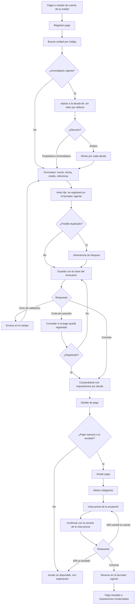

# Flujo: registrar un pago manual y anularlo

Estado: **Aprobado** (aprobado por el líder del proyecto el 2026-11-08, cierre de la Etapa 1)
Actor: administrador (el comité ve pagos y anulaciones en modo lectura)
Superficie: web de administración
Alcance: MVP
Referencias en `docs/specs/gasto-comun.md`:

- Movimientos posteriores a la emisión: A-4 (S-17).
- Versión confirmada: A-7.
- Pagos: F-1 a F-4, F-6, F-9 (ámbito de los créditos), F-12 (un pago, un crédito por ámbito), F-13 (ocupación terminada) y F-15 (unidad sin propietario).
- Textos que ve el residente: F-17. Códigos y mensajes de error: tabla de la spec.
- Criterios de aceptación: CA-5, CA-11, CA-12, CA-15, CA-31, CA-32, CA-40, CA-53, CA-56 y CA-67.

Otras referencias: `docs/arquitectura.md` §4 (vistas previas con `previewHash` y 409 `PREVIEW_OUTDATED`; idempotencia de pagos manuales; grupo de pagos `payment_group_id` y rutas `payment-groups/{paymentGroupId}/void-preview` y `.../void`).

> **Revisión crítica 3 (`docs/revisiones/2026-11-07-diseno-rev3.md`): cambios aplicados.** M-8: el residente ve el pago manual como "Registrado por la administración". Menor 2: ámbito `owner`. Menor 5: textos y códigos de la spec. La anulación se hace sobre el grupo de pagos.

En la interfaz, la corrección se llama **"Anular pago"**: un pago nunca se edita ni se borra; se registra un reverso que apunta al original (F-4). En los mensajes, `{dato}` marca un valor variable.

## Diagrama

## Pasos

**Registrar**

1. "Registrar pago" desde Pagos o desde el estado de cuenta de una unidad (en ese caso la unidad ya viene elegida). Al abrirse, el formulario genera su clave de idempotencia (F-2).
2. Se busca la unidad por código, con autocompletado.
3. **Aplicar a la deuda de** (F-9, M2). Va antes del monto y muestra la situación de cada deuda con los datos de la API:
   - **Unidad sin arrendatario vigente:** no se pregunta. El pago va a la deuda del propietario (ámbito `owner`) y el formulario lo dice: "Se aplicará a la deuda del propietario".
   - **Unidad con arrendatario vigente:** opciones sin valor por defecto, cada una con su deuda y su saldo a favor:
     - "Propietario {nombre}: deuda ${monto} · a favor ${monto}"
     - "Arrendatario {nombre}: deuda ${monto} · a favor ${monto}"
     - "Ambos"
   - **"Ambos":** aparecen dos campos de monto, "Para la deuda del propietario" y "Para la deuda del arrendatario". Debajo, "Total del pago: ${suma}" como control contra el comprobante bancario; es la suma de los dos montos escritos, no un cálculo de deuda, y el comprobante final lo entrega la API (F-12).
   - **Unidad sin propietario registrado** (F-15): la opción "Propietario" se llama "Deuda de la unidad (propietario sin registrar)". Es la única forma de pagar ese ámbito.
   - **Ex arrendatario que paga después del término:** no hay opción para ocupaciones terminadas. La ayuda dice: "Los pagos de un arrendatario que ya no está se aplican a la deuda del propietario" (F-9, P-26).
   - **Arriendo programado (aún no comienza):** no se ofrece; el pago va a la deuda del propietario (F-9, F-14, CA-53).
   - **Lo que verá el residente:** el pago aparece en la app como "Registrado por la administración", tanto para el propietario como para el arrendatario, aunque el administrador sepa quién transfirió (F-12, F-17). La pantalla lo dice bajo "Aplicar a la deuda de".
4. **Formulario** (F-1):
   - **Monto:** campo de dígitos con máscara de miles. Envía un entero mayor que 0 y hasta $9.999.999.999 (B-5, B-6). Con "Ambos", cada campo es mayor que 0; el envío lleva una asignación por deuda, cada una con su monto (F-1).
   - **Fecha de pago:** hoy por defecto. No se aceptan fechas futuras en hora de Chile (F-1, CA-15).
   - **Medio:** transferencia, depósito, efectivo, cheque u otro.
   - **Referencia:** obligatoria (F-1); vacía o de solo espacios, la API responde 422 `PAYMENT_REFERENCE_REQUIRED` con "Ingresa la referencia del pago" (S-62, CA-67). La ayuda dice "Número de comprobante o de recibo. No incluyas datos personales". La referencia no tiene que ser única (F-2).
5. **Aviso fijo** bajo el formulario (A-4, S-17): "Se registrará en el periodo en borrador {mes} con fecha de pago {dd-mm-aaaa}."
6. **Posible duplicado** (F-3, CA-11, CA-31). El formulario consulta a la API y advierte sin bloquear en dos casos:
   - Misma unidad, monto, fecha y medio: "Ya existe un pago de ${monto} para {unidad} con fecha {dd-mm-aaaa} por {medio}. Revisa que no sea un duplicado".
   - Misma referencia (sin distinguir mayúsculas ni espacios), mismo medio y mismo monto en la comunidad: "Ya existe un pago de ${monto} por {medio} con la referencia "{referencia}" ({unidad}, {dd-mm-aaaa}). Revisa que no sea un duplicado".
7. **Guardar:** el envío lleva la clave del formulario. Un doble clic o un reintento con la misma clave devuelve el mismo pago (F-2). Ante un corte de conexión, la pantalla consulta si el pago quedó registrado antes de permitir reintentar, y reintenta con la misma clave.
8. **Comprobante:** muestra las imputaciones que hizo la API, separadas por deuda ("Deuda del propietario" y "Deuda del arrendatario"), por periodo y cuenta, más el saldo a favor si queda en cada una, y la deuda y el saldo a favor resultantes de cada ámbito. Botones "Registrar otro pago" y "Ver estado de cuenta".

**Anular**

1. Desde el detalle del pago, "Anular pago". Solo está disponible en pagos manuales no anulados (permiso `payment.void`). La anulación es sobre el grupo de pagos (`payment_group_id`): si el registro fue "Ambos", anula los dos pagos juntos, también después de 30 días (F-4).
2. Motivo obligatorio (UX-17), con la ayuda "No incluyas datos personales".
3. **Vista previa de la anulación** (`void-preview`, A-7): la pantalla muestra lo que entrega la API, por ámbito:
   - El reverso de ${monto} en el borrador vigente {mes}.
   - Los cargos que vuelven a quedar pendientes.
   - Los saldos a favor que se reimputan (F-6).
   - Con el flag `billing.interest` activo, los ajustes de intereses (E-10).
   - La deuda y el saldo a favor resultantes de cada ámbito.
   - Si el pago tiene un crédito por ámbito, la anulación revierte los dos: "Este pago se aplicó a dos deudas. Se anulará completo" (F-4).
4. **Confirmación:** "Se registrará un reverso de ${monto} en el periodo en borrador {mes}. El pago original no se borra." El envío lleva la versión de la vista previa (`previewHash`) y una clave de idempotencia.
5. **Resultado:** el pago queda con la etiqueta **Anulado**, enlazado a su reverso, y la pantalla muestra las imputaciones nuevas. El pago y el reverso siguen visibles en el estado de cuenta.

## Estados vacíos

- **Sin pagos en el filtro:** "No hay pagos registrados en este periodo." con "Registrar pago".
- **Deuda elegida en $0:** "Esta deuda no tiene saldo pendiente. El pago quedará como saldo a favor de {propietario o arrendatario}." (F-5). No bloquea.

## Errores

Los textos con código son los de la tabla "Códigos y mensajes de error" de la spec, copiados tal cual.

| Caso | Código | Mensaje | Comportamiento |
| --- | --- | --- | --- |
| Monto vacío, 0 o con decimales | 422 `INVALID_AMOUNT` | "El monto debe ser un número entero de pesos mayor que $0" | El campo no acepta otros caracteres (B-5) |
| Monto sobre el máximo | 422 `AMOUNT_TOO_LARGE` | "El monto supera el máximo permitido de $9.999.999.999" | El campo es inválido (B-6) |
| Fecha futura | 422 `PAID_ON_IN_FUTURE` | "La fecha de pago no puede ser futura" | El campo es inválido (F-1, CA-15) |
| Referencia vacía o de solo espacios | 422 `PAYMENT_REFERENCE_REQUIRED` | "Ingresa la referencia del pago" | El campo es inválido. La API lo valida después de la deuda, el arriendo, el monto y la fecha (F-1, S-62, CA-67; texto aprobado por el líder el 2026-11-07) |
| Unidad con arrendatario vigente sin elegir a qué deuda | 422 `SCOPE_REQUIRED` | "Elige a qué deuda aplicar el pago" | No se envía; si llega a la API, se rechaza sin escribir nada (F-9, CA-32) |
| El arriendo terminó mientras el formulario estaba abierto | 409 `OCCUPANCY_ALREADY_ENDED` | "El arriendo de esta persona ya terminó. Aplica el pago a la deuda del propietario" | Recarga "Aplicar a la deuda de" sin la opción del arrendatario (CA-56) |
| El pago se dirige a un arriendo programado | 409 `OCCUPANCY_NOT_STARTED` | "El arriendo aún no comienza. Aplica el pago a la deuda del propietario" | Recarga "Aplicar a la deuda de" (CA-53) |
| El pago se dirige a un arriendo cancelado | 409 `OCCUPANCY_CANCELLED` | "Este arriendo fue cancelado y nunca comenzó. Aplica el pago a la deuda del propietario" | Recarga "Aplicar a la deuda de" |
| "Ambos" con la misma deuda dos veces | 422 `DUPLICATE_SCOPE` | "Cada deuda puede aparecer una sola vez en el pago" | No debería ocurrir desde el formulario; si llega a la API, se rechaza |
| Misma clave de idempotencia con otros datos | 422 `IDEMPOTENCY_KEY_REUSED` | "Esta operación ya se envió con otros datos. Vuelve a abrir el formulario" | Pide reabrir el formulario |
| Unidad no encontrada | — | "No hay unidades con ese código en esta comunidad" | Sugiere revisar el código |
| Posible duplicado | — | Textos del paso 6 (F-3) | Advertencia; permite guardar |
| Doble envío con la misma clave | — | Sin mensaje | Muestra el comprobante del pago ya registrado (F-2) |
| Anular sin motivo | 422 `REASON_REQUIRED` | "Indica el motivo de la anulación" | El campo es inválido (F-4) |
| La cuenta cambió entre la vista previa y la anulación | 409 `PREVIEW_OUTDATED` | "La cuenta de la unidad cambió desde la vista previa. Revisa la nueva vista previa antes de anular" | Pide una vista previa nueva y marca lo que cambió (A-7, CA-40) |
| Anular un grupo de pagos ya anulado | 409 `PAYMENT_ALREADY_VOIDED` | "El pago ya fue anulado" | Recarga el detalle con la etiqueta Anulado (CA-40) |
| Anular un pago que no es manual (Webpay) | 422 `PAYMENT_NOT_VOIDABLE` | "Este pago no se puede anular desde ComVive" | El botón no se muestra; el detalle muestra el mismo texto en su lugar (F-4) |
| Sin conexión | — | "No se pudo confirmar el registro. Revisando…" | Consulta el estado y conserva los datos del formulario |
| Comité | 403 `FORBIDDEN` | "Tu rol no permite esta acción" | Los botones "Registrar pago" y "Anular pago" no se muestran (CA-24) |

## Carga

- **Búsqueda de unidad:** resultados al escribir, con un indicador pequeño.
- **Deudas por ámbito y advertencia de duplicado:** esqueleto en las opciones de "Aplicar a la deuda de" mientras responde la API.
- **Vista previa de la anulación:** esqueleto de la tabla.
- **Guardar y anular:** botón con indicador y bloqueo del doble envío.

## Supuestos (a validar)

- Los pagos sin unidad identificada quedan fuera de este flujo (UX-11).
- La lista de motivos de anulación está en UX-17.
- El "Total del pago" con "Ambos" se muestra como suma de lo escrito, solo como control visual.
