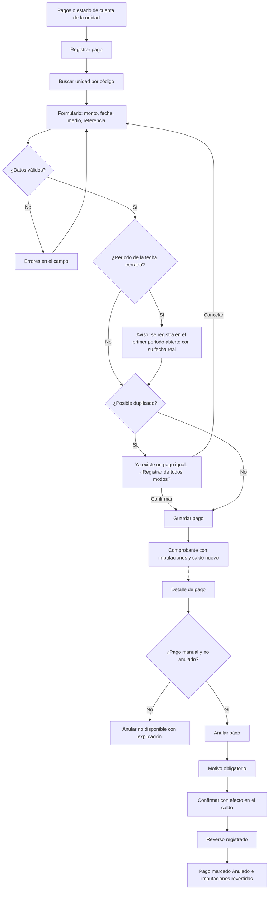

# Flujo: registrar un pago manual y anularlo

Estado: Borrador
Actor: administrador
Superficie: web de administración
Alcance: MVP
Referencias: `docs/specs/gasto-comun.md` A-6, A-7, F-1 a F-5; CA-5, CA-8, CA-10, CA-12

En la interfaz la corrección se llama **"Anular pago"**: un pago nunca se edita ni se borra; se registra un reverso que apunta al original (F-4).

## Diagrama

## Pasos

**Registrar**

1. "Registrar pago" desde Pagos o desde el estado de cuenta de una unidad (en ese caso la unidad viene elegida).
2. Buscar unidad por código con autocompletado. Se muestra el saldo actual de la unidad como referencia.
3. Formulario (F-1): monto en pesos enteros mayor que 0, fecha de pago (por defecto hoy, no futura), medio (transferencia, depósito, efectivo, cheque, otro) y referencia (obligatoria salvo efectivo; supuesto).
4. Si el mes de la fecha está cerrado: "El periodo septiembre 2026 está cerrado. Este pago se registrará en octubre 2026 con su fecha real (30-09-2026)." (A-6, CA-12).
5. Si coincide unidad, monto, fecha y medio con otro pago: "Ya existe un pago igual para esta unidad y fecha. ¿Registrar de todos modos?" (F-3, CA-10). La confirmación queda en auditoría.
6. Comprobante: imputaciones que hizo la API (intereses, multas, capital por periodo y cuenta, saldo a favor) y saldo nuevo. Botones "Registrar otro pago" y "Ver estado de cuenta".

**Anular**

1. Desde el detalle del pago, "Anular pago" (solo pagos manuales no anulados, permiso `payment.void`).
2. Motivo obligatorio (UX-17).
3. Confirmación: "Se registrará un reverso de $262.500 en octubre 2026. El saldo del Depto 201 pasará de −$262.500 a $0. El pago original no se borra." Los montos los entrega la API.
4. Resultado: el pago queda con etiqueta **Anulado**, enlazado a su reverso, y ambos siguen visibles en el estado de cuenta.

## Estados vacíos

- **Sin pagos en el filtro:** "No hay pagos registrados en este periodo." con "Registrar pago".
- **Unidad sin deuda:** el formulario avisa "Esta unidad no tiene deuda. El pago quedará como saldo a favor." (F-6). No bloquea.

## Errores

| Caso | Mensaje | Comportamiento |
| --- | --- | --- |
| Monto 0, negativo o con decimales | "Ingresa un monto en pesos, mayor que 0 y sin decimales" | Campo inválido |
| Fecha futura | "La fecha de pago no puede ser posterior a hoy" | Campo inválido (supuesto) |
| Unidad no encontrada | "No hay unidades con ese código en esta comunidad" | Sugiere revisar el código |
| Referencia repetida en la comunidad | "Ya existe un pago con la referencia X" (F-2) | Muestra el pago existente; no crea otro |
| Anular pago Webpay | "Los pagos Webpay no se anulan desde ComVive" (F-4) | Botón oculto; texto explicativo |
| Anular pago ya anulado | "Este pago ya fue anulado el 12-11-2026" | Sin acción |
| Sin conexión al guardar | "No se pudo guardar. Revisa tu conexión e intenta de nuevo." | El formulario conserva los datos |

## Carga

- Búsqueda de unidad: resultados al escribir, con indicador pequeño.
- Guardar y anular: botón con indicador y bloqueo de doble envío.

## Supuestos (a validar)

- La referencia es obligatoria salvo en efectivo.
- No se permiten fechas de pago futuras.
- Pagos sin unidad identificada quedan fuera del flujo (UX-11).
