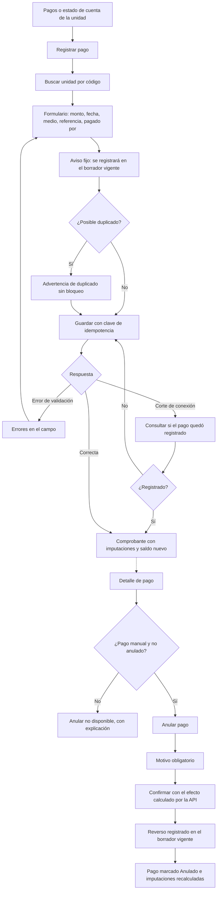

# Flujo: registrar un pago manual y anularlo

Estado: Borrador
Actor: administrador
Superficie: web de administración
Alcance: MVP
Referencias en `docs/specs/gasto-comun.md`:

- Movimientos posteriores a la emisión: A-4 (S-17).
- Pagos: F-1 a F-4, F-6 y F-9.
- Criterios de aceptación: CA-5, CA-11, CA-12 y CA-15.

En la interfaz, la corrección se llama **"Anular pago"**: un pago nunca se edita ni se borra; se registra un reverso que apunta al original (F-4). En los mensajes, `{dato}` marca un valor variable.

## Diagrama

## Pasos

**Registrar**

1. "Registrar pago" desde Pagos o desde el estado de cuenta de una unidad (en ese caso la unidad ya viene elegida).
2. Se busca la unidad por código, con autocompletado.
3. **Formulario** (F-1):
   - **Monto:** campo de dígitos con máscara de miles. Envía un entero mayor que 0.
   - **Fecha de pago:** hoy por defecto. No se aceptan fechas futuras en hora de Chile (F-1, CA-15).
   - **Medio:** transferencia, depósito, efectivo, cheque u otro.
   - **Referencia:** obligatoria (F-1). En efectivo, la ayuda sugiere "N° de recibo".
   - **Pagado por** (F-9): aparece solo si la unidad tiene un arrendatario vigente, con dos opciones: "Propietario" (por defecto, ámbito de la unidad completa) o "Arrendatario {nombre}" (solo su ventana).
4. **Aviso fijo** bajo el formulario (A-4, S-17): "Se registrará en el periodo en borrador {mes} con fecha de pago {dd-mm-aaaa}."
5. **Posible duplicado** (F-3, CA-11): si coinciden la unidad, el monto, la fecha y el medio, el formulario muestra "Ya existe un pago de ${monto} para {unidad} con fecha {dd-mm-aaaa} por {medio}. Revisa que no sea un duplicado". El guardado no se bloquea.
6. **Guardar:** cada envío lleva una clave de idempotencia. Ante un corte de conexión, la pantalla consulta si el pago quedó registrado antes de permitir reintentar.
7. **Comprobante:** muestra las imputaciones que hizo la API (por periodo y cuenta, más el saldo a favor si queda) y el saldo nuevo del ámbito. Botones "Registrar otro pago" y "Ver estado de cuenta".

**Anular**

1. Desde el detalle del pago, "Anular pago". Solo está disponible en pagos manuales no anulados (permiso `payment.void`).
2. Motivo obligatorio (UX-17).
3. **Confirmación con el efecto que entrega la API:** "Se registrará un reverso de $315.000 en el periodo en borrador noviembre 2026. Los cargos que cubría este pago vuelven a quedar pendientes y se aplicarán los saldos a favor de la unidad. El pago original no se borra." (F-4, F-6, CA-12).
4. El envío lleva una clave de idempotencia.
5. **Resultado:** el pago queda con la etiqueta **Anulado**, enlazado a su reverso, y la pantalla muestra las imputaciones nuevas. El pago y el reverso siguen visibles en el estado de cuenta.

## Estados vacíos

- **Sin pagos en el filtro:** "No hay pagos registrados en este periodo." con "Registrar pago".
- **Unidad sin deuda en el ámbito elegido:** "Esta unidad no tiene deuda. El pago quedará como saldo a favor." (F-5). No bloquea.

## Errores

| Caso | Mensaje | Comportamiento |
| --- | --- | --- |
| Monto vacío o 0 | "Ingresa un monto mayor que $0" | El campo no acepta otros caracteres (B-5) |
| Fecha futura | "La fecha de pago no puede ser futura" (F-1, CA-15) | El campo es inválido |
| Unidad no encontrada | "No hay unidades con ese código en esta comunidad" | Sugiere revisar el código |
| Mismo medio y referencia ya registrados | "Este pago ya estaba registrado" | Muestra el pago existente; no crea otro (F-2) |
| Anular un pago Webpay | "Los pagos Webpay no se anulan desde ComVive" | Botón oculto con texto explicativo (F-4) |
| Anular un pago ya anulado | "Este pago fue anulado el {dd-mm-aaaa}" | Sin acción |
| Sin conexión | "No se pudo confirmar el registro. Revisando…" | Consulta el estado y conserva los datos del formulario |

## Carga

- **Búsqueda de unidad:** resultados al escribir, con un indicador pequeño.
- **Guardar y anular:** botón con indicador y bloqueo del doble envío.

## Supuestos (a validar)

- Los pagos sin unidad identificada quedan fuera de este flujo (UX-11).
- La lista de motivos de anulación está en UX-17.
