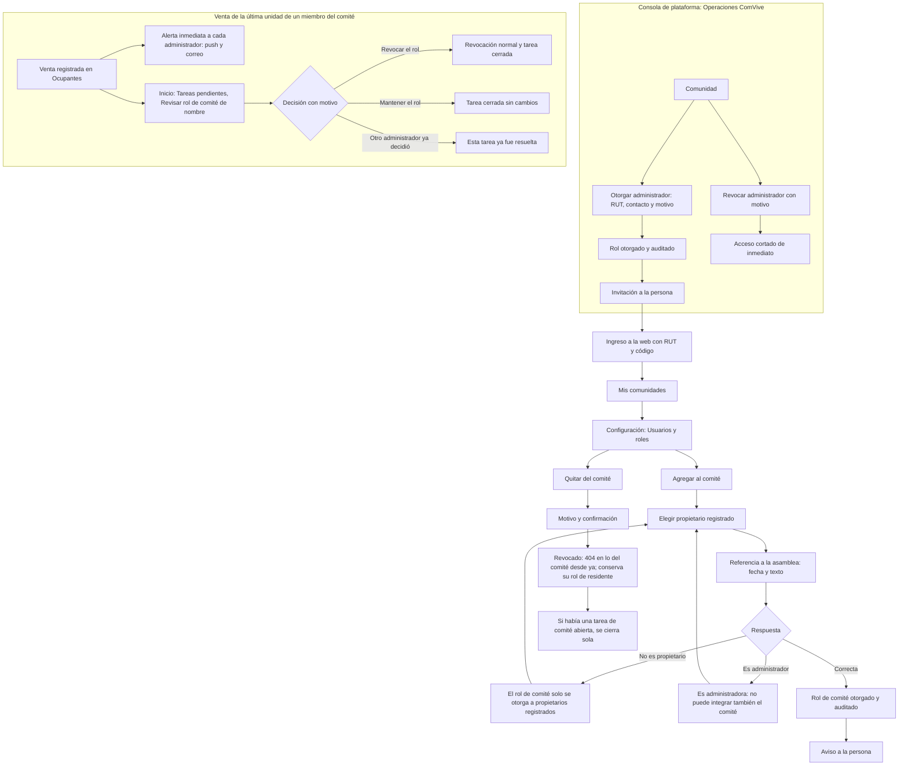

# Flujo: usuarios y roles

Estado: Borrador
Actor: Operaciones ComVive (rol de administrador), administrador (rol de comité) y la persona que recibe el rol
Superficie: consola de plataforma (Operaciones) y web de administración
Alcance: MVP
Referencias en `docs/specs/gasto-comun.md`:

- Usuarios y permisos; "Respuestas de error" (404 o 403); "Otorgamiento de roles" (S-34, S-43); "Comité que deja de ser propietario" (M-7); "Datos de copropietarios que ve el comité" (S-33).
- Permiso para otorgar y revocar el comité y para resolver su tarea: `committee_role.grant`.
- Criterios de aceptación: CA-24, CA-43, CA-44 y CA-57.

Otras referencias: `docs/arquitectura.md` §2 (404 neutros), §3 ("Quién otorga cada rol", "Comité que deja de ser propietario" con `admin-tasks`, "Usuarios de plataforma", "Ingreso, sesiones y límites", revocación) y §5 (auditoría).

En los mensajes, `{dato}` marca un valor variable.

> **Revisión crítica 3 (`docs/revisiones/2026-11-07-diseno-rev3.md`): cambios aplicados.** M-7: tarea "Revisar rol de comité" en Inicio > Tareas pendientes. M-4: el comité revocado recibe 404. Menor 4: permiso `committee_role.grant` y 422 `ADMIN_COMMITTEE_CONFLICT`. Menor 5: textos de la spec. Segundo factor opcional para administradores (decisión del líder; UX-41 cerrada).

## Quién otorga qué

| Rol | Quién lo otorga y revoca | Dónde | Requisito |
| --- | --- | --- | --- |
| Administrador | Solo Operaciones ComVive | Consola de plataforma | RUT y contacto de la persona; motivo (por ejemplo, contrato de administración) |
| Comité | El administrador de la comunidad | Web: Configuración > Usuarios y roles | Propietario registrado de la comunidad y referencia a la asamblea que lo eligió (S-34) |
| Residente propietario o arrendatario | El administrador, al registrar la ocupación | Web: Unidades y residentes > Ocupantes | Ver `admin-ocupaciones.md` |
| Soporte ComVive y Operaciones ComVive | Solo el equipo de ComVive, por procedimiento aprobado por el líder del proyecto | Fuera de la aplicación (P-24) | Segundo factor (supuesto de la arquitectura) |
| Conserje | El administrador | **Posterior** | Sin pantallas en el MVP |

- Un administrador nunca ve la acción "Agregar administrador" ni "Quitar administrador", ni siquiera para sí mismo. Si lo intenta por la ruta de comunidad, recibe 403 `FORBIDDEN`, porque ve las membresías pero su rol no permite la acción (CA-43).
- El comité no ve la pantalla "Usuarios y roles" (404 si entra por ruta directa). Si pide otorgar el rol de comité desde el registro de copropietarios, que sí ve, recibe 403 `FORBIDDEN` (CA-43).
- Una persona no puede ser administradora y comité en la misma comunidad: 422 `ADMIN_COMMITTEE_CONFLICT` (S-43).

## Diagrama

## Pasos

**Ingreso del administrador (web)**

1. Operaciones ComVive otorga el rol en la consola de plataforma, con el RUT, el contacto y el motivo. Si la persona no existe en ComVive, se crea con ese contacto como contacto de ingreso.
2. La persona recibe: "Te dieron acceso como administrador de una comunidad en ComVive. Ingresa en {dirección web}." El mensaje no nombra la comunidad.
3. **Ingreso:** RUT → "Si el RUT está registrado, te enviamos un código a {contacto enmascarado}" → código de 6 dígitos. Mismas reglas y límites que la app (`residente-primer-ingreso.md`; arquitectura §3).
4. Primera vez: pantalla "Cómo usamos tus datos" y una segunda, "Tus responsabilidades con los datos de la comunidad", que recuerda que verá RUT y deudas de terceros y que esas lecturas quedan registradas (Ley 21.719). Botón "Continuar".
5. Llega a **Mis comunidades**. Con varias comunidades, elige una; el selector de comunidad queda en la barra superior.
6. **Sesión:** se cierra tras 30 minutos sin actividad, con aviso un minuto antes (supuesto de diseño; ADR 0005). Si se revoca el rol, la siguiente acción devuelve al ingreso.

**Pantalla Configuración > Usuarios y roles** (solo administrador)

1. **Administradores** (solo lectura): nombre, RUT completo, desde cuándo y "Otorgado por ComVive". Texto: "Para agregar o quitar administradores, escribe a Cuentas ComVive."
2. **Comité:** nombre, unidad, desde cuándo, referencia a la asamblea, estado de ingreso (pendiente o activo) y "Quitar del comité". Si la persona tiene una tarea "Revisar rol de comité" abierta, su fila muestra la etiqueta "Ya no es propietario: decisión pendiente" con enlace a la tarea; si se decidió mantenerla, "Sin unidad en la comunidad: mantenido el {dd-mm-aaaa}".
3. **Residentes:** enlace a "Unidades y residentes" (las membresías de residentes nacen de las ocupaciones).
4. **Historial de roles:** otorgamientos y revocaciones, con quién, a quién, cuándo, vía (comunidad o ComVive) y referencia o motivo. Incluye los de administradores hechos por ComVive.

**Agregar al comité**

1. "Agregar al comité" abre un buscador **solo de propietarios registrados** de la comunidad, por nombre o unidad. Los arrendatarios no aparecen.
2. **Referencia a la asamblea** (obligatoria, S-34): fecha y texto, por ejemplo "Asamblea ordinaria del 20-10-2026". Ayuda: "No incluyas datos personales".
3. **Confirmación:** "{nombre} podrá ver la información de la comunidad en modo lectura: gastos, pagos, deudas por unidad y avisos. Verá los RUT enmascarados y no verá teléfonos ni correos. Esta acción queda registrada."
4. **Resultado:** rol otorgado y en auditoría. La persona recibe "Te dieron acceso como comité de tu comunidad en ComVive" con el enlace a la web. Si ya usaba la app como propietario, la app no cambia: el comité usa solo la web (decisión del líder del proyecto, 2026-11-07; UX-14 cerrada).

**Quitar del comité (revocación)**

1. "Quitar del comité" pide un motivo (lista: término del periodo, renuncia, otro; texto libre si es "otro").
2. **Confirmación:** "{nombre} dejará de ver la comunidad como comité de inmediato. Seguirá viendo su unidad como propietario. Deberá volver a ingresar en sus dispositivos."
3. **Resultado:** desde ese momento, las pantallas y los datos que solo ve el comité (registro de copropietarios, deuda de otras unidades, reportes, intentos Webpay) le responden 404, porque ya no puede verlos (M-4). Conserva su rol de residente. Sus sesiones se revocan (supuesto de la arquitectura §3) y la revocación queda en el historial.
4. Si había una tarea "Revisar rol de comité" abierta para esa persona, se cierra sola (`revoked_elsewhere`) y sale de Inicio > Tareas pendientes.

**Tarea "Revisar rol de comité" (Inicio > Tareas pendientes; M-7, CA-57)**

Cuándo aparece: al confirmar una venta en `admin-ocupaciones.md`, si la persona que deja de ser propietaria integra el comité y ya no es propietaria de ninguna otra unidad de la comunidad. Su rol de comité **no se revoca automáticamente**: lo decide el administrador (decisión del líder del proyecto, 2026-11-07).

1. **Alerta inmediata** a cada administrador con membresía vigente en la comunidad, con los textos de la spec, sin montos, deudas ni la unidad vendida:
   - **Push:** "Tienes una tarea pendiente sobre el comité de {comunidad}".
   - **Correo:** asunto "Revisa el rol de comité de {nombre}"; texto "{nombre} dejó de ser propietario en {comunidad} y sigue en el comité. Decide si mantienes o revocas su rol en Inicio > Tareas pendientes".
2. **Tareas pendientes** (Inicio de la web, solo administrador): alerta fija, arriba de todo, que no se puede descartar ni posponer. Cada tarea muestra el título "Revisar rol de comité de {nombre}", la fecha de la venta, quién la registró y el botón "Decidir". Queda visible hasta que algún administrador de la comunidad decida; la tarea no vence ni se repite.
3. **Decidir** abre un panel con:
   - Texto: "{nombre} dejó de ser propietario en la comunidad y sigue en el comité. Mientras no decidas, conserva su acceso de comité."
   - Dos opciones, sin valor por defecto: **"Revocar el rol"** (`revoke_committee`) y **"Mantener el rol"** (`keep_committee`). Ayuda de "Mantener": "Por ejemplo, si representa a una persona jurídica propietaria o la asamblea la mantuvo."
   - **Motivo** obligatorio, con la ayuda "No incluyas datos personales".
   - Botón "Confirmar decisión". El envío lleva una clave de idempotencia generada al abrir el panel (`POST .../admin-tasks/{taskId}/resolve`).
4. **Resultado:**
   - **Revocar:** aplica la revocación normal (sección anterior) en la misma operación y cierra la tarea. Confirmación (F-17): "Revocaste el rol de comité de {nombre}. La tarea quedó cerrada".
   - **Mantener:** cierra la tarea sin cambiar el rol. Confirmación (F-17): "Mantuviste el rol de comité de {nombre}. La tarea quedó cerrada".
   - La tarea sale de Tareas pendientes para todos los administradores y queda en el historial de roles con la decisión, el motivo, quién decidió y cuándo.
5. **Quién la ve:** solo el administrador. Al comité y a los residentes, la lista de tareas les responde 404; la web del comité no muestra Tareas pendientes.

**Revocación del administrador (Operaciones ComVive)**

1. En la consola de plataforma, "Revocar administrador" con motivo.
2. El acceso se corta en la siguiente petición. Si la persona tiene otras comunidades, las sigue viendo.
3. Si la comunidad queda sin administrador, la consola lo advierte: "La comunidad quedará sin administrador. Los residentes podrán seguir viendo y pagando, pero nadie podrá emitir ni registrar pagos manuales." (supuesto de diseño).

**Auditoría de roles y accesos de ComVive** (Configuración > Registro de auditoría, MVP mínimo)

- Otorgamientos y revocaciones de roles en la comunidad.
- Alertas, tareas y decisiones de "Revisar rol de comité", con motivo.
- Acciones de Soporte ComVive sobre intentos Webpay de la comunidad (lectura y resolución, con motivo) (arquitectura §3).
- Exportaciones de planillas con deudas.
- Filtros por fecha, tipo de acción y persona. Solo lectura, sin exportación en el MVP.

## Estados vacíos

- **Sin comité:** "Esta comunidad no tiene comité registrado en ComVive." con "Agregar al comité".
- **Sin propietarios registrados:** "Registra a los propietarios para poder elegir al comité." con enlace a Unidades y residentes.
- **Historial vacío:** "Aún no hay cambios de roles."
- **Sin tareas pendientes:** el bloque Tareas pendientes no aparece en Inicio.

## Errores

Los textos con código son los de la tabla "Códigos y mensajes de error" de la spec, copiados tal cual. Al otorgar el rol de comité, la API responde solo el primer error, en este orden: `ASSEMBLY_REFERENCE_REQUIRED` → `COMMITTEE_REQUIRES_OWNER` → `ADMIN_COMMITTEE_CONFLICT` → `ALREADY_COMMITTEE_MEMBER` (S-34, CA-64). Así, un miembro del comité que dejó de ser propietario recibe `COMMITTEE_REQUIRES_OWNER`.

| Caso | Código | Mensaje | Comportamiento |
| --- | --- | --- | --- |
| La persona elegida no es propietaria registrada | 422 `COMMITTEE_REQUIRES_OWNER` | "El rol de comité solo se otorga a propietarios registrados de la comunidad" | No se guarda (S-34, CA-43) |
| La persona es administradora de la comunidad | 422 `ADMIN_COMMITTEE_CONFLICT` | "Esta persona es administradora de la comunidad. No puede integrar también el comité" | No se guarda (S-43) |
| Operaciones ComVive otorga el rol de administrador a un miembro del comité (consola de plataforma) | 422 `ADMIN_COMMITTEE_CONFLICT` | "Esta persona integra el comité de la comunidad. Primero se debe revocar su rol de comité" | No se guarda (S-43) |
| Referencia a la asamblea vacía | 422 `ASSEMBLY_REFERENCE_REQUIRED` | "Indica la asamblea que eligió al comité: fecha y referencia" | El campo es inválido (CA-43) |
| La persona ya integra el comité | 409 `ALREADY_COMMITTEE_MEMBER` | "Esta persona ya integra el comité" | Sin cambios; el buscador la marca como "Ya integra el comité" y no la deja elegir (S-34, CA-64) |
| Administrador intenta otorgar o revocar un administrador por la ruta de comunidad | 403 `FORBIDDEN` | "Tu rol no permite esta acción" | La acción no se muestra (CA-43) |
| Comité entra a Usuarios y roles o a Tareas pendientes por ruta directa | 404 `NOT_FOUND` | "No encontramos lo que buscas o no tienes acceso" | El comité no ve esas pantallas (CA-57) |
| Decidir la tarea sin motivo | 422 `REASON_REQUIRED` | "Indica el motivo de tu decisión" | El campo es inválido (CA-57) |
| Otro administrador ya decidió la tarea | 409 `TASK_ALREADY_RESOLVED` | "Esta tarea ya fue resuelta" | Cierra el panel y recarga Tareas pendientes (CA-57) |
| Misma clave de idempotencia con otros datos | 422 `IDEMPOTENCY_KEY_REUSED` | "Esta operación ya se envió con otros datos. Vuelve a abrir el formulario" | Cierra el panel |
| Persona revocada usa una pestaña abierta | — | "Tu acceso cambió. Vuelve a ingresar." | Lleva al ingreso |
| Corte de conexión al otorgar, revocar o decidir | — | "Revisando si el cambio quedó registrado…" | Consulta el estado antes de reintentar con la misma clave |

## Carga

- **Buscador de propietarios:** resultados al escribir.
- **Otorgar, revocar y decidir una tarea:** botón con indicador y bloqueo del doble envío.
- **Tareas pendientes:** esqueleto del bloque en Inicio mientras responde `admin-tasks`.

## Supuestos (a validar)

- El administrador ingresa con RUT y código, como el residente. El segundo factor es **opcional** para administradores en el MVP y obligatorio para los roles de plataforma (decisión del líder del proyecto, 2026-11-07; UX-41 cerrada). Si se exige a los administradores antes del Piloto queda en P-36. Mientras sea opcional, se activa en "Mi cuenta > Segundo factor" de la web (`arquitectura-de-informacion.md`); el método lo fija el ADR 0005.
- La tarea "Revisar rol de comité" no vence y exige motivo en ambas decisiones (S-43). Si la ley hace perder el rol al dejar de ser copropietario, la tarea pasaría a revocación automática (P-35).
- Inactividad de 30 minutos en la web.
- El contacto de ingreso de un administrador nuevo es el que registra Operaciones ComVive.
- Al revocar se cierran todas las sesiones de la persona (arquitectura §8, pregunta "Revocación de rol").
- El cónyuge, el conviviente civil o el representante de una persona jurídica propietaria no pueden integrar el comité hasta que se resuelva P-25.
