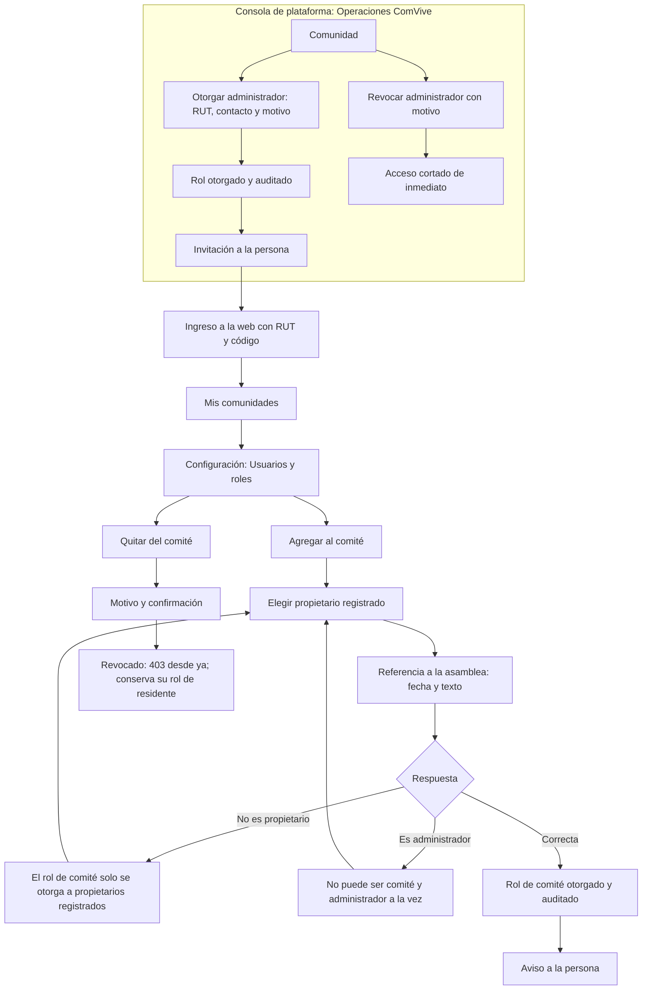

# Flujo: usuarios y roles

Estado: Borrador
Actor: Operaciones ComVive (rol de administrador), administrador (rol de comité) y la persona que recibe el rol
Superficie: consola de plataforma (Operaciones) y web de administración
Alcance: MVP
Referencias en `docs/specs/gasto-comun.md`:

- Usuarios y permisos; "Otorgamiento de roles" (S-34); "Datos de copropietarios que ve el comité" (S-33).
- Criterios de aceptación: CA-24, CA-43 y CA-44.

Otras referencias: `docs/arquitectura.md` §2 (404 neutros), §3 ("Quién otorga cada rol", "Usuarios de plataforma", "Ingreso, sesiones y límites", revocación) y §5 (auditoría).

En los mensajes, `{dato}` marca un valor variable.

## Quién otorga qué

| Rol | Quién lo otorga y revoca | Dónde | Requisito |
| --- | --- | --- | --- |
| Administrador | Solo Operaciones ComVive | Consola de plataforma | RUT y contacto de la persona; motivo (por ejemplo, contrato de administración) |
| Comité | El administrador de la comunidad | Web: Configuración > Usuarios y roles | Propietario registrado de la comunidad y referencia a la asamblea que lo eligió (S-34) |
| Residente propietario o arrendatario | El administrador, al registrar la ocupación | Web: Unidades y residentes > Ocupantes | Ver `admin-ocupaciones.md` |
| Soporte ComVive y Operaciones ComVive | Solo el equipo de ComVive, por procedimiento aprobado por el líder del proyecto | Fuera de la aplicación (P-24) | Segundo factor (supuesto de la arquitectura) |
| Conserje | El administrador | **Posterior** | Sin pantallas en el MVP |

- Un administrador nunca ve la acción "Agregar administrador" ni "Quitar administrador", ni siquiera para sí mismo. Si lo intenta por la API, recibe 403 (CA-43).
- El comité no ve "Usuarios y roles" y no otorga roles (403, CA-43).
- Una persona no puede ser administradora y comité en la misma comunidad (supuesto de la arquitectura §3).

## Diagrama

## Pasos

**Ingreso del administrador (web)**

1. Operaciones ComVive otorga el rol en la consola de plataforma, con el RUT, el contacto y el motivo. Si la persona no existe en ComVive, se crea con ese contacto como contacto de ingreso.
2. La persona recibe: "Te dieron acceso como administrador de una comunidad en ComVive. Ingresa en {dirección web}." El mensaje no nombra la comunidad.
3. **Ingreso:** RUT → "Si el RUT está registrado, te enviamos un código a {contacto enmascarado}" → código de 6 dígitos. Mismas reglas y límites que la app (`residente-primer-ingreso.md`; arquitectura §3).
4. Primera vez: pantalla "Cómo usamos tus datos" y una segunda, "Tus responsabilidades con los datos de la comunidad", que recuerda que verá RUT y deudas de terceros y que esas lecturas quedan registradas (Ley 21.719). Botón "Continuar".
5. Llega a **Mis comunidades**. Con varias comunidades, elige una; el selector de comunidad queda en la barra superior.
6. **Sesión:** se cierra tras 30 minutos sin actividad, con aviso un minuto antes (supuesto de diseño; ADR 0005). Si se revoca el rol, la siguiente acción devuelve al ingreso.

**Pantalla Configuración > Usuarios y roles** (solo administrador)

1. **Administradores** (solo lectura): nombre, RUT completo, desde cuándo y "Otorgado por ComVive". Texto: "Para agregar o quitar administradores, escribe a Cuentas ComVive."
2. **Comité:** nombre, unidad, desde cuándo, referencia a la asamblea, estado de ingreso (pendiente o activo) y "Quitar del comité".
3. **Residentes:** enlace a "Unidades y residentes" (las membresías de residentes nacen de las ocupaciones).
4. **Historial de roles:** otorgamientos y revocaciones, con quién, a quién, cuándo, vía (comunidad o ComVive) y referencia o motivo. Incluye los de administradores hechos por ComVive.

**Agregar al comité**

1. "Agregar al comité" abre un buscador **solo de propietarios registrados** de la comunidad, por nombre o unidad. Los arrendatarios no aparecen.
2. **Referencia a la asamblea** (obligatoria, S-34): fecha y texto, por ejemplo "Asamblea ordinaria del 20-10-2026". Ayuda: "No incluyas datos personales".
3. **Confirmación:** "{nombre} podrá ver la información de la comunidad en modo lectura: gastos, pagos, deudas por unidad y avisos. Verá los RUT enmascarados y no verá teléfonos ni correos. Esta acción queda registrada."
4. **Resultado:** rol otorgado y en auditoría. La persona recibe "Te dieron acceso como comité de tu comunidad en ComVive" con el enlace a la web. Si ya usaba la app como propietario, la app no cambia (UX-14).

**Quitar del comité (revocación)**

1. "Quitar del comité" pide un motivo (lista: término del periodo, renuncia, otro; texto libre si es "otro").
2. **Confirmación:** "{nombre} dejará de ver la comunidad como comité de inmediato. Seguirá viendo su unidad como propietario. Deberá volver a ingresar en sus dispositivos."
3. **Resultado:** desde ese momento recibe 403 en las acciones y pantallas del comité y conserva su rol de residente (CA-43). Sus sesiones se revocan (supuesto de la arquitectura §3) y la revocación queda en el historial.

**Revocación del administrador (Operaciones ComVive)**

1. En la consola de plataforma, "Revocar administrador" con motivo.
2. El acceso se corta en la siguiente petición. Si la persona tiene otras comunidades, las sigue viendo.
3. Si la comunidad queda sin administrador, la consola lo advierte: "La comunidad quedará sin administrador. Los residentes podrán seguir viendo y pagando, pero nadie podrá emitir ni registrar pagos manuales." (supuesto de diseño).

**Auditoría de roles y accesos de ComVive** (Configuración > Registro de auditoría, MVP mínimo)

- Otorgamientos y revocaciones de roles en la comunidad.
- Acciones de Soporte ComVive sobre intentos Webpay de la comunidad (lectura y resolución, con motivo) (arquitectura §3).
- Exportaciones de planillas con deudas.
- Filtros por fecha, tipo de acción y persona. Solo lectura, sin exportación en el MVP.

## Estados vacíos

- **Sin comité:** "Esta comunidad no tiene comité registrado en ComVive." con "Agregar al comité".
- **Sin propietarios registrados:** "Registra a los propietarios para poder elegir al comité." con enlace a Unidades y residentes.
- **Historial vacío:** "Aún no hay cambios de roles."

## Errores

| Caso | Mensaje | Comportamiento |
| --- | --- | --- |
| La persona elegida no es propietaria registrada | "El rol de comité solo se otorga a propietarios registrados de la comunidad" (S-34, CA-43) | No se guarda |
| La persona es administradora de la comunidad | "Esta persona es administradora de la comunidad; no puede integrar el comité" | 409 en la API (supuesto de la arquitectura §3) |
| Referencia a la asamblea vacía | "Indica la asamblea que eligió a esta persona" | El campo es inválido |
| La persona ya integra el comité | "Esta persona ya integra el comité" | Sin cambios |
| Administrador intenta otorgar o revocar un administrador (por ruta directa) | "No tienes permiso para esta acción" | 403 (CA-43) |
| Comité entra a Usuarios y roles por ruta directa | "No encontramos lo que buscas o no tienes acceso" | 404 neutro: el comité no ve esa pantalla |
| Persona revocada usa una pestaña abierta | "Tu acceso cambió. Vuelve a ingresar." | Lleva al ingreso |
| Corte de conexión al otorgar o revocar | "Revisando si el cambio quedó registrado…" | Consulta el estado antes de reintentar |

## Carga

- **Buscador de propietarios:** resultados al escribir.
- **Otorgar y revocar:** botón con indicador y bloqueo del doble envío.

## Supuestos (a validar)

- El administrador ingresa con RUT y código, como el residente, sin segundo factor en el MVP (UX-41).
- Inactividad de 30 minutos en la web.
- El contacto de ingreso de un administrador nuevo es el que registra Operaciones ComVive.
- Al revocar se cierran todas las sesiones de la persona (arquitectura §8, pregunta 13).
- El cónyuge, el conviviente civil o el representante de una persona jurídica propietaria no pueden integrar el comité hasta que se resuelva P-25.
