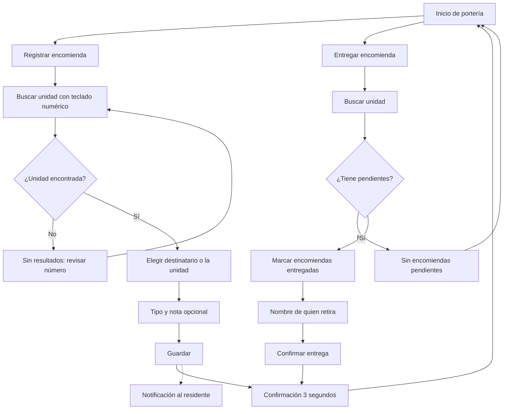

# Flujo: registrar y entregar una encomienda

Estado: Borrador
Actor: conserje (el residente recibe la notificación)
Superficie: modo conserjería en tablet; app residente
Alcance: **Propuesta MVP, sujeta a especificación** (UX-9)
Referencias: `docs/arquitectura.md` §3 y §5 (el conserje ve nombre y unidad; sin RUT ni deudas)

## Por qué encomiendas y no visitas

- **Riesgo de datos bajo:** una encomienda solo necesita unidad, destinatario y una descripción. Una visita implica datos de terceros (nombre, RUT, patente) con retención aún sin definir (arquitectura §8, pregunta 9; Ley 21.719).
- **Valor visible para el residente:** la notificación "Tienes una encomienda en conserjería" es frecuente y refuerza el uso de la app más allá del pago.
- **Flujo corto:** 3 pasos, ideal para validar el modo tablet.
- **Visitas:** quedan como **Posterior**, hasta definir retención y datos mínimos.

Falta la especificación del módulo de conserjería; este flujo no define reglas de negocio.

## Diagrama

## Pasos

**Registrar (3 pasos)**

1. "Registrar encomienda": teclado numérico grande; resultados al escribir ("101" muestra "Depto 101").
2. Destinatario: lista de residentes de la unidad (solo nombre) o "Para la unidad".
3. Tipo (paquete, sobre, otro) con botones grandes y nota opcional (p. ej. "Mercado Libre, caja grande"). "Guardar".
4. Confirmación: "Encomienda registrada para Depto 101" durante 3 segundos y regreso al inicio.
5. El residente recibe "Tienes una encomienda en conserjería" y la ve en Inicio de la app.

**Entregar**

1. "Entregar encomienda", buscar unidad.
2. Lista de pendientes con hora de llegada; seleccionar una o varias.
3. Nombre de quien retira (texto libre; supuesto: sin RUT).
4. "Confirmar entrega". El residente recibe "Retiraste tu encomienda".

## Estados vacíos

- **Sin encomiendas pendientes en la comunidad:** "No hay encomiendas por entregar."
- **Unidad sin residentes registrados:** solo opción "Para la unidad".

## Errores

| Caso | Mensaje | Comportamiento |
| --- | --- | --- |
| Unidad no existe | "No hay una unidad 1010. Revisa el número." | Mantiene el teclado |
| Sin conexión | "Sin conexión. La encomienda se guardará al volver la señal." | Cola local con aviso visible (supuesto) |
| Sesión del conserje vencida | Pide PIN | UX-10 |

## Carga

- Búsqueda: resultados locales inmediatos (lista de unidades guardada en la tablet; supuesto).
- Guardar: botón "Guardando…" y bloqueo de doble toque.

## Supuestos (a validar)

- Registro sin foto en el MVP; la foto de la etiqueta queda para después (puede contener datos personales).
- El residente no confirma la entrega en la app; la registra el conserje.
- Cola sin conexión para registrar; entregar requiere conexión.
