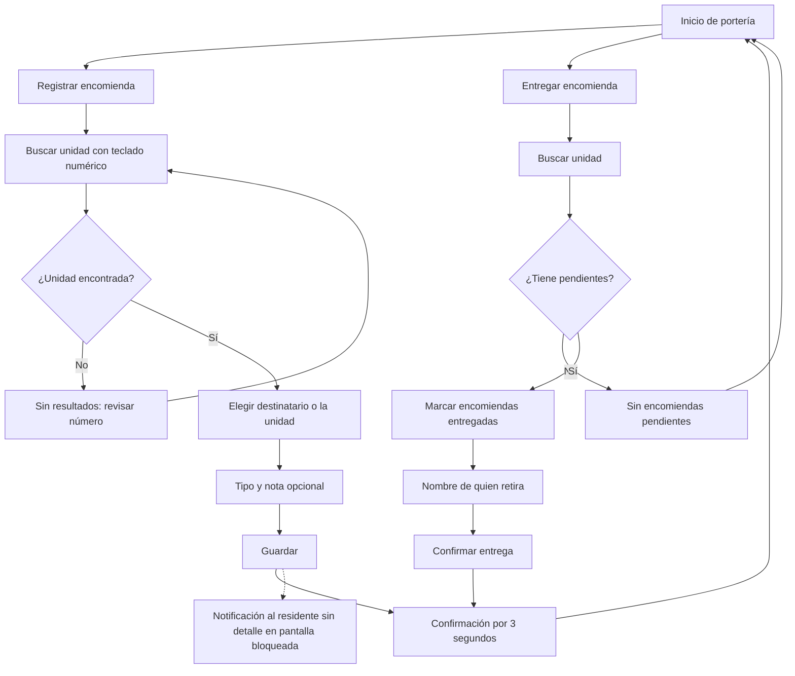

# Flujo: registrar y entregar una encomienda

Estado: Borrador
Actor: conserje (el residente recibe la notificación)
Superficie: modo conserjería en tablet y app residente
Alcance: **Posterior.** No entra al MVP hasta que exista la especificación de conserjería.
Referencias: `docs/arquitectura.md` §3 y §5 (el conserje ve nombre y unidad, sin RUT ni deudas)

Este flujo es una referencia de diseño, no define reglas de negocio. Se eligió encomiendas antes que visitas porque necesita menos datos personales: unidad, destinatario y descripción, frente al nombre, RUT y patente de terceros de una visita, cuya retención aún no está definida (arquitectura §8, pregunta 9).

## Diagrama

## Pasos

**Registrar (3 pasos)**

1. "Registrar encomienda": teclado numérico grande, con resultados al escribir ("101" muestra "Depto 101").
2. **Destinatario:** lista de residentes de la unidad (solo el nombre) o "Para la unidad".
3. **Tipo:** paquete, sobre u otro, con botones grandes, y una nota opcional. Botón "Guardar".
4. **Confirmación:** "Encomienda registrada para Depto 101" durante 3 segundos, y luego vuelve al inicio.

**Entregar**

1. "Entregar encomienda" y buscar la unidad.
2. Se seleccionan una o varias encomiendas pendientes.
3. Nombre de quien retira (supuesto: sin RUT).
4. "Confirmar entrega".

## Estados vacíos, errores y carga

- **Sin pendientes:** "No hay encomiendas por entregar."
- **Unidad inexistente:** "No hay una unidad 1010. Revisa el número."
- **Copia local en la tablet:** se borra al cerrar sesión o al perder el acceso.
- **Guardar:** botón "Guardando…" con bloqueo del doble toque.

## Pendiente para cuando se especifique

- La forma de iniciar sesión y cambiar de turno en una tablet compartida.
- La retención de los registros.
- El uso de fotos de etiquetas.
- El funcionamiento sin conexión.
