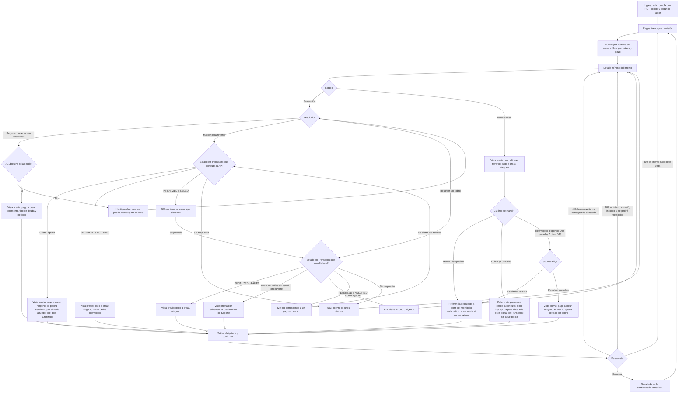

# Flujo: Soporte ComVive resuelve un pago Webpay en revisión

Estado: Borrador
Actor: Soporte ComVive (rol de plataforma `platform_support`); el administrador y el comité ven el resultado en lectura; el residente recibe el aviso
Superficie: consola de plataforma (web, separada de la web de administración)
Alcance: MVP
Referencias en `docs/specs/gasto-comun.md`:

- Intento en revisión: F-16 (S-32). Excepción de aislamiento: EX-1. Huella de plataforma: A-7.
- Ocupación terminada durante la revisión y aviso al pagador sin membresía: F-13 (S-42).
- Textos para el residente: F-17. Días hábiles: "Definiciones".
- Registro en el borrador vigente: A-4. Intereses: E-10.
- Reembolso automático (D2) y resolución sin cobro (D3, `resolve_without_charge`): F-16 y F-17 de la spec rev. 5 (S-57 a S-59; textos de S-59 aprobados por el líder el 2026-11-07).
- Consulta previa al marcar para reverso y cobro ya devuelto (D4, D6 a D8), declaración sin estado concluyente (D5): F-16 y F-17 de la spec rev. 6 (S-65 a S-67).
- Criterios de aceptación: CA-41, CA-42, CA-54, CA-55, CA-59, CA-65 y CA-68.

Otras referencias: `docs/arquitectura.md` §2 (vista `platform_webpay_review`, 404 neutros), §3 ("Usuarios de plataforma": sesión con audiencia `platform`, segundo factor, endpoints `/platform/webpay-attempts`, auditoría de cada acceso) y §4 (`resolution-preview`, `previewHash` de plataforma, estados del intento, `review_due_on`).

**Plazo de resolución:** 5 días hábiles desde que el intento pasa a revisión, con alerta automática al vencer (decisión del líder del proyecto, 2026-11-07; regla F-16). Los días hábiles son de lunes a viernes, sin feriados nacionales legales de Chile; el vencimiento se fija al entrar a revisión (`review_due_on`, CA-59).

> **Revisión crítica 3 (`docs/revisiones/2026-11-07-diseno-rev3.md`): cambios aplicados.** M-5: la vista previa muestra solo los campos de EX-1 y el pago a crear, sin imputación; el resultado se muestra solo en la confirmación inmediata y la consola no recarga un detalle que responde 404. Menor 1: referencias a P-31 y al plazo vigente. Menor 5: textos y códigos de error copiados de la spec.
>
> **Spec rev. 5 (decisiones del líder D2 y D3, 2026-11-07): cambios aplicados.** Al marcar para reverso, la API pide el reembolso a Transbank automáticamente y la consola propone la referencia para confirmar el reverso. Nueva resolución "sin cobro" (`resolve_without_charge`, `in_review` → `rejected`), con la consulta del estado en Transbank. Textos de F-17 (S-59) y códigos de la tabla de errores. Wireframes: `../wireframes/consola-plataforma.md`.
>
> **Spec rev. 6 (decisiones del líder D4 a D8, 2026-11-07): cambios aplicados.** Consulta previa a Transbank al marcar para reverso, con cobro ya devuelto sin reembolso nuevo, 422 `NO_CHARGE_TO_REVERSE`, 503 y 409 por cambio de "se pedirá reembolso"; declaración sin estado concluyente pasados los 7 días; sin advertencia en un cobro ya devuelto y ayuda para la referencia; texto del residente para el cobro ya devuelto.
>
> **Revisión crítica 4 (`docs/revisiones/2026-11-07-diseno-rev4.md`) y decisiones del líder D13 y D15 (2026-11-07): cambios aplicados.** M-3: la vista previa de "marcar para reverso" muestra "Se pedirá reembolso: sí, por ${monto}" (saldo anulable o total autorizado). D13: desde "Para reverso", si el reembolso respondió 292 pasados los 7 días, Soporte puede resolver sin cobro (`reversal_pending` → `rejected`). Menor 1: el texto de `mark_for_reversal` en un cobro ya devuelto es el de F-17 (D11; UX-74 cerrada). D15: los textos propios del diseño (UX-69) quedan aprobados.

## Reglas de pantalla

- **Consola mínima:** una sola sección, "Pagos Webpay en revisión". No hay menú de comunidades, residentes ni finanzas.
- **Solo los campos de EX-1:** número de orden, comunidad, código de la unidad, tipo de deuda ("Propietario" o "Arrendatario", sin nombre), monto iniciado por ámbito, monto autorizado, estado y códigos de Transbank, fechas y la marca "Plazo vencido". Nunca nombres, RUT, contactos, cargos, deudas, saldos ni imputaciones.
- **Vista previa sin deuda (M-5):** la vista previa de una resolución muestra solo el pago que se crearía: monto, tipo de deuda final y periodo del borrador vigente. No muestra la deuda de la unidad ni cómo se imputará, porque Soporte no la ve (EX-1).
- **Lista de pendientes:** la consola solo ve intentos en "En revisión" (`in_review`) y "Para reverso" (`reversal_pending`). Un intento registrado (`resolved_paid`), reversado (`reversed`) o cerrado sin cobro (`rejected`) sale de su vista y le responde 404.
- **Soporte no llama a Transbank:** el estado de Transbank, el resultado del reembolso automático y la consulta de estado de "sin cobro" los obtiene la API con las credenciales de la comunidad del intento (EX-1, ADR 0007).
- **Resultado solo en la confirmación inmediata (M-5):** después de resolver, la pantalla muestra el resultado con los datos de la respuesta de la resolución y el botón "Volver a la lista". No recarga el detalle del intento, porque si salió de la vista responde 404.
- **Toda lectura queda en auditoría,** también abrir el detalle. La consola lo dice en el pie: "Cada consulta y cada resolución queda registrada y la ve la administración de la comunidad".
- **Cualquier otra ruta** responde "No encontramos lo que buscas o no tienes acceso" (404 `NOT_FOUND`).

## Diagrama

## Pasos

1. **Ingreso:** RUT, código y segundo factor; sesión de la audiencia `platform`, de máximo 8 horas (supuestos de la arquitectura §3). La sesión no sirve en la web de administración ni en la app, y viceversa.
2. **Lista "Pagos Webpay en revisión":** tabla con número de orden, comunidad, unidad, tipo de deuda, monto iniciado, monto autorizado, días hábiles en revisión y estado. Orden por defecto: el más antiguo primero.
   - **Filtros:** estado ("En revisión", "Para reverso") y "Plazo vencido".
   - **Búsqueda** por número de orden exacto.
   - **Plazo:** cada fila muestra "Vence el {dd-mm-aaaa}" (`review_due_on`) o, si se pasó, "Plazo vencido" en rojo, con texto y no solo con color.
3. **Detalle:** los campos de EX-1 y la diferencia entre monto iniciado y autorizado. Si cubre dos deudas, muestra el monto iniciado de cada una ("Propietario ${monto}", "Arrendatario ${monto}").
4. **Resolución** (F-16), según el estado:
   - **En revisión:**
     - **"Registrar por el monto autorizado"** (`register_authorized`): solo para intentos de una deuda. En intentos de dos deudas aparece desactivado con "Un pago que cubre dos deudas solo se puede marcar para reverso".
     - **"Marcar para reverso"** (`mark_for_reversal`). La API consulta antes el estado en Transbank, en la vista previa y en la ejecución (D4):
       - **Cobro vigente** (`AUTHORIZED`, `CAPTURED` o `PARTIALLY_NULLIFIED`): al confirmarse, la API pide automáticamente el reembolso (D2) por el saldo anulable de la consulta previa o, si no hubo anulaciones, por el total autorizado (M-3 de la revisión crítica 4).
       - **Cobro ya devuelto** (`REVERSED` o `NULLIFIED`): no pide reembolso y deja el intento listo para confirmar el reverso. El residente ve "Tu pago no se registró. Transbank ya devolvió el monto" (D8).
       - **Sin cobro** (`INITIALIZED` o `FAILED`): 422 `NO_CHARGE_TO_REVERSE`, "Transbank informa el estado {estado}: este pago no tiene un cobro que devolver. Si corresponde, resuélvelo sin cobro"; la consola ofrece "Resolver sin cobro".
       - **Sin respuesta** dentro de los 7 días consultables: 503 `PAYMENT_GATEWAY_UNAVAILABLE`.
     - **"Resolver sin cobro"** (`resolve_without_charge`, D3): solo si Transbank informa `INITIALIZED` o `FAILED`; disponible también en intentos de dos deudas. Con `REVERSED` o `NULLIFIED` responde 422 `TRANSBANK_STATUS_NOT_WITHOUT_CHARGE` y el intento se cierra por reverso (D4). Pasados los 7 días consultables sin ninguna respuesta concluyente, Soporte puede resolver sin cobro como declaración, con motivo y la advertencia aprobada (D5).
   - **Para reverso:** **"Confirmar reverso"** (`confirm_reversal`). Pide la referencia de la anulación en Transbank (obligatoria; vacía, 422 `REVERSAL_REFERENCE_REQUIRED`, "Ingresa la referencia de la anulación en Transbank").
     - **Con reembolso pedido** (`reversalKind = refund_requested`): la consola **propone** la referencia a partir del resultado del reembolso automático: con una anulación, el código de autorización de la anulación; con una reversa, `REVERSED <buy_order> <fecha y hora del reembolso>`. Si el reembolso no fue exitoso, el campo va vacío y la consola advierte, sin bloquear: "Transbank no confirmó la devolución de este intento. Confirma el reverso solo con una referencia que obtuviste directamente de Transbank" (F-17, S-59).
     - **Cobro ya devuelto** (`reversalKind = already_returned`; D7): la consola propone la referencia a partir de la consulta previa y **nunca** muestra la advertencia anterior. Si la consulta no trajo referencia, el campo va vacío con la ayuda "Transbank no entregó la referencia de esta anulación. Obtenla en el portal de Transbank con el número de orden {buy_order} y escríbela aquí" (F-17; aprobado por el líder, D10, 2026-11-07).
     - **Transbank nunca cobró (decisión del líder D13, 2026-11-07):** si, pasados los 7 días consultables, el reembolso automático respondió con el código 292 (no hubo cobro), además de "Confirmar reverso" la consola ofrece **"Resolver sin cobro"** (`resolve_without_charge`, `reversal_pending` → `rejected`). Se muestra solo si la API ofrece esa resolución para el intento; la consola no lo deduce del código. Mantiene la advertencia de reembolso no exitoso y agrega el aviso "Transbank respondió al reembolso que este pago nunca se cobró (código 292). Si es así, ciérralo sin cobro en lugar de confirmar el reverso" (texto del diseño, UX-75). Vista previa y motivo como en "Resolver sin cobro" (paso 5); el pagador ve "Tu pago no se completó. No se hizo ningún cargo" (`rejectionKind = resolved_without_charge`). Wireframes: CON-07 y CON-08.
5. **Vista previa** (`resolution-preview`; devuelve los campos de EX-1, el pago a crear y la versión `previewHash`):
   - **Registrar:** "Se registrará un pago Webpay de ${monto} en el periodo en borrador {periodo}, en la deuda del {propietario o arrendatario}." Si el tipo de deuda final es "Propietario" y el intento era del arrendatario (el arriendo terminó durante la revisión, F-13, CA-54): "El arriendo de este intento terminó. El pago quedará en la deuda del propietario de la misma unidad." No muestra la deuda de la unidad, los cargos ni la imputación: se calculan al ejecutar (EX-1, M-5).
   - **Marcar para reverso:** el estado consultado en Transbank, "Se pedirá reembolso: sí, por ${monto}" o "Se pedirá reembolso: no. Transbank ya devolvió el cobro" (datos de la huella que entrega la API; el monto es el saldo anulable o, si no hubo anulaciones, el total autorizado, M-3) y:
     - con cobro vigente, "No se registrará ningún pago. ComVive pedirá a Transbank la devolución de ${monto}. El residente verá que su pago no se registró y que se solicitará la devolución del monto a Transbank.";
     - con cobro ya devuelto, "No se registrará ningún pago ni se pedirá un reembolso nuevo. El intento quedará listo para confirmar el reverso. El residente verá que su pago no se registró y que Transbank ya devolvió el monto."
     - Si el estado, "se pedirá reembolso" o su monto cambian entre la vista previa y la ejecución (por ejemplo, de `AUTHORIZED` a `REVERSED`), 409 `PREVIEW_OUTDATED` y vista previa nueva (CA-68).
   - **Confirmar reverso:** "No se registrará ningún pago. El intento quedará como reversado con la referencia de Transbank que ingreses."
   - **Resolver sin cobro:** el estado en Transbank que obtuvo la API y "No se registrará ningún pago y la deuda no cambia. El intento quedará cerrado sin cobro." Si pasaron los 7 días en que Transbank permite consultar y nunca hubo una respuesta concluyente, Soporte puede resolver como declaración, con motivo, y la consola advierte "No hay un estado de Transbank que respalde esta resolución. Confírmala solo si verificaste con Transbank que no hubo cobro" (F-17, S-59; decisión del líder D5).
   - **Resolver sin cobro desde "Para reverso" (D13):** la respuesta del reembolso ("nunca hubo cobro, código 292") con su fecha, y "No se registrará ningún pago y la deuda no cambia. El intento quedará cerrado sin cobro y no se confirmará el reverso." (texto del diseño, UX-75). **Supuesto (a validar):** sin la advertencia de D5, porque la respuesta 292 respalda la resolución.
6. **Motivo obligatorio** (texto, con la ayuda "No incluyas datos personales") y "Confirmar". El envío lleva la versión de la vista previa y una clave de idempotencia generada al abrir la confirmación.
7. **Resultado (solo en la confirmación inmediata, M-5, F-16):** la pantalla muestra una sola vez lo que devolvió la resolución, con el texto de F-17, y el botón "Volver a la lista". No vuelve a pedir el detalle del intento.
   - **`register_authorized`:** "Pago registrado por ${monto} en la deuda {del propietario o del arrendatario} de {unidad}, periodo {AAAA-MM}. Número de orden {buy_order}". "Del propietario" o "del arrendatario" sale del tipo de ámbito final y {unidad} es el código de la unidad; nunca un nombre (EX-1).
   - **`mark_for_reversal`** con reembolso pedido (`refund_requested`): "Intento {buy_order} marcado para reverso. ComVive ya pidió la anulación a Transbank. Cuando Transbank responda, revisa la referencia propuesta y confirma el reverso" (S-59).
   - **`mark_for_reversal`** de un cobro ya devuelto (`already_returned`): "Intento {buy_order} marcado para reverso. Transbank ya había devuelto el cobro. Revisa la referencia y confirma el reverso" (F-17; decisión del líder D11, 2026-11-07; UX-74 cerrada).
   - **`confirm_reversal`:** "Reverso confirmado para el intento {buy_order}. Referencia de Transbank: {referencia}".
   - **`resolve_without_charge`:** "Intento {buy_order} cerrado sin cobro. Estado en Transbank: {estado}" (S-59). Desde "Para reverso" (D13), el mismo texto con el {estado} que entregue la API.
   - Al volver, la lista se recarga y el intento ya no aparece (registrado, reversado o cerrado sin cobro) o aparece como "Para reverso".
8. **Avisos de la resolución:**
   - El administrador de la comunidad la ve en "Intentos Webpay" y recibe una notificación (arquitectura §3).
   - Quien inició el pago, si sigue con membresía, ve en la app los textos de F-17 (`residente-estado-de-cuenta-y-pago.md`, paso 7).
   - Si ya no tiene membresía (ex arrendatario o ex propietario), recibe el aviso por correo verificado o, si no tiene, por SMS, sin montos ni deudas (F-13, S-42, CA-54). La consola no muestra a quién se envió.

**Alerta de plazo vencido (automática):**

- Al terminar el quinto día hábil sin resolución, la consola marca el intento "Plazo vencido" y ComVive envía una alerta al equipo de Soporte solo con el id del intento y su número de orden (F-16, CA-59; canal interno por definir, UX-42).
- El administrador de la comunidad ve en su pantalla "Intentos Webpay" la etiqueta "Plazo vencido" (solo lectura).

**Lo que ven el administrador y el comité** (web: Pagos > Intentos Webpay, solo lectura, `webpay_attempt.read`):

- Lista con número de orden, unidad, deuda (propietario o arrendatario; el comité no ve el nombre del arrendatario), monto iniciado, monto autorizado, estado, plazo y resolución, con "Soporte ComVive" como actor.
- Búsqueda por número de orden y filtro por estado.
- Texto fijo: "Estos pagos los resuelve Soporte ComVive en un plazo de hasta 5 días hábiles. Si un residente pregunta, dale el número de orden."
- Sin botones de resolución. No existe una ruta de resolución para la comunidad: si el administrador o el comité llaman a la ruta `/platform/...`, reciben 404 `NOT_FOUND` (M-4, CA-41).

## Estados vacíos

- **Consola sin pendientes:** "No hay pagos en revisión."
- **Búsqueda sin resultados:** "No hay un pago en revisión con ese número de orden." (también si existe pero no está en revisión ni para reverso: 404 neutro).
- **Web del administrador sin intentos:** "No hay pagos en línea en revisión en esta comunidad."

## Errores

Los textos y códigos son los de la tabla "Códigos y mensajes de error" de la spec.

| Caso | Código | Mensaje | Comportamiento |
| --- | --- | --- | --- |
| El intento salió de la vista (ya registrado o reversado, por ejemplo por otra persona de Soporte), o ruta fuera de la consola | 404 `NOT_FOUND` | "No encontramos lo que buscas o no tienes acceso" | Vuelve a la lista y la recarga; no reintenta el detalle (M-5, CA-55) |
| La resolución no corresponde al estado actual (por ejemplo, otra persona lo marcó para reverso) | 409 `PREVIEW_OUTDATED` | "Esta resolución no corresponde al estado actual del intento. Revisa la nueva vista previa" | Recarga el detalle, que sigue en la vista, con las resoluciones de su estado actual (CA-55) |
| Cambió la huella (estado, monto, tipo de deuda final, periodo o, al marcar para reverso, si se pedirá reembolso) | 409 `PREVIEW_OUTDATED` | "El intento cambió desde la vista previa. Revisa la nueva vista previa antes de resolver" | Pide una vista previa nueva y marca lo que cambió (A-7, CA-54) |
| Registrar un intento de dos deudas | 422 `MULTI_SCOPE_REVIEW_REVERSAL_ONLY` | "Un pago que cubre dos deudas solo se puede marcar para reverso" | Botón desactivado; si llega a la API, se rechaza (CA-41) |
| Motivo vacío | 422 `REASON_REQUIRED` | "Indica el motivo de la resolución" | El campo es inválido |
| Confirmar reverso sin referencia | 422 `REVERSAL_REFERENCE_REQUIRED` | "Ingresa la referencia de la anulación en Transbank" | El campo es inválido (CA-55) |
| Resolver sin cobro sobre un intento "Para reverso" que no cumple D13 (el reembolso no respondió 292 pasados los 7 días) | 409 `PREVIEW_OUTDATED` | "Esta resolución no corresponde al estado actual del intento. Revisa la nueva vista previa" | Recarga el detalle. **Supuesto (a validar)** hasta que el analista fije D13 en la spec (UX-75) |
| Resolver sin cobro con un cobro vigente en Transbank | 422 `CHARGE_AUTHORIZED_IN_TRANSBANK` | "Transbank informa que este pago tiene un cobro vigente. Regístralo por el monto autorizado o márcalo para reverso" | Banner; el intento sigue en revisión (CA-65) |
| Resolver sin cobro con otro estado en Transbank | 422 `TRANSBANK_STATUS_NOT_WITHOUT_CHARGE` | "Transbank informa el estado {estado}, que no corresponde a un pago sin cobro. Revisa el intento antes de resolver" | Banner (CA-65) |
| Transbank no responde a la consulta de estado de "sin cobro" o de "marcar para reverso" | 503 `PAYMENT_GATEWAY_UNAVAILABLE` | "No pudimos consultar el estado en Transbank. Intenta en unos minutos" | Banner; no se escribe nada (S-57, CA-65, CA-68) |
| Marcar para reverso con `INITIALIZED` o `FAILED` en Transbank | 422 `NO_CHARGE_TO_REVERSE` | "Transbank informa el estado {estado}: este pago no tiene un cobro que devolver. Si corresponde, resuélvelo sin cobro" | Banner con "Resolver sin cobro"; el intento sigue en revisión (D6, CA-68) |
| Misma clave de idempotencia con otros datos | 422 `IDEMPOTENCY_KEY_REUSED` | "Esta operación ya se envió con otros datos. Vuelve a abrir el formulario" | Cierra la confirmación y vuelve a la lista |
| Rol de plataforma revocado o sesión vencida | — | "Tu sesión terminó. Vuelve a ingresar." | Lleva al ingreso |
| Falla de la auditoría | — | "No se pudo completar la acción. Intenta de nuevo." | La API no responde datos sin auditoría |

## Carga

- **Lista y detalle:** esqueleto de tabla.
- **Vista previa y confirmación:** botón con indicador y bloqueo del doble envío.

## Supuestos (a validar)

- Segundo factor y sesión de 8 horas (arquitectura §3).
- El canal de la alerta de plazo vencido y quién la recibe (UX-42).
- El reembolso lo pide la API automáticamente (D2; P-31 cerrada). Si falla, Soporte lo gestiona directamente con Transbank y confirma con la referencia que obtenga. El aviso al pagador cuando el reembolso se completa sigue abierto en P-44.
- Los textos del resultado del paso 7 son los de F-17 (S-52 y, para `mark_for_reversal` y `resolve_without_charge`, S-59). Los textos de las vistas previas del paso 5 son del diseño.
