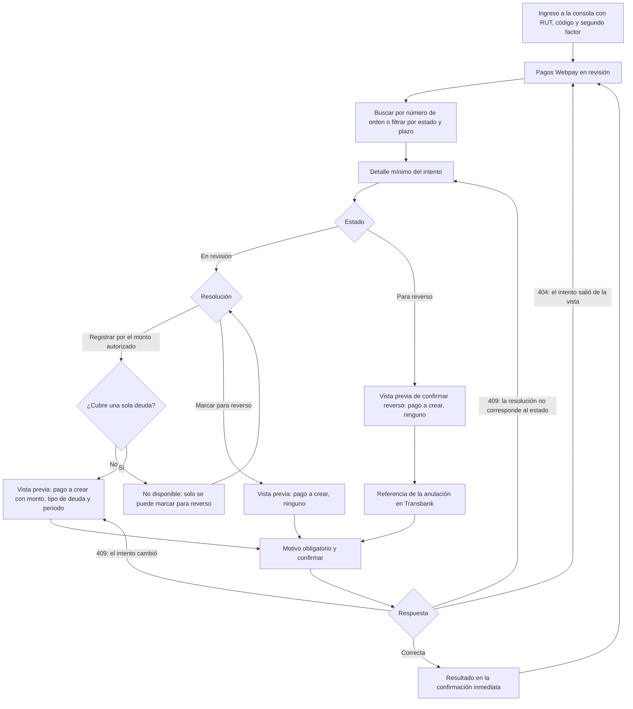

# Flujo: Soporte ComVive resuelve un pago Webpay en revisión

Estado: Borrador
Actor: Soporte ComVive (rol de plataforma `platform_support`); el administrador y el comité ven el resultado en lectura; el residente recibe el aviso
Superficie: consola de plataforma (web, separada de la web de administración)
Alcance: MVP
Referencias en `docs/specs/gasto-comun.md`:

- Intento en revisión: F-16 (S-32). Excepción de aislamiento: EX-1. Huella de plataforma: A-7.
- Ocupación terminada durante la revisión y aviso al pagador sin membresía: F-13 (S-42).
- Textos para el residente: F-17. Días hábiles: "Definiciones".
- Registro en el borrador vigente: A-4. Intereses: E-10.
- Criterios de aceptación: CA-41, CA-42, CA-54, CA-55 y CA-59.

Otras referencias: `docs/arquitectura.md` §2 (vista `platform_webpay_review`, 404 neutros), §3 ("Usuarios de plataforma": sesión con audiencia `platform`, segundo factor, endpoints `/platform/webpay-attempts`, auditoría de cada acceso) y §4 (`resolution-preview`, `previewHash` de plataforma, estados del intento, `review_due_on`).

**Plazo de resolución:** 5 días hábiles desde que el intento pasa a revisión, con alerta automática al vencer (decisión del líder del proyecto, 2026-11-07; regla F-16). Los días hábiles son de lunes a viernes, sin feriados nacionales legales de Chile; el vencimiento se fija al entrar a revisión (`review_due_on`, CA-59).

> **Revisión crítica 3 (`docs/revisiones/2026-11-07-diseno-rev3.md`): cambios aplicados.** M-5: la vista previa muestra solo los campos de EX-1 y el pago a crear, sin imputación; el resultado se muestra solo en la confirmación inmediata y la consola no recarga un detalle que responde 404. Menor 1: referencias a P-31 y al plazo vigente. Menor 5: textos y códigos de error copiados de la spec.

## Reglas de pantalla

- **Consola mínima:** una sola sección, "Pagos Webpay en revisión". No hay menú de comunidades, residentes ni finanzas.
- **Solo los campos de EX-1:** número de orden, comunidad, código de la unidad, tipo de deuda ("Propietario" o "Arrendatario", sin nombre), monto iniciado por ámbito, monto autorizado, estado y códigos de Transbank, fechas y la marca "Plazo vencido". Nunca nombres, RUT, contactos, cargos, deudas, saldos ni imputaciones.
- **Vista previa sin deuda (M-5):** la vista previa de una resolución muestra solo el pago que se crearía: monto, tipo de deuda final y periodo del borrador vigente. No muestra la deuda de la unidad ni cómo se imputará, porque Soporte no la ve (EX-1).
- **Lista de pendientes:** la consola solo ve intentos en "En revisión" (`in_review`) y "Para reverso" (`reversal_pending`). Un intento registrado (`resolved_paid`) o reversado (`reversed`) sale de su vista y le responde 404.
- **Resultado solo en la confirmación inmediata (M-5):** después de resolver, la pantalla muestra el resultado con los datos de la respuesta de la resolución y el botón "Volver a la lista". No recarga el detalle del intento, porque si salió de la vista responde 404.
- **Toda lectura queda en auditoría,** también abrir el detalle. La consola lo dice en el pie: "Cada consulta y cada resolución queda registrada y la ve la administración de la comunidad".
- **Cualquier otra ruta** responde "No encontramos lo que buscas o no tienes acceso" (404 `NOT_FOUND`).

## Diagrama

## Pasos

1. **Ingreso:** RUT, código y segundo factor; sesión de la audiencia `platform`, de máximo 8 horas (supuestos de la arquitectura §3). La sesión no sirve en la web de administración ni en la app, y viceversa.
2. **Lista "Pagos Webpay en revisión":** tabla con número de orden, comunidad, unidad, tipo de deuda, monto iniciado, monto autorizado, días hábiles en revisión y estado. Orden por defecto: el más antiguo primero.
   - **Filtros:** estado ("En revisión", "Para reverso") y "Plazo vencido".
   - **Búsqueda** por número de orden exacto.
   - **Plazo:** cada fila muestra "Vence el {dd-mm-aaaa}" (`review_due_on`) o, si se pasó, "Plazo vencido" en rojo, con texto y no solo con color.
3. **Detalle:** los campos de EX-1 y la diferencia entre monto iniciado y autorizado. Si cubre dos deudas, muestra el monto iniciado de cada una ("Propietario ${monto}", "Arrendatario ${monto}").
4. **Resolución** (F-16), según el estado:
   - **En revisión:**
     - **"Registrar por el monto autorizado"** (`register_authorized`): solo para intentos de una deuda. En intentos de dos deudas aparece desactivado con "Un pago que cubre dos deudas solo se puede marcar para reverso".
     - **"Marcar para reverso"** (`mark_for_reversal`).
   - **Para reverso:** **"Confirmar reverso"** (`confirm_reversal`), cuando Transbank confirma la anulación. Pide la referencia de la anulación en Transbank (obligatoria).
5. **Vista previa** (`resolution-preview`; devuelve los campos de EX-1, el pago a crear y la versión `previewHash`):
   - **Registrar:** "Se registrará un pago Webpay de ${monto} en el periodo en borrador {periodo}, en la deuda del {propietario o arrendatario}." Si el tipo de deuda final es "Propietario" y el intento era del arrendatario (el arriendo terminó durante la revisión, F-13, CA-54): "El arriendo de este intento terminó. El pago quedará en la deuda del propietario de la misma unidad." No muestra la deuda de la unidad, los cargos ni la imputación: se calculan al ejecutar (EX-1, M-5).
   - **Marcar para reverso:** "No se registrará ningún pago. El residente verá que su pago no se registró y que se solicitará la devolución del monto a Transbank."
   - **Confirmar reverso:** "No se registrará ningún pago. El intento quedará como reversado con la referencia de Transbank que ingreses."
6. **Motivo obligatorio** (texto, con la ayuda "No incluyas datos personales") y "Confirmar". El envío lleva la versión de la vista previa y una clave de idempotencia generada al abrir la confirmación.
7. **Resultado (solo en la confirmación inmediata, M-5, F-16):** la pantalla muestra una sola vez lo que devolvió la resolución, con el texto de F-17, y el botón "Volver a la lista". No vuelve a pedir el detalle del intento.
   - **`register_authorized`:** "Pago registrado por ${monto} en la deuda {del propietario o del arrendatario} de {unidad}, periodo {AAAA-MM}. Número de orden {buy_order}". "Del propietario" o "del arrendatario" sale del tipo de ámbito final y {unidad} es el código de la unidad; nunca un nombre (EX-1).
   - **`mark_for_reversal`:** "Intento {buy_order} marcado para reverso. Solicita la anulación en Transbank y luego confirma el reverso con su referencia".
   - **`confirm_reversal`:** "Reverso confirmado para el intento {buy_order}. Referencia de Transbank: {referencia}".
   - Al volver, la lista se recarga y el intento ya no aparece (registrado o reversado) o aparece como "Para reverso".
8. **Avisos de la resolución:**
   - El administrador de la comunidad la ve en "Intentos Webpay" y recibe una notificación (arquitectura §3).
   - Quien inició el pago, si sigue con membresía, ve en la app los textos de F-17 (`residente-estado-de-cuenta-y-pago.md`, paso 7).
   - Si ya no tiene membresía (ex arrendatario o ex propietario), recibe el aviso por correo verificado o, si no tiene, por SMS, sin montos ni deudas (F-13, S-42, CA-54). La consola no muestra a quién se envió.

**Alerta de plazo vencido (automática):**

- Al terminar el quinto día hábil sin resolución, la consola marca el intento "Plazo vencido" y ComVive envía una alerta al equipo de Soporte solo con el id del intento y su número de orden (F-16, CA-59; canal interno por definir, UX-42).
- El administrador de la comunidad ve en su pantalla "Intentos Webpay" la etiqueta "Plazo vencido" (solo lectura).

**Lo que ven el administrador y el comité** (web: Pagos > Intentos Webpay, solo lectura, `webpay_attempt.read`):

- Lista con número de orden, unidad, deuda (propietario o arrendatario; el comité no ve el nombre del arrendatario), monto iniciado, monto autorizado, estado, plazo y resolución, con "Soporte ComVive" como actor.
- Búsqueda por número de orden y filtro por estado.
- Texto fijo: "Estos pagos los resuelve Soporte ComVive en un plazo de hasta 5 días hábiles. Si un residente pregunta, dale el número de orden."
- Sin botones de resolución. No existe una ruta de resolución para la comunidad: si el administrador o el comité llaman a la ruta `/platform/...`, reciben 404 `NOT_FOUND` (M-4, CA-41).

## Estados vacíos

- **Consola sin pendientes:** "No hay pagos en revisión."
- **Búsqueda sin resultados:** "No hay un pago en revisión con ese número de orden." (también si existe pero no está en revisión ni para reverso: 404 neutro).
- **Web del administrador sin intentos:** "No hay pagos en línea en revisión en esta comunidad."

## Errores

Los textos y códigos son los de la tabla "Códigos y mensajes de error" de la spec.

| Caso | Código | Mensaje | Comportamiento |
| --- | --- | --- | --- |
| El intento salió de la vista (ya registrado o reversado, por ejemplo por otra persona de Soporte), o ruta fuera de la consola | 404 `NOT_FOUND` | "No encontramos lo que buscas o no tienes acceso" | Vuelve a la lista y la recarga; no reintenta el detalle (M-5, CA-55) |
| La resolución no corresponde al estado actual (por ejemplo, otra persona lo marcó para reverso) | 409 `PREVIEW_OUTDATED` | "Esta resolución no corresponde al estado actual del intento. Revisa la nueva vista previa" | Recarga el detalle, que sigue en la vista, con las resoluciones de su estado actual (CA-55) |
| Cambió la huella (estado, monto, tipo de deuda final o periodo) | 409 `PREVIEW_OUTDATED` | "El intento cambió desde la vista previa. Revisa la nueva vista previa antes de resolver" | Pide una vista previa nueva y marca lo que cambió (A-7, CA-54) |
| Registrar un intento de dos deudas | 422 `MULTI_SCOPE_REVIEW_REVERSAL_ONLY` | "Un pago que cubre dos deudas solo se puede marcar para reverso" | Botón desactivado; si llega a la API, se rechaza (CA-41) |
| Motivo vacío | 422 `REASON_REQUIRED` | "Indica el motivo de la resolución" | El campo es inválido |
| Confirmar reverso sin referencia | 422 `REVERSAL_REFERENCE_REQUIRED` | "Ingresa la referencia de la anulación en Transbank" | El campo es inválido (CA-55) |
| Misma clave de idempotencia con otros datos | 422 `IDEMPOTENCY_KEY_REUSED` | "Esta operación ya se envió con otros datos. Vuelve a abrir el formulario" | Cierra la confirmación y vuelve a la lista |
| Rol de plataforma revocado o sesión vencida | — | "Tu sesión terminó. Vuelve a ingresar." | Lleva al ingreso |
| Falla de la auditoría | — | "No se pudo completar la acción. Intenta de nuevo." | La API no responde datos sin auditoría |

## Carga

- **Lista y detalle:** esqueleto de tabla.
- **Vista previa y confirmación:** botón con indicador y bloqueo del doble envío.

## Supuestos (a validar)

- Segundo factor y sesión de 8 horas (arquitectura §3).
- El canal de la alerta de plazo vencido y quién la recibe (UX-42).
- La anulación en Transbank se ejecuta fuera de la consola y Soporte registra su referencia al confirmar el reverso. El mecanismo y el plazo de la devolución siguen abiertos en P-31.
- Los textos del resultado del paso 7 son los de F-17 (propuestas del analista, S-52). Los textos de las vistas previas del paso 5 son del diseño.
