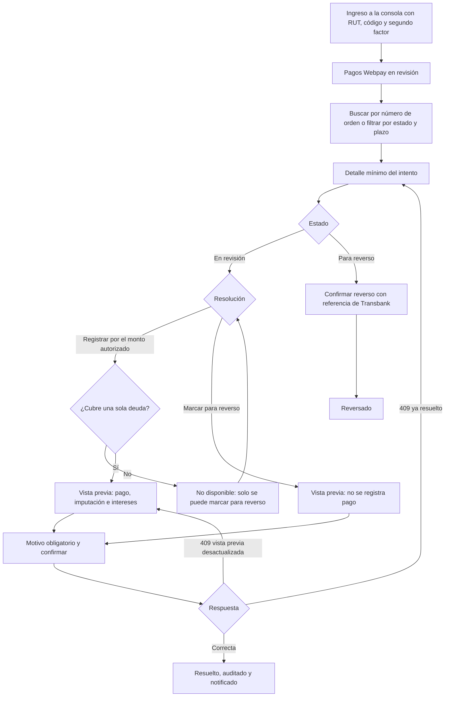

# Flujo: Soporte ComVive resuelve un pago Webpay en revisión

Estado: Borrador
Actor: Soporte ComVive (rol de plataforma `platform_support`); el administrador y el comité ven el resultado en lectura; el residente recibe el aviso
Superficie: consola de plataforma (web, separada de la web de administración)
Alcance: MVP
Referencias en `docs/specs/gasto-comun.md`:

- Intento en revisión: F-16 (S-32). Excepción de aislamiento: EX-1.
- Registro en el borrador vigente: A-4. Intereses: E-10.
- Criterios de aceptación: CA-41 y CA-42.

Otras referencias: `docs/arquitectura.md` §2 (vista `platform_webpay_review`, 404 neutros), §3 ("Usuarios de plataforma": sesión con audiencia `platform`, segundo factor, endpoints `/platform/webpay-attempts`, auditoría de cada acceso) y §4 (`resolution-preview`, `previewHash`, estados del intento).

**Plazo de resolución:** 5 días hábiles desde que el intento pasa a revisión, con alerta automática al vencer (decisión del líder del proyecto, 2026-11-07; reemplaza los 2 días de S-32).

## Reglas de pantalla

- **Consola mínima:** una sola sección, "Pagos Webpay en revisión". No hay menú de comunidades, residentes ni finanzas.
- **Solo los campos de EX-1:** número de orden, comunidad, código de la unidad, tipo de deuda ("Propietario" o "Arrendatario", sin nombre), monto iniciado por ámbito, monto autorizado, fechas de inicio y de autorización, código de autorización de Transbank, estado y resolución. Nunca nombres, RUT, contactos, deudas ni saldos.
- **Toda lectura queda en auditoría,** también abrir el detalle. La consola lo dice en el pie: "Cada consulta y cada resolución queda registrada y la ve la administración de la comunidad".
- **Cualquier otra ruta** responde "No encontramos lo que buscas o no tienes acceso" (404 neutro).

## Diagrama

## Pasos

1. **Ingreso:** RUT, código y segundo factor; sesión de la audiencia `platform`, de máximo 8 horas (supuestos de la arquitectura §3). La sesión no sirve en la web de administración ni en la app, y viceversa.
2. **Lista "Pagos Webpay en revisión":** tabla con número de orden, comunidad, unidad, tipo de deuda, monto iniciado, monto autorizado, días hábiles en revisión y estado. Orden por defecto: el más antiguo primero.
   - **Filtros:** estado ("En revisión", "Para reverso") y "Plazo vencido".
   - **Búsqueda** por número de orden exacto.
   - **Plazo:** cada fila muestra "Vence en {n} días hábiles" o, si se pasó, "Plazo vencido hace {n} días hábiles" en rojo.
3. **Detalle:** los campos de EX-1 y la diferencia entre monto iniciado y autorizado. Si cubre dos deudas, muestra el monto iniciado de cada una ("Propietario ${monto}", "Arrendatario ${monto}").
4. **Resolución** (F-16), con dos botones:
   - **"Registrar por el monto autorizado":** solo para intentos de una deuda. En intentos de dos deudas aparece desactivado con "Un pago que cubre dos deudas solo se puede marcar para reverso".
   - **"Marcar para reverso".**
5. **Vista previa** (`resolution-preview`, devuelve la versión):
   - Registrar: "Se registrará un pago Webpay de ${monto autorizado} con fecha {fecha de autorización} en {comunidad} · {unidad}, en el periodo en borrador. Se aplicará a la deuda del {propietario o arrendatario}". Con intereses activos: "Puede generar ajustes de intereses en la comunidad". No muestra la deuda de la unidad (EX-1).
   - Reverso: "No se registrará ningún pago. El residente verá que su pago no se registró y que se pedirá la devolución a Transbank."
6. **Motivo obligatorio** (texto, con la ayuda "No incluyas datos personales") y "Confirmar". El envío lleva la versión y una clave de idempotencia.
7. **Resultado:**
   - El intento queda "Pago registrado" o "Para reverso", con la persona, la fecha y el motivo.
   - El administrador de la comunidad y quien inició el pago reciben una notificación de la resolución (arquitectura §3). El residente ve los textos de `residente-estado-de-cuenta-y-pago.md`, paso 7.
8. **Confirmar reverso:** para los intentos "Para reverso", cuando Transbank confirma la devolución, Soporte ingresa la referencia de Transbank y confirma. El intento pasa a "Reversado" (el procedimiento con Transbank está en P-17).

**Alerta de plazo vencido (automática):**

- Al cumplirse 5 días hábiles sin resolución, la consola marca el intento y ComVive envía una alerta al equipo de Soporte (canal interno por definir, UX-42).
- El administrador de la comunidad ve en su pantalla "Intentos Webpay" la etiqueta "Plazo vencido" (solo lectura).

**Lo que ven el administrador y el comité** (web: Pagos > Intentos Webpay, solo lectura, `webpay_attempt.read`):

- Lista con número de orden, unidad, deuda (propietario o arrendatario; el comité no ve el nombre del arrendatario), monto iniciado, monto autorizado, estado, plazo y resolución.
- Búsqueda por número de orden y filtro por estado.
- Texto fijo: "Estos pagos los resuelve Soporte ComVive en un plazo de hasta 5 días hábiles. Si un residente pregunta, dale el número de orden."
- Sin botones de resolución. Si se intenta por la API, 403 (CA-41).

## Estados vacíos

- **Consola sin pendientes:** "No hay pagos en revisión."
- **Búsqueda sin resultados:** "No hay un pago en revisión con ese número de orden." (también si existe pero no está en revisión: 404 neutro).
- **Web del administrador sin intentos:** "No hay pagos en línea en revisión en esta comunidad."

## Errores

| Caso | Mensaje | Comportamiento |
| --- | --- | --- |
| Registrar un intento de dos deudas | "Un pago que cubre dos deudas solo se puede marcar para reverso" (422, F-16, CA-41) | Botón desactivado; si llega a la API, se rechaza |
| Intento ya resuelto | "El intento ya fue resuelto" (409, CA-41) | Recarga el detalle con la resolución |
| La vista previa cambió (por ejemplo, otro borrador vigente) | "La resolución cambió desde la vista previa. Revisa la nueva vista previa" (409 `PREVIEW_OUTDATED`) | Pide una vista previa nueva |
| Motivo vacío | "Indica el motivo de la resolución" | El campo es inválido |
| Ruta fuera de la consola o intento en otro estado | "No encontramos lo que buscas o no tienes acceso" | 404 neutro (CA-42) |
| Rol de plataforma revocado o sesión vencida | "Tu sesión terminó. Vuelve a ingresar." | Lleva al ingreso |
| Falla de la auditoría | "No se pudo completar la acción. Intenta de nuevo." | La API no responde datos sin auditoría |

## Carga

- **Lista y detalle:** esqueleto de tabla.
- **Vista previa y confirmación:** botón con indicador y bloqueo del doble envío.

## Supuestos (a validar)

- Segundo factor y sesión de 8 horas (arquitectura §3).
- El canal de la alerta de plazo vencido y quién la recibe (UX-42).
- La confirmación del reverso la registra Soporte manualmente con la referencia de Transbank (P-17).
