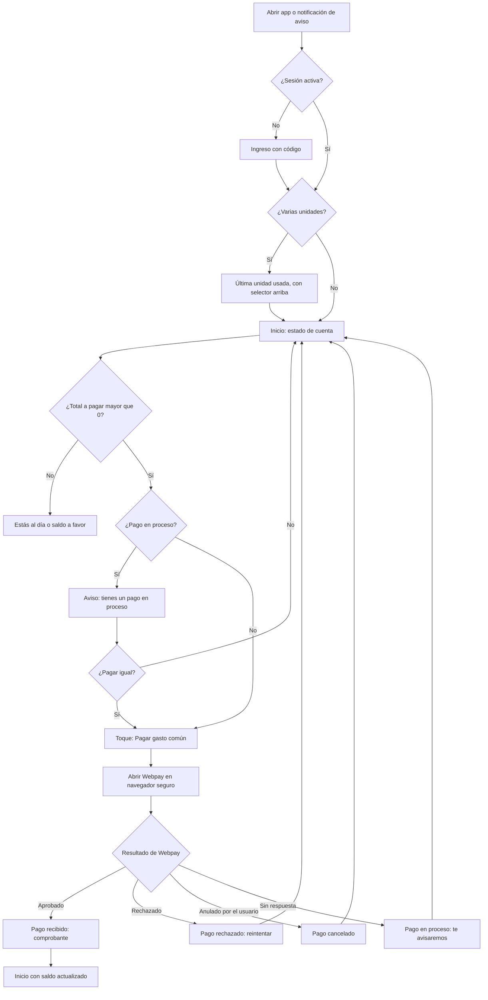

# Flujo: ver estado de cuenta y pagar con Webpay

Estado: Borrador
Actor: residente propietario o arrendatario
Superficie: app residente (celular)
Alcance: MVP
Referencias: `docs/specs/gasto-comun.md` F-2, F-5, F-6, F-9, S-14; CA-9, CA-20; `docs/arquitectura.md` §1 (Webpay)

Objetivo: desde abrir la app hasta iniciar el pago, **un toque** ("Pagar gasto común") cuando hay una sola unidad.

## Diagrama

## Pasos

1. El residente abre la app (o toca la notificación "Ya está tu gasto común de octubre").
2. **Inicio** muestra, en este orden:
   - Comunidad y unidad (selector si hay varias, UX-13).
   - **Total a pagar** en grande y **fecha de vencimiento** ("Vence el 11 de noviembre").
   - Botón **"Pagar gasto común"** a todo el ancho.
   - Desglose plegado: periodo actual, deuda anterior, intereses, multas, saldo a favor (montos de la API).
   - Enlaces "Ver detalle del periodo" y "Ver aviso (PDF)".
3. Toque en "Pagar gasto común": la app pide a la API iniciar la transacción por el total a pagar de esa unidad (UX-3, UX-4) y abre Webpay en un navegador seguro dentro de la app.
4. Al volver, la app consulta el estado del pago a la API (nunca confía solo en el retorno del navegador):
   - **Aprobado:** "Pago recibido. $262.500 · Depto 102 · 05-11-2026" con número de orden y "Compartir comprobante".
   - **Rechazado:** "Tu banco rechazó el pago. No se hizo ningún cargo." con "Intentar de nuevo".
   - **Cancelado:** "Cancelaste el pago." y vuelve a Inicio.
   - **En proceso:** "Estamos confirmando tu pago con Transbank. Te avisaremos." (UX-12).
5. Si la confirmación llega dos veces, el residente ve un solo pago (F-2, CA-9).

**Arrendatario:** ve cargos y pagos desde su fecha de ingreso (S-14). Si la unidad tiene deuda anterior, se muestra la nota de UX-2 (texto en revisión).

## Estados vacíos

- **Al día:** "Estás al día. Tu próximo aviso llegará a comienzos de mes." Sin botón de pago.
- **Saldo a favor:** "Tienes $37.500 a favor. Se descontarán de tu próximo gasto común." (F-6).
- **Sin avisos emitidos aún:** "Tu comunidad todavía no emite gastos comunes en ComVive."
- **Sin pagos en el historial:** "Aquí verás tus pagos."

## Errores

| Caso | Mensaje | Comportamiento |
| --- | --- | --- |
| Sin conexión | "Sin conexión. Mostramos tus datos del 05-11 a las 10:32." | Muestra última copia guardada; desactiva "Pagar" |
| Falla al iniciar Webpay | "No pudimos conectar con Webpay. Intenta en unos minutos." | Vuelve a Inicio |
| Pago rechazado | "Tu banco rechazó el pago. No se hizo ningún cargo." | "Intentar de nuevo" |
| Sesión expirada al volver de Webpay | Pide ingreso y luego muestra el resultado del pago | El pago no depende de la sesión |
| Unidad ya no asociada (cambio de propietario o fin de arriendo) | "Ya no tienes acceso a esta unidad." | Quita la unidad del selector |

## Carga

- Inicio: esqueleto del total y del botón; si hay copia guardada, se muestra primero con "Actualizando…".
- Antes de abrir Webpay: el botón cambia a "Conectando con Webpay…" y no admite otro toque.
- Al volver: pantalla "Confirmando tu pago…" con consulta periódica a la API durante un tiempo máximo (UX-12); al vencer, pasa a "En proceso".

## Supuestos (a validar)

- Se paga el total a pagar de una unidad por transacción, sin elegir monto (UX-3, UX-13).
- El botón no aparece con total 0 o saldo a favor (UX-4).
- La copia sin conexión muestra montos con la fecha de actualización y no permite pagar.
