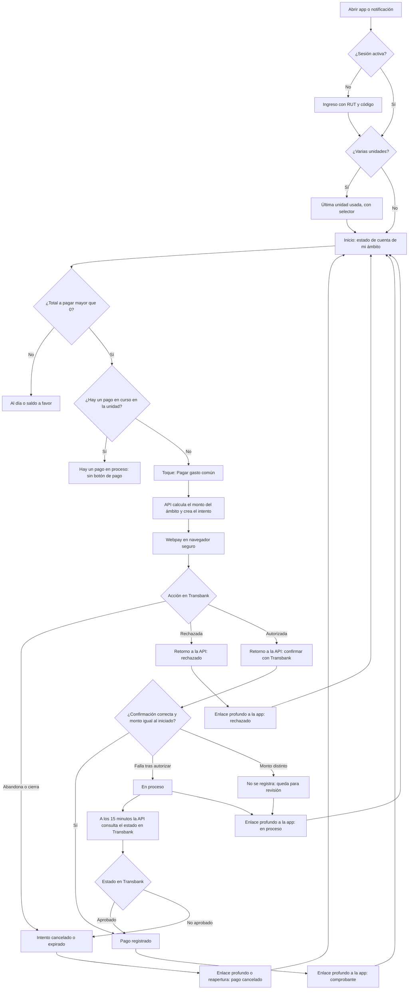

# Flujo: ver estado de cuenta y pagar con Webpay

Estado: Borrador
Actor: residente propietario o arrendatario
Superficie: app residente (celular)
Alcance: MVP
Referencias en `docs/specs/gasto-comun.md`:

- Pagos: F-1, F-2 y F-6.
- Ámbito y aviso legal: F-9, S-14 y S-19.
- Aviso al pagar: E-8, solo con el flag `billing.interest`.
- Criterios de aceptación: CA-10, CA-22 y CA-23.

Otras referencias: `docs/arquitectura.md` §4 (Webpay, `WEBPAY_ATTEMPT`).

Objetivo: desde abrir la app hasta iniciar el pago, **un toque** ("Pagar gasto común") cuando hay una sola unidad.

## Reglas de pantalla

- **Total a pagar:** es el saldo del **ámbito** de quien mira (F-9). El propietario ve la unidad completa; el arrendatario, solo su ventana. Lo calcula la API.
- **Arrendatario:** ningún texto, monto ni enlace menciona o insinúa la deuda del propietario. Su "saldo anterior" es solo el de su ventana (F-9, CA-22).
- **Aviso en PDF:** solo para el propietario. El arrendatario ve el detalle del periodo en pantalla; si pide la ruta del PDF, la API responde 404.
- **Monto del pago:** la app no envía el monto. La API lo calcula según el ámbito y verifica que el monto autorizado por Transbank sea igual al iniciado.
- **Pagos en curso:** solo uno por unidad. Si ya hay uno, se muestra "Hay un pago en proceso" y no se permite iniciar otro.

## Diagrama

## Pasos

1. El residente abre la app o toca la notificación ("Tienes un nuevo aviso de gasto común", sin montos en la pantalla bloqueada).
2. **Inicio** muestra, en este orden:
   - Comunidad y unidad, con selector si hay varias (UX-13).
   - **Total a pagar** en grande y **fecha de vencimiento** ("Vence el 11 de noviembre").
   - Con el flag `billing.interest` activo y deuda vencida, el texto de E-8: "Tu deuda está vencida. Se pueden generar intereses hasta la fecha de tu pago, que se cobrarán en el próximo aviso".
   - Botón **"Pagar gasto común"** a todo el ancho.
   - Desglose plegado de su ámbito: periodo actual, saldo anterior, multas y saldo a favor (montos de la API).
   - Enlace "Ver detalle del periodo". El propietario además tiene "Ver aviso (PDF)".
3. **Toque en "Pagar gasto común":** la app pide a la API iniciar un pago de esa unidad, sin enviar monto. La API calcula el monto del ámbito, crea el intento y devuelve la dirección de Webpay, que se abre en un navegador seguro dentro de la app.
4. **En Transbank** el residente paga, abandona o es rechazado. Transbank vuelve a la API; la API confirma la transacción y verifica el monto. Luego redirige a la app con un enlace profundo.
5. **Al volver,** la app siempre consulta el estado del intento a la API:
   - **Aprobado:** "Pago recibido. $262.500 · Depto 102 · 05-11-2026", con el número de orden y "Compartir comprobante".
   - **Rechazado:** "Tu banco rechazó el pago. No se hizo ningún cargo." con "Intentar de nuevo".
   - **Cancelado o expirado:** "El pago no se completó. No se hizo ningún cargo."
   - **En proceso:** "Estamos confirmando tu pago con Transbank. No vuelvas a pagar. Te avisaremos cuando se confirme." Debajo: "Si se descontó dinero y en 15 minutos no ves el pago, escribe a tu administración con el número de orden {orden}."
6. **Sin retorno a la app** (por ejemplo, si cerró el navegador): la próxima vez que abra la app, Inicio consulta el intento en curso y muestra su estado.
7. **Confirmación duplicada:** si Transbank confirma dos veces, el residente ve un solo pago (F-2, CA-10).

## Estados vacíos

- **Al día:** "Estás al día. Te avisaremos cuando llegue tu próximo gasto común." Sin botón de pago.
- **Saldo a favor:** "Tienes $37.500 a favor. Se descontarán de tu próximo gasto común." (F-6).
- **Propietario sin periodos emitidos:** "Tu comunidad todavía no emite gastos comunes en ComVive."
- **Arrendatario sin cargos en su ventana:** "Aún no hay cobros desde tu ingreso el {dd-mm-aaaa}. Te avisaremos cuando llegue el primero."
- **Historial de pagos vacío:** "Aquí verás tus pagos."

## Errores

| Caso | Mensaje | Comportamiento |
| --- | --- | --- |
| Sin conexión | "Sin conexión. Mostramos tus datos del 05-11 a las 10:32." | Muestra la copia local y desactiva "Pagar" |
| Pago en curso en la unidad | "Hay un pago en proceso" | No permite iniciar otro |
| Falla al iniciar Webpay | "No pudimos conectar con Webpay. Intenta en unos minutos." | Vuelve a Inicio |
| Pago rechazado | "Tu banco rechazó el pago. No se hizo ningún cargo." | "Intentar de nuevo" |
| Falla de la confirmación después de autorizar | Mensaje de "En proceso" (paso 5) | La API consulta el estado en Transbank a los 15 minutos |
| Monto autorizado distinto del iniciado | Mensaje de "En proceso" (paso 5) | La API no registra el pago y lo deja para revisión (UX-24) |
| Sesión expirada al volver de Webpay | Pide ingreso y luego muestra el resultado | El pago no depende de la sesión |
| Pérdida de acceso (venta, fin de arriendo) | "Ya no tienes acceso a esta unidad." | Quita la unidad y borra su copia local (S-14) |
| Arrendatario pide el PDF del aviso | No hay enlace; si llega por ruta directa, "No encontramos este documento" | 404 en la API |

## Carga

- **Inicio:** esqueleto del total y del botón. Si hay copia local, se muestra primero con "Actualizando…".
- **Antes de abrir Webpay:** el botón cambia a "Conectando con Webpay…" y no admite otro toque.
- **Al volver:** pantalla "Confirmando tu pago…" con consulta a la API. Si no hay respuesta final, pasa a "En proceso".

## Supuestos (a validar)

- **Plazo de "En proceso":** 15 minutos, tras los cuales la API consulta el estado en Transbank (arquitectura §4).
- **Una unidad por transacción** (UX-13).
- **Copia local:** muestra montos con su fecha de actualización, no permite pagar y se borra al cerrar sesión o al perder el acceso.
