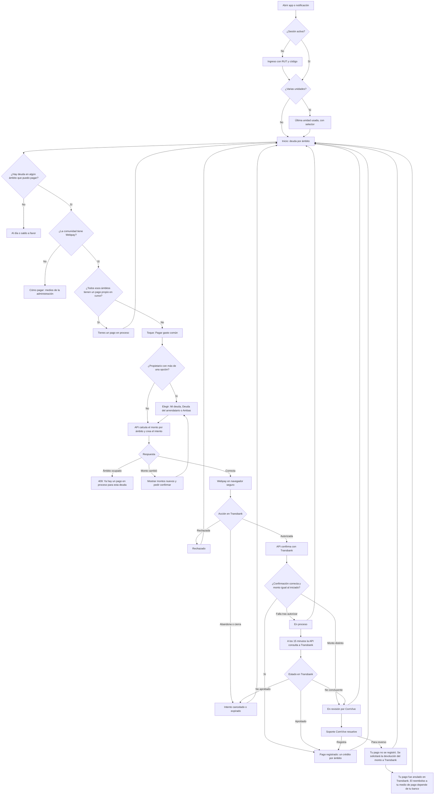

# Flujo: ver estado de cuenta y pagar con Webpay

Estado: Borrador
Actor: residente propietario o arrendatario
Superficie: app residente (celular)
Alcance: MVP
Referencias en `docs/specs/gasto-comun.md`:

- Pagos: F-1, F-2, F-6, F-12 (pago por ámbito) y F-16 (intento en revisión).
- **Textos canónicos de pagos: F-17.** Todo texto de esta pantalla que aparece en F-17 o en la tabla "Códigos y mensajes de error" se copia tal cual.
- Ámbito, visibilidad y aviso legal: F-9, F-13, F-15, S-14, S-19, S-25 y S-48. "Datos del arrendatario que ve el propietario" (S-44).
- Vista del cobro del arrendatario y resumen de gastos: G-7 y G-8.
- Aviso al pagar: E-8, solo con el flag `billing.interest`.
- Criterios de aceptación: CA-10, CA-22, CA-23, CA-29, CA-30, CA-35, CA-41, CA-47, CA-55 y CA-60.

Otras referencias: `docs/arquitectura.md` §2 (respuestas neutras), §4 (Webpay: `webpay-attempts`, bloqueo por (unidad, ámbito), estados; visibilidad por ámbito y `payerKind`) y §5 (copia local y push).

> **Revisión crítica 3 (`docs/revisiones/2026-11-07-diseno-rev3.md`): cambios aplicados.** M-8: textos de F-17 ("Ya hay un pago en proceso para esta deuda", "Registrado por la administración", "En revisión por ComVive", "Pagado por ti", "Pagado por el arrendatario" y los de `reversal_pending` y `reversed`). Menor 2: ámbito `owner`. Menor 5: textos de error de la spec. Menor 1: referencias al plazo vigente.

Objetivo: desde abrir la app hasta iniciar el pago, **un toque** ("Pagar gasto común") cuando hay una sola deuda que pagar; **dos toques** cuando el propietario tiene que elegir qué deuda paga.

## Reglas de pantalla

- **Ámbitos separados (F-9, M1):**
  - **Propietario sin arrendatario vigente:** un solo bloque, "Tu deuda" (ámbito `owner`).
  - **Propietario con arrendatario vigente:** dos bloques, "Tu deuda" y "Deuda del arrendatario {nombre}", cada uno con su deuda y su saldo a favor. **Nunca** se muestra un "Total a pagar" que sume o compense los dos ámbitos.
  - **Arrendatario:** un solo bloque con su ámbito. Ningún texto, monto ni enlace menciona o insinúa la deuda del propietario (S-19).
  - Dentro de un mismo ámbito nunca coexisten deuda y saldo a favor (F-6), así que cada bloque muestra uno de los dos.
- **Qué se puede pagar (F-12):**
  - El propietario elige "Mi deuda", "Deuda del arrendatario" o "Ambas". Solo se ofrecen los ámbitos con deuda mayor que $0; "Ambas" solo si los dos tienen deuda y ninguno tiene un pago en curso.
  - El arrendatario paga solo su ámbito.
  - Si el propietario no tiene arrendatario vigente, o solo uno de los ámbitos tiene deuda, no hay elección: el botón paga ese ámbito.
- **Monto del pago:** la app no calcula ni suma montos. Muestra los montos que entrega la API para cada opción (incluido el de "Ambas") y, al iniciar, envía los ámbitos elegidos y el total que el residente vio (`expectedTotalClp`). Si la deuda cambió, la API responde 409 `AMOUNT_CHANGED` con los montos nuevos.
- **Pagos en curso por (unidad, ámbito) (M3, F-12, F-17):** un intento en curso bloquea solo los ámbitos que cubre.
  - **Quien inició el intento** (`startedByMe`, estado `initiated`) ve en el bloque de esa deuda el estado "Tienes un pago en proceso" y debajo "Número de orden {buy_order}. Te avisaremos el resultado". Es un estado, no un error.
  - **Los demás residentes** que ven ese ámbito no ven ningún estado. Si intentan pagarlo, la API responde 409 `PAYMENT_IN_PROGRESS` y la app muestra "Ya hay un pago en proceso para esta deuda", sin decir quién paga (CA-30).
- **Quién pagó (F-12, F-17, S-25, S-48):** cada pago muestra una etiqueta relativa a quien mira. La API entrega `payerKind` y la app solo traduce:

  | `payerKind` | Quién pagó | Etiqueta | Quién la ve |
  | --- | --- | --- | --- |
  | `self` | Quien mira inició el pago | "Pagado por ti" | Propietario y arrendatario, en sus propios pagos |
  | `owner` | El propietario, en el ámbito del arrendatario | "Pagado por el propietario" | Arrendatario |
  | `tenant` | El arrendatario, en su ámbito | "Pagado por el arrendatario" | Propietario, en "Deuda del arrendatario" |
  | `administration` | Pago manual del administrador | "Registrado por la administración" | Propietario y arrendatario |

  - El arrendatario ve el pago de su ámbito con monto, fecha y medio. No ve la deuda propia del propietario, ni el total de la transacción, ni el otro pago del grupo, ni el número de orden si el pago cubrió dos ámbitos (404 en la API). Mientras el pago está en curso, el arrendatario no ve ningún estado; solo recibe el 409 neutro si intenta pagar.
  - Un pago manual siempre es "Registrado por la administración", aunque el administrador sepa quién transfirió (F-12).
  - **Sin etiqueta (F-12, F-17, S-51, CA-63):** un pago Webpay que inició un propietario anterior, visto por el propietario nuevo en "Tu deuda", llega con `payerKind` nulo y se muestra solo con monto, fecha y medio, sin texto de quién pagó.
  - **Traspasos en "Tu deuda" (F-17):** la deuda traspasada se muestra como "Traspaso desde arriendo terminado el {dd-mm-aaaa}" y el saldo a favor traspasado como "Saldo a favor traspasado desde arriendo terminado el {dd-mm-aaaa}", sin el nombre del ex arrendatario.
- **Comunidad sin pago en línea (F-12, F-17):** si la comunidad no tiene código de comercio Transbank, el botón "Pagar gasto común" no aparece. En su lugar va el texto "Esta comunidad aún no recibe pagos en línea. Pide a la administración los datos para pagar por transferencia", igual para el propietario y el arrendatario, y debajo el enlace "Cómo pagar", con los medios de pago que configuró la administración.
- **Aviso en PDF:** solo para el propietario y con el RUT siempre enmascarado (G-2, S-30). El arrendatario ve la vista de su cobro en pantalla (G-7).
- **Vencimiento con varias deudas (menor 10):** cada bloque muestra por separado "Vencido desde {dd-mm-aaaa}" y "Por vencer el {dd-mm-aaaa}", con el monto de cada uno que entrega la API.

## Diagrama

## Pasos

1. El residente abre la app o toca la notificación. Textos de la notificación (G-6), sin montos ni unidad en la pantalla bloqueada:
   - Propietario: "Ya está disponible tu aviso de cobro de {periodo}. Vence el {dd-mm-aaaa}".
   - Arrendatario: "Tienes un nuevo cobro de gasto común de {periodo}. Vence el {dd-mm-aaaa}" (menor 8).
2. **Inicio** muestra, en este orden:
   - Comunidad y unidad, con selector si hay varias (UX-13).
   - **Bloque "Tu deuda"** (propietario) o **"Tu gasto común"** (arrendatario), con el monto en grande y, debajo, "Vencido desde {fecha}: ${monto}" y "Por vencer el {fecha}: ${monto}". Si no hay deuda, "Al día" o "Saldo a favor ${monto}".
   - **Bloque "Deuda del arrendatario {nombre}"** (solo propietario con arrendatario vigente), con el mismo formato y la nota "Esta deuda es del arriendo vigente. Puedes pagarla si lo acordaste con tu arrendatario." No hay una línea de total que sume los bloques.
   - Con el flag `billing.interest` activo y deuda vencida en el ámbito, el texto de E-8 dentro de su bloque: "Tu deuda está vencida. Se pueden generar intereses hasta la fecha de tu pago, que se cobrarán en el próximo aviso".
   - Botón **"Pagar gasto común"** a todo el ancho, si la comunidad tiene Webpay y hay al menos un ámbito con deuda y sin pago en curso. Si no tiene Webpay, el texto de F-17 "Esta comunidad aún no recibe pagos en línea. Pide a la administración los datos para pagar por transferencia" y el enlace "Cómo pagar".
   - Si la persona tiene un intento propio en revisión, la hoja de pago muestra antes de pagar "Tienes un pago en revisión por ${monto}; si pagas de nuevo podría quedar saldo a favor" (F-16, F-17).
   - Desglose plegado de cada bloque: periodo actual, saldo anterior del ámbito, multas, ajustes y saldo a favor (montos de la API).
   - Enlaces "Ver detalle del periodo" y, solo el propietario, "Ver aviso (PDF)".
3. **Toque en "Pagar gasto común":**
   - **Una sola opción** (arrendatario, o propietario con un solo ámbito con deuda): la app pide a la API iniciar el pago de ese ámbito. Es el único toque.
   - **Propietario con varias opciones:** se abre la hoja "¿Qué quieres pagar?" con hasta tres opciones, cada una con el monto que entrega la API: "Mi deuda ${monto}", "Deuda del arrendatario ${monto}" y "Ambas ${monto}". Una opción con un pago propio en curso aparece desactivada con "Tienes un pago en proceso". Si la opción elegida tiene un pago en curso de otra persona, la API responde 409 y la hoja muestra "Ya hay un pago en proceso para esta deuda" en esa opción. Al elegir, botón "Pagar ${monto}".
4. **Inicio del intento:** la app envía los ámbitos elegidos y el total que vio (`POST .../units/{unitId}/webpay-attempts`, con clave de idempotencia). La API calcula el monto de cada ámbito, fija el reparto y devuelve la dirección de Webpay, que se abre en un navegador seguro dentro de la app.
5. **En Transbank** el residente paga, abandona o es rechazado. Transbank vuelve a la API, que confirma la transacción y verifica el monto. Luego redirige a la app con un enlace profundo.
6. **Al volver,** la app siempre consulta el estado del intento a la API:
   - **Aprobado:** "Pagado por ti · ${monto} · {unidad} · {dd-mm-aaaa}", con el número de orden y "Compartir comprobante". Si el propietario pagó "Ambas", el comprobante detalla "Tu deuda ${monto}" y "Deuda del arrendatario ${monto}" (F-12).
   - **Rechazado:** "Tu banco rechazó el pago. No se hizo ningún cargo." con "Intentar de nuevo".
   - **Cancelado o expirado:** "El pago no se completó. No se hizo ningún cargo." Si el intento aún bloquea el ámbito (cerró el navegador sin volver), "Podrás reintentar en {n} min".
   - **En proceso:** "Estamos confirmando tu pago con Transbank. No vuelvas a pagar. Te avisaremos cuando se confirme." con el número de orden.
   - **En revisión** (`in_review`, F-16, F-17): el estado dice "En revisión por ComVive" y debajo "Te avisaremos cuando se resuelva. Número de orden {buy_order}". La deuda no cambia mientras tanto.
7. **Resolución de un pago en revisión** (la hace Soporte ComVive; ver `plataforma-soporte-webpay.md`). El residente recibe una notificación y la app muestra (F-16, F-17):
   - **Registrado** (`resolved_paid`): el pago aparece como "Pagado por ti" por el monto autorizado.
   - **Para reverso** (`reversal_pending`): "Tu pago no se registró. Se solicitará la devolución del monto a Transbank".
   - **Reversado** (`reversed`): "Tu pago fue anulado en Transbank. El reembolso a tu medio de pago depende de tu banco".
   - Si quien pagó ya no tiene membresía en la comunidad (por ejemplo, su arriendo terminó durante la revisión), no ve la app: recibe el aviso por correo o SMS de F-13, sin montos (CA-54).
8. **Sin retorno a la app** (por ejemplo, si cerró el navegador): la próxima vez que abra la app, Inicio consulta los intentos en curso visibles para la persona (`webpay-attempts/current`) y muestra su estado en el bloque que corresponda.
9. **Confirmación duplicada:** si Transbank confirma dos veces, el residente ve un solo pago (F-2, CA-10).

**Lo que ve cada uno cuando el propietario paga la deuda del arrendatario (CA-29, CA-30):**

| Momento | Propietario | Arrendatario |
| --- | --- | --- |
| Intento en curso sobre el ámbito del arrendatario | "Tienes un pago en proceso" y "Número de orden {buy_order}. Te avisaremos el resultado" en el bloque "Deuda del arrendatario" | Ningún estado. Si intenta pagar, 409 con "Ya hay un pago en proceso para esta deuda" |
| Pago confirmado | Pago completo con el detalle por ámbito, cada pago con "Pagado por ti" | "Pagado por el propietario · ${monto del ámbito} · {dd-mm-aaaa} · Webpay", sin la deuda propia del propietario, sin el total ni el número de orden |
| Intento en curso del propietario sobre "Mi deuda" | "Tienes un pago en proceso" y "Número de orden {buy_order}. Te avisaremos el resultado" en "Tu deuda" | Nada: no se muestra |

**Lo que ve cada uno en los demás casos (F-12, F-17, CA-60):**

| Caso | Propietario | Arrendatario |
| --- | --- | --- |
| El arrendatario paga su ámbito por Webpay | En "Deuda del arrendatario": "Pagado por el arrendatario · ${monto} · {dd-mm-aaaa} · Webpay". El detalle del intento le responde 404 | "Pagado por ti · ${monto} · {dd-mm-aaaa} · Webpay" |
| El administrador registra un pago manual en el ámbito del arrendatario | En "Deuda del arrendatario": "Registrado por la administración · ${monto} · {dd-mm-aaaa} · {medio}" | "Registrado por la administración · ${monto} · {dd-mm-aaaa} · {medio}" |
| El administrador registra un pago manual en el ámbito `owner` | En "Tu deuda": "Registrado por la administración · ${monto} · {dd-mm-aaaa} · {medio}" | Nada: no se muestra |

**Historial de pagos (pestaña Pagos):**

- Cada pago registrado lleva la etiqueta de quién pagó (tabla de "Quién pagó").
- Cada intento propio que no terminó en un pago registrado muestra su estado: "En proceso", "En revisión por ComVive", "Tu pago no se registró. Se solicitará la devolución del monto a Transbank", "Tu pago fue anulado en Transbank. El reembolso a tu medio de pago depende de tu banco", "Rechazado" o "Cancelado".
- El propietario ve los pagos de los dos ámbitos, marcados "Tu deuda" o "Deuda del arrendatario".
- El arrendatario ve solo los pagos de su ámbito. Los que no inició él ("Pagado por el propietario" y "Registrado por la administración") no tienen enlace al comprobante completo (404 en la API).

**Cobros (pestaña Cobros):**

- **Propietario:** aviso de cada periodo con PDF para ver y compartir (RUT enmascarado) y "Resumen de gastos de la comunidad".
- **Arrendatario (G-7, CA-47):** vista del cobro, que no es el aviso legal. Contiene, en este orden:
  1. Comunidad, unidad, periodo, fecha de emisión y fecha de vencimiento.
  2. Alícuota de la unidad.
  3. Sus cargos del periodo por cuenta; sus intereses y ajustes con su motivo.
  4. Saldo anterior de su ámbito, pagos de su ámbito con la etiqueta de quién pagó (F-12, F-17) y total a pagar de su ámbito.
  5. Cuotas impagas.
  6. Resumen de gastos de la comunidad, saldo del fondo y saldo de caja.

  No muestra nombre ni RUT del propietario, deuda del ámbito `owner`, total de la unidad ni número correlativo del aviso. Puede descargar el "Comprobante de cobro (no es el aviso de cobro legal)" en PDF (G-7, S-40).
- **Resumen de gastos para residentes (G-8):** gastos por subcategoría con su total y cada gasto con concepto y monto; las remuneraciones van en una sola línea "Remuneraciones del personal" y los honorarios del administrador en "Honorarios de administración" (menor 11). Sin deudas por unidad ni nombres. Lo ven el propietario y el arrendatario (P-23).

## Estados vacíos

- **Al día:** "Estás al día. Te avisaremos cuando llegue tu próximo gasto común." Sin botón de pago.
- **Saldo a favor del propietario:** "Tienes ${monto} a favor. Se descontará de tu próximo gasto común." (F-6).
- **Saldo a favor del arrendatario:** "Tienes ${monto} a favor. Se descontará de tus próximos cobros mientras sigas arrendando esta unidad." (sugerencia de la revisión; al terminar el arriendo el saldo pasa a la unidad, F-9 y P-21).
- **Propietario sin periodos emitidos:** "Tu comunidad todavía no emite gastos comunes en ComVive."
- **Arrendatario sin cargos en su ámbito:** "Aún no hay cobros desde tu ingreso el {dd-mm-aaaa}. Te avisaremos cuando llegue el primero."
- **Deuda del arrendatario en $0:** el bloque dice "Deuda del arrendatario {nombre}: al día" y no se ofrece como opción de pago.
- **Historial de pagos vacío:** "Aquí verás tus pagos."
- **Comunidad sin pago en línea:** "Esta comunidad aún no recibe pagos en línea. Pide a la administración los datos para pagar por transferencia" (F-17), y debajo el enlace "Cómo pagar" con los medios de la administración.

## Errores

Los textos con código son los de la tabla "Códigos y mensajes de error" y de F-17 de la spec, copiados tal cual.

| Caso | Mensaje | Comportamiento |
| --- | --- | --- |
| Sin conexión | "Sin conexión. Mostramos tus datos del {dd-mm} a las {hh:mm}." | Muestra la copia local y desactiva "Pagar" |
| Ámbito con pago en curso de otra persona (409 `PAYMENT_IN_PROGRESS`) | "Ya hay un pago en proceso para esta deuda" (F-12, F-17) | No inicia otro pago sobre ese ámbito; no dice quién paga |
| Ámbito con pago en curso propio (estado, no error) | "Tienes un pago en proceso" y debajo "Número de orden {buy_order}. Te avisaremos el resultado" (F-17) | Muestra el estado del intento en el bloque de esa deuda |
| La deuda cambió entre la pantalla y el inicio (409 `AMOUNT_CHANGED`) | "El monto a pagar cambió. Revisa el nuevo monto" | Muestra los montos nuevos de la API y pide confirmar de nuevo |
| Ámbito sin deuda (422 `SCOPE_WITHOUT_DEBT`) | "Esta deuda no tiene saldo pendiente" | Recarga Inicio |
| Comunidad sin código de comercio (422 `ONLINE_PAYMENT_NOT_AVAILABLE`) | "Esta comunidad aún no recibe pagos en línea. Pide a la administración los datos para pagar por transferencia" | Quita el botón de pago y muestra "Cómo pagar" |
| Misma clave de idempotencia con otros datos (422 `IDEMPOTENCY_KEY_REUSED`) | "Esta operación ya se envió con otros datos. Vuelve a abrir el formulario" | Cierra la hoja y recarga Inicio |
| Falla al iniciar Webpay | "No pudimos conectar con Webpay. Intenta en unos minutos." | Vuelve a Inicio |
| Pago rechazado | "Tu banco rechazó el pago. No se hizo ningún cargo." | "Intentar de nuevo" |
| Falla de la confirmación después de autorizar | Mensaje de "En proceso" (paso 6) | La API consulta a Transbank a los 15 minutos |
| Monto autorizado distinto del iniciado, o estado no concluyente | "En revisión por ComVive" y debajo "Te avisaremos cuando se resuelva. Número de orden {buy_order}" (F-16, F-17) | Lo resuelve Soporte ComVive; la deuda no cambia mientras tanto |
| Pago en revisión y el residente quiere pagar de nuevo | "Tienes un pago en revisión por ${monto}; si pagas de nuevo podría quedar saldo a favor" (F-16, F-17) | Supuesto (a validar) de la arquitectura: el intento en revisión no bloquea |
| Sesión expirada al volver de Webpay | Pide ingreso y luego muestra el resultado | El pago no depende de la sesión |
| Pérdida de acceso (venta, fin de arriendo, revocación) | "Ya no tienes acceso a esta unidad. Si crees que es un error, contacta a tu administración." | Quita la unidad, borra su copia local y deja de recibir notificaciones de esa comunidad (S-14) |
| Ruta a un recurso que no existe o no es suyo (PDF del aviso para el arrendatario, comprobante completo de un pago de otro, intento de otra persona) (404 `NOT_FOUND`) | "No encontramos lo que buscas o no tienes acceso" | 404 neutro, igual exista o no |

## Carga

- **Inicio:** esqueleto de los bloques y del botón. Si hay copia local, se muestra primero con "Actualizando…".
- **Hoja "¿Qué quieres pagar?":** los montos llegan de la API; mientras tanto, opciones en esqueleto y botón desactivado.
- **Antes de abrir Webpay:** el botón cambia a "Conectando con Webpay…" y no admite otro toque.
- **Al volver:** pantalla "Confirmando tu pago…" con consulta a la API. Si no hay respuesta final, pasa a "En proceso".

## Supuestos (a validar)

- **Plazo de "En proceso":** 15 minutos, tras los cuales la API consulta a Transbank (arquitectura §4).
- **Intento en revisión no bloquea:** se puede volver a pagar con la advertencia de saldo a favor (spec F-16; arquitectura §4).
- **Plazo de revisión:** 5 días hábiles (decisión del líder del proyecto, 2026-11-07; regla F-16). La app no muestra el plazo al residente: el texto de F-17 no lo menciona.- **Una unidad por transacción** (UX-13).
- **Nota en el bloque del arrendatario** ("Puedes pagarla si lo acordaste con tu arrendatario"): texto del diseño, sin regla detrás.
- **Copia local:** muestra montos con su fecha de actualización, no permite pagar y se borra al cerrar sesión, al perder el acceso o tras 30 días sin sincronizar (arquitectura §5).
