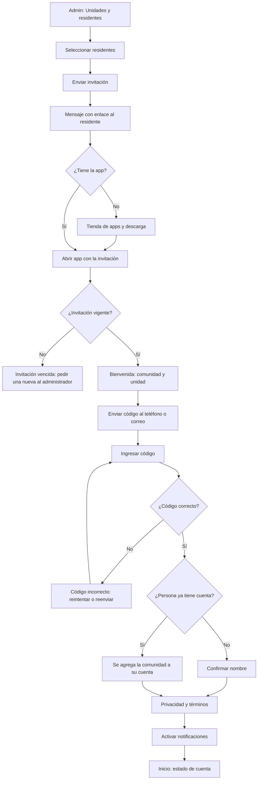

# Flujo: primer ingreso por invitación

Estado: Borrador
Actor: residente propietario o arrendatario (inicia el administrador)
Superficie: web de administración (invitar) y app residente (aceptar)
Alcance: MVP
Referencias: `docs/arquitectura.md` §2 (identidad global, membresía por comunidad) y §5 (Ley 21.719); `docs/specs/gasto-comun.md` S-14

El método de autenticación depende del ADR 0005. **Supuesto (a validar; UX-7):** enlace de invitación más código de un solo uso, sin contraseña.

## Diagrama

## Pasos

1. **Administrador:** en "Unidades y residentes" selecciona uno o varios residentes con teléfono o correo y toca "Enviar invitación" (acción masiva). Ve el estado de cada invitación: pendiente, aceptada, vencida.
2. **Residente** recibe: "La administración de Edificio Los Aromos te invita a ComVive para ver y pagar tu gasto común del Depto 101." con enlace.
3. Si no tiene la app, el enlace lleva a la tienda y, al abrir la app, retoma la invitación.
4. **Bienvenida:** muestra comunidad, unidad y relación (propietario o arrendatario). "¿No eres tú? Avísale a tu administración."
5. **Código:** se envía al contacto que registró el administrador; 6 dígitos, campo con teclado numérico y autocompletado del sistema.
6. Si la persona ya usa ComVive en otra comunidad, se agrega la membresía sin pedir datos de nuevo.
7. **Privacidad:** texto breve sobre qué datos se tratan y para qué (Ley 21.719), con enlace a la política completa. Botón "Aceptar y continuar".
8. **Notificaciones:** "Te avisaremos cuando llegue tu gasto común y cuando se confirme un pago." con "Activar" y "Ahora no".
9. Llega a **Inicio** con su estado de cuenta.

## Estados vacíos

- **Admin sin residentes con contacto:** "Agrega teléfono o correo a los residentes para invitarlos."
- **Residente sin periodos emitidos:** Inicio muestra "Tu comunidad todavía no emite gastos comunes en ComVive."

## Errores

| Caso | Mensaje | Comportamiento |
| --- | --- | --- |
| Invitación vencida | "Esta invitación venció. Pide una nueva a tu administración." | Sin acceso |
| Invitación ya usada | "Esta invitación ya fue usada. Ingresa con tu teléfono o correo." | Lleva a ingreso |
| Código incorrecto | "El código no es correcto. Te quedan 2 intentos." | Tras 3 fallos, espera de 5 minutos (supuesto) |
| Código vencido | "El código venció. Te enviamos uno nuevo." | Reenvío |
| Contacto equivocado | "¿No te llegó el código? Revisa con tu administración que tu teléfono o correo esté bien." | Sin cambio de contacto desde la app (supuesto, evita suplantación) |
| Ocupación aún no vigente (arrendatario con fecha futura) | "Tu acceso comienza el 01-12-2026." | Sin datos hasta la fecha |

## Carga

- Envío masivo: progreso "Enviando 12 de 40" y resumen final con enviadas y fallidas.
- Envío de código: botón "Enviando…" y temporizador visible de 60 segundos para reenviar.

## Supuestos (a validar)

- Vigencia de la invitación: 14 días; del código: 10 minutos.
- El residente no cambia su contacto desde la app; lo corrige el administrador.
- Datos mínimos para invitar: ver UX-8.
