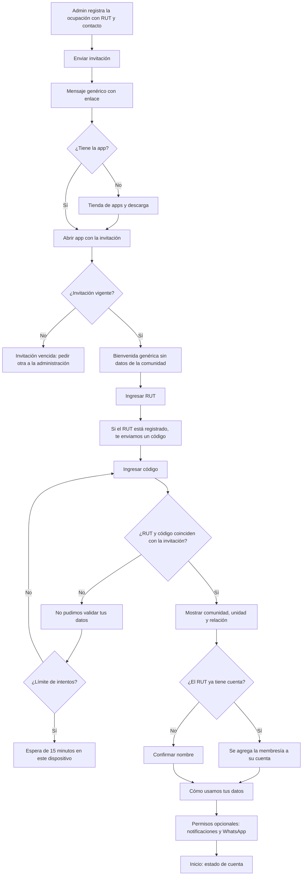

# Flujo: primer ingreso por invitación e ingresos siguientes

Estado: Borrador
Actor: residente propietario o arrendatario (el flujo lo inicia el administrador al registrar la ocupación)
Superficie: web de administración (invitar) y app residente (aceptar e ingresar)
Alcance: MVP
Referencias:

- `docs/arquitectura.md` §2 (identidad global por RUT, membresía por comunidad, 404 neutros), §3 ("Ingreso, sesiones y límites": contacto de ingreso, respuesta neutra, `LOGIN_THROTTLE`) y §5 (Ley 21.719, copia local y push).
- `docs/specs/gasto-comun.md`: F-9 y S-14 (ámbito del arrendatario y pérdida de acceso), F-14 (ocupación con fecha pasada o futura).
- Alta de ocupaciones: `flujos/admin-ocupaciones.md`. Roles: `flujos/admin-usuarios-y-roles.md`.

El método de autenticación depende del ADR 0005. **Supuesto (a validar; UX-7):** el residente ingresa su RUT y un código de un solo uso, sin contraseña. La persona se reconoce por su RUT, nunca por correo ni teléfono.

## Reglas de pantalla

- **A dónde va el código (menor 12):** siempre al **contacto de ingreso verificado de la persona** (`PERSON`), que es uno solo aunque tenga varias membresías.
  - **Persona nueva:** el contacto que registró el administrador en la ocupación pasa a ser su contacto de ingreso cuando la persona ingresa el código por primera vez.
  - **Persona que ya tiene cuenta en ComVive:** el código va a su contacto de ingreso existente, aunque el administrador de la nueva comunidad haya registrado otro. Así un administrador no puede tomar la cuenta de otra persona escribiendo su propio teléfono. **Supuesto (a validar)**, a confirmar con el arquitecto (UX-30).
- **Respuesta neutra:** después de escribir el RUT, la pantalla siempre dice "Si el RUT está registrado, te enviamos un código a {contacto enmascarado}". Si el RUT no existe, la pantalla es la misma, sin contacto.
- **Límites (menor 12; arquitectura §3):** los fallos cuentan por (RUT, dispositivo) y por IP, no solo por RUT, para que nadie bloquee el ingreso de otra persona escribiendo su RUT. Los envíos de código tienen su propio límite.
- **Privacidad (menor 13):** pantalla informativa, no de aceptación. Los permisos opcionales (notificaciones push y WhatsApp) se piden aparte y se pueden negar sin perder acceso.
- **Errores neutros (spec, "Respuestas de error"):** 404 `NOT_FOUND`: "No encontramos lo que buscas o no tienes acceso", exista o no el recurso. 403 `FORBIDDEN`, solo si la persona ve el recurso pero su rol no permite la acción: "Tu rol no permite esta acción".

## Diagrama

## Pasos

**Invitar (administrador)**

1. La invitación nace de una ocupación (`admin-ocupaciones.md`): al registrar un propietario o arrendatario con RUT y teléfono o correo, la pantalla ofrece "Enviar invitación ahora". También se puede enviar después desde "Unidades y residentes > Invitaciones", en forma masiva.
2. El administrador ve el estado de cada invitación: pendiente, aceptada o vencida, con "Reenviar".

**Aceptar (residente)**

1. **Mensaje** genérico, para no exponer datos si el contacto está equivocado: "Te invitaron a ComVive para ver y pagar tu gasto común. Abre el enlace para continuar." Si la invitación es de un arrendatario, agrega el texto de S-44 del paso 8, que no contiene datos de la comunidad ni de la unidad.
2. Si no tiene la app, el enlace lleva a la tienda y la app retoma la invitación al abrirse.
3. **Bienvenida genérica:** "Para continuar, ingresa tu RUT." No muestra la comunidad ni la unidad.
4. **RUT:** con formato automático (`12.345.678-5`) y validación del dígito verificador.
5. **Código:** "Si el RUT está registrado, te enviamos un código a {contacto enmascarado}", por ejemplo `+56 9 **** 1234`. Son 6 dígitos, con teclado numérico y autocompletado del sistema.
6. **Validación:** solo si el RUT y el código coinciden con la invitación, la app muestra "Edificio Los Aromos · Depto 101 · Propietario". Si el RUT es válido pero no es el de la invitación, el mensaje es el mismo que con un código errado y no revela cuál de los dos falló.
7. Si el RUT ya tiene cuenta en ComVive, se agrega la membresía sin pedir datos de nuevo.
8. **Cómo usamos tus datos** (deber de información, Ley 21.719). Pantalla informativa con botón "Continuar", no "Aceptar":
   - Quién trata los datos: la comunidad, a través de su administración, con ComVive como proveedor (pregunta UX-31).
   - Qué datos: RUT, nombre, contacto, unidad, cargos y pagos.
   - Para qué: cobrar el gasto común y avisarte de cobros y pagos.
   - Quién más los ve: el administrador; el comité ve tu nombre, unidad, alícuota y deuda, con el RUT enmascarado y sin tus contactos (solo propietarios).
   - **Solo para el arrendatario** (spec, "Datos del arrendatario que ve el propietario", S-44, CA-60), también en el mensaje de invitación: "El propietario de la unidad puede ver tu nombre, tu deuda de gasto común y los pagos que se aplican a ella. La administración de la comunidad ve todos tus datos de cobro".
   - Tus derechos y cómo ejercerlos: enlace "Ejercer mis derechos" (también en Más > Privacidad).
   - Enlace a la política completa.
9. **Permisos opcionales (menor 13):**
   - **Notificaciones:** "Te avisaremos cuando llegue tu gasto común y cuando se confirme un pago. Los avisos no muestran montos en la pantalla bloqueada." Opciones "Activar" (abre el permiso del sistema) y "Ahora no".
   - **WhatsApp:** casilla sin marcar "Recibir avisos por WhatsApp". **Posterior:** no aparece hasta que exista la integración.
   - Ambos se cambian en Más > Notificaciones.
10. Llega a **Inicio**. El arrendatario ve solo su ámbito (F-9).

**Ingresos siguientes (sin invitación)**

1. "Ingresar" → RUT → "Si el RUT está registrado, te enviamos un código a {contacto enmascarado}" → código.
2. Si la persona tiene varias membresías, el código es uno solo (va a su contacto de ingreso) y después elige comunidad y unidad.
3. Si no tiene ninguna membresía vigente: "No tienes comunidades activas en ComVive. Si crees que es un error, contacta a tu administración."

**Ejercer mis derechos (Más > Privacidad)**

- Pantalla con los derechos de acceso, rectificación, supresión, oposición y portabilidad, en lenguaje simple, y el botón "Enviar solicitud", que abre un formulario breve (derecho, comunidad, detalle). La solicitud llega a la administración de la comunidad y queda registrada. El canal definitivo y los plazos los fija el abogado (UX-31).

## Estados vacíos

- **Administrador sin residentes invitables:** "Agrega RUT y teléfono o correo a los residentes para invitarlos."
- **Propietario sin periodos emitidos:** "Tu comunidad todavía no emite gastos comunes en ComVive."
- **Arrendatario sin cargos en su ámbito:** "Aún no hay cobros desde tu ingreso el {dd-mm-aaaa}."

## Errores

| Caso | Mensaje | Comportamiento |
| --- | --- | --- |
| Invitación vencida | "Esta invitación venció. Pide una nueva a tu administración." | Sin acceso |
| Invitación ya usada | "Esta invitación ya fue usada. Ingresa con tu RUT." | Lleva al ingreso |
| RUT con dígito verificador inválido | "Ingresa un RUT válido. Revisa el dígito verificador" (texto de `INVALID_RUT` de la spec; UX-60) | El campo es inválido |
| RUT o código que no coinciden | "No pudimos validar tus datos." | No dice cuántos intentos quedan ni cuál dato falló |
| Límite de fallos por (RUT, dispositivo) | "Demasiados intentos. Espera 15 minutos e intenta de nuevo." | Bloquea solo esa combinación; el titular puede ingresar desde su propio dispositivo (arquitectura §3) |
| Límite de envíos de código | "Ya te enviamos varios códigos. Espera un momento antes de pedir otro." | Sin envío nuevo |
| Código vencido | "El código venció. Pide uno nuevo." | Botón "Enviar otro código" |
| No llega el código | "¿No te llegó el código? Pide a tu administración que revise tu teléfono o correo." | El contacto no se cambia desde la app (supuesto, para evitar suplantación) |
| Ocupación con fecha futura | "Tu acceso comienza el {dd-mm-aaaa}." | Sin datos hasta esa fecha |
| Pérdida de acceso (fin de ocupación, venta, revocación) | "Ya no tienes acceso a esta unidad. Si crees que es un error, contacta a tu administración." | Borra la copia local de esa comunidad; deja de recibir notificaciones (menor 14) |
| Recurso inexistente o ajeno | "No encontramos lo que buscas o no tienes acceso" | 404 neutro (menor 15) |

## Carga

- **Envío masivo:** progreso "Enviando 12 de 40" y un resumen final de enviadas y fallidas.
- **Envío del código:** botón "Enviando…" y temporizador visible de 60 segundos para reenviar.

## Copia local y notificaciones tras perder el acceso (menor 14)

- La copia local de cada comunidad se borra cuando la API responde 404 para esa comunidad o deja de aparecer en "Mis comunidades", al cerrar sesión y tras **30 días sin sincronizar** (arquitectura §5, supuesto a validar). Al abrir una copia de más de 7 días, la app avisa "Estos datos tienen más de 7 días" (supuesto de diseño).
- Al terminar la membresía, la API desvincula el dispositivo de las notificaciones de esa comunidad. Si la persona no tiene otras membresías, deja de recibir notificaciones de ComVive.

## Supuestos (a validar)

- La invitación dura 14 días y el código, 10 minutos.
- Límites: 5 códigos fallidos por (RUT, dispositivo) bloquean 15 minutos; envíos y límites por IP según la arquitectura §3.
- El residente no cambia su contacto desde la app; lo corrige el administrador. Si la persona ya tiene cuenta, el cambio de su contacto de ingreso es un procedimiento aparte (UX-30).
- El RUT es obligatorio para invitar (UX-8).
