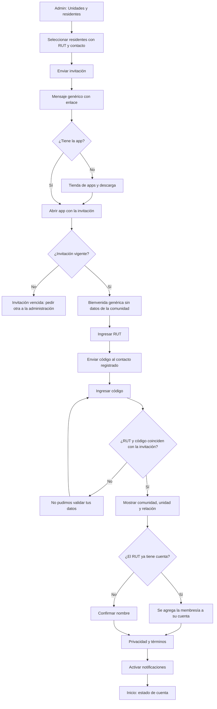

# Flujo: primer ingreso por invitación

Estado: Borrador
Actor: residente propietario o arrendatario (el flujo lo inicia el administrador)
Superficie: web de administración (invitar) y app residente (aceptar)
Alcance: MVP
Referencias:

- `docs/arquitectura.md` §2 (identidad global por RUT y membresía por comunidad), §4 (RUT para pagar) y §5 (Ley 21.719).
- `docs/specs/gasto-comun.md`: F-9 y S-14 (ventana del arrendatario y pérdida de acceso).

El método de autenticación depende del ADR 0005. **Supuesto (a validar; UX-7, UX-8):** el residente ingresa su RUT y un código de un solo uso enviado al contacto que registró el administrador, sin contraseña. La persona se reconoce por su RUT, nunca por correo ni teléfono.

## Diagrama

## Pasos

1. **Administrador:** en "Unidades y residentes" selecciona uno o varios residentes que tengan RUT y contacto, y toca "Enviar invitación" (acción masiva). Ve el estado de cada invitación: pendiente, aceptada o vencida.
2. **Mensaje al residente**, genérico para no exponer datos si el contacto está equivocado: "Te invitaron a ComVive para ver y pagar tu gasto común. Abre el enlace para continuar."
3. Si no tiene la app, el enlace lleva a la tienda y la app retoma la invitación al abrirse.
4. **Bienvenida genérica:** "Para continuar, ingresa tu RUT." No muestra la comunidad ni la unidad.
5. **RUT:** con formato automático (`12.345.678-9`) y validación del dígito verificador.
6. **Código:** se envía al contacto registrado por el administrador. Son 6 dígitos, con teclado numérico y autocompletado del sistema.
7. **Validación:** solo si el RUT y el código coinciden con la invitación, la app muestra "Edificio Los Aromos · Depto 101 · Propietario". Si no coinciden, el mensaje es genérico y no revela cuál de los dos falló.
8. Si el RUT ya tiene cuenta en ComVive, se agrega la membresía sin pedir datos de nuevo.
9. **Privacidad:** texto breve sobre qué datos se tratan y para qué (Ley 21.719), con enlace a la política completa. Botón "Aceptar y continuar".
10. **Notificaciones:** "Te avisaremos cuando llegue tu gasto común y cuando se confirme un pago. Los avisos no muestran montos en la pantalla bloqueada." Opciones "Activar" y "Ahora no".
11. Llega a **Inicio**. El arrendatario ve solo su ventana (F-9).

## Estados vacíos

- **Administrador sin residentes invitables:** "Agrega RUT y teléfono o correo a los residentes para invitarlos."
- **Propietario sin periodos emitidos:** "Tu comunidad todavía no emite gastos comunes en ComVive."
- **Arrendatario sin cargos en su ventana:** "Aún no hay cobros desde tu ingreso el {dd-mm-aaaa}."

## Errores

| Caso | Mensaje | Comportamiento |
| --- | --- | --- |
| Invitación vencida | "Esta invitación venció. Pide una nueva a tu administración." | Sin acceso |
| Invitación ya usada | "Esta invitación ya fue usada. Ingresa con tu RUT." | Lleva al ingreso |
| RUT con dígito verificador inválido | "Revisa tu RUT" | El campo es inválido |
| RUT o código que no coinciden | "No pudimos validar tus datos. Te quedan 2 intentos." | Tras 3 fallos, espera de 5 minutos (supuesto) |
| Código vencido | "El código venció. Te enviamos uno nuevo." | Reenvío |
| No llega el código | "¿No te llegó el código? Pide a tu administración que revise tu teléfono o correo." | El contacto no se cambia desde la app (supuesto, para evitar suplantación) |
| Ocupación con fecha futura | "Tu acceso comienza el {dd-mm-aaaa}." | Sin datos hasta esa fecha |

## Carga

- **Envío masivo:** progreso "Enviando 12 de 40" y un resumen final de enviadas y fallidas.
- **Envío del código:** botón "Enviando…" y temporizador visible de 60 segundos para reenviar.

## Supuestos (a validar)

- La invitación dura 14 días y el código, 10 minutos.
- El residente no cambia su contacto desde la app; lo corrige el administrador.
- El RUT es obligatorio para invitar (UX-8).
